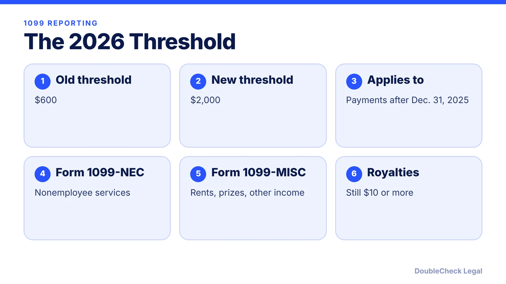
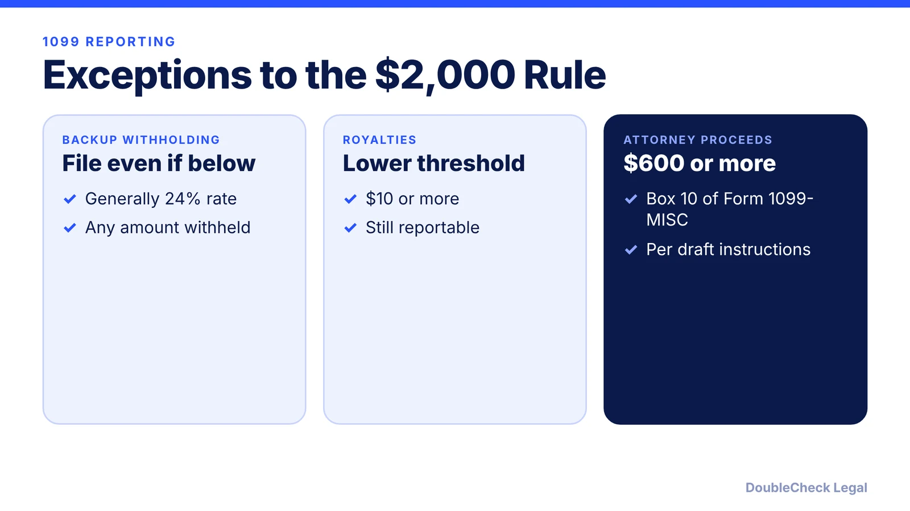
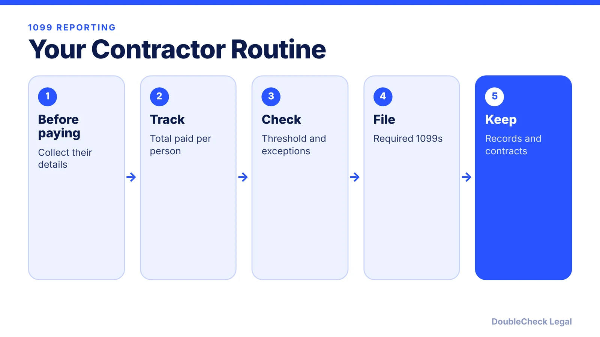

*Paying freelancers in 2026? The 1099 reporting threshold changed from $600 to $2,000.*

**Key takeaways:**

- The 1099-NEC and certain 1099-MISC threshold rose from $600 to $2,000 for payments after December 31, 2025.
- Backup withholding triggers a filing even below the threshold.
- Royalties remain reportable at $10 or more.
- The test is the total paid to the same recipient in the calendar year.

## 1. The quick answer

**Quick answer:** The reporting threshold for Form 1099-NEC (nonemployee compensation) and several 1099-MISC categories rose from $600 to **$2,000** for payments made after December 31, 2025, so it first applies to 2026 payments. If you pay a freelancer, designer, or contractor $2,000 or more in a year for services, you generally file a 1099-NEC.

## 2. Exceptions to remember

Per the NATP summary: a 1099-NEC or 1099-MISC generally must be filed for a payment from which **backup withholding** was taken, even if below the threshold (the backup withholding rate is generally 24%). Royalties remain reportable at $10 or more. Attorney gross proceeds of $600 or more are reported in Box 10 of Form 1099-MISC. For categories under the new threshold, the test is the total paid to the same recipient during the calendar year.

## 3. A solo founder's contractor routine

Treating someone as a contractor also raises a classification question; see [independent contractor vs. employee](/blog/independent-contractor-vs-employee/) and [how to write a freelance contract](/blog/how-to-write-a-freelance-contract/). If you use AI tools or AI-assisted freelancers, add IP terms: [confidentiality and IP assignment](/blog/confidentiality-ip-assignment-agreements-startups/).

## 4. Caveat

The summary does not say whether or when the threshold will be indexed for inflation. Confirm current instructions on IRS.gov or with your accountant before you file.

## Where DoubleCheck fits

[DoubleCheck](https://www.contactdoublecheck.com) is built for businesses that start legal work with AI. Bring your question or draft, use an AI-first workflow to understand and verify it, and when professional advice is warranted, you can connect with an independent attorney. Attorneys on DoubleCheck are independent professionals; an attorney-client relationship forms only if an attorney accepts your engagement.

**Sources:** [NATP: Form 1099 filing changes under the new $2,000 threshold](https://www.natptax.com/news-insights/blog/form-1099-filing-changes-under-the-new-2-000-threshold/).

## FAQ

**What is the 1099-NEC threshold for 2026?**

$2,000 for payments made after December 31, 2025, up from $600, per NATP's summary.

**Do I file a 1099 if I withheld backup tax?**

Generally yes, even if the payment is below the threshold.

**Does the $2,000 apply to royalties?**

No. Royalties remain reportable at $10 or more.

**Is the new threshold indexed for inflation?**

The summary does not say. Check current IRS instructions.

---

*General information only. This article is not legal, tax, investment, or accounting advice.*
