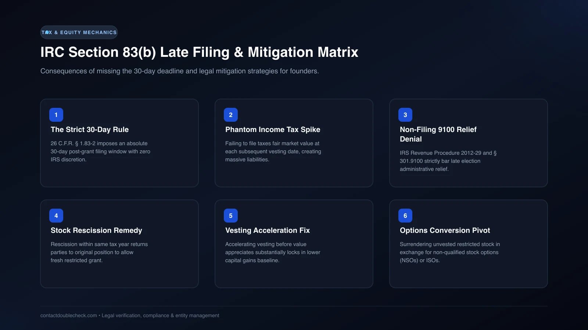
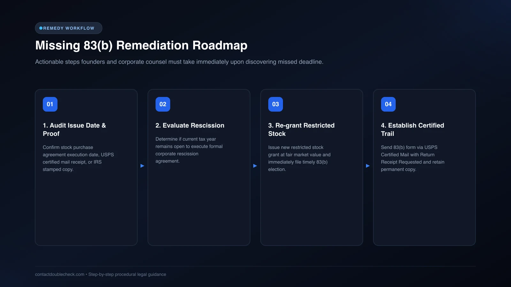

<div class="article-hero-banner mb-8">
  
</div>

## Can the IRS Grant an Extension or Relief for a Late Section 83(b) Election?

The answer under United States tax law is an unequivocal **no**. Under **Internal Revenue Code (IRC) Section 83(b)** and Treasury Regulation **26 C.F.R. § 1.83-2(b)**, an election to include the fair market value of restricted property in gross income during the year of transfer must be filed **no later than 30 days after the date the property was transferred**.

Unlike other tax deadlines that permit administrative relief, private letter rulings, or discretionary waivers under Treasury Regulation **§ 301.9100-3 (Section 9100 relief)**, the IRS has repeatedly reaffirmed—most notably in **Revenue Procedure 2012-29**—that it possesses **no statutory authority** to excuse a late 83(b) election, regardless of whether the failure resulted from postal error, legal malpractice, clerical oversight, or corporate ignorance.

```
IRC Section 83(b) Statutory Filing Window

   Day 0 (Stock Issuance)                      Day 30 (Hard Statutory Deadline)
     ├─────────────────────────────────────────────┤
     ▼                                             ▼
  [Restricted Stock Purchase Agreement Signed]   [ABSOLUTE IRS FILING CUTOFF]
  • Payment completed                            • Must be mailed / postmarked
  • Shares issued subject to vesting             • Zero administrative extensions
                                                 • No Section 9100 relief available
```

When a startup founder or early executive misses this strict 30-day window, the tax consequences are severe, cumulative, and capable of creating catastrophic personal tax liabilities.

---

## The Phantom Income Tax Trap: Modeling Section 83(a) Ordinary Income Liability

To understand the magnitude of missing an 83(b) election, examine the default tax treatment under **IRC Section 83(a)** versus the elected treatment under **IRC Section 83(b)**.

```
Comparative Tax Mechanics: Timely 83(b) vs. Default 83(a)

┌───────────────────────────────┬───────────────────────────────┬───────────────────────────────┐
│ Feature                       │ Timely 83(b) Election Filed   │ No 83(b) Election Filed (83a) │
├───────────────────────────────┼───────────────────────────────┼───────────────────────────────┤
│ Tax Assessment Event          │ Date of Initial Stock Grant   │ Each Individual Vesting Date  │
│ Taxable Value                 │ Spread at Grant ($0.0001 par) │ Fair Market Value at Vesting  │
│ Tax Characterization          │ Capital Gains at Liquidity    │ Ordinary Income + FICA/Medica │
│ Liquidity Requirement         │ Negligible upfront cash       │ Cash required on non-liquid   │
│ Holding Period Commencement   │ Date of original grant        │ Commences separately at vest  │
│ QSBS Qualification (§ 1202)   │ 5-year clock starts Day 0     │ 5-year clock starts as shares │
└───────────────────────────────┴───────────────────────────────┴───────────────────────────────┘
```

### The Financial Mathematical Reality

Consider a founder who founds an AI enterprise and receives **4,000,000 shares** of common stock at **$0.0001 per share ($400 total purchase price)** on a standard 4-year monthly vesting schedule with a 1-year cliff.

1. **Scenario A (Timely 83(b) Filed):**
   - The founder reports $0 spread income on their Form 1040.
   - All subsequent upside is taxed as long-term capital gains (or completely excluded under Qualified Small Business Stock - **IRC § 1202**).
   - Total current tax paid: **$0.00**.

2. **Scenario B (Missed 83(b) Election, Series A at Month 12):**
   - The company raises a $10M Series A at a **$40M post-money valuation ($2.00 per share 409A fair market value)**.
   - At Month 12, the 1-year cliff hits, and **1,000,000 shares vest immediately**.
   - Under IRC § 83(a), the founder realizes **ordinary income** of $2.00 × 1,000,000 = **$2,000,000**.
   - At a combined federal and California state ordinary income tax rate of **50.3%**, the founder owes **$1,006,000 in immediate cash taxes**.
   - Over the remaining 36 months, if the company stock rises to $5.00/share, the founder faces recurring monthly ordinary income tax liabilities on illiquid shares.

This is the dreaded **phantom income trap**: massive tax bills on paper wealth that cannot be sold or liquidated.

---

## The Legal Remedy Playbook: 4 Valid Mitigation Strategies

When counsel or founders discover a missed 83(b) filing, four primary legal remedies exist depending on the timing of discovery, current 409A valuation, and tax calendar status.

```
83(b) Late Filing Remediation Hierarchy

                    ┌──────────────────────────────────────────────┐
                    │       Missed 83(b) Discovered Post Day 30     │
                    └──────────────────────┬───────────────────────┘
                                           │
         ┌─────────────────────────────────┴─────────────────────────────────┐
         ▼                                                                   ▼
┌──────────────────────────────────────┐            ┌──────────────────────────────────────┐
│ Discovered Within Same Taxable Year  │            │ Discovered in Subsequent Tax Year    │
├──────────────────────────────────────┤            ├──────────────────────────────────────┤
│ PRIMARY REMEDY:                      │            │ ALTERNATIVE MITIGATION PATHS:        │
│ • Formal Corporate Stock Rescission  │            │ • Immediate Vesting Acceleration     │
│ • Return to Status Quo Ante          │            │ • Option Conversion (NSO / ISO Swap) │
│ • Re-issue Restricted Stock          │            │ • Corporate Recapitalization         │
│ • File Timely New 83(b) Election     │            │ • Structured Repurchase Agreement    │
└──────────────────────────────────────┘            └──────────────────────────────────────┘
```

### Strategy 1: Same-Year Corporate Stock Rescission Doctrine

Under the **IRS Rescission Doctrine** articulated in **Revenue Ruling 80-311** and **Revenue Ruling 2008-29**, a transaction may be completely undone and treated as though it never occurred for federal income tax purposes if two mandatory requirements are satisfied:
1. **Status Quo Ante:** Both the corporation and the founder must be returned to the exact economic and legal position they occupied prior to the stock issuance.
2. **Same Taxable Year:** The rescission and complete return of consideration must occur within the **exact same calendar tax year** in which the original stock grant occurred.

**Execution Mechanics:**
- Execute a formal **Unanimous Written Consent of the Board** and **Rescission Agreement**.
- The founder surrenders all restricted shares back to the corporate treasury.
- The company refunds the founder's initial purchase consideration (e.g., $400).
- After an appropriate legal cooling period (typically several weeks to demonstrate distinct economic substance), the board authorizes a **new restricted stock grant** at the prevailing fair market value.
- The founder files a pristine 83(b) election for the *new* issuance via USPS Certified Mail within 30 days.

### Strategy 2: Immediate Vesting Acceleration While FMV Is Nominal

If the missed election is discovered within the first 60–90 days of company formation—and the company has not raised institutional seed capital, signed material commercial contracts, or established intellectual property that drives a high 409A valuation—the Board can amend the stock restriction agreement to **accelerate 100% of the vesting immediately**.

Under Section 83(a), ordinary income is recognized upon vesting. If 4,000,000 shares vest when fair market value is still par value ($0.0001 per share), the founder recognizes ordinary income on the negligible spread ($0), eliminating all future phantom tax events for subsequent years.

### Strategy 3: Restricted Stock-to-Option Conversion (NSO/ISO Swap)

If the tax year has closed or fair market value has appreciated moderately, rescission is unavailable. In this scenario, the founder can negotiate to **surrender their unvested restricted stock** back to the company in exchange for **stock options**:
- **Incentive Stock Options (ISOs):** Carry no ordinary income tax upon grant or vesting under IRC § 421 and § 422 (subject to Alternative Minimum Tax considerations upon exercise).
- **Non-Qualified Stock Options (NSOs):** Exercise can be deferred until an actual liquidity event (M&A or IPO), completely eliminating premature tax exposure.

### Strategy 4: Re-capitalization and Holding Company Structuring

In complex venture situations involving substantial cap tables, corporate counsel may execute an **IRC § 351 tax-free incorporation** or holding company restructuring, transferring assets into a new parent corporation where newly structured shares are granted with compliant 83(b) elections.

---

## How to File a Bulletproof 83(b) Election: The Evidentiary Audit Standard

To ensure that the IRS cannot challenge a timely filing, every founder must follow this strict procedural protocol:

```
IRS Certified Mail Evidentiary Flow

┌───────────────────────────────┬─────────────────────────────────────────────────────────┐
│ Procedural Requirement        │ Tactical Execution Guideline                            │
├───────────────────────────────┼─────────────────────────────────────────────────────────┤
│ Filing Destination            │ Internal Revenue Service Center where 1040 is filed      │
│ Mailing Method                │ USPS Certified Mail with Return Receipt Requested       │
│ Timely Mailing as Timely Filing│ 26 U.S.C. § 7502: USPS Postmark date governs timeliness│
│ Document Copies               │ Send 2 copies of Form 83(b) + Self-Addressed Envelope   │
│ Stamped Acknowledgment        │ Include cover letter requesting IRS stamp and return cpy│
│ Corporate Copy Requirement    │ Deliver fully executed copy to Secretary of Corporation │
│ Retention Period              │ Retain Certified Mail green card + stamped copy FOREVER │
└───────────────────────────────┴─────────────────────────────────────────────────────────┘
```

---

## Statutory Authorities and Benchmark References

- **Internal Revenue Code Section 83 (26 U.S.C. § 83):** Property transferred in connection with performance of services.
- **Treasury Regulation 26 C.F.R. § 1.83-2:** Election to include in gross income in year of transfer.
- **IRS Revenue Procedure 2012-29:** Official model language and statutory refusal of discretionary extension relief.
- **Revenue Ruling 80-311 & Revenue Ruling 2008-29:** Governing criteria for same-year tax rescissions.
- **Internal Revenue Code Section 1202 (26 U.S.C. § 1202):** Qualified Small Business Stock (QSBS) holding period rules.

<div class="article-steps-banner my-10">
  
</div>
