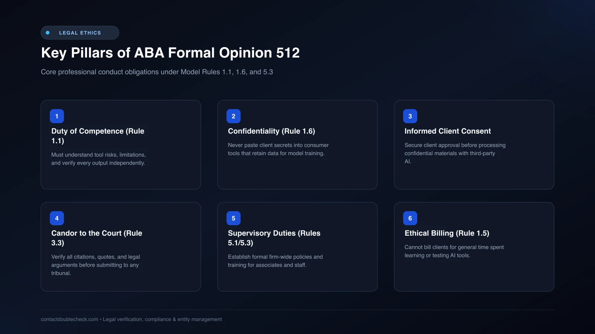
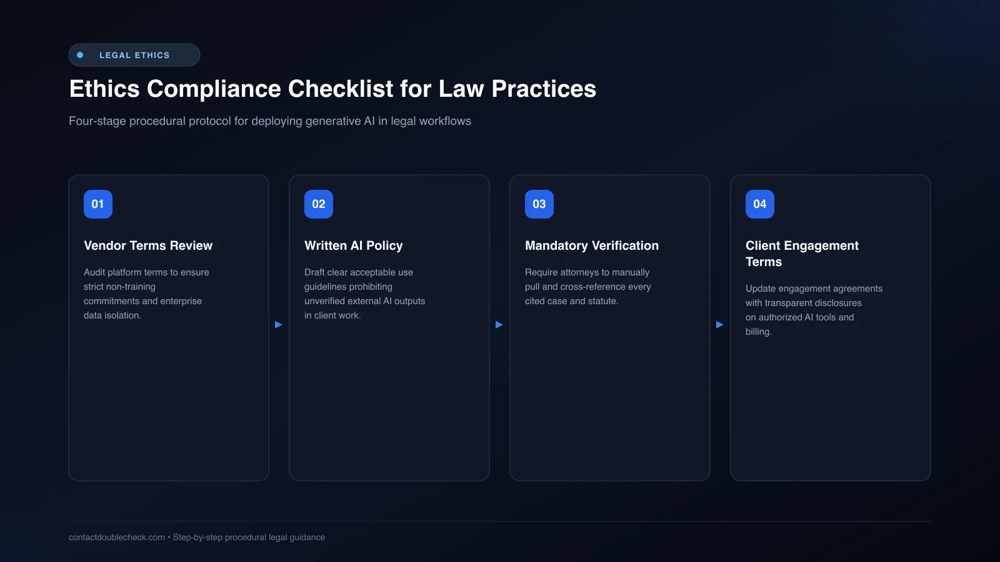

*A comprehensive compliance guide to American Bar Association (ABA) Formal Opinion 512 regarding generative artificial intelligence tools in legal practice, professional conduct obligations, and risk management as of November 2026. General information, not legal advice.*

**Key takeaways:**

- Technological competence under ABA Model Rule 1.1 requires lawyers to understand generative AI limitations, capabilities, and hallucination risks before deploying them in client representations.
- Model Rule 1.6 strictly bars inputting confidential client information into consumer-grade or public AI tools that retain user prompts for model retraining.
- Law firms must secure explicit, informed client consent before inputting sensitive representation data into third-party AI platforms.
- Supervising partners and managers bear non-delegable responsibilities under Rules 5.1 and 5.3 to establish clear written policies, controls, and training across all attorneys and staff.
- Billable hours cannot include time spent learning basic AI prompt engineering or testing general-purpose AI models.

## 1. The quick answer

**Quick answer:** ABA Formal Opinion 512, issued by the Standing Committee on Ethics and Professional Responsibility, establishes that while lawyers are permitted—and encouraged—to utilize generative AI to enhance practice efficiency, they remain strictly bound by the ABA Model Rules of Professional Conduct. Lawyers cannot outsource legal judgment or factual verification to an automated tool.

Crucially, **Model Rule 1.1 (Competence)** demands that attorneys independently check and verify every citation, quotation, and legal proposition generated by AI before relying upon it. Furthermore, **Model Rule 1.6 (Confidentiality)** prohibits exposing client facts to third-party models without enterprise data-isolation agreements or specific informed client consent. Firm leaders face direct ethical liability under **Rules 5.1 and 5.3** if they fail to institute enforceable AI usage guardrails.

For legal teams evaluating automation risks, see our related analysis on [AI chats and attorney-client privilege](/blog/ai-chats-not-privileged-heppner/) and [handling hallucinated citations in commercial filings](/blog/ai-hallucinated-citations-business/).

## 2. Technological competence and Model Rule 1.1

Comment 8 to ABA Model Rule 1.1 mandates that competent representation requires lawyers to keep abreast of changes in the law and its practice, including the benefits and risks associated with relevant technology. Formal Opinion 512 builds upon this duty:

- **Understanding Probabilistic Architecture:** Lawyers need not be computer scientists or neural network architects, but they must understand that large language models (LLMs) operate probabilistically rather than deterministically. They generate likely word sequences, not verified legal truth.
- **The Non-Delegable Duty of Verification:** Relying blindly on an AI-drafted brief or contract clause is a per se breach of professional competence. An attorney must read and verify every case citation, statutory reference, and factual statement against authoritative legal databases or primary statutory texts.
- **Assessing Reliability:** Lawyers must continuously evaluate the output quality and limitations of the specific software tools they select, including domain-specific legal models versus generic consumer chatbots.

## 3. Client confidentiality and data security under Rule 1.6

Model Rule 1.6 requires attorneys to make reasonable efforts to prevent the inadvertent or unauthorized disclosure of, or unauthorized access to, information relating to the representation of a client. Formal Opinion 512 identifies generative AI as a primary vector for inadvertent disclosure:

1. **The Model Retraining Trap:** Many free or consumer-tier generative AI platforms default to storing user prompts, uploaded documents, and generated outputs to train future model iterations. Submitting unredacted contracts, deposition transcripts, or proprietary business information to these platforms effectively publishes client secrets to a third-party vendor.
2. **Enterprise Isolation Agreements:** To comply with Rule 1.6, law firms must procure enterprise-grade solutions featuring explicit contractual commitments that customer data is encrypted in transit and at rest, logically partitioned from other tenants, and never used for model training or retained beyond the immediate session.
3. **Informed Consent Standards:** If a legal task requires sharing confidential client information with a third-party AI vendor that poses any risk of external retention or processing, the attorney must secure the client’s informed consent. The ABA made clear that standardized, boilerplate paragraphs hidden inside standard engagement letters do not satisfy this standard.

## 4. Supervisory responsibilities under Rules 5.1 and 5.3

Law firm partners, practice group leaders, and in-house general counsel cannot ignore the reality of "shadow AI"—where associates, paralegals, or contract attorneys utilize personal AI subscriptions to speed up drafting:

- **Managerial Duty (Rule 5.1):** Partners must establish internal policies and technical guardrails that give reasonable assurance that all lawyers in the firm conform to the Model Rules when interacting with AI technologies.
- **Non-Lawyer Supervision (Rule 5.3):** The duty extends to paralegals, legal assistants, administrative staff, and outside vendors. If staff members use unvetted AI tools that compromise client records, supervising attorneys face regulatory discipline.
- **Continuous Education:** Firms must provide ongoing training regarding prompt security, hallucination risks, and data leakage prevention to ensure team-wide compliance.

## 5. Candor toward tribunals and ethical fee practices

Formal Opinion 512 reinforces procedural rules and client fee requirements:

### Candor Toward the Tribunal (Rule 3.3)
Submitting an unverified AI-generated document containing fabricated legal authorities or distorted factual summaries violates Rule 3.3(a)(1) (knowingly making a false statement of fact or law to a tribunal). In federal court, this misconduct also triggers immediate sanctions under Federal Rule of Civil Procedure 11.

### Reasonable Fees (Rule 1.5)
The ABA established strict billing guidelines for generative AI:
- **General Education Is Overhead:** Attorneys cannot bill clients for the time spent learning how to use an AI platform, learning prompting strategies, or configuring baseline software.
- **Efficiency Pass-Through:** If an AI tool enables an attorney to draft a complex operating agreement in 45 minutes instead of 6 hours, the attorney cannot bill for 6 hours of work. Hourly billing must accurately reflect actual time spent.
- **Third-Party Tool Expenses:** Firms may only charge clients for third-party AI software costs if the client explicitly agreed in advance and the charge represents direct, out-of-pocket costs without unauthorized firm markups.

## 6. Law firm generative AI deployment protocol

To operationalize ABA Formal Opinion 512, organizations should implement a structured compliance checklist:

1. **Conduct a Software Audit:** Inventory all software applications, browser extensions, and APIs currently in use across the firm to identify embedded or third-party AI tools.
2. **Execute Vendor Due Diligence:** Require written confirmation from all software vendors stating that client data is not utilized for model training, algorithmic fine-tuning, or third-party access.
3. **Publish a Formal Firm AI Policy:** Draft and circulate an explicit usage policy defining permitted tools, prohibited data inputs, mandatory human review protocols, and disciplinary consequences for non-compliance.
4. **Mandate Double-Checking of Citations:** Institute a zero-tolerance policy requiring manual citation checking against primary sources before any filing or client deliverable is finalized.
5. **Update Engagement Letters:** Include transparent disclosures explaining how enterprise-grade AI is utilized to deliver cost-effective legal services while safeguarding confidentiality.

## Where DoubleCheck fits

[DoubleCheck](https://www.contactdoublecheck.com) provides businesses, general counsel, and enterprise teams with automated contract review, AI-assisted verification, and legal workflow assurance. DoubleCheck helps teams verify citations, audit regulatory compliance across California, Colorado, New York, and federal agencies, and connect with experienced attorneys to ensure compliance with emerging AI standards.

**Related reading:**
- [AI Chats Are Not Privileged: Heppner Decision](/blog/ai-chats-not-privileged-heppner/)
- [AI Hallucinated Citations in Business Filings](/blog/ai-hallucinated-citations-business/)
- [AI Contract Review Prompts: What to Ask and Verify](/blog/ai-contract-review-prompts-what-to-ask-and-what-to-verify/)
- [Agentic AI for Lawyers and Legal Workflows](/blog/agentic-ai-lawyers-entrepreneurs-legal-work/)

**Sources:** [American Bar Association, Formal Opinion 512: Generative Artificial Intelligence Tools](https://www.americanbar.org/groups/professional_responsibility/publications/ethics_opinions/formal-opinion-512/); [ABA Model Rules of Professional Conduct, Rule 1.1 Competence and Comment 8](https://www.americanbar.org/groups/professional_responsibility/publications/model_rules_of_professional_conduct/rule_1_1_competence/); [ABA Model Rules of Professional Conduct, Rule 1.6 Confidentiality of Information](https://www.americanbar.org/groups/professional_responsibility/publications/model_rules_of_professional_conduct/rule_1_6_confidentiality_of_information/); [ABA Model Rules of Professional Conduct, Rule 5.3 Responsibilities Regarding Nonlawyer Assistance](https://www.americanbar.org/groups/professional_responsibility/publications/model_rules_of_professional_conduct/rule_5_3_responsibilities_regarding_nonlawyer_assistant/); [Cornell Legal Information Institute, Professional Responsibility Overview](https://www.law.cornell.edu/wex/legal_ethics).

## FAQ

**Does ABA Formal Opinion 512 prohibit lawyers from using generative AI?**

No. Formal Opinion 512 explicitly recognizes the efficiency benefits of generative AI, but clarifies that lawyers must maintain competence under Model Rule 1.1, protect client confidentiality under Rule 1.6, and independently verify all outputs.

**Does uploading client documents to public AI tools violate attorney-client privilege?**

Yes. Feeding confidential client information into public or consumer AI models that use user prompts for model training can waive the attorney-client privilege and directly violates Model Rule 1.6.

**Can a law firm bill clients for the time it takes to learn generative AI prompts?**

No. Under Model Rule 1.5 and Formal Opinion 512, time spent acquiring general familiarity with AI tools constitutes unbillable firm overhead and cannot be charged to clients.

**Is boilerplate language in an engagement letter enough for AI consent?**

No. The ABA explicitly noted that vague or generalized boilerplate disclosures do not constitute informed consent when sharing sensitive client information with third-party AI platforms.

**Who is liable if an associate submits an AI hallucination in a brief?**

Both the drafting associate and the supervising partner are liable under Model Rules 5.1 and 5.3, alongside federal and state procedural rules governing court filings.

---

*General information only. This article is not legal, tax, investment, or accounting advice.*
