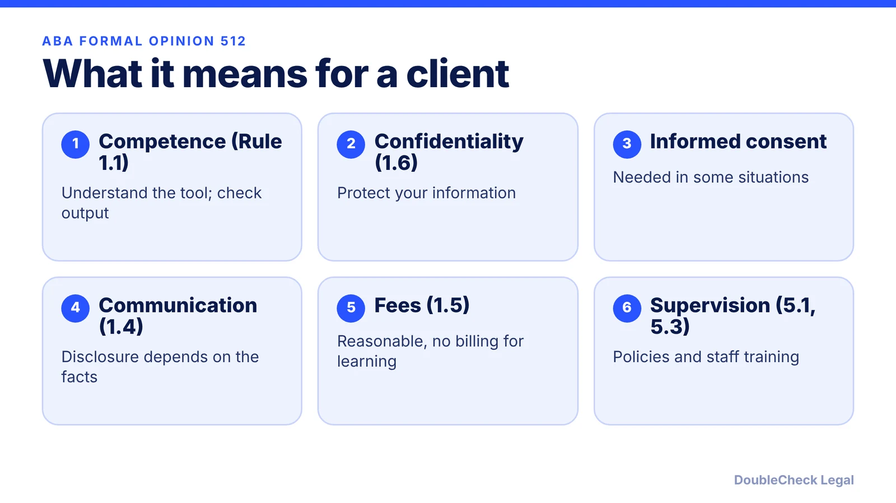
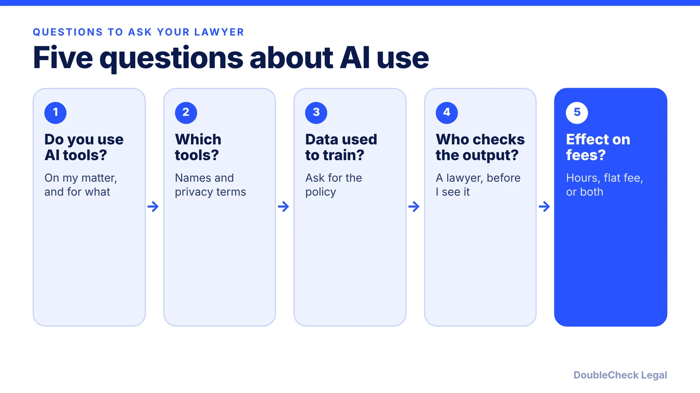

*Released July 29, 2024, Formal Opinion 512 applies existing ethics rules to lawyers' use of generative AI.*

**Key takeaways:**

- It is the ABA ethics committee's first formal opinion on generative AI, released July 29, 2024.
- Competence: lawyers must understand the tools and independently check output.
- Confidentiality and consent: informed consent may be required in some cases, especially for self-learning tools.
- Billing: no billing for time spent learning a tool; fixed fees may need adjusting.

## 1. The quick answer

**Quick answer:** ABA Formal Opinion 512, released July 29, 2024 by the ABA Standing Committee on Ethics and Professional Responsibility, is the committee's first formal opinion on lawyers' use of generative AI. It says the existing Model Rules apply. For clients, that means four things: your lawyer needs a reasonable understanding of the tools they use, must protect your confidential information, may need your informed consent in some cases, and must keep fees reasonable. It is ethics guidance, not a law, and state bars set the binding rules where your lawyer practices.

## 2. Competence and confidentiality

**Competence (Rule 1.1).** Per the [ABA's release](https://www.americanbar.org/news/abanews/aba-news-archives/2024/07/aba-issues-first-ethics-guidance-ai-tools/), lawyers must understand the benefits and risks of the technology they use. [LawSites](https://www.lawnext.com/2024/07/in-first-ethics-ruling-on-gen-ai-aba-says-lawyers-must-have-reasonable-understanding-of-the-technology-but-need-not-become-experts.html) reports that lawyers do not need to be AI experts but need a working understanding of what a specific tool can and cannot do, and that they must independently check AI output, including citations, before relying on it. The level of checking depends on the tool and the task. 2Civility's summary adds that this covers any output used for clients because these tools can produce false information.

**Confidentiality (Rule 1.6).** The duty to protect client information applies to AI use. Per LawSites, lawyers must assess disclosure risks, safeguard inputs, and review the tool's terms and privacy policies. [2Civility](https://www.2civility.org/breaking-down-the-abas-guidance-on-using-generative-ai-in-legal-practice/) notes lawyers must consider whether information could be accessed by people inside or outside the firm, including through other users' outputs.

What this means for you: it is reasonable to ask which tools touch your documents and whether your information is used to train them. Related reading: [AI chats and privilege](/blog/ai-chats-not-privileged-heppner/) and [AI hallucinated citations](/blog/ai-hallucinated-citations-business/).

## 3. Informed consent and communication

Informed consent is not always required. Per LawSites, it may be required in some cases, particularly for self-learning tools whose output could be shared with others. 2Civility's summary says that for self-learning tools consent must be informed first and must go beyond boilerplate provisions in engagement letters.

For consent to be informed, LawSites says the lawyer must explain why the tool is being used, the specific risks and kinds of client information involved, how others might use that information against the client, and the tool's benefits to the representation.

Separately, under Rule 1.4 (communication), whether a lawyer must tell you about AI use depends on the facts. LawSites says that in some situations disclosure is unnecessary; 2Civility says it may be required when AI informs significant decisions in a matter, and that explaining general AI use in engagement letters may be prudent.

## 4. Billing, and what the opinion does not do

**Fees (Rule 1.5).** Fees must be reasonable and reflect time actually spent. Per LawSites and the Florida Bar's report, the opinion's example is that a lawyer who spends 15 minutes entering information into an AI tool to draft a pleading may bill that time along with review time. A lawyer may not bill clients for time necessitated by their own inexperience or for learning how to use a tool, per the same sources. LawSites adds that for fixed-fee matters, charging the same fee whether or not AI is used may be unreasonable, though the opinion does not say how to handle time saved. 2Civility says lawyers should explain AI-related charges before or shortly after starting work.

**Limits.** The opinion is guidance on lawyers' duties, not a rule that binds a court or state bar. 2Civility notes the opinion also covers supervision and candor to courts, and the ABA says state and local ethics bodies will likely offer updated guidance. Check your state bar's rules.

For your own AI use, the opinion is a useful standard: know the tool, protect information, verify output, and keep the cost fair. See [how to tell if your lawyer is good](/blog/how-do-i-know-if-my-lawyer-is-good/), [AI legal work mistakes](/blog/ai-legal-work-mistakes-businesses/), and [how to choose a good lawyer](/blog/how-to-choose-good-lawyer/).

## Where DoubleCheck fits

[DoubleCheck](https://www.contactdoublecheck.com) helps businesses and founders start legal work with AI, verify it, and, when professional advice is warranted, connect with an independent attorney, including for immigration questions. Attorney availability and practice areas vary. Attorneys on DoubleCheck are independent professionals; an attorney-client relationship forms only if an attorney accepts your engagement.

**Sources:** [ABA news release](https://www.americanbar.org/news/abanews/aba-news-archives/2024/07/aba-issues-first-ethics-guidance-ai-tools/); [LawSites](https://www.lawnext.com/2024/07/in-first-ethics-ruling-on-gen-ai-aba-says-lawyers-must-have-reasonable-understanding-of-the-technology-but-need-not-become-experts.html); [2Civility](https://www.2civility.org/breaking-down-the-abas-guidance-on-using-generative-ai-in-legal-practice/); [Florida Bar News](https://www.floridabar.org/the-florida-bar-news/aba-issues-first-ethics-guidance-on-a-lawyers-use-of-ai-tools/).

## FAQ

**What is ABA Formal Opinion 512?**

It is the first formal opinion from the ABA Standing Committee on Ethics and Professional Responsibility on lawyers' use of generative AI, released July 29, 2024. It says existing Model Rules apply, including competence, confidentiality, communication, and fees.

**Does my lawyer have to tell me they use AI?**

Not always. Per LawSites, whether disclosure or consent is needed depends on the facts, and in some situations disclosure is unnecessary. Consent may be required in some cases, especially for self-learning tools.

**Can my lawyer bill me for time spent using AI?**

Per LawSites and the Florida Bar, a lawyer may bill time spent entering information into an AI tool and reviewing the output, but not time spent learning the tool because of their own inexperience. Fees must stay reasonable.

**Is Opinion 512 a law?**

No. It is ethics guidance from the ABA committee. Binding rules come from each state's bar and courts, so check the rules where your lawyer is licensed.

---

*General information only. This article is not legal, tax, investment, or accounting advice.*
