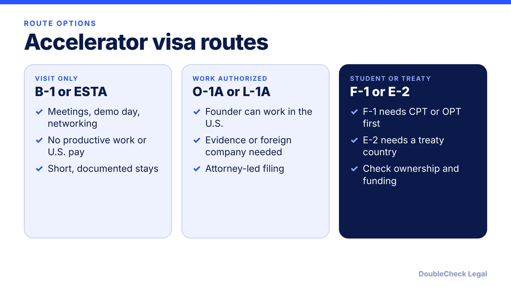
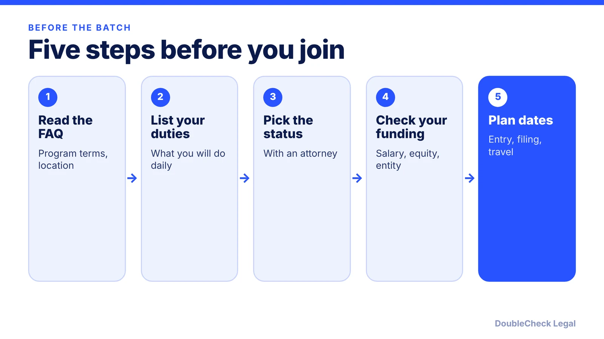

*No accelerator visa exists. Your status depends on what you will do, how you are paid and where you are from.*

**Key takeaways:**

- YC says it will help with visas and works with immigration attorneys; Techstars helps only after acceptance.
- B-1 and ESTA do not allow productive work or U.S. pay (per Alma, NNU).
- O-1A is a common work route but needs evidence of at least 3 of 8 criteria (per Alma).
- F-1 students need authorization before startup work, even if unpaid (per Harvard HIO).

## 1. The quick answer

**Quick answer:** There is no accelerator visa. International founders usually join a U.S. program on a visitor status (ESTA or B-1) for the in-person period, or on a work-authorized status such as O-1A, and the right choice depends on what you will actually do there. Per Y Combinator's FAQ, "If we accept your application, we'll help you get visas and incorporate," and YC works with immigration attorneys on an individualized plan. Techstars says it can help with legal and immigration issues only after you are accepted, and you must be legally in the program country throughout. Per Alma, B-1 prohibits productive labor such as coding or product development, and many founders switch to O-1A. As of November 2026, confirm every point with an attorney.

## 2. What YC and Techstars say

Attribute the program, not the blog posts, when you can.

**Y Combinator (ycombinator.com/faq).** YC says it accepts applications from "any startup, anywhere in the world" and that founders are expected to be in San Francisco for the batch. Non-U.S. founders need not act before applying: "If we accept your application, we'll help you get visas and incorporate." YC "works with excellent immigration attorneys" and says "there are a number of possible visa options depending on the details of your situation." If your company is incorporated outside the U.S., Canada, Singapore or the Cayman Islands, YC says you need a parent company in one of those jurisdictions. YC invests $500,000 per company, says the first use should be for founders to support themselves (for example a salary), and expects founders to commit full-time.

**Techstars (help center).** You can apply to programs outside your country. You must be legally in the program country for the whole program. After you are accepted, Techstars can help through its contacts and network with legal and immigration issues, but it cannot do so before acceptance.

**What this means.** Neither source says "B-1 is enough," and neither files your case. The program connects you to counsel; the status is your decision with an attorney. Secondary sources add detail: attorney Peter Roberts is reported (via Alma) to have said most foreign founders admitted to YC initially enter on B-1, but that is a single-source report, so treat it as color, not a rule.

## 3. Work authorization, stipends and equity

This is where founders trip up. The question is not whether you are paid; it is whether you are doing work.

- **B-1 or ESTA.** Per Alma, B-1 prohibits productive labor (coding, marketing execution, product development) and U.S.-source salary, and routine activities during a batch can raise compliance concerns. Per Sophie Alcorn (TechCrunch, May 2023), B-1 can cover an accelerator stay of up to six months initially, but "under a B-1 visa, you cannot perform work."
- **Equity and ownership.** Per Grossman Young (June 2026), owning shares is generally not prohibited; the risk is operational involvement. Not being paid does not settle it, and unpaid work in exchange for future salary or equity is especially risky. The firm says officers may look at your LinkedIn, accelerator bio and company website.
- **Funding as salary.** YC's FAQ says the first use of its investment should be founders supporting themselves. Whether a salary from your U.S. company is allowed depends on your status; on a visitor status it is not.
- **Programs and visitor status.** Grossman Young reports that participation in incubators and accelerators is drawing increased immigration scrutiny. Read that firm's June 2026 piece before you rely on visitor status for a full batch.

See also [what a B-1 visitor can do](/blog/b-1-b-2-visa-business-visitor-what-founders-can-do/), [investor trips on ESTA or B-1](/blog/visiting-the-us-to-meet-investors-b-1-esta-startup-trip-what-is-allowed/) and [how to move to the U.S. as an entrepreneur](/blog/how-to-move-to-the-us-as-an-entrepreneur-options-compared/).

## 4. Practical routes: B-1, O-1, F-1, E-2 and others

Each route has a catch. Sources are attributed.

- **B-1 or ESTA.** Fine for meetings, networking and demo day (Alma). Not for building the product in the U.S. Good for a short exploratory trip, not for a full operating batch.
- **O-1A.** No annual cap and available without a lottery. Per Alma, acceptance to YC can support evidence but does not conclusively satisfy any single criterion, and you must meet at least 3 of 8 criteria. Per Sophie Alcorn (2023), accelerator acceptance may help with the award and membership criteria. Per Techstars' blog (Legalpad, April 2021, promotional), being a Techstars founder satisfies the basic criteria; do not read this as a guarantee. See the [O-1A evidence guide](/blog/o-1a-visa-for-startup-founders-evidence/).
- **F-1 with CPT or OPT.** Per Harvard's International Office, any paid work, and some unpaid work, needs authorization before it begins, and failure is a status violation. Per ASU, F-1 students cannot start a business under CPT, but may work for an established startup, and OPT is needed for self-employment. Talk to your DSO before any commitment. See [CPT vs OPT](/blog/cpt-vs-opt-f1-students/) and [OPT for your own startup](/blog/f1-opt-stem-opt-start-your-own-startup/).
- **E-2.** Requires a treaty-country passport, at least 50% treaty-national ownership and a substantial investment (Alma). Per Alma, VC dilution can push ownership below 50%. See the [E-2 guide](/blog/e-2-treaty-investor-visa-for-founders/).
- **L-1A.** For founders with an existing company abroad; Alcorn cites a typical need for about $100,000 in a U.S. bank account and one year of work abroad in the last three. See [L-1A for founders](/blog/l-1a-visa-new-office-foreign-founders/).
- **International Entrepreneur Rule.** Grossman Young says it is generally not viable (long processing, approval rates "close to zero"). See [the IER status](/blog/international-entrepreneur-rule-startup-parole-2026/).

**Self-handle vs attorney.** Reading the program FAQ and planning your timeline is a good start. Get an attorney before you travel if your plan includes working full-time in the U.S., receiving a salary, or relying on B-1 for a whole batch. If you are weighing everything, see [should you move to the U.S.](/blog/should-you-move-to-the-us-to-start-a-startup-visa-reality-check/) and [how to find an immigration lawyer](/blog/how-to-find-good-immigration-lawyer-startup-founder/).

## Where DoubleCheck fits

[DoubleCheck](https://www.contactdoublecheck.com) helps businesses and founders start legal work with AI, verify it, and, when professional advice is warranted, connect with an independent attorney, including for immigration questions. Attorney availability and practice areas vary. Attorneys on DoubleCheck are independent professionals; an attorney-client relationship forms only if an attorney accepts your engagement.

**Sources:** [Y Combinator FAQ](https://ycombinator.com/faq); [Techstars help center](https://help.techstars.com/support/solutions/articles/4000207088-can-i-apply-to-techstars-programs-not-in-my-country-can-you-help-with-visa-or-immigration-issues-); [Techstars blog on work visas](https://www.techstars.com/blog/advice/work-visas-for-founders-tips-for-international-startups-launching-in-the-u-s); [TechCrunch, Ask Sophie (May 2023)](https://techcrunch.com/2023/05/17/ask-sophie-which-visas-are-best-for-u-s-startup-accelerators/); [Grossman Young (June 2026)](https://www.grossmanyoung.com/wp-content/uploads/2026/06/Startup-Founders-Beware-Participation-in-Incubators-and-Accelerators-Is-Drawing-Increased-Immigration-Scrutiny.pdf); [Alma, YC founder visa options](https://www.tryalma.com/learn/best-visa-options-yc-company-founders); [Harvard HIO, entrepreneurial activities](https://hio.harvard.edu/entrepreneurial-activities); [ASU ISSC, entrepreneurship](https://issc.asu.edu/index.php/entrepreneur). Alma is marketing content; Techstars blog is from 2021. travel.state.gov and uscis.gov were not fetched.

## FAQ

**Do I need a visa before applying to YC?**

No, per the YC FAQ: non-U.S. founders need not act before applying, and if accepted, YC will help with visas and incorporation. YC says it works with immigration attorneys and that options depend on your situation.

**Can I do an accelerator on a B-1 visa?**

B-1 allows meetings and networking but prohibits productive labor and U.S.-source salary, per Alma. Sophie Alcorn (TechCrunch, 2023) says you cannot perform work on B-1. Whether a full batch is compatible depends on your activities, so ask an attorney.

**Can I take a stipend or salary from an accelerator or my startup?**

Depends on status. On a visitor status, U.S.-source salary is not allowed (per Alma). The YC FAQ says funding should first support founders, but that does not change work-authorization rules. Get advice before taking pay.

**Is O-1A automatic if I am accepted into YC or Techstars?**

No. Per Alma, acceptance can support evidence but does not conclusively satisfy any single criterion, and you must meet at least 3 of 8 criteria. Per the Techstars blog (Legalpad, 2021), being a Techstars founder helps, but it is promotional.

---

*General information only. This article is not legal, tax, investment, or accounting advice.*
