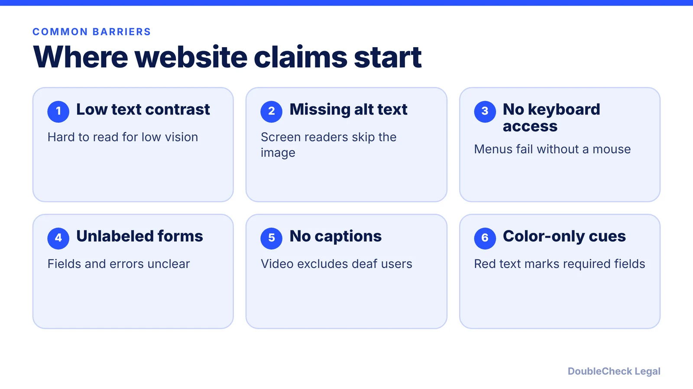
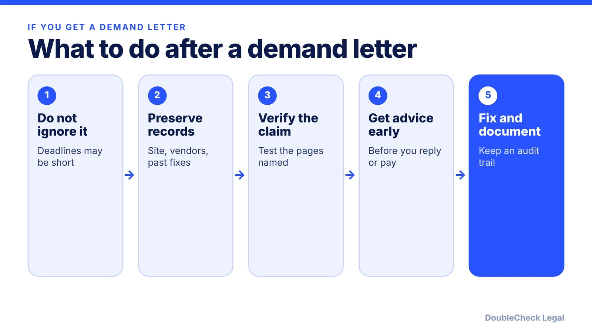

*There is no federal website rule for private businesses, but claims keep coming. Here is where the law stands as of November 2026.*

**Key takeaways:**

- DOJ says the ADA covers what businesses offer on the web, but it has not set a technical standard for private sites.
- WCAG 2.1 Level AA is the common benchmark; DOJ's Title II rule for governments uses it, with deadlines moved to April 2027 and April 2028.
- Courts disagree on whether a website alone is a place of public accommodation.
- Overlay widgets are not a safe harbor; audit, fix, document, and retest.

## 1. The quick answer

**Quick answer:** The ADA applies to businesses open to the public, and the Department of Justice (DOJ) has "consistently taken the position" that this includes what they offer on the web. There is still no DOJ regulation setting a technical standard for private business websites, so WCAG 2.1 Level AA has become the benchmark most lawyers and plaintiffs use. As of November 2026, the only binding WCAG 2.1 AA rule is the DOJ's Title II rule for state and local governments, not private companies.

## 2. What the law and DOJ actually say

Title III of the ADA covers "public accommodations," meaning businesses open to the public. Per [ADA.gov's web guidance](https://www.ada.gov/resources/web-guidance), DOJ says those businesses must give equal access to their goods and services, that they "have flexibility in how they comply," and that the Web Content Accessibility Guidelines (WCAG) and the Section 508 Standards are helpful guidance. DOJ does not publish detailed technical standards for private websites.

Two things are easy to confuse:

- **Title II (government).** DOJ's April 2024 final rule adopted WCAG 2.1 Level AA for state and local government websites and apps. Per [the adatitleiii.com blog](https://www.adatitleiii.com/2026/04/doj-extends-ada-title-ii-website-accessibility-deadlines-for-governmental-entities-but-litigation-and-compliance-risks-remain/), an interim final rule published April 20, 2026 pushed those deadlines to April 26, 2027 (entities with 50,000 or more people) and April 26, 2028 (smaller entities). The same source says Title III web rulemaking is paused indefinitely.
- **Title III (private business).** No equivalent rule exists, so the standard is set case by case. Courts also disagree on whether a website alone is a "place of public accommodation." Per [Promise Legal](https://blog.promise.legal/startup-central/ada-website-accessibility-compliance-2026/), the First, Second, and Seventh Circuits treat websites as covered, while the Third, Sixth, and Ninth suggest a link to a physical place is needed.

In *Robles v. Domino's Pizza*, per [a Beancount.io summary](https://beancount.io/blog/2026/06/04/ada-title-iii-website-mobile-app-accessibility-compliance-small-mid-size-businesses-serial-demand-letters-wcag-2-1-level-aa-robles-dominos-pizza-doj-guide), the Ninth Circuit held in 2019 that Title III covered the site and app because they connected to physical restaurants; the Supreme Court declined review.

State laws add exposure. For privacy and policy pages that every site needs anyway, see [website terms of service](/blog/website-terms-of-service-saas-startups/) and the [privacy policy guide](/blog/privacy-policy-generator-small-business/).

## 3. What WCAG 2.1 AA asks of a small site

WCAG is organized around four ideas: content must be perceivable, operable, understandable, and robust. Per the Beancount.io summary, Level AA has 50 success criteria. For a typical small business site, the practical checks are:

- **Text alternatives** for meaningful images, including product photos and buttons.
- **Contrast** between text and background, and no use of color alone to convey meaning.
- **Keyboard operation** for menus, forms, and checkout, with a visible focus indicator.
- **Labeled forms** with clear instructions and error messages.
- **Captions** for video and transcripts for audio.
- **Logical headings** and content that reflows when zoomed.

Be careful with "overlay" widgets that promise one-line compliance. Per Promise Legal, an Overlay Fact Sheet signed by more than 600 accessibility professionals says no overlay "can cause a website to become fully compliant," and the FTC approved a final order in April 2025 requiring accessiBe to pay $1 million over deceptive claims. Treat any tool as an aid to testing, not a legal shield.

## 4. Reducing your risk and what a claim can cost

Nobody can promise immunity, but a documented, good-faith program is the strongest position. A sensible sequence:

1. **Audit** your top pages (home, product, checkout, contact) with automated tools plus manual keyboard and screen-reader checks. Automated scans miss a lot.
2. **Fix** the high-impact barriers first and set WCAG 2.1 AA as the target. Per Promise Legal, the Texas Department of Licensing and Regulation uses WCAG 2.2 AA as its testing criteria, so 2.2 is a reasonable goal if you rebuild.
3. **Write an accessibility statement** with a contact method. Promise Legal describes it as evidence of good faith, not a shield.
4. **Put it in contracts.** Require agencies and template vendors to deliver accessible work.
5. **Retest** after redesigns, new plugins, and third-party widgets.

Exposure varies by state and plaintiff. Secondary sources report that many claims settle privately before any case is filed, and that attorney's fees and remediation drive cost. We could not verify a reliable national average, so get a quote for your own situation. If you receive a letter, read [how to respond to a cease and desist letter](/blog/how-to-respond-cease-and-desist-letter/) and [what to do if your small business is served a lawsuit](/blog/what-to-do-if-your-small-business-is-served-a-lawsuit/). For wider compliance planning see [business insurance types](/blog/business-insurance-types-small-business/) and the [state privacy law checklist](/blog/state-privacy-laws-2027-small-business-checklist/).

## Where DoubleCheck fits

[DoubleCheck](https://www.contactdoublecheck.com) helps businesses and founders start legal work with AI, verify it, and, when professional advice is warranted, connect with an independent attorney, including for immigration questions. Attorney availability and practice areas vary. Attorneys on DoubleCheck are independent professionals; an attorney-client relationship forms only if an attorney accepts your engagement.

**Sources:** [ADA.gov, Guidance on Web Accessibility and the ADA](https://www.ada.gov/resources/web-guidance); [adatitleiii.com, DOJ extends Title II deadlines](https://www.adatitleiii.com/2026/04/doj-extends-ada-title-ii-website-accessibility-deadlines-for-governmental-entities-but-litigation-and-compliance-risks-remain/); [Promise Legal, ADA website accessibility 2026](https://blog.promise.legal/startup-central/ada-website-accessibility-compliance-2026/); [Beancount.io, ADA Title III guide](https://beancount.io/blog/2026/06/04/ada-title-iii-website-mobile-app-accessibility-compliance-small-mid-size-businesses-serial-demand-letters-wcag-2-1-level-aa-robles-dominos-pizza-doj-guide).

## FAQ

**Does the ADA apply to my small business website?**

Per ADA.gov, DOJ has consistently taken the position that ADA requirements cover offerings made on the web by businesses open to the public. Courts differ on whether a site with no physical location is covered, so the answer can depend on your circuit.

**Is WCAG 2.1 AA legally required for private websites?**

Not by a DOJ regulation. Per the adatitleiii.com blog, the April 2024 rule adopting WCAG 2.1 AA applies to state and local governments. For private businesses it is the commonly used benchmark, and DOJ's guidance names WCAG as helpful.

**Will an accessibility overlay protect me?**

No. Per Promise Legal, no overlay product can make a site fully compliant according to the signatories of the Overlay Fact Sheet, and the FTC's April 2025 accessiBe order involved deceptive compliance claims.

**What changed for government websites in 2026?**

Per the adatitleiii.com blog, DOJ's April 20, 2026 interim final rule moved Title II compliance dates to April 26, 2027 for larger entities and April 26, 2028 for smaller ones. It did not change the WCAG 2.1 AA standard.

---

*General information only. This article is not legal, tax, investment, or accounting advice.*
