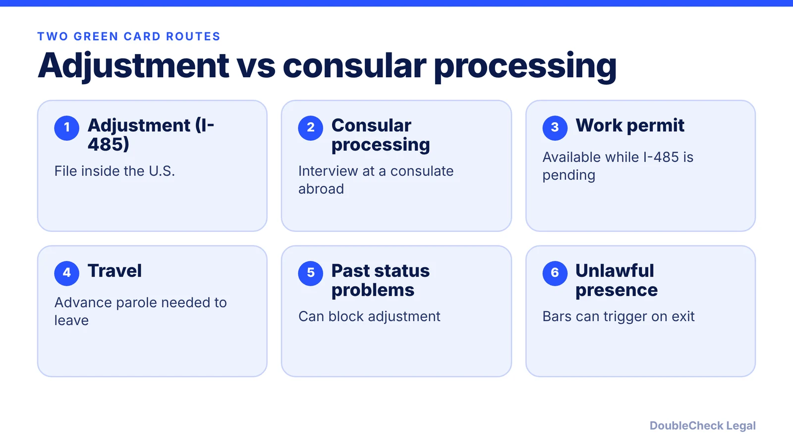
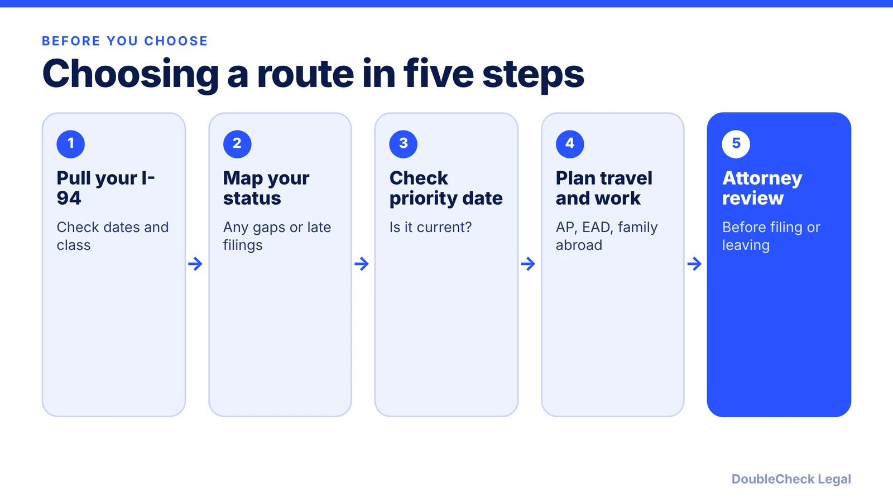

*Two ways to a green card, different risks. Here is how they compare as of November 2026.*

**Key takeaways:**

- Adjustment keeps you in the U.S. and can come with a work permit; consular processing happens abroad.
- Some people can only use one route, based on entry, status history, and category.
- A May 21, 2026 USCIS memo makes adjustment more discretionary; it is under court challenge.
- Past status gaps or unlawful presence call for an attorney before you file or leave.

## 1. The quick answer

**Quick answer:** Adjustment of status (Form I-485) lets you apply for a green card without leaving the U.S.; consular processing means finishing the immigrant visa at a U.S. consulate abroad. You do not always get to choose: some people can only adjust (for example under INA 245(i), per Klasko Immigration Law Partners) and others can only use a consulate. As of November 2026 the choice is harder, because a May 21, 2026 USCIS memo (PM-602-0199) tells officers to treat adjustment as a discretionary benefit and, per Greenberg Traurig, to look for "unusual or outstanding circumstances." The statute has not changed, and the memo is being challenged in court, but the safer route depends on your status history. Get an attorney to review it before you file or travel.

## 2. Who can adjust status, and who usually cannot

Per Nolo, adjustment is generally available to people in the U.S. in lawful status, people who entered legally and are immediate relatives of U.S. citizens, and some people covered by Section 245(i). Consular processing is the route for applicants who live overseas.

The main obstacles, per the [USCIS Policy Manual](https://uscis.gov/policy-manual/volume-7-part-b-chapter-3) and Gozel Law:

- **Entry without inspection.** If you were never admitted or paroled, adjustment is generally unavailable unless Section 245(i) applies.
- **Unlawful status on the filing date (INA 245(c)(2)).** This includes status that expired or was violated. Immediate relatives of U.S. citizens are exempt from these 245(c) bars, though not from the entry-without-inspection problem.
- **Unauthorized employment.** Per Gozel Law, family-preference cases have no minimum period, while Section 245(k) forgives limited violations for most employment-based applicants.
- **Visa Waiver Program entry.** Per Nolo, these entrants are generally barred from adjusting, with few exceptions.

Per Gozel Law, a "no fault of your own or technical reasons" exception exists but is read narrowly. Whether you are in lawful status on the day you file is often the deciding fact, so know your I-94 date.

**Employment-based cases.** Per Klasko, employment-based adjustment cases usually have no interview, while consular cases always include one. See our guides to the [I-485](/blog/i-485-adjustment-of-status-guide/), [PERM](/blog/perm-labor-certification-green-card-process/), and the [H-1B to green card timeline](/blog/h-1b-to-green-card-timeline-tech-workers/).

## 3. Travel, work, and timing differences

Per Klasko and Nolo:

- **Work.** Adjustment applicants, and their spouses and children under 21, can generally obtain employment authorization (EAD) soon after filing. Employment authorization is not available during consular processing.
- **Travel.** Adjustment applicants generally need advance parole to leave the U.S., with an exception for people maintaining H or L status. Consular applicants travel to the consulate in their country of nationality or last residence. See [advance parole and EAD while an I-485 is pending](/blog/advance-parole-and-ead-while-i-485-pending/). Per Greenberg Traurig, the May 2026 memo does not address advance parole, but traveling on it may complicate reentry if adjustment is denied while you are abroad.
- **Delays.** Per Klasko, if USCIS is slow, an adjustment applicant can stay and keep working, while a consular applicant delayed after the interview may be stuck abroad. Consular processing has traditionally saved three to 18 months depending on location, though concurrent filing may remove that advantage. Check current USCIS and consulate times rather than relying on old numbers.
- **Interviews and denials.** Per Klasko, attorneys can attend USCIS interviews, while many consulates give no right to representation. Adjustment denials can be appealed or renewed, with no equivalent for denied immigrant visa applications.
- **Priority dates.** In many employment categories you can file only when your date is current. See the [Visa Bulletin explained](/blog/visa-bulletin-explained-priority-dates-eb-categories/) and [retrogression for India and China](/blog/priority-date-retrogression-india-china-backlog/).

**Interplay with H-1B and F-1.** The Klasko article does not cover how these statuses interact with either path, so verify with your attorney. Per Greenberg Traurig, maintaining dual-intent status such as H-1B or L-1 does not automatically guarantee approval under the new memo. Dropped status or a late extension are the facts that can hurt most. If you are between jobs, see the [H-1B 60-day grace period](/blog/h-1b-layoff-60-day-grace-period/).

## 4. Unlawful presence, the May 2026 memo, and when to get an attorney

**Unlawful presence.** Per Nolo and Klasko, the 3-year and 10-year bars generally trigger when you depart after more than 180 days or one year of unlawful presence, including to attend a consular interview. That is why people with past overstays often fear consular processing. A waiver based on extreme hardship to a qualifying relative exists, and some immediate relatives can seek a provisional waiver (Form I-601A) before leaving, per Nolo and Gozel Law. Gozel Law advises against departing before a waiver is approved. See our [overstay and unlawful presence explainer](/blog/immigration-overstay-unlawful-presence-3-10-year-bars-explained/).

**The May 2026 memo.** Per Morgan Lewis, PM-602-0199 says adjustment is not designed to supersede regular consular processing, and that applicants may need "unusual or even outstanding equities." USCIS spokesperson statements, as reported by Morgan Lewis, said applicants in the U.S. temporarily must return home "except in extraordinary circumstances," and later said cases providing an economic benefit or in the national interest will likely continue on their current path. Per bizlegalservices, the memo was challenged in AAUP v. Mullin (D. Mass., filed October 5, 2026), and as of its October 6 report there was no decision and the memos remained in effect. Check the docket and USCIS for updates.

**Handle yourself vs. get an attorney.**

- Likely manageable with careful preparation: a clean, continuous lawful status record and a straightforward category.
- Get an attorney before filing if you have a gap in status, unauthorized work, a late extension, a prior overstay, an entry question, a pending denial, or you plan to travel on advance parole.
- Get one before leaving the U.S. if you may have accrued unlawful presence.

Read about [finding a good immigration lawyer](/blog/how-to-find-good-immigration-lawyer-startup-founder/) and [fee structures](/blog/immigration-lawyer-fees-flat-fee-vs-hourly/).

## Where DoubleCheck fits

[DoubleCheck](https://www.contactdoublecheck.com) helps businesses and founders start legal work with AI, verify it, and, when professional advice is warranted, connect with an independent attorney, including for immigration questions. Attorney availability and practice areas vary. Attorneys on DoubleCheck are independent professionals; an attorney-client relationship forms only if an attorney accepts your engagement.

**Sources:** [Nolo via AllLaw](https://www.alllaw.com/articles/nolo/us-immigration/getting-green-card-consular-processing-adjustment-of-status.html); [Klasko Immigration Law Partners](https://www.klaskolaw.com/choosing-between-adjustment-of-status-and-consular-immigrant-visa-processing-2/); [USCIS Policy Manual, Vol. 7 Part B Ch. 3](https://uscis.gov/policy-manual/volume-7-part-b-chapter-3); [Gozel Law](https://www.gozellaw.com/blog/who-cannot-adjust-status-245-bars); [Morgan Lewis](https://www.morganlewis.com/pubs/2026/05/uscis-issues-new-policy-memorandum-on-adjustment-of-status); [Greenberg Traurig](https://www.gtlaw.com/ar/insights/2026/5/new-uscis-policy-memorandum-addresses-adjustment-of-status-adjudications); [JD Supra](https://www.jdsupra.com/legalnews/uscis-reframes-adjustment-of-status-as-2114067/); [bizlegalservices](https://bizlegalservices.com/2026/10/07/lawsuit-challenging-uscis-green-card-policies-filed/). USCIS fee and processing-time pages were not used; check uscis.gov for current figures.

## FAQ

**Can I choose between adjustment of status and consular processing?**

Sometimes. Per Klasko Immigration Law Partners, some applicants can only adjust (for example under INA 245(i)) and others can only process at a consulate. Eligibility depends on how you entered, your status when you file, and your category.

**Do I need advance parole while my I-485 is pending?**

Per Klasko, adjustment applicants generally need advance parole to leave the U.S., with an exception for people maintaining H or L status. Greenberg Traurig notes traveling on advance parole can complicate matters if the case is denied while you are abroad. Ask an attorney before any trip.

**Does the May 2026 USCIS memo mean I must leave the U.S.?**

Not automatically. Per Morgan Lewis, the memo does not change the statute, and USCIS statements said some cases will likely continue on their current path. The memo is being challenged in AAUP v. Mullin, per bizlegalservices, with no ruling reported as of October 2026.

**Which route is safer if I have unlawful presence?**

It depends. Per Nolo, adjustment can avoid the bars that trigger on departure, but the May 2026 memo makes unlawful presence a negative factor, per a JD Supra summary of the memo (applicants with unlawful presence may need "unusual or even outstanding equities"). Do not leave before getting advice, since departure can trigger the 3- or 10-year bar.

---

*General information only. This article is not legal, tax, investment, or accounting advice.*
