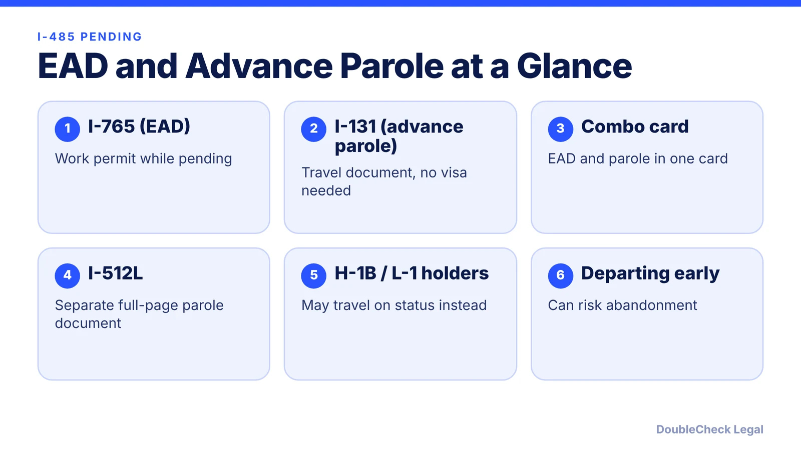
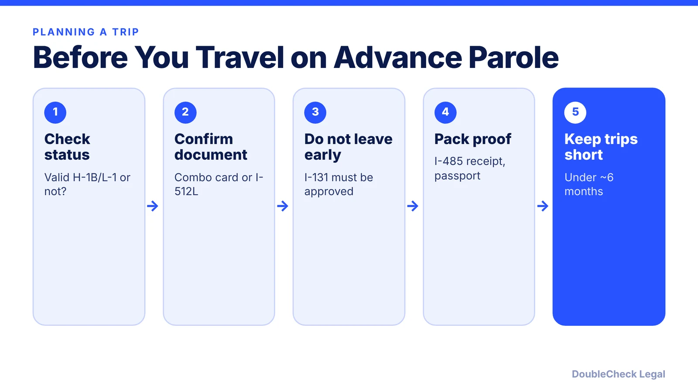

*Pending green card, need a work permit or want to travel? Here is how the EAD, advance parole and combo card fit together.*

**Key takeaways:**

- The I-765 gives work authorization and the I-131 gives travel permission; a combo card can combine them, but USCIS often issues them separately.
- Do not leave the U.S. while the I-131 is pending; per RN Law Group that can be treated as abandonment.
- H-1B and L-1 holders may be able to travel on their status instead, with trade-offs worth discussing with an attorney.
- Confirm fees against USCIS Form G-1055; the I-765 is listed at $260 and the I-131 at $630 by one university source.

## 1. The quick answer

**Quick answer:** While your Form I-485 is pending, you can ask for a work permit (EAD, Form I-765) and a travel document (advance parole, Form I-131). USCIS may issue them separately or as one "combo card." Work authorization lets you work for any employer; advance parole lets you re-enter the U.S. without abandoning the pending I-485. If you hold valid H-1B or L-1 status, you may not need to travel on advance parole at all, but the choice has trade-offs. As of November 2026, confirm fees on USCIS's fee schedule (Form G-1055) before filing.

## 2. EAD, advance parole, and the combo card

Two forms, two purposes:

- **Form I-765** asks for employment authorization based on a pending adjustment application. The EAD lets you work for any U.S. employer, per Locke Immigration.
- **Form I-131** asks for advance parole, a document that lets you travel abroad and return without abandoning the pending I-485.

Historically both were filed together and approved together as an "EAD/AP combo card," which looks like an EAD and has "SERVES AS I-512 ADVANCE PAROLE" printed on it, per RN Law Group. RN Law Group also reports that USCIS now often approves the I-765 first and the I-131 months later. A standalone EAD does not have the parole endorsement, and CBP will not accept it for travel. In that case the travel document is the full-page Form I-512L.

Processing varies widely. Ellis & Associates reported combo cards averaging 4 to 6 months, so check USCIS's current processing times for your service center rather than assuming a date.

## 3. Traveling: the H-1B and L-1 question

This is where tech employees most often get confused.

- **Do not leave while the I-131 is pending.** RN Law Group says departing the U.S. while the advance parole application is pending can lead to abandonment and denial of that application under current USCIS policy. If the I-131 is approved while you are abroad, the document is not valid for reentry.
- **H-1B and L-1 holders have a choice.** Per RN Law Group, entering on advance parole makes you an adjustment applicant under your I-94, but USCIS has said valid, unexpired H or L status can still be extended through an extension filed with USCIS. Ellis reports that people in valid H-1B or L-1 status who are adjusting usually do not need advance parole to travel, as long as they keep that status and return with valid documents (including a valid visa stamp).
- **Bring the paperwork.** Original advance parole document, a copy of the I-485 receipt notice, and your passport. Expect possible secondary inspection, where you should say the document is based on the pending adjustment application (RN Law Group).
- **Keep trips short.** USCIS sets no strict per-trip maximum, but Ellis notes that most attorneys advise staying under about six months, since trips over 180 days can raise abandonment and unlawful-presence issues.
- **Approval is not a guarantee.** CBP makes the final decision at the port of entry. Prior unlawful presence, removal orders, criminal history, or misrepresentation can create problems even with a valid document.

If you are weighing H-1B status against an adjustment-based EAD, see our guides on the [I-485 process](/blog/i-485-adjustment-of-status-guide/) and [H-1B to green card timelines](/blog/h-1b-to-green-card-timeline-tech-workers/).

## 4. Fees and validity (verify before filing)

**Fees.** The University of Michigan's international center lists $260 for the I-765 and $630 for the I-131 when you file them with an I-485. F1Jobs likewise lists $260 for the pending-I-485 (category C9) I-765 if the I-485 was filed on or after April 1, 2024. Michigan notes these filing fees were waived for adjustment applications filed between August 1, 2007 and April 1, 2024. USCIS adjusts some fees annually, and G-1055 is the official schedule, so use it the day you file. Do not rely on any blog (including this one) for the final amount.

**Validity.** Sources differ and USCIS decides case by case. RN Law Group says standard advance parole is typically valid for two years; Ellis says one year is usual and some adjustment applicants get two; Locke Immigration reports five-year combo cards for some I-485 applicants following a September 2023 USCIS policy update. Read the dates on your own document. When you enter on advance parole, RN Law Group says the I-94 usually shows one year in the "DA" class and does not need to be extended while the I-485 remains pending.

**Renewals.** Apply early enough to avoid a gap in work authorization. If you change jobs, see [I-140 portability](/blog/i-140-portability-ac21-changing-jobs/) and our [H-1B transfer guide](/blog/h-1b-transfer-change-of-employer-portability/). For spouses, see [H-4 EAD](/blog/h-4-ead-spouses-of-h-1b/).

## Where DoubleCheck fits

[DoubleCheck](https://www.contactdoublecheck.com) helps businesses and founders start legal work with AI, verify it, and, when professional advice is warranted, connect with an independent attorney, including for immigration questions. Attorney availability and practice areas vary. Attorneys on DoubleCheck are independent professionals; an attorney-client relationship forms only if an attorney accepts your engagement.

**Sources:** [RN Law Group, travel on advance parole FAQs](https://www.rnlawgroup.com/travel-on-advance-parole-faqs); [Ellis, advance parole in 2026](https://www.ellis.com/resources/advance-parole-in-2026-a-guide-to-traveling-abroad-while-your-us-case-is-pending); [Locke Immigration](https://www.lockeimmigration.com/approvals/adjustment-of-status-5-year-work-permit); [University of Michigan International Center](https://internationalcenter.umich.edu/node/1522); [F1Jobs, I-765 fees](https://www.f1jobs.io/resources/blog/i-765-filing-fee-by-category-2026).

## FAQ

**What is the difference between an EAD and advance parole?**

An EAD (Form I-765) is permission to work. Advance parole (Form I-131) lets you return to the U.S. after travel without abandoning a pending I-485. A combo card serves as both, per RN Law Group.

**Can I travel on an EAD alone?**

No. Per RN Law Group, a standalone EAD lacks the advance parole endorsement and CBP will not accept it for travel. You would need the combo card or a Form I-512L.

**Can H-1B or L-1 holders skip advance parole?**

Often yes. Ellis reports people in valid H-1B or L-1 status who are adjusting usually do not need advance parole to travel if they maintain that status and return with valid documents. Ask an attorney which route fits your case.

**How much do the I-765 and I-131 cost?**

The University of Michigan lists $260 for the I-765 and $630 for the I-131 with a pending I-485. Fees change, so check USCIS Form G-1055 before filing.

---

*General information only. This article is not legal, tax, investment, or accounting advice.*
