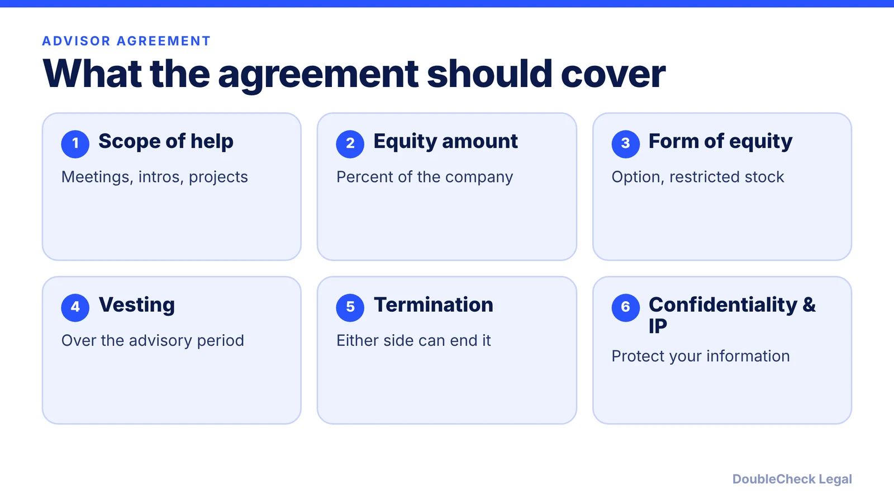
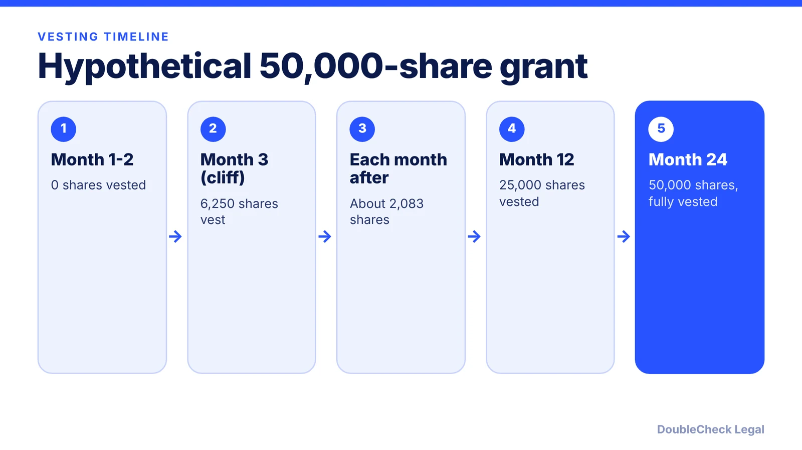

*Advisors can open doors, but their equity is permanent dilution. Here is how to size, structure, and vest it.*

**Key takeaways:**

- Per Carta, the median pre-seed advisor grant in H1 2024 was 0.21%, and only 10% got 1% or more.
- FAST (Founder Institute) ties equity to engagement level and company stage, with vesting over time.
- Typical forms are restricted stock or non-qualified options; tax treatment differs for each.
- Put scope, vesting, termination, confidentiality, and IP in writing before the first meeting.

## 1. The quick answer

**Quick answer:** An advisor agreement sets what an outside advisor will do for your startup and what equity they earn, usually through vesting. Per Carta, "advisory shares" is a common label, not a distinct security type; in practice it means options, restricted stock, or common stock. Carta's data for first-half 2024 pre-seed companies put the median advisor grant at 0.21% of company shares. The Founder Institute's free FAST template is a widely used starting point.

## 2. How much equity and what form

There is no single required amount, so use sourced ranges as reference points, not rules.

- **Carta data (first half of 2024, published September 11, 2024):** for pre-seed companies, the median advisor grant was 0.21% of company shares, down from 0.25% in 2021 through 2023, and only 10% of pre-seed advisors received 1% or more.
- **FAST tiers (Founder Institute):** a Standard advisor (monthly meetings) gets 0.50% at pre-seed, 0.25% at seed, and 0.10% at Series A. An Expert advisor (adds contacts and projects) gets 1.00%, 0.75%, and 0.50%. The page names a third strategic level without giving percentages, and lists Version 3 as released in July 2026.
- **Cake Equity:** describes a typical range of 0.25% to 5% depending on contribution, expertise, and duration. That is a broad range from one vendor, not a survey.

On form, [Carta](https://carta.com/learn/startups/equity-management/advisory-shares/) lists restricted stock awards (common stock granted upfront, often before a first financing when fair market value is low), stock options, and rarely RSUs. Cake Equity says advisory shares are almost always non-qualified stock options. Options need a strike price set with a 409A valuation (see [stock options and 409A](/blog/stock-options-409a-valuation-startups/)); employee-only ISOs are not available to advisors per Carta, so see [ISOs vs. NSOs](/blog/isos-vs-nsos-employee-stock-options/).

## 3. Vesting, cliffs, and acceleration

Per Carta, vesting usually runs for the length of the advisory relationship; a common structure is a two-year schedule vesting monthly with no cliff, and some agreements add a three-month cliff. The FAST page describes a three-month cliff and its example has an expert-level pre-seed advisor earning 1% over two years. Cake Equity's example is a four-year schedule with a one-year cliff, so schedules vary by deal.

Our arithmetic on a hypothetical: an advisor is granted 0.5% of 10,000,000 fully diluted shares, or 50,000 shares, vesting monthly over 24 months with a three-month cliff.

Carta adds that advisors often negotiate single-trigger acceleration (all shares vest on a specified event such as a sale), so decide in advance whether you will agree. Compare the logic with [co-founder vesting and cliffs](/blog/cofounder-vesting-cliff-explained/).

## 4. Process and protections

Issuing advisor equity follows the same steps as other grants. Per Carta, those include reviewing the draft securities, obtaining board and shareholder approval, and getting an updated valuation. Check how your [board](/blog/how-to-set-up-a-startup-board-of-directors/) approves grants.

Tax treatment differs by form. Carta says restricted stock recipients who pay little or nothing owe ordinary income tax on the value, and NSO holders are taxed as ordinary income on the gap between strike price and fair market value at exercise. A restricted stock advisor may consider the timing rules in [83(b) elections](/blog/83b-election-startup-founders/); the advisor should get tax advice.

Clauses worth including, per Cake Equity: clear scope and expectations, the type and percentage of equity, vesting, the conversion mechanism if options are used, confidentiality, and IP agreements (see [confidentiality and IP assignment agreements](/blog/confidentiality-ip-assignment-agreements-startups/)). Add a short termination clause so an inactive advisor can be ended without losing unvested equity.

Also expect questions later: advisor grants appear on your [cap table](/blog/cap-table-basics-for-first-time-founders/) and in [fundraising diligence](/blog/due-diligence-checklist-for-startup-fundraising/). Cap them, because each grant dilutes [founder equity](/blog/founder-equity-split-how-to-divide/).

## Where DoubleCheck fits

[DoubleCheck](https://www.contactdoublecheck.com) helps businesses and founders start legal work with AI, verify it, and, when professional advice is warranted, connect with an independent attorney, including for immigration questions. Attorney availability and practice areas vary. Attorneys on DoubleCheck are independent professionals; an attorney-client relationship forms only if an attorney accepts your engagement.

**Sources:** [Founder Institute, FAST Agreement](https://fi.co/fast); [Carta, Advisory Shares: A Founder's Guide](https://carta.com/learn/startups/equity-management/advisory-shares/); [Cake Equity, Advisory Shares](https://cakeequity.com/blog/advisory-shares).

## FAQ

**How much equity should a startup advisor get?**

There is no required amount. Carta's data for first-half 2024 put the median pre-seed advisor grant at 0.21%, and the Founder Institute's FAST tiers range from 0.10% (Standard, Series A) to 1.00% (Expert, pre-seed).

**What is a FAST agreement?**

It is the Founder/Advisor Standard Template published by the Founder Institute, used to trade advice for a standardized amount of equity. Per the Founder Institute, it includes a three-month cliff and tiered equity by stage and engagement level.

**How should advisor equity vest?**

Per Carta, vesting usually follows the length of the advisory relationship, and a common structure is two years monthly with no cliff. Some agreements add a three-month cliff. Cake Equity gives a four-year, one-year-cliff example, so terms vary.

**Are advisory shares taxed?**

Yes, depending on form. Per Carta, restricted stock recipients who pay little or nothing owe ordinary income tax on its value, and NSO holders owe ordinary income tax on the spread at exercise. Advisors should consult a tax professional.

---

*General information only. This article is not legal, tax, investment, or accounting advice.*
