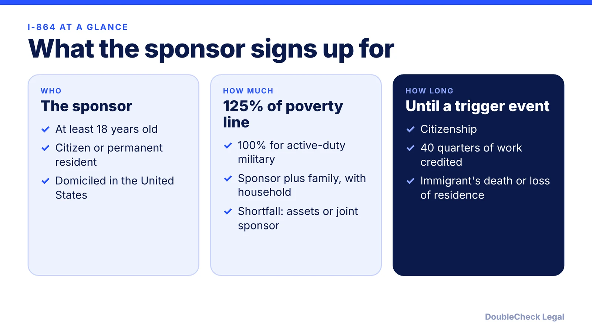
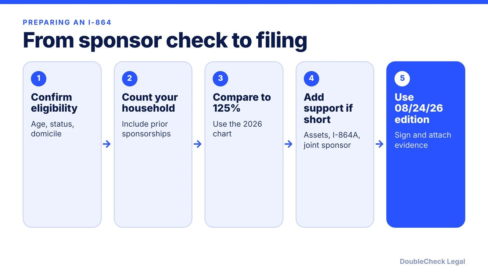

*The I-864 is a promise you can be held to, so know the numbers before you sign.*

**Key takeaways:**

- Sponsors generally need 125% of the poverty guidelines; 100% for active-duty military sponsoring a spouse or child (per 8 U.S.C. 1183a).
- 2026 figure for a household of 2 in the contiguous states and D.C.: $27,050 at 125%.
- USCIS published the 08/24/26 edition on August 31, 2026, with a consumer-report release; confirm on USCIS which editions it currently accepts.
- The obligation lasts until a trigger such as citizenship or 40 quarters of work; divorce does not end it.

## 1. The quick answer

**Quick answer:** Form I-864 is a legally enforceable contract in which a sponsor promises to support an immigrant at 125% of the federal poverty guidelines (100% for active-duty military sponsoring a spouse or child), per [8 U.S.C. 1183a](https://uscode.house.gov/us/usc/119-120/t8/s1183a/). For 2026 in the 48 contiguous states and D.C., that is $27,050 for a household of 2 and $34,150 for a household of 3. USCIS published a new 08/24/26 edition of the form on August 31, 2026, which adds a consumer-report (credit) information release; confirm on the USCIS I-864 page which editions it currently accepts.

## 2. Who must file, and who can sponsor

The I-864 usually accompanies a family-based green card, and some employment-based cases, so USCIS can see the immigrant will not need public benefits. Per the [State Department](https://travel.state.gov/content/travel/en/us-visas/immigrate/the-immigrant-visa-process/step-1-submit-a-petition/i-864-affidavit-faqs.html), the sponsor is usually the U.S. petitioner, who must be at least 18, a U.S. citizen or permanent resident, and domiciled in the U.S. Sponsors abroad must show a U.S. domicile that continues or will be reestablished by the immigrant's admission or adjustment, and a joint sponsor cannot cure a domicile problem.

For the underlying case, see [the marriage-based timeline](/blog/marriage-based-green-card-process-timeline/) and [the I-485 guide](/blog/i-485-adjustment-of-status-guide/).

## 3. Income, household size, and joint sponsors

These 2026 figures for the contiguous states and D.C. (Alaska and Hawaii differ) are the [HHS poverty guidelines](https://www.govinfo.gov/content/pkg/FR-2026-01-15/pdf/2026-00755.pdf) (100%) and 125% of them:

| Household | 125% | 100% (military) |
|---|---|---|
| 2 | $27,050 | $21,640 |
| 3 | $34,150 | $27,320 |
| 4 | $41,250 | $33,000 |
| Each additional person | +$7,100 | +$5,680 |

Household size counts the sponsor, spouse, minor children, other claimed dependents, immigrants on earlier affidavits still in force, and everyone on this affidavit. Poverty figures change each year, so confirm them on USCIS's I-864 page before signing.

If income falls short, the options are:

- **Net assets,** generally five times the shortfall (three times when sponsoring a spouse or child of a U.S. citizen), per the State Department.
- **A household member** signing Form I-864A.
- **A joint sponsor** on a separate I-864. The joint sponsor must independently meet 125% for their own household plus the immigrants they sponsor, and need not live with or be related to the sponsor.

## 4. The new edition, credit release, and how long it lasts

Per an [AILA-hosted court complaint](https://assets.aila.org/files/14e75ed0-afab-48cd-a1f3-d04aff6038f6/26083102a.pdf), USCIS published a new 08/24/26 edition of Form I-864 on August 31, 2026. USCIS's transition timing for the prior 10/17/24 edition changed after publication, so check the USCIS I-864 page for which editions it currently accepts, and file the current edition from the start.

The new edition includes a privacy release letting USCIS request sponsor information from consumer reporting agencies. If you have a credit or security freeze, the AILA-hosted complaint says to lift it promptly if USCIS asks, since a failure to obtain the information may delay the case.

Per [8 U.S.C. 1183a](https://uscode.house.gov/us/usc/119-120/t8/s1183a/) and the Ninth Circuit's opinion in [Erler v. Erler](https://cases.justia.com/federal/appellate-courts/ca9/14-15362/14-15362-2016-06-08.pdf), the obligation ends on citizenship, 40 quarters of credited work, loss of permanent residence plus leaving the U.S., a new adjustment grant in removal proceedings, or the immigrant's death. Divorce does not end it. Because it is an enforceable contract, have an attorney review it; see [immigration lawyer fees](/blog/immigration-lawyer-fees-flat-fee-vs-hourly/) and [green card vs citizenship](/blog/green-card-vs-us-citizenship-differences/).

## Where DoubleCheck fits

[DoubleCheck](https://www.contactdoublecheck.com) helps businesses and founders start legal work with AI, verify it, and, when professional advice is warranted, connect with an independent attorney, including for immigration questions. Attorney availability and practice areas vary. Attorneys on DoubleCheck are independent professionals; an attorney-client relationship forms only if an attorney accepts your engagement.

**Sources:** [U.S. Department of State, I-864 Affidavit of Support FAQs](https://travel.state.gov/content/travel/en/us-visas/immigrate/the-immigrant-visa-process/step-1-submit-a-petition/i-864-affidavit-faqs.html); [8 U.S.C. 1183a](https://uscode.house.gov/us/usc/119-120/t8/s1183a/); [Federal Register, 2026 HHS Poverty Guidelines](https://www.govinfo.gov/content/pkg/FR-2026-01-15/pdf/2026-00755.pdf); [Erler v. Erler, 824 F.3d 1173 (9th Cir. 2016)](https://cases.justia.com/federal/appellate-courts/ca9/14-15362/14-15362-2016-06-08.pdf); [AILA, complaint on new I-864 edition](https://assets.aila.org/files/14e75ed0-afab-48cd-a1f3-d04aff6038f6/26083102a.pdf).

## FAQ

**What income do I need to sponsor someone with an I-864?**

Generally 125% of the federal poverty guidelines for your household size, or 100% for active-duty military sponsoring a spouse or child. At 125% of the 2026 HHS poverty guidelines, that is $27,050 for a household of 2 and $34,150 for 3 (contiguous states and D.C.).

**Can a joint sponsor help?**

Yes. Per the State Department, a joint sponsor files a separate I-864 and must independently meet 125% for their own household plus the immigrants they sponsor.

**Which edition of Form I-864 is accepted now?**

USCIS published the 08/24/26 edition on August 31, 2026. Because USCIS changed its transition timing after publication, confirm on the USCIS I-864 page which editions it currently accepts.

**Does divorce end my I-864 obligation?**

No. Gozel Law states that the sponsor's death ends future obligations but divorce does not.

---

*General information only. This article is not legal, tax, investment, or accounting advice.*
