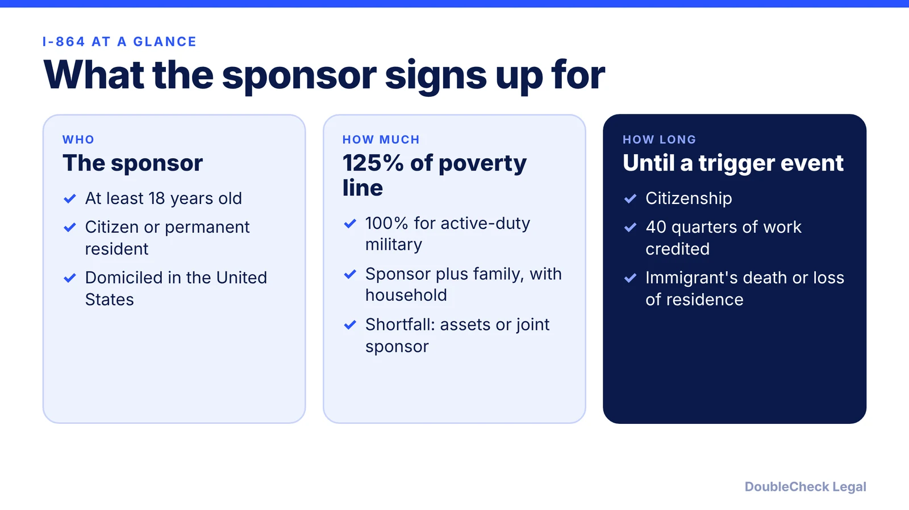
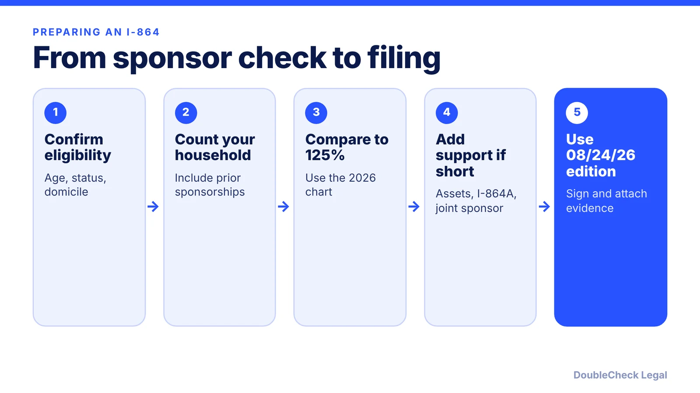

*The I-864 is a promise you can be held to, so know the numbers before you sign.*

**Key takeaways:**

- Sponsors generally need 125% of the poverty guidelines; 100% for active-duty military sponsoring a spouse or child (per Gozel Law).
- 2026 figure for a household of 2 in the contiguous states and D.C.: $27,050 at 125%.
- Since October 1, 2026, only the 08/24/26 edition is accepted, with a consumer-report release.
- The obligation lasts until a trigger such as citizenship or 40 quarters of work; divorce does not end it.

## 1. The quick answer

**Quick answer:** Form I-864 is a legally enforceable contract in which a sponsor promises to support an immigrant at 125% of the federal poverty guidelines (100% for active-duty military sponsoring a spouse or child), per Gozel Law's 2026 summary. For 2026 in the 48 contiguous states and D.C., that is $27,050 for a household of 2 and $34,150 for a household of 3. As of November 2026, USCIS accepts only the 08/24/26 edition of the form, which adds a consumer-report (credit) information release.

## 2. Who must file, and who can sponsor

The I-864 usually accompanies a family-based green card, and some employment-based cases, so USCIS can see the immigrant will not need public benefits. Per [Gozel Law](https://www.gozellaw.com/blog/form-i-864-affidavit-of-support-2026), the sponsor is usually the U.S. petitioner, who must be at least 18, a U.S. citizen or permanent resident, and domiciled in the U.S. Sponsors abroad must show a U.S. domicile that continues or will be reestablished by the immigrant's admission or adjustment, and a joint sponsor cannot cure a domicile problem.

For the underlying case, see [the marriage-based timeline](/blog/marriage-based-green-card-process-timeline/) and [the I-485 guide](/blog/i-485-adjustment-of-status-guide/).

## 3. Income, household size, and joint sponsors

Gozel Law gives these 2026 figures for the contiguous states and D.C. (Alaska and Hawaii differ):

| Household | 125% | 100% (military) |
|---|---|---|
| 2 | $27,050 | $21,640 |
| 3 | $34,150 | $27,320 |
| 4 | $41,250 | $33,000 |
| Each additional person | +$7,100 | +$5,680 |

Household size counts the sponsor, spouse, minor children, other claimed dependents, immigrants on earlier affidavits still in force, and everyone on this affidavit. Gozel Law also notes that the article's figures are time-sensitive and should be confirmed on USCIS's I-864 page before signing.

If income falls short, the options per Gozel are:

- **Net assets,** generally three times the shortfall (five times in most cases other than a citizen sponsoring a spouse or adult child).
- **A household member** signing Form I-864A.
- **A joint sponsor** on a separate I-864. The joint sponsor must independently meet 125% for their own household plus the immigrants they sponsor, and need not live with or be related to the sponsor.

## 4. The new edition, credit release, and how long it lasts

Per [Manifest](https://manifestlaw.com/blog/uscis-new-i864-edition-08-31-2026) and [VisaServe](https://visaserve.com/uscis-provides-30-day-grace-period-for-new-form-i-864-edition/), USCIS published the 08/24/26 edition of Forms I-864, I-864A, and I-864EZ on August 31, 2026, accepted the prior 10/17/24 edition through September 30, 2026, and since October 1, 2026 accepts only the new edition. A non-current edition filed after that date is treated as an evidence issue and draws a Request for Evidence rather than an automatic rejection, per Manifest, which still advises filing the right edition from the start.

The new edition includes a privacy release letting USCIS request sponsor information from consumer reporting agencies. If you have a credit or security freeze, Manifest says to lift it promptly if USCIS asks, since a failure to obtain the information may delay the case.

Per Gozel, the obligation ends on citizenship, 40 quarters of credited work, loss of permanent residence plus leaving the U.S., a new adjustment grant in removal proceedings, or the immigrant's death. The sponsor's death ends future obligations, but divorce does not. Because it is an enforceable contract, have an attorney review it; see [immigration lawyer fees](/blog/immigration-lawyer-fees-flat-fee-vs-hourly/) and [green card vs citizenship](/blog/green-card-vs-us-citizenship-differences/).

## Where DoubleCheck fits

[DoubleCheck](https://www.contactdoublecheck.com) helps businesses and founders start legal work with AI, verify it, and, when professional advice is warranted, connect with an independent attorney, including for immigration questions. Attorney availability and practice areas vary. Attorneys on DoubleCheck are independent professionals; an attorney-client relationship forms only if an attorney accepts your engagement.

**Sources:** [Gozel Law, Form I-864 in 2026](https://www.gozellaw.com/blog/form-i-864-affidavit-of-support-2026); [Manifest Law, New I-864 Edition](https://manifestlaw.com/blog/uscis-new-i864-edition-08-31-2026); [VisaServe, 30-Day Grace Period for New I-864 Edition](https://visaserve.com/uscis-provides-30-day-grace-period-for-new-form-i-864-edition/).

## FAQ

**What income do I need to sponsor someone with an I-864?**

Generally 125% of the federal poverty guidelines for your household size, or 100% for active-duty military sponsoring a spouse or child. Gozel Law lists $27,050 for a household of 2 and $34,150 for 3 in 2026 (contiguous states and D.C.).

**Can a joint sponsor help?**

Yes. Per Gozel Law, a joint sponsor files a separate I-864 and must independently meet 125% for their own household plus the immigrants they sponsor.

**Which edition of Form I-864 is accepted now?**

Per Manifest and VisaServe, since October 1, 2026 USCIS accepts only the 08/24/26 edition.

**Does divorce end my I-864 obligation?**

No. Gozel Law states that the sponsor's death ends future obligations but divorce does not.

---

*General information only. This article is not legal, tax, investment, or accounting advice.*
