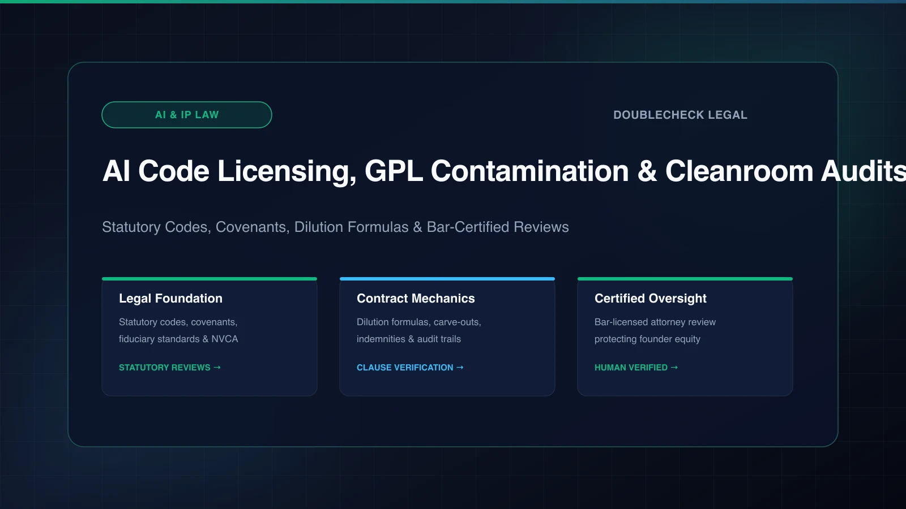
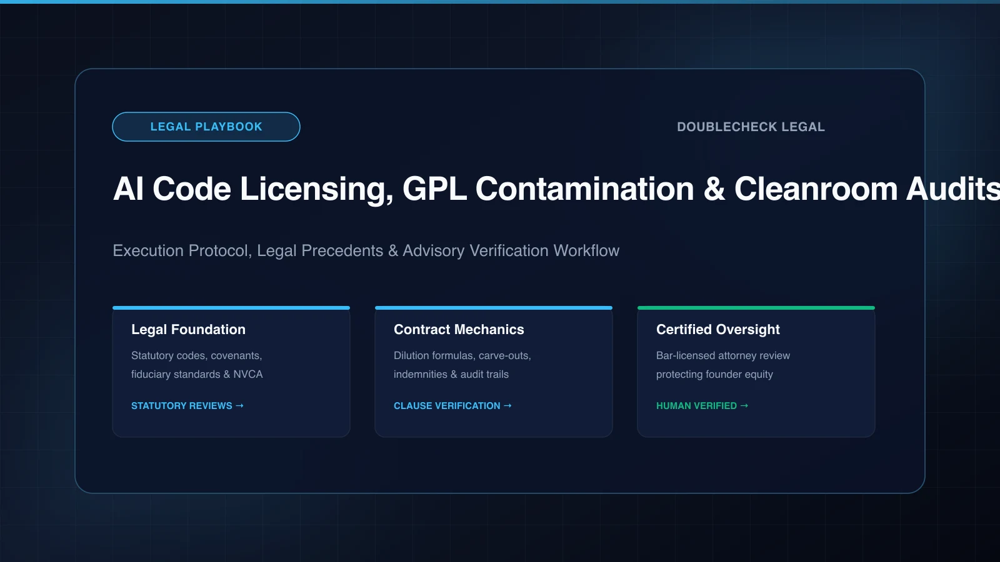

<div class="article-hero-banner mb-8">
  
</div>

## Can AI-Generated Code Contaminate Commercial Software with GPL Licenses?

Yes. Generative AI programming assistants (including GitHub Copilot, Cursor, Anthropic Claude Code, and OpenAI Codex) can inadvertently introduce **viral copyleft open-source licenses (GPLv2, GPLv3, AGPLv3)** into proprietary enterprise software. When foundational models ingest publicly available codebases during pre-training, complex or non-trivial algorithmic structures can be regurgitated verbatim into commercial code editors without the corresponding attribution notices or copyleft disclosures.

Under established copyright and open-source licensing principles, incorporating a substantial excerpt of GPL-licensed source code into a proprietary codebase can legally classify the entire commercial application as a **"derivative work"**, triggering statutory obligations to release the full proprietary source code to the public under the same copyleft license upon commercial distribution.

```
AI Code Generation License Contamination Spectrum

┌───────────────────┬─────────────────────────────────────────────────────────────────┐
│ License Category  │ Risk Level & Commercial Impact                                  │
├───────────────────┼─────────────────────────────────────────────────────────────────┤
│ Permissive        │ LOW: Requires attribution preservation only                     │
│ (MIT / Apache 2.0)│ Minimal risk if notice headers are maintained.                  │
├───────────────────┼─────────────────────────────────────────────────────────────────┤
│ Weak Copyleft     │ MEDIUM: File-level disclosure duties                            │
│ (LGPL / MPL)      │ Modifications to the specific library must remain open-source.  │
├───────────────────┼─────────────────────────────────────────────────────────────────┤
│ Strong Copyleft   │ CRITICAL: Whole-application viral exposure                      │
│ (GPLv2 / GPLv3)   │ Commercial distribution mandates full proprietary source release│
├───────────────────┼─────────────────────────────────────────────────────────────────┤
│ Network Copyleft  │ FATAL FOR SAAS: Server execution triggers copyleft              │
│ (AGPLv3)          │ Merely offering software across the cloud mandates code release │
└───────────────────┴─────────────────────────────────────────────────────────────────┘
```

---

## Direct Answer for CTOs, Founders & General Counsels

- **For Enterprise Startups:** Unmonitored developer usage of AI coding tools poses an existential threat to your intellectual property portfolio. If an M&A acquirer or Series A venture fund conducts a **Black Duck or FOSSA Software Composition Analysis (SCA)** and discovers regurgitated AGPL/GPL snippets in your core backend, they will demand strict escrow holdbacks, price re-trades, or formal cleanroom rewrites prior to closing.
- **Remediation Protocol:** Establish an enforceable **AI Software Development Policy (SDP)**, enforce client-side "matching public code" detection filters, and institute a rigorous **Cleanroom Audit Protocol** whenever license contamination is identified.

---

## 1. The Legal Mechanism: Why Copyleft Attaches to AI Outputs

### The Derivative Work Trigger
Section 106 of the US Copyright Act grants copyright owners the exclusive right to prepare derivative works. The Free Software Foundation (FSF) and federal courts (*Jacobsen v. Katzer*, *Whelan Associates v. Jaslow Dental Laboratory*) establish that open-source licenses are enforceable conditions on copyright grants, not merely contractual covenants:
- If a developer copies an expressive, non-trivial function from a GPL repository, the resulting compiled binary is a derivative work.
- If that software is distributed or (under AGPL) made accessible over a computer network, the company must provide the machine-readable source code under the GPL license.

### The Problem of Verbatim Model Output
While AI vendors argue that models generate novel statistical predictions, empirical studies and copyright litigation (*Doe v. GitHub*) reveal that code assistants frequently emit identical syntax, function signatures, and comment structures when presented with specific algorithmic prompts. If the training data was subject to copyleft terms, the resulting output carries the same legal exposure as manual copy-pasting from a GPL repository.

---

## 2. Vendor Indemnification: The Fine Print and Carve-Outs

Many enterprise founders mistakenly believe that commercial AI subscriptions insulate them from legal liability through vendor copyright indemnities:

1. **Copyleft Non-Compliance Exclusions:** Most vendor indemnification clauses protect exclusively against **direct third-party copyright infringement damages**. They explicitly disclaim responsibility for statutory open-source license obligations or regulatory demands to release proprietary code.
2. **Filter Disable Disclaimers:** Enterprise indemnities universally require that the customer maintain all "duplicate detection filters" or "prevent public code matching" settings in an active state. If a developer disabled these filters to bypass code generation latency, vendor protections are entirely voided.
3. **Consequential and Reputational Damages:** Indemnities cover direct court judgments or negotiated settlements. They never compensate a startup for canceled M&A acquisitions, lost enterprise contracts, or engineering re-architecting expenses.

---

## 3. The IP Cleanroom Remediation Protocol

When a code audit detects that critical proprietary modules contain GPL-contaminated AI snippets, the startup must execute a **Cleanroom Engineering Procedure** to restore pristine title to the codebase:

```
Cleanroom Remediation Workflow

┌──────────────────────┐      ┌───────────────────────────┐      ┌──────────────────────┐
│   Dirty Team         │      │     Functional Spec       │      │   Clean Team         │
│ (Analyzes Infection) │ ───> │ (Strict Black-Box Logic)  │ ───> │ (Writes from Scratch)│
└──────────────────────┘      └───────────────────────────┘      └──────────────────────┘
         │                                                                  │
         ▼                                                                  ▼
 Document Contamination                                            Verify No Code Shared
 & Quarantine Files                                                 Commit Clean Module
```

1. **Step 1: Code Quarantine (The "Dirty Team"):** The original engineers who utilized the AI tool document the infected code, identify the inputs, outputs, and performance requirements, and isolate the contaminated files in a quarantined repository branch.
2. **Step 2: Functional Specification Authoring:** The team authors a pure functional specification that describes *what* the module must accomplish (e.g., API inputs, mathematical transformations, data structures) without detailing *how* the contaminated code implemented it.
3. **Step 3: Clean Team Implementation:** Software engineers who have **never seen the contaminated code or the original AI prompt output** are assigned to implement the functional specification entirely from scratch.
4. **Step 4: Audit Trail Archival:** Legal counsel preserves all prompt histories, commit logs, and cleanroom developer certifications to furnish to prospective venture investors and M&A buyers during technical diligence.

---

## 4. Institutional Diligence Readiness Checklist

Before entering Series A financing or enterprise procurement security evaluations:
- **Deploy Continuous SCA Scanners:** Integrate automated tools (Snyk, Black Duck, FOSSA) into GitHub Actions / CI/CD pipelines to block commits matching known open-source signatures.
- **Implement Developer AI Attestation:** Mandate that engineering teams log whether external AI assistants contributed to core IP modules and certify that public code filters were enforced.
- **Standardize Commercial Reps & Warranties:** Prepare representations affirming that no proprietary source code is subject to open-source licenses that require disclosure, licensing, or royalty-free distribution of commercial assets.

---

## Statutory Authorities and Benchmark References

- **United States Copyright Act (17 U.S.C. § 101, § 106, § 501):** Statutory framework for derivative works and copyright infringement.
- **Federal Judicial Precedent:** *Jacobsen v. Katzer* (Federal Circuit enforceability of open-source licensing conditions).
- **GNU General Public License (GPLv2, GPLv3, AGPLv3):** Free Software Foundation licensing terms and source disclosure mandates.
- **National Venture Capital Association (NVCA) Series A Model Stock Purchase Agreement:** Standard IP representations, warranties, and disclosure schedules.

<div class="article-steps-banner my-10">
  
</div>
