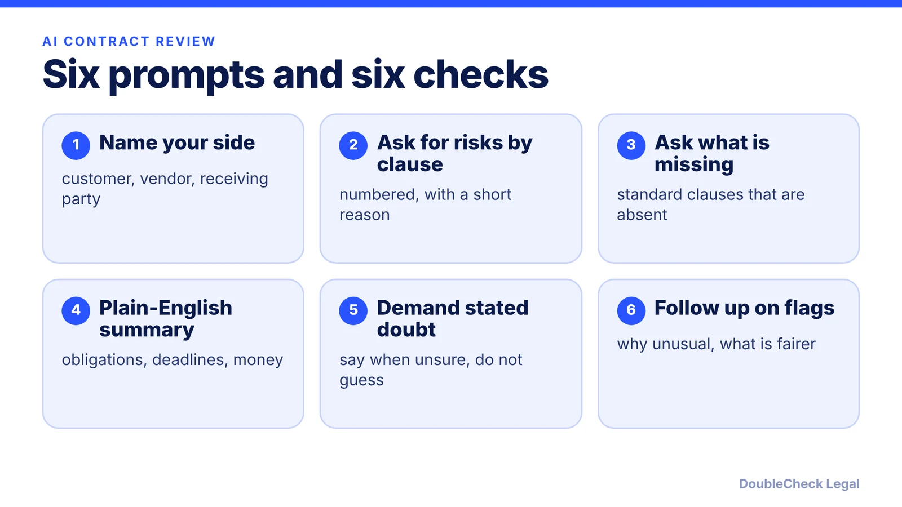
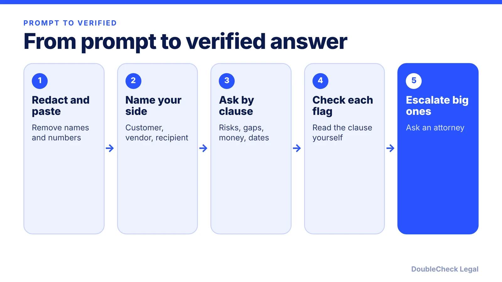

*How to prompt any AI model for a contract first pass, and the checks that turn its answer into something you can rely on, as of November 2026.*

**Key takeaways:**

- Tell the model your side, the deal context and the output format; ask for risks, missing clauses and questions, not approval.
- Use one prompt per job: summary, risk scan, missing clauses, money and dates, follow-ups, questions for the other side.
- Verify roles, every flagged clause, any legal claim and the blind spots AI often misses, such as renewal windows and survival clauses.
- For high-stakes contracts, get an independent attorney to verify; prompts work in any model, open or closed.

## 1. The quick answer

**Quick answer:** The best AI contract review prompts tell the model who you are, what the deal is, and what output you want, then ask it to flag risks, missing clauses and questions rather than to approve the contract. Good prompts name your side (customer, vendor, receiving party), ask for a numbered answer by clause, and tell the model to say when it is unsure. Then you verify: confirm the parties, read every flagged clause yourself, trace any legal claim to a source, and check the blind spots AI tends to miss. The same prompts work in any chatbot, open or closed; the checking is what protects you.

## 2. What a good contract review prompt contains

A prompt is a short brief to a fast reader who knows nothing about your deal. A well-structured prompt specifies the task (summarize, compare or rewrite), defines your standards (such as fallback positions or risk appetite) and asks for a clear output format such as a table or list. Without your standards, the model can only guess what "good" looks like.

A reusable skeleton:

- **Role and side.** "I am the customer in this software agreement." For an NDA, say whether you are the disclosing or receiving party; for a services agreement, say whether you are the customer or the vendor.
- **Context.** Deal size, how long you have worked with the other side, what you cannot accept, and any term sheet or email that set the deal.
- **Structure.** Ask for numbered sections, for example parties, term, payment, termination, liability cap, indemnity, IP, data and governing law.
- **Honesty instruction.** The same tutorial tells the model not to fabricate legal standards and to say when it is unsure whether a clause is market standard.
- **Jurisdiction.** Name your state and ask the model to flag state-specific concerns, since enforceability of some clauses varies by state.

Keep one prompt per job. A summary prompt and a risk prompt give cleaner answers than one giant request. For the confidentiality side of this step, redact before you paste: see [what to redact before pasting a contract into AI](/blog/what-to-redact-before-pasting-a-contract-into-ai/) and [uploading contracts to ChatGPT and confidentiality](/blog/uploading-contracts-to-chatgpt-confidentiality/). Redaction can also remove what you need; masking a liability cap, for instance, stops the model from judging whether it fits your risk appetite. Redact names and identifiers, not the numbers you need analyzed.

## 3. Prompts to ask, in order

Here are six prompts, in the order that tends to work. Adapt the brackets.

1. **Plain-English summary.** "Summarize this contract for a non-lawyer. Group the result into what I must do, what the other side must do, money and dates, and risks."
2. **First-pass risk scan.** A useful sample prompt asks the model to flag clauses that could expose a party to legal, commercial or financial risk, with a short explanation and a mitigation for each. Add: "I am the [customer/vendor]. Number each flag and quote the clause."
3. **Missing clauses.** "List standard clauses for a [type] agreement that are absent from this draft and explain why each matters." This check covers the gap a summary cannot: a summary will not tell you what the contract failed to include.
4. **Money and dates.** "List every payment, fee, deadline, notice period and renewal date, with the section number." Pair this with [auto-renewal clauses](/blog/auto-renewal-clauses-business-contracts/) and your calendar.
5. **Follow-up on each flag.** The tutorial suggests asking what makes the clause unusual, what risk it creates and what more balanced wording would look like.
6. **Questions for the other side.** "Draft five plain questions I could send the counterparty about the clauses you flagged."

For the specific clauses to point the model at, use the checklist in [AI contract review: what to check before signing](/blog/ai-contract-review-what-to-check-before-signing/) and the warning signs in [contract red flags for small business](/blog/contract-red-flags-small-business/). For deeper clause questions, see [limitation of liability](/blog/limitation-of-liability-clause-explained/) and [indemnification](/blog/indemnification-clause-explained-small-business/).

## 4. What to verify after the AI answers

A confident answer is not a checked answer. The tutorial lists verification steps that match what most careful reviewers do:

- **Check the roles.** Confirm the model identified who is who. A reversed customer and vendor flips every risk call.
- **Read every flag.** Open the clause and make sure you understand the risk it describes. Do not rely on the model's paraphrase.
- **Ask for the basis of legal claims.** Any statement about a legal standard should be traced to a source and checked independently before you rely on it. Hallucinated authorities are a known problem; see [AI hallucinated citations for business](/blog/ai-hallucinated-citations-business/).
- **Check the numbers.** Dates, amounts, section references and defined terms should match the document.
- **Check known blind spots.** The tutorial says AI often misses evergreen renewal windows, defined terms that differ from their everyday meaning, interactions between indemnity and insurance, survival clauses, and conflicts between exhibits and the main body. Search for these manually.

The ABA gives a useful rule even though it is written for lawyers. Per the NCBE Bar Examiner summary of ABA Formal Opinion 512 (July 2024), the level of verification depends on the tool and the task, document review calls for more independent checking than brainstorming, and generative AI tools cannot solely substitute for a lawyer's competent work. Treat your own contract the same way: the higher the stakes, the more you verify.

A second model can help find disagreements; see [cross-checking a contract with two AI models](/blog/cross-check-a-contract-with-two-ai-models-method/). That method is about comparing outputs; this post is about what to ask in the first place. Neither replaces reading the contract. For the general verification habit, see [verifying AI-generated legal documents](/blog/verify-ai-generated-legal-document/).

## 5. Choosing a tool and knowing when to stop

Prompts are model-agnostic. They work in closed chatbots, in open-weight models you run yourself and in contract-specific products. The tradeoffs are about data handling, not magic wording: where the text goes, what the provider retains, whether inputs are used for training, and whether you have a business agreement. Read the terms for your plan, since consumer and business plans differ. See [open-source vs closed-source AI models](/blog/open-source-vs-closed-source-ai-models-which-should-you-use/), [running AI locally for privacy](/blog/run-ai-locally-for-privacy-ollama-lm-studio-small-business/) and [how to choose an AI model for business](/blog/how-to-choose-an-ai-model-for-business-privacy-cost-quality/). Also be aware that vendor claims about no-training or security certifications are the vendor's representations; the tutorial says to confirm them directly.

AI is a poor fit as the only reviewer in some cases. Avoid relying on it alone for bespoke, high-value or strategic agreements and for contracts involving litigation, regulatory exposure or IP transfers. ABA Formal Opinion 512 says how much independent review is needed depends on the tool and the task, and that lawyers should not rely uncritically on generative AI output. These are practical cautions, not rules of law for non-lawyers, but they match common sense.

**Self-handle vs. get an attorney:**

- Low stakes, standard form, you can walk away: AI first pass plus your own read is often reasonable.
- Meaningful money, exclusivity, IP, personal guarantees, data or regulated activity: get an attorney to verify the AI work. See [lawyer review of a ChatGPT contract](/blog/lawyer-review-chatgpt-contract/), [how much a lawyer charges to review a contract](/blog/how-much-does-a-lawyer-charge-to-review-a-contract/) and [handing off an AI-drafted document to an attorney](/blog/hand-off-an-ai-drafted-legal-document-to-an-attorney-package/).

Bring your prompts, the model answers and your list of unresolved questions. It makes the attorney's time cheaper and more focused.

## Where DoubleCheck fits

[DoubleCheck](https://www.contactdoublecheck.com) helps businesses and founders start legal work with AI, verify it, and, when professional advice is warranted, connect with an independent attorney, including for immigration questions. Attorney availability and practice areas vary. Attorneys on DoubleCheck are independent professionals; an attorney-client relationship forms only if an attorney accepts your engagement.

**Sources:** [NCBE Bar Examiner, Generative Artificial Intelligence Tools (ABA Formal Opinion 512)](https://thebarexaminer.ncbex.org/article/fall-2024/generative-artificial-intelligence-tools/); [Thomson Reuters Institute, What to check in AI-generated legal work](https://www.thomsonreuters.com/en/institute/articles/ai-generated-legal-work); [Thomson Reuters, How generative AI can enhance your legal work without compromising ethics](https://legal.thomsonreuters.com/blog/how-genai-can-enhance-your-legal-work-without-compromising-ethics/).

## FAQ

**What are good AI contract review prompts?**

A good prompt specifies the task, your standards and the output format. Name your side, ask for numbered risk flags by clause, ask what clauses are missing and tell the model to say when it is unsure.

**Can I trust the answer an AI gives about my contract?**

Treat it as a first pass. Confirm the parties and their roles, read every flag and trace any legal claim to a source. Thomson Reuters advises verifying AI output against primary sources, and anything high-stakes should be checked by an attorney.

**What does AI often miss in a contract?**

AI can miss things, so search for them yourself: evergreen renewal windows, defined terms that differ from everyday meaning, indemnity and insurance interactions, survival clauses and conflicts between exhibits and the main body.

**Do I need a special model or a contract-review tool?**

No. The prompts work in any capable chatbot, open or closed. The choice affects data handling and cost, so read the terms for your plan and redact sensitive details first.

**Should I redact before pasting a contract into AI?**

Usually yes for consumer tools. Consider replacing names, dates and confidential terms with placeholders, keeping in mind that redaction can hide what the model needs to judge, such as a liability cap. ABA Formal Opinion 512 tells lawyers to assess confidentiality risk and review a tool's terms before entering client information. Check any confidentiality clause in the contract first.

---

*General information only. This article is not legal, tax, investment, or accounting advice.*
