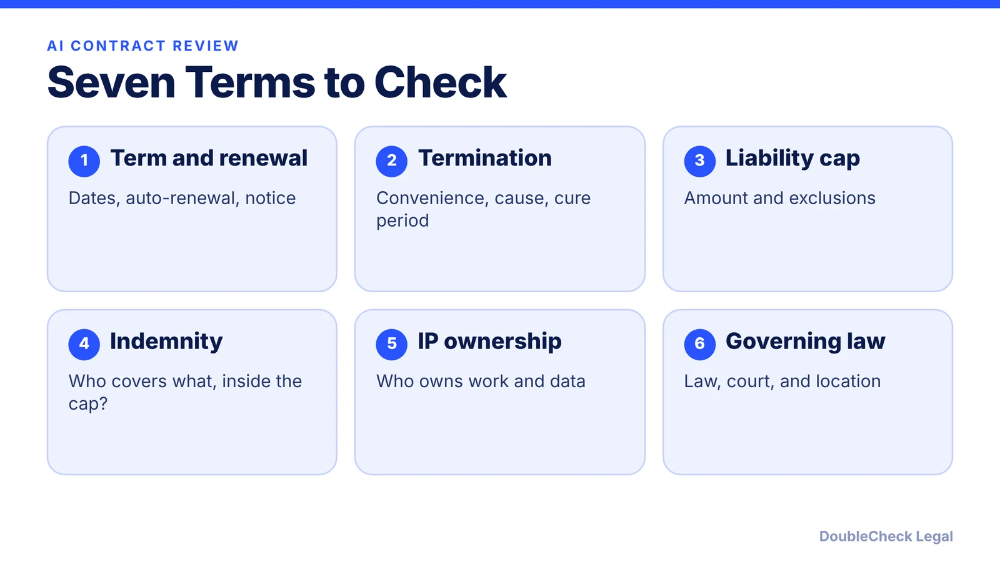
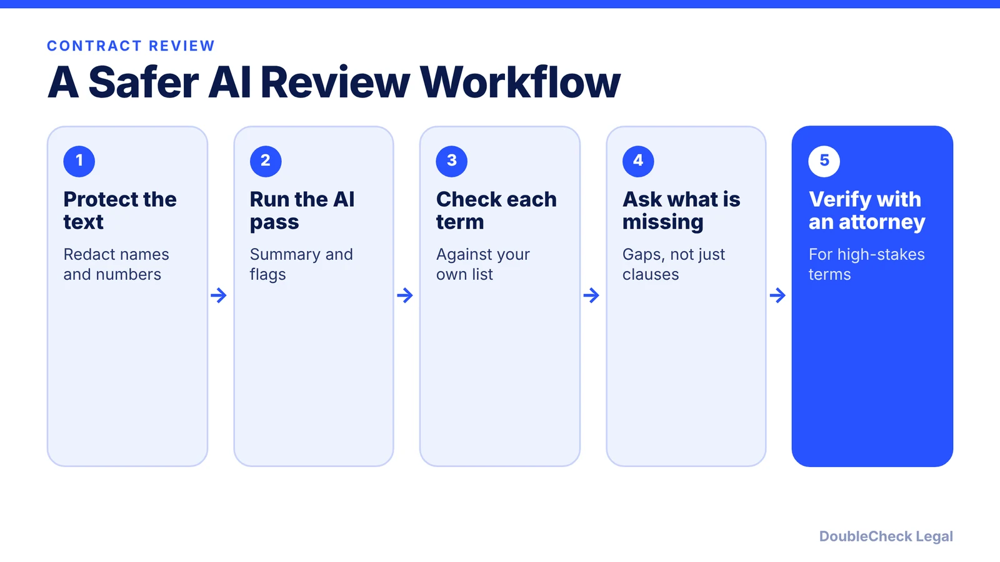

*AI is a fast first reader, not a final one. Here is a checklist and the privacy risks to know.*

**Key takeaways:**

- AI is useful for summaries and flagging clauses but can be wrong and cannot see what is missing.
- Check term, termination, renewal, liability cap, indemnity, IP, and governing law yourself.
- Public AI chats may not be confidential or privileged; check the tool's terms before pasting.
- Have an attorney verify high-stakes contracts.

## 1. The quick answer

**Quick answer:** AI can summarize a contract, flag unusual clauses, and draft questions to ask, which makes it a fast first pass. It cannot know your business goals, the law of your state, or what is missing, and it can be confidently wrong. Before you sign, check seven terms yourself (term, termination, renewal, liability cap, indemnity, IP, governing law), be careful what you paste into consumer AI tools, and have an attorney verify anything high-stakes.

## 2. What AI can and cannot do in contract review

**Where AI helps:** plain-English summaries, finding clauses fast, comparing your draft to a checklist, spotting terms that look one-sided, and suggesting redlines or questions for the other side. It is useful for understanding what you are about to sign. See [AI contract review for small business](/blog/ai-contract-review-small-business/) and [contract red flags](/blog/contract-red-flags-small-business/).

**Where it falls short:**

- **Accuracy.** A Stanford study of commercial legal research tools found they hallucinated on 17% to 33% of queries, per VentureBeat (June 2024). That study tested legal research, not contract review, but it shows that even purpose-built legal AI makes mistakes.
- **Missing context.** AI does not know your deal leverage, your industry rules, or what the other side already agreed to by email.
- **Omissions.** A summary will not tell you what the contract failed to include.
- **Jurisdiction.** Enforceability of clauses such as non-competes and limitation of liability differs by state.

ABA Formal Opinion 512 (July 29, 2024) tells lawyers that the level of verification depends on the task and that document review calls for more independent checking than brainstorming. That is a good rule for anyone: the higher the stakes, the more you verify. For how the leading chatbots compare, see [ChatGPT vs. Claude vs. Gemini for legal work](/blog/chatgpt-vs-claude-vs-gemini-legal-work/). The same discipline applies outside contracts; see [checking immigration documents with AI before filing](/blog/check-immigration-documents-with-ai-before-filing/).

## 3. The seven-term checklist

Bind Legal's contract review checklist and TermScout's IT contract checklist agree on the core items. Use them as prompts for the AI and for your own read:

- **Term and renewal.** Confirm start and end dates, whether it renews automatically, and the notice period to stop renewal. Bind Legal advises putting the notice date in your calendar. TermScout flags auto-renewal with no opt-out.
- **Termination.** Can either side terminate for convenience, and on what notice? How is material breach defined, is there a cure period, and what happens to payments, data, and transition help? Without any customer termination right you may have no exit if the vendor underperforms (TermScout).
- **Liability cap.** Is there a cap, how is it calculated, and does it apply to both sides? Bind Legal says to read the exclusions together with the cap, since they often hold the real risk. TermScout treats a vendor cap below 12 months of fees as a flag.
- **Indemnity.** Who indemnifies whom, and for what? Is it inside or outside the cap? TermScout says a vendor should at least indemnify for IP infringement and that this should sit outside the cap.
- **IP.** Who owns what is created under the contract, and what license does the other side receive? A vendor claiming ownership of your data is a flag (TermScout).
- **Governing law and venue.** Which law applies and where disputes are heard. Bind Legal warns a foreign forum can make a small claim impossible to pursue.
- **Before signing.** Confirm the final version matches what you approved, the signer has authority, and all exhibits are attached (Bind Legal).

## 4. Confidentiality, privilege, and why verification matters

**What you paste may not stay private.** In *United States v. Heppner* (S.D.N.Y., February 2026), a federal court held a defendant's conversations with a public AI assistant were not protected by attorney-client privilege; we summarize it in [AI chats are not privileged](/blog/ai-chats-not-privileged-heppner/). It is one ruling on specific facts, but it is a warning. Frantz Ward explains that putting client information into a public tool without an enterprise agreement may count as disclosure to a third party, which could waive privilege, and that risk rises when the terms let the provider retain or use inputs. A Daily Journal analysis adds that chats with consumer AI may be discoverable and recommends tools with no-retention modes and contractual promises that inputs will not be used for training.

ABA Formal Opinion 512 says lawyers must assess the risk that others could access information entered into a generative AI tool, and that self-learning tools may require informed client consent before client information is entered. If lawyers have those duties, you should apply the same care to your contracts, which may include pricing, customer names, and trade secrets. Some contracts also have their own confidentiality clauses that forbid sharing them with third parties; check before pasting. See [using AI for legal work safely](/blog/small-business-ai-legal-work-safely/).

**Why attorney verification matters.** AI can be wrong, can miss context, and does not owe you professional duties. A licensed attorney can confirm what the clauses mean in your state, tell you which to negotiate, and take responsibility for the advice. Use AI to get organized, then [lawyer-review your AI-assisted contract](/blog/lawyer-review-chatgpt-contract/) when the money or risk is meaningful, and see [verifying AI-generated legal documents](/blog/verify-ai-generated-legal-document/).

## Where DoubleCheck fits

[DoubleCheck](https://www.contactdoublecheck.com) helps businesses and founders start legal work with AI, verify it, and, when professional advice is warranted, connect with an independent attorney, including for immigration questions. Attorney availability and practice areas vary. Attorneys on DoubleCheck are independent professionals; an attorney-client relationship forms only if an attorney accepts your engagement.

**Sources:** [VentureBeat: Stanford study on AI legal research tools](https://venturebeat.com/ai/stanford-study-finds-ai-legal-research-tools-prone-to-hallucinations); [NCBE Bar Examiner: ABA Formal Opinion 512 summary](https://thebarexaminer.ncbex.org/article/fall-2024/generative-artificial-intelligence-tools/); [Frantz Ward: Privilege and generative AI](https://www.frantzward.com/privilege-considerations-when-using-generative-artificial-intelligence-in-legal-practice/); [Daily Journal: AI chats aren't privileged](https://www.dailyjournal.com/articles/387206-ai-chats-aren-t-privileged-what-california-lawyers-need-to-do-now); [Bind Legal: Contract review checklist](https://bindlegal.com/resources/guides/contract-review-checklist/); [TermScout: IT contract review checklist](https://blog.termscout.com/contract-review-checklist-19-crucial-clauses-for-it-contracts).

## FAQ

**Can AI review a contract for me?**

It can give a useful first pass, but not a final answer. A Stanford study of commercial legal research tools found hallucinations on 17% to 33% of queries, per VentureBeat, so verify important points.

**Is it safe to paste a contract into ChatGPT?**

Not automatically. Frantz Ward notes that entering information into a public tool without an enterprise agreement may count as disclosure to a third party, and the terms on retention and training matter. Redact sensitive details first.

**Are my AI chats attorney-client privileged?**

Not by default. In United States v. Heppner (S.D.N.Y., February 2026), a court held a defendant's chats with a public AI assistant were not privileged. It is one ruling, but treat chats as potentially discoverable.

**Which contract terms matter most?**

Per Bind Legal and TermScout: term and renewal, termination, liability cap and exclusions, indemnity, IP ownership, and governing law and venue.

---

*General information only. This article is not legal, tax, investment, or accounting advice.*
