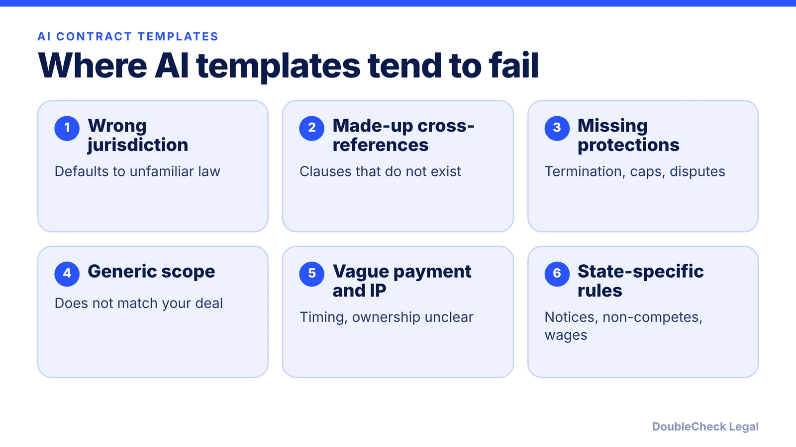
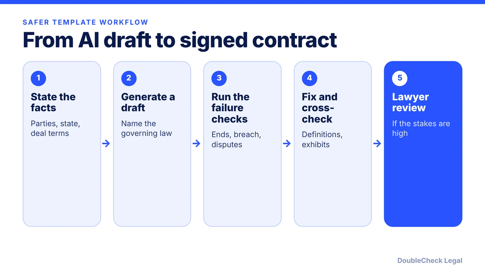

*AI templates read like real contracts, which is exactly why their gaps are easy to miss. Here is where they fail and how to check them.*

**Key takeaways:**

- Common failures: wrong jurisdiction, invented cross-references, missing termination and liability terms, vague payment and IP.
- State rules, such as extra wage notices or non-compete limits, are easy for a generic template to miss.
- Legal-AI studies cited by LLRX show meaningful hallucination rates, mostly on legal research tasks.
- Use templates for low-stakes paperwork; get an attorney for high-stakes or state-specific contracts.

## 1. The quick answer

**Quick answer:** AI-generated contract templates fail in predictable places: they default to the wrong jurisdiction, cite clauses that do not exist, omit protections such as termination and liability caps, leave payment and IP terms vague, and miss state-specific rules. They also read fluently, which makes errors easy to trust. Use a template as a first draft, check it against your actual deal, and have an independent attorney review any contract where a mistake would be expensive.

## 2. The failure modes, one by one

Lawpath, an Australian legal platform, lists common problems in contracts written by ChatGPT or Claude. The examples are Australian, but the patterns apply anywhere:

- **Jurisdiction mismatch.** AI often defaults to US law and wording, so the governing-law clause may not name the right state or country.
- **Invented cross-references.** A draft may cite a schedule, clause, or definition that does not exist.
- **Missing protections.** Dispute resolution, termination for convenience with a notice period, termination for cause, and liability caps are often left out.
- **Lopsided indemnities.** A broad indemnity may favor one side without saying so.
- **Unclear payment terms.** The draft may not say when invoices are triggered or what is included.
- **Vague IP ownership.** Who owns work product, and when ownership passes, may be unclear.

Lawpath also warns against trusting polished writing, asking the same AI to check its own output, and skipping schedules and definitions, where errors often hide. A good test: ask how the contract ends, what happens on breach, and how disputes get resolved. If you cannot find those answers in plain words, the template is not ready.

For a deeper review routine, see [AI contract review: what to check before signing](/blog/ai-contract-review-what-to-check-before-signing/) and [contract red flags for small businesses](/blog/contract-red-flags-small-business/).

## 3. Why local law and the legal-research record matter

Templates fail most quietly on local rules. Cooley GO notes that some states require extra documents with an employment offer: California requires an additional wage notice for nonexempt employees, and New York requires notice of the wage rate for all new hires. A generic template will not include what your state requires unless you ask.

The same applies to restrictive covenants. After the FTC abandoned its appeal in September 2025, per Mondaq, enforceability largely turns on state law. Our [non-compete state guide](/blog/non-compete-agreements-by-state-2026/) shows how different states are, and a template that says one thing cannot be right everywhere.

Research on legal AI gives a sense of the error risk, though most of it tests legal research, not contract drafting. Per LLRX's 2026 review of the literature:

- Dahl et al. tested 2023 models on more than 800,000 legal questions and found hallucination rates of 58% to 88%.
- Magesh et al. found Lexis+ AI hallucinated 17% of the time, Westlaw AI-Assisted Research 33%, and GPT-4 43%.
- Curran et al. found rates varied by location on identical scenarios: 45% for Los Angeles, 55% for London, and 61% for Sydney.

LLRX warns that current tools may differ from the 2023 to 2025 models tested. The lesson for templates is narrower than any single number: jurisdiction affects accuracy, so state your jurisdiction, then verify it.

## 4. When a template is fine and when it is not

Templates are reasonable for low-stakes, standard paperwork where you understand every term, such as an NDA you will review closely (see [how to write an NDA](/blog/how-to-write-an-nda-startups/) and [review an NDA you received](/blog/review-nda-you-received/)). Hire a lawyer or at least get one to review when the contract:

- involves significant money or a long term, such as a lease, partnership, or master services agreement (see [how to write a partnership agreement](/blog/how-to-write-a-partnership-agreement/));
- includes personal guaranties, indemnities, or exclusivity;
- governs ownership of your IP or equity;
- depends on state-specific rules, such as employment documents; or
- will be signed by many customers, so one error repeats at scale.

When a lawyer reviews your AI draft, bring the facts, your goals, and the questions your own checks raised. Tell them the document came from AI. Our guides on [lawyer review of a ChatGPT contract](/blog/lawyer-review-chatgpt-contract/), [what review costs](/blog/how-much-does-a-lawyer-charge-to-review-a-contract/), and [verifying an AI-generated legal document](/blog/verify-ai-generated-legal-document/) walk through the process. For the bigger picture, read [7 things to know about AI legal documents](/blog/ai-legal-documents-7-things-to-know/).

## Where DoubleCheck fits

[DoubleCheck](https://www.contactdoublecheck.com) helps businesses and founders start legal work with AI, verify it, and, when professional advice is warranted, connect with an independent attorney, including for immigration questions. Attorney availability and practice areas vary. Attorneys on DoubleCheck are independent professionals; an attorney-client relationship forms only if an attorney accepts your engagement.

**Sources:** [Lawpath, how to review a contract written by ChatGPT or Claude](https://lawpath.com.au/blog/review-ai-written-contract); [LLRX, what the science says about hallucinations in legal research](https://www.llrx.com/2026/02/what-the-science-says-about-hallucinations-in-legal-research/); [Cooley GO, drafting offer letters](https://www.cooleygo.com/drafting-offer-letters/); [Mondaq, FTC abandons non-compete rule](https://www.mondaq.com/unitedstates/employee-rights-labour-relations/1706482/ftc-officially-abandons-prior-non-compete-rule-but-its-work-on-this-issue-isnt-over-yet).

## FAQ

**Are AI-generated contract templates legally valid?**

A contract's validity depends on its terms, the parties, and applicable law, not on whether AI wrote it. The risk is that an AI draft may be incomplete or wrong for your state, so verify it and consider attorney review.

**What are the most common mistakes in AI-written contracts?**

Per Lawpath: jurisdiction mismatch, invented cross-references, missing termination and dispute provisions, lopsided indemnities, unclear payment terms, and vague IP ownership.

**Does AI hallucinate in legal work?**

Yes. Per LLRX's 2026 review, Magesh et al. found Lexis+ AI hallucinated 17% of the time and Westlaw AI-Assisted Research 33% on legal research queries. These studies test research, not contract drafting, and tools change.

**Can I ask the AI to check its own contract?**

You can, but Lawpath warns against asking the same AI to check its own output. Use a separate check against your deal terms, then a lawyer for high-stakes contracts.

---

*General information only. This article is not legal, tax, investment, or accounting advice.*
