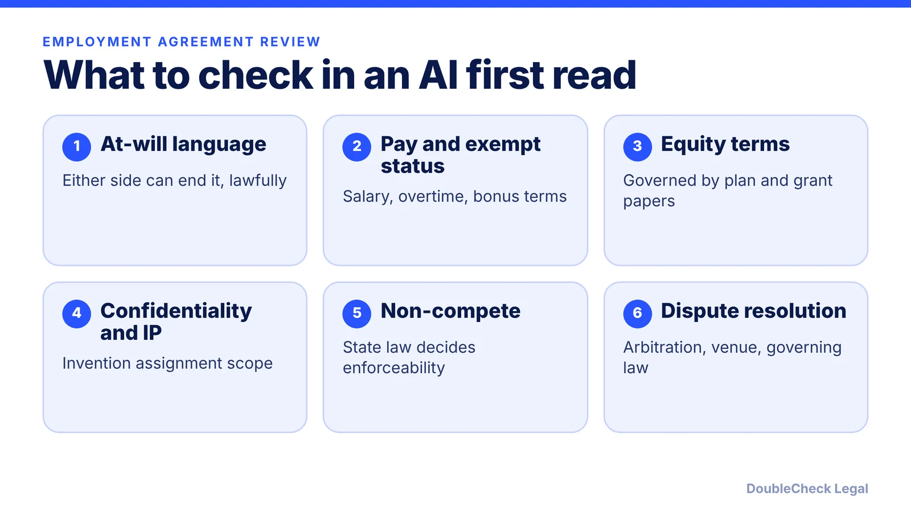
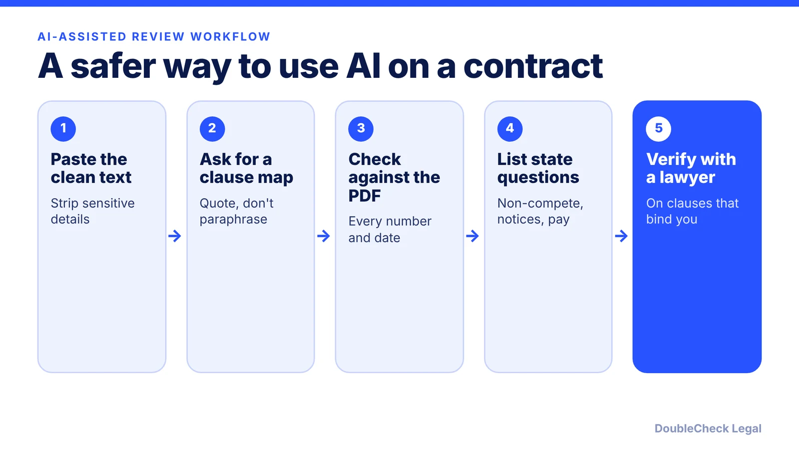

*AI can give you a fast first read of an employment agreement. Here is the checklist of terms to verify before you sign or send one.*

**Key takeaways:**

- Use AI to map and summarize clauses, not to decide whether they are enforceable.
- At-will applies in 49 states plus D.C. per TriNet, but public-policy, implied-contract, and good-faith limits still exist.
- Pay classification, equity, and invention assignment terms need exact wording, and some states require extra notices.
- Non-compete enforceability is a state-law question; the FTC rule is not in effect.

## 1. The quick answer

**Quick answer:** AI is useful for a first read of an employment agreement or offer letter: it can summarize the terms, flag clauses to ask about, and draft questions. It cannot know your state's rules, your job's facts, or what a court would enforce. Check five areas before you sign or send: at-will language, pay and classification, equity and bonus terms, confidentiality and invention assignment, and any non-compete or arbitration clause. Treat the AI output as a reading aid, then verify the high-stakes clauses with a licensed attorney in the relevant state.

## 2. At-will, implied promises, and what AI tends to gloss over

At-will employment means either side can end the relationship at any time, with or without notice or reason, as long as the reason is lawful. Per TriNet's state guide (table current as of July 2026), it applies in 49 states plus D.C.; Montana is the exception, where employers need good cause after a probation period that defaults to 12 months and cannot exceed 18.

Even in at-will states, three limits matter when you read a draft:

- **Public policy:** a firing for refusing illegal activity, jury service, a workers' comp claim, or whistleblowing can be unlawful.
- **Implied contract:** per TriNet, oral promises of termination only "for cause," handbook language on progressive discipline, or long tenure plus regular promotions can imply continued employment. Clear at-will language in offer letters and handbooks reduces that risk.
- **Good faith:** recognized in only a few states, and it may apply to a firing just before a bonus or commission is earned.

Ask the AI to quote every sentence that mentions duration, termination, notice, severance, or "for cause." Employers should also avoid wording that implies a fixed term, a point Cooley GO makes in its offer-letter guidance. Employees should flag any promise that appears only in an email or conversation, not in the signed document. For offer letters specifically, see our guide to [drafting a job offer letter with AI](/blog/draft-job-offer-letter-with-ai/).

## 3. Pay, equity, confidentiality, and the clauses with legal consequences

Cooley GO's list of what a strong offer letter covers is a practical checklist for either side:

- **Exempt or nonexempt:** an exempt role should say the employee is not eligible for overtime. A nonexempt role should address recorded hours and pre-approved overtime. Cooley also notes that some states require extra notices, for example California's additional wage notice for nonexempt employees and New York's wage-rate notice for all new hires. A generic template can miss these.
- **Equity:** brief terms such as share count and vesting, stated as governed by the equity plan and grant agreement. Unqualified promises ("you will receive 1%") are a problem for employers and a reason for employees to ask for the grant paperwork.
- **Bonus and commissions:** the plan or the discretion language that controls them.
- **Confidentiality and invention assignment:** a signed agreement as a condition of employment. Read how broadly "inventions" is defined and whether it reaches work done on your own time. See [confidentiality and IP assignment agreements](/blog/confidentiality-ip-assignment-agreements-startups/).
- **Prior-employer restrictions:** a bar on using a former employer's confidential information, and a duty to disclose existing non-competes.
- **Contingencies:** background checks and proof of U.S. work eligibility.

Cooley also suggests consulting counsel before including arbitration or any non-compete or non-solicitation terms.

## 4. Non-competes: the clause where AI is most likely to mislead

There is no federal non-compete ban to rely on. Per Mondaq's summary, the FTC abandoned its appeal in *Ryan LLC v. FTC* in September 2025, ending its defense of the rule, and enforceability now largely turns on state law, which is changing. A model trained on older text may describe the 2024 FTC rule as if it were in force, so ask it for the date of any rule it cites and check that date yourself.

State rules vary widely: some states void most employee non-competes, others use income thresholds or notice periods. Our [state-by-state non-compete guide](/blog/non-compete-agreements-by-state-2026/) and [non-compete overview](/blog/noncompete-agreements-2026-small-business/) cover the picture, and the same clause can be enforceable in one state and void in another.

Before signing, also confirm the governing-law and venue clauses, because they decide which state's rules apply to a dispute. If a document will bind you or your company, use the general approach in [how to verify an AI-generated legal document](/blog/verify-ai-generated-legal-document/) and the [7 things to know about AI legal documents](/blog/ai-legal-documents-7-things-to-know/). For a draft you plan to send to a new hire, an independent attorney in your state can confirm the pieces that depend on local law. Related: the [employee handbook guide](/blog/employee-handbook-small-business-what-to-include/) and [how to terminate an employee legally](/blog/how-to-terminate-an-employee-legally-small-business/).

## Where DoubleCheck fits

[DoubleCheck](https://www.contactdoublecheck.com) helps businesses and founders start legal work with AI, verify it, and, when professional advice is warranted, connect with an independent attorney, including for immigration questions. Attorney availability and practice areas vary. Attorneys on DoubleCheck are independent professionals; an attorney-client relationship forms only if an attorney accepts your engagement.

**Sources:** [TriNet, at-will employment by state](https://www.trinet.com/insights/at-will-employment-states); [Cooley GO, drafting offer letters](https://www.cooleygo.com/drafting-offer-letters/); [Mondaq, FTC abandons non-compete rule](https://www.mondaq.com/unitedstates/employee-rights-labour-relations/1706482/ftc-officially-abandons-prior-non-compete-rule-but-its-work-on-this-issue-isnt-over-yet).

## FAQ

**Can I use ChatGPT to review my employment agreement?**

Yes for a first read: summaries, clause maps, and questions to ask. It is not a substitute for a licensed attorney's advice on enforceability, and you should check every number, date, and defined term against the signed document.

**What does at-will employment mean?**

Per TriNet, either the employer or the employee can end the relationship at any time, with or without notice or reason, as long as the reason is lawful. It applies in 49 states plus D.C.; Montana requires good cause after probation.

**Are non-compete clauses enforceable in 2026?**

It depends on the state. Per Mondaq, the FTC abandoned its appeal defending its rule in September 2025, so enforceability largely turns on state law. See our state-by-state guide and check the worker's state.

**What should an offer letter include?**

Per Cooley GO: position and supervisor, work location, exempt or nonexempt status, pay, equity and bonus terms tied to plan documents, at-will status, a confidentiality and invention assignment agreement, prior-employer restrictions, and contingencies.

---

*General information only. This article is not legal, tax, investment, or accounting advice.*
