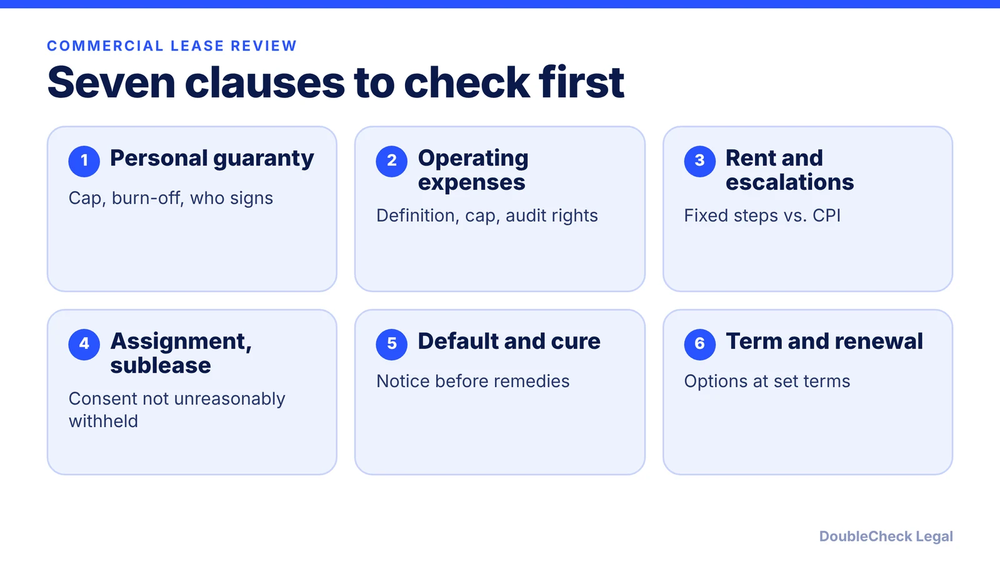
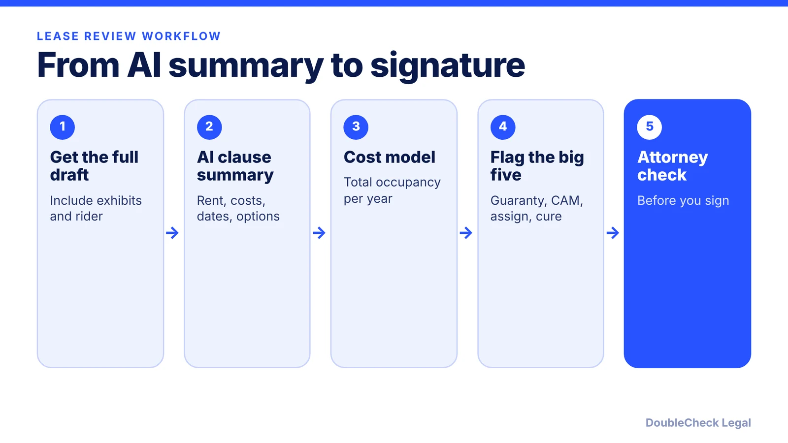

*AI can summarize a commercial lease in minutes. Here is what it does well, which clauses carry personal risk, and what to verify before signing.*

**Key takeaways:**

- Use AI to summarize terms, find defined terms, and draft questions, not to approve the lease.
- Personal guaranties, operating expenses, assignment, and notice-and-cure carry the most risk, per Taft.
- Build a total-cost model and check every AI-quoted number against the signed text, including exhibits.
- Take open questions to an independent attorney in the property's state.

## 1. The quick answer

**Quick answer:** AI can read a commercial lease quickly, summarize the rent schedule and key dates, and point to clauses worth questioning. It cannot see your property, your landlord's track record, or local law, and a lease is often a multi-year commitment that can reach your personal assets. Use AI to build a clause-by-clause summary, then have an independent attorney check the clauses that carry the most money and personal liability: the guaranty, operating expenses, assignment, default and cure, and renewal terms.

## 2. What AI does well on a lease

A lease is long, repetitive, and full of defined terms, which suits a language model. Reasonable uses:

- **Summarize** the term, base rent, escalations, deposit, and key dates into a one-page table.
- **Find defined terms** such as "operating expenses" and show every place they are used.
- **Compare** the landlord's draft with your letter of intent and list differences.
- **Draft questions** for the broker or landlord.

Per Taft's guidance for tenants, the lease type matters: net, gross, modified gross, or triple net determines who pays shared property costs. Beancount.io, a secondary source, adds that "modified gross" has no standard definition, so every shared cost should be in writing. Ask the AI to state, in your words, which costs you pay beyond base rent, and verify the answer against the text.

The weakness is context. A model does not know that your build-out will take four months, that the landlord is a new entity, or that the center has a competitor tenant. Those facts change which clauses are dangerous. Our general guidance applies: see [AI contract review for small business](/blog/ai-contract-review-small-business/) and [contract red flags](/blog/contract-red-flags-small-business/).

## 3. The clauses that carry the money and the personal risk

Taft Law lists seven issues for prospective tenants. These are the ones to ask your AI summary about, and then ask a lawyer about:

- **Personal guaranties.** Landlords often ask owners of newer or weaker-credit businesses to guarantee the lease personally. Taft says to decide early whether that is a deal breaker and to consider alternatives to a full-term guaranty. Per Beancount.io, a guaranty can expose personal assets to "hundreds of thousands of dollars," and options include a dollar cap or a limited period such as the first two years. A law firm explainer from SJKP notes that a guaranty may extend past the original term and that closing an LLC does not automatically discharge an existing guaranty.
- **Operating expenses.** Taft advises that the lease define "operating expenses," explain how they are calculated, and state any cap on your share. Beancount.io reports CAM can add 20% to 40% on top of base rent, and suggests an annual cap (typically 3% to 5%), audit rights, and excluding capital expenditures. SJKP warns that a cap may exclude taxes, insurance, or extraordinary repairs.
- **Rent start date.** Rent may start on a fixed date regardless of build-out progress, or be tied to the landlord finishing improvements. Taft says to address abatement and remedies for delays.
- **Assignment and subletting.** Landlords usually must approve in advance; seek consent that cannot be unreasonably withheld. You will likely remain liable for rent even after assigning.
- **Notice and cure.** Seek notice of default and a chance to cure so a late payment does not become grounds for termination.

Treat the percentages above as examples from a secondary source, not market rules for your city.

## 4. Verification: what to do before you sign

Build a simple cost model first: base rent, escalations, your share of operating expenses, taxes, insurance, and utilities, for each year of the term. Taft also recommends estimating improvement costs with contractor quotes, because a landlord's allowance may not cover the full build-out. Beancount.io suggests budgeting $1,000 to $3,000 for a thorough attorney review; actual fees vary by market and complexity, and our [guide to lawyer review costs](/blog/how-much-does-a-lawyer-charge-to-review-a-contract/) explains the ranges.

Then check the model's claims against the document:

1. Find each number the AI quoted and confirm it in the lease.
2. Confirm the AI read the exhibits, work letter, and any rider, since these often override the main text.
3. Ask a second tool to argue the landlord's side of each clause, then compare.
4. Take your open questions to a licensed attorney in the property's state, where local law applies.

Beancount.io did not cover security deposit terms or subordination and estoppel documents, and the other sources above did not either. Those are common lease provisions, so ask a professional about them. The same verification habits appear in [verify an AI-generated legal document](/blog/verify-ai-generated-legal-document/) and [lawyer review of a ChatGPT contract](/blog/lawyer-review-chatgpt-contract/). If you are buying a business with a lease attached, see the [buy or sell a small business checklist](/blog/how-to-buy-or-sell-a-small-business-legal-checklist/).

## Where DoubleCheck fits

[DoubleCheck](https://www.contactdoublecheck.com) helps businesses and founders start legal work with AI, verify it, and, when professional advice is warranted, connect with an independent attorney, including for immigration questions. Attorney availability and practice areas vary. Attorneys on DoubleCheck are independent professionals; an attorney-client relationship forms only if an attorney accepts your engagement.

**Sources:** [Taft, seven issues for prospective tenants](https://www.taftlaw.com/news-events/law-bulletins/even-the-smallest-commercial-lease-is-a-big-deal-here-are-seven-key-issues-prospective-tenants-need-to-consider-and-address/); [Beancount.io, negotiating a commercial lease (secondary)](https://beancount.io/blog/2026/03/15/how-to-negotiate-commercial-lease-small-business-guide); [SJKP Law, CAM charges and personal guarantees](https://www.daeryunlaw.com/us/insights/lease-lawyer-ca).

## FAQ

**Can AI review a commercial lease?**

It can summarize and flag clauses, but it cannot weigh your facts or local law. Use it for a first pass and have a licensed attorney check the clauses with the most money and personal liability.

**What is a personal guaranty in a commercial lease?**

Per Taft, landlords often ask owners of newer or weaker-credit businesses to personally guarantee lease obligations. Options include a dollar cap or a limited period, per Beancount.io; closing an LLC does not automatically end an existing guaranty, per SJKP.

**What is the difference between gross and triple net leases?**

Per Beancount.io, a gross lease is one flat payment with the landlord covering property costs, while triple net has lower base rent and you pay property taxes, building insurance, and CAM, so total cost varies.

**What should I ask about operating expenses or CAM?**

Ask how operating expenses are defined, how your share is calculated, whether there is a cap, and whether you have audit rights. Per SJKP, an annual cap may exclude taxes, insurance, or extraordinary repairs.

---

*General information only. This article is not legal, tax, investment, or accounting advice.*
