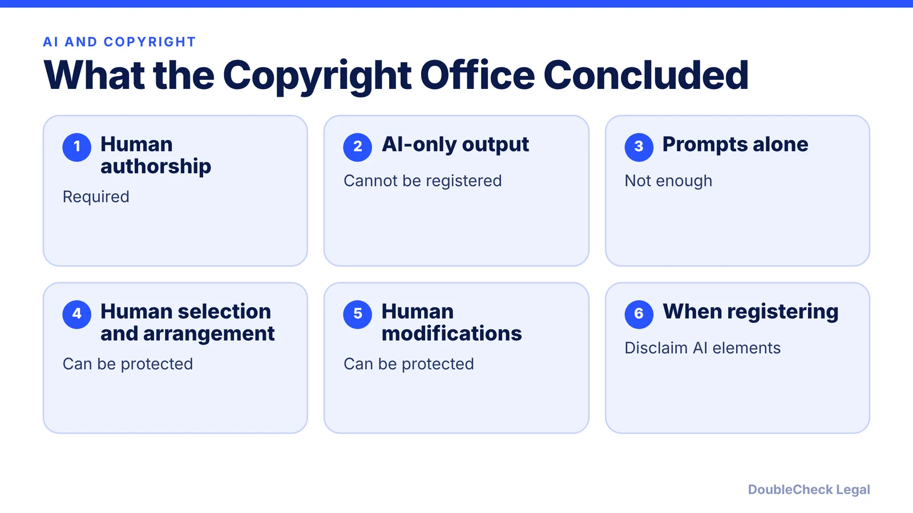
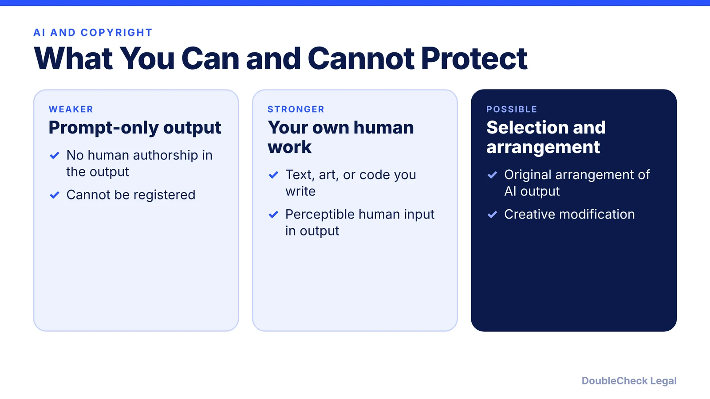
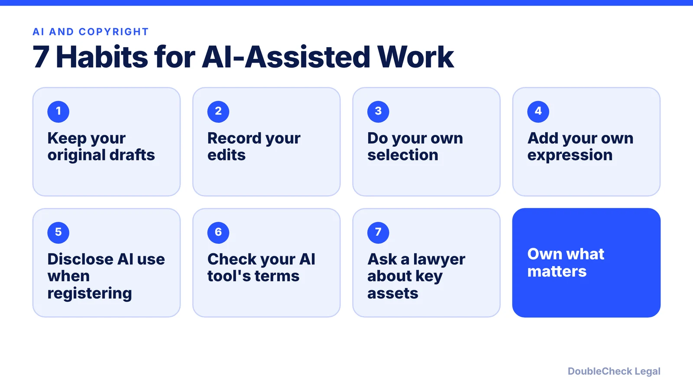

*Using AI to make logos, copy, or code for your business? Here is what the Copyright Office said about who can own it.*

**Key takeaways:**

- Copyright protects only human-authored expression, per the Copyright Office's January 2025 report.
- Prompts alone do not give enough control to count as human authorship.
- Human selection, arrangement, and modification of AI output can be protected.
- Disclaim AI-generated elements when you register.

## 1. The quick answer

**Quick answer:** Under the U.S. Copyright Office's January 29, 2025 report on copyrightability (Part 2), copyright protects only human-authored expression. Output generated wholly by AI cannot be registered, and **prompts alone are insufficient**. Original human selection, arrangement, or modification of AI output can be protected, and applicants should disclaim AI-generated elements when registering.

## 2. What this means for a one-person business

If your logo, product copy, images, or code are generated mostly by AI, you may not be able to stop others from copying them. The report says prompting does not give users enough control over how the AI expresses ideas, and it rejected arguments based on iterative prompting, randomness, and "authorship by adoption." It left open that future tools with tighter human control might change this.

## 3. Practical habits

The Copyright Office cited *Thaler v. Perlmutter*, where the court agreed that AI-only images were unprotected. For code specifically, see [AI-generated code and IP for startup founders](/blog/ai-generated-code-ip-startup-founders/). For the tools themselves, see [AI vendor contract checklist](/blog/ai-vendor-contract-checklist/) and [business owner using AI for legal work](/blog/business-owner-ai-legal-work/).

## 4. What the report did not do

The Office did not recommend new rights for AI-generated output, reasoning that copyright incentives are meant for human authors. This is a summary of one report and not a prediction of how courts will rule; ask an IP attorney about assets that matter to your business.

## Where DoubleCheck fits

[DoubleCheck](https://www.contactdoublecheck.com) is built for businesses that start legal work with AI. Bring your question or draft, use an AI-first workflow to understand and verify it, and when professional advice is warranted, you can connect with an independent attorney. Attorneys on DoubleCheck are independent professionals; an attorney-client relationship forms only if an attorney accepts your engagement.

**Sources:** [Copyright Alliance: Summary of the USCO AI report, Part 2](https://copyrightalliance.org/ai-report-part-2-copyrightability/).

## FAQ

**Can I copyright something ChatGPT or Midjourney made?**

Output generated wholly by AI cannot be registered, and the Copyright Office says prompts alone are insufficient.

**Can I protect AI-assisted work at all?**

Original human selection, arrangement, or modification of AI output can be protected, and human expression perceptible in the output may be protected.

**Do I disclose AI use when registering?**

The report indicates applicants should disclaim AI-generated elements.

**Did the Office propose new AI rights?**

No. It did not recommend new rights for AI-generated output.

---

*General information only. This article is not legal, tax, investment, or accounting advice.*
