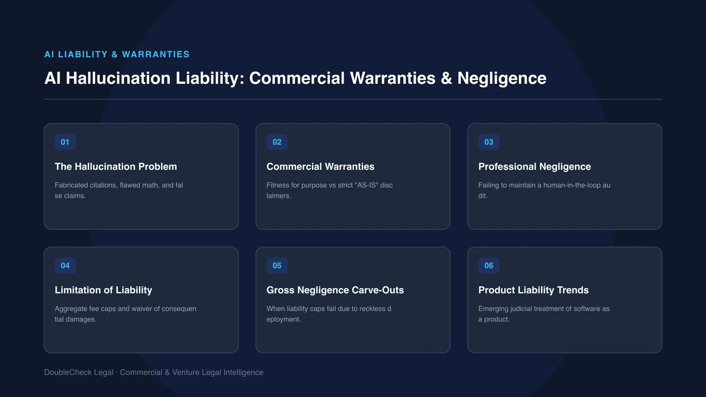
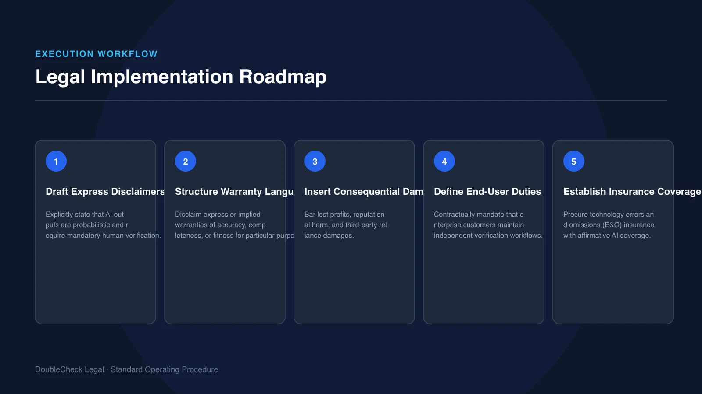

*A comprehensive legal analysis of commercial contract liability, Uniform Commercial Code (UCC) warranties, tort negligence, and risk-allocation strategies surrounding artificial intelligence hallucinations and algorithmic errors.*

**Key takeaways:**
- **Probabilistic Reality:** Large language models are statistical prediction engines, not determinative factual databases; hallucinations are an inherent feature of generative architectures.
- **Contractual Shifting of Risk:** AI vendors aggressively shift accuracy risks onto commercial buyers through express "AS-IS" disclaimers and human-in-the-loop covenants.
- **The Limits of Disclaimers:** Gross negligence, willful misconduct, and consumer protection statutes (such as FTC Act Section 5) cannot be contractually waived through standard software disclaimers.
- **Professional Standard of Care:** Professionals cannot delegate their fiduciary or ethical duties to automated algorithms; human oversight is legally mandatory.

## 1. The quick answer: Who bears the risk of AI hallucinations?

An **AI hallucination** occurs when a generative model outputs assertions, citations, calculations, or code that appear completely authoritative but are factually fabricated:

1. **Vendor Contractual Posture:** Enterprise software vendors disclaim all liability for accuracy, warranting only system availability (uptime SLA) and basic security protocols.
2. **Customer Exposure:** If an enterprise deploys an unverified hallucination into medical triage, credit underwriting, or court filings, **the enterprise bears primary legal and regulatory liability**.
3. **Core Risk Mitigation:** Contracts must establish a **"Human-in-the-Loop" standard**, mandating that internal subject-matter experts review and validate all AI outputs prior to real-world execution.



## 2. In-depth legal analysis: UCC warranties, disclaimers, and tort liability

Allocating the risk of algorithmic error requires analyzing contract law, statutory warranties, and tort negligence.

### A. UCC Article 2 and Implied Warranties
Under Uniform Commercial Code (UCC) §§ 2-314 and 2-315, commercial transactions carry implied warranties of **Merchantability** and **Fitness for a Particular Purpose**. 
- **The Threat:** If a customer purchases an "AI Tax Advisory Copilot" and the software calculates incorrect deductions due to hallucinated statutory thresholds, the customer could claim breach of implied warranty.
- **The Defense:** To be legally enforceable, the disclaimer must be **conspicuous** (typically in all-caps or boldface):

```
"THE SERVICE, INCLUDING ALL GENERATIVE AI OUTPUTS, TEXT, RECOMMENDATIONS, AND DATA GENERATED THEREBY, IS PROVIDED 'AS-IS' AND 'AS-AVAILABLE'. PROVIDER EXPRESSLY DISCLAIMS ALL WARRANTIES, WHETHER EXPRESS, IMPLIED, STATUTORY, OR OTHERWISE, INCLUDING ALL WARRANTIES OF MERCHANTABILITY, FITNESS FOR A PARTICULAR PURPOSE, TITLE, AND ACCURACY."
```

### B. The "Human-in-the-Loop" Allocation Covenant
Enterprise buyers negotiating SaaS agreements should insist on clear delineations of responsibility, while vendors must mandate human oversight:

```
"Customer acknowledges and agrees that the Outputs generated by the Generative AI Service are probabilistic in nature and may contain inaccuracies, hallucinations, or errors. Customer agrees that it shall not rely on any Output without independent review and verification by qualified personnel. Provider shall have no liability whatsoever for any decisions made or actions taken by Customer in reliance upon the Outputs."
```

### C. Tort Negligence and the Non-Delegable Duty
In professional settings, reliance on automated tools is governed by common law tort standards:
- In *Mata v. Avianca, Inc.* (S.D.N.Y. 2023), attorneys were sanctioned under Rule 11 for citing non-existent court opinions generated by ChatGPT. The court ruled that an attorney holds a non-delegable duty to verify every legal assertion.
- Similar standards apply to healthcare providers under HIPAA and state medical malpractice statutes, and to financial institutions under the Fair Credit Reporting Act (FCRA).

| Scenario | Primary Liable Party | Governing Legal Theory | Enforceability of Disclaimer |
|---|---|---|---|
| AI Chatbot quotes wrong price to consumer | Merchant / Enterprise | Promissory Estoppel / Consumer Fraud | Unenforceable against consumers (*Moffatt v. Air Canada*) |
| Enterprise AI generates buggy software code | Enterprise Licensee | Breach of Contract (to end client) | Enforceable between B2B commercial entities |
| AI tool gives erroneous medical dosage advice | Attending Physician | Professional Malpractice / Negligence | Strictly unenforceable (Duty of Care cannot be waived) |
| AI algorithm hallucinates court citations | Attorney of Record | Judicial Sanctions (Rule 11) / Malpractice | Unenforceable (Duty of Competence under ABA Rule 1.1) |

## 3. Step-by-step: How to draft commercial AI agreements to manage hallucination risks



Corporate transactional attorneys should deploy a structured drafting workflow:

### Step 1: Differentiate Input vs Output Warranties
Warrant system inputs (e.g., that the underlying platform contains no malware and does not infringe third-party IP) while strictly disclaiming output accuracy and perfection.

### Step 2: Establish Consequential Damages Waivers
Draft airtight exclusions barring recovery for indirect, incidental, punitive, special, or consequential damages, specifically enumerating lost profits, business interruption, and loss of goodwill.

### Step 3: Implement Tiered Aggregate Liability Caps
Cap the vendor's total financial exposure at the total fees paid by the customer in the preceding 12-month period. For higher-risk enterprise contracts, negotiate a separate "super-cap" strictly for data privacy and security breaches.

### Step 4: Require Documented Human Verification Workflows
For enterprise buyers, establish standard operating procedures (SOPs) requiring two-person sign-off on any high-stakes business decision informed by algorithmic outputs.

### Step 5: Audit Insurance Policies for "Algorithmic Malpractice"
Review Technology Errors & Omissions (E&O) and Cyber Liability policies. Ensure policies do not contain emerging "Artificial Intelligence Exclusions" that deny coverage for hallucination-related claims.

## 4. Consumer protection enforcement: The FTC "Operation AI Comply" warning

Enterprises marketing AI-powered tools directly to consumers face aggressive regulatory scrutiny:
- The Federal Trade Commission (FTC) under Section 5 enforces against deceptive AI claims, prohibiting companies from exaggerating AI accuracy or claiming a tool possesses human-level expertise.
- In *Moffatt v. Air Canada* (2024), the tribunal rejected the airline's defense that its customer service chatbot was a "separate legal entity" responsible for its own misrepresentations, holding the company strictly liable for hallucinated baggage refund policies.

## 5. Due diligence checklist: AI accuracy and liability review

1. **Verify Disclaimer Prominence:** Confirm that all warranty disclaimers satisfy the UCC conspicuousness test in terms of typography, font size, and placement.
2. **Review Marketing Representations:** Ensure public sales decks and website copy do not promise "100% accuracy" or "guaranteed error-free outputs."
3. **Audit Human-in-the-Loop Implementation:** Verify that internal teams maintain verifiable audit trails showing human review of automated outputs.
4. **Check Professional Ethics Rules:** For law firms, CPA firms, and medical clinics, ensure compliance with ABA Formal Opinion 512 and state licensing board directives.

## Where DoubleCheck fits

[DoubleCheck](https://www.contactdoublecheck.com) provides businesses, law firms, and enterprise teams with AI-powered contract review and precision verification. DoubleCheck audits commercial software agreements to identify defective warranty disclaimers and excessive liability exposure, while its verification engine cross-references AI-generated redlines and legal summaries against original contract text to catch hallucinations before documents are executed.

**Related reading:**
- [AI Hallucinated Citations Business: What to Check](/blog/ai-hallucinated-citations-business/)
- [ABA Formal Opinion 512: Generative AI Legal Ethics Compliance](/blog/aba-formal-opinion-512-generative-ai-legal-ethics-compliance/)
- [AI Contract Review: What to Check Before Signing](/blog/ai-contract-review-what-to-check-before-signing/)
- [AI Vendor Contract Checklist](/blog/ai-vendor-contract-checklist/)

**Sources:** [Uniform Commercial Code (UCC) Article 2 (Sales)](https://www.law.cornell.edu/ucc/2); [Federal Rules of Civil Procedure Rule 11 (Signing Pleadings, Motions, and Other Papers; Representations to the Court; Sanctions)](https://www.law.cornell.edu/rules/frcp/rule_11); [United States District Court (S.D.N.Y.), Mata v. Avianca, Inc., 678 F. Supp. 3d 443 (2023)](https://www.nysd.uscourts.gov/); [Federal Trade Commission (FTC), Operation AI Comply](https://www.ftc.gov/).

## FAQ

**Who is legally responsible if an enterprise AI tool hallucinates false information?**

Liability depends on contract terms and common law negligence. In standard commercial software agreements, vendors disclaim all warranties of accuracy and limit liability, shifting the legal risk to the enterprise user who fails to verify the output before relying on it.

**Can an AI software vendor disclaim liability for hallucinations?**

Yes. Commercial vendors utilize boldface Uniform Commercial Code (UCC) disclaimers, explicitly providing the AI service "AS-IS" and disclaiming implied warranties of merchantability and fitness for a particular purpose.

**What is a "human-in-the-loop" clause in an enterprise AI contract?**

A human-in-the-loop clause is a contractual provision where the customer agrees that all AI-generated outputs, recommendations, or drafts will be reviewed and validated by a qualified human professional before being executed, deployed, or shared with third parties.

**Can relying on an AI hallucination constitute professional malpractice?**

Yes. In legal, medical, accounting, and engineering professions, practitioners owe a non-delegable standard of care. Submitting or executing hallucinated data without independent verification constitutes actionable malpractice (*Mata v. Avianca*).

**How can AI contract tools mitigate hallucination risks?**

AI contract tools cross-examine generated summaries and redlines against primary source text in real time, detecting factual discrepancies and hallucinated citations before documents are executed.

---

*General information only. This article is not legal, tax, investment, or accounting advice.*
