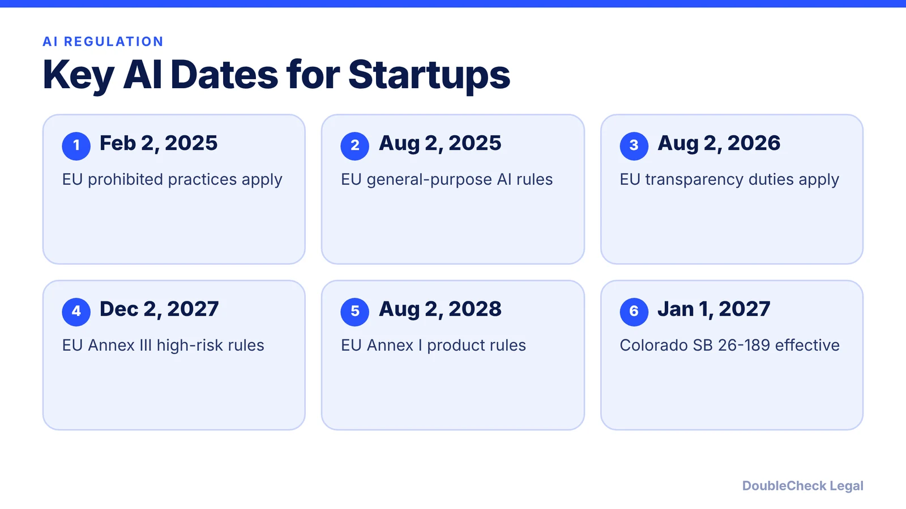
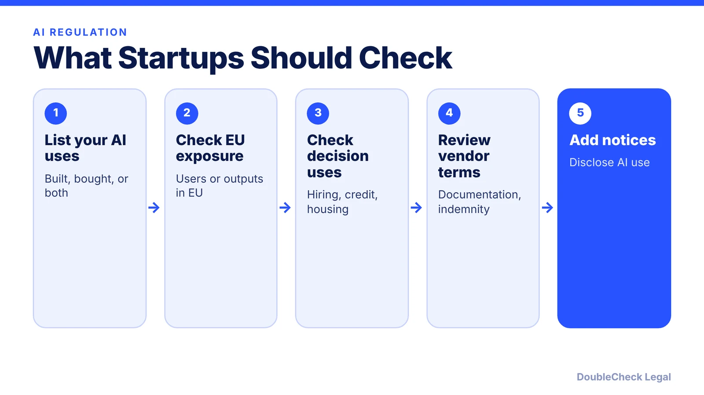

*The EU delayed its high-risk AI rules and Colorado rewrote its AI law. Here is where both stand as of November 2026.*

**Key takeaways:**

- EU AI Act: prohibitions apply since Feb 2, 2025; general-purpose AI since Aug 2, 2025; most transparency duties from Aug 2, 2026.
- The AI Omnibus moved Annex III high-risk rules to Dec 2, 2027 and Annex I product rules to Aug 2, 2028.
- Colorado replaced SB 24-205 with SB 26-189, signed May 14, 2026, effective Jan 1, 2027, with notice-focused duties.
- Inventory your AI uses and check vendor terms; dates have shifted more than once.

## 1. The quick answer

**Quick answer:** As of November 2026, two regimes matter most for startups building or using AI. In the EU, the AI Act's prohibitions (since February 2, 2025) and general-purpose AI rules (since August 2, 2025) already apply, transparency duties apply from August 2, 2026, and high-risk rules were pushed to December 2, 2027 (Annex III systems) and August 2, 2028 (Annex I products) by the AI Omnibus. In Colorado, the original AI Act (SB 24-205) was replaced by SB 26-189, signed May 14, 2026, with an effective date of January 1, 2027.

## 2. EU AI Act: timeline and risk categories

The AI Act sorts systems by risk. Per the Future of Privacy Forum's timeline:

- **Prohibited practices (Article 5):** banned outright; applying since February 2, 2025. The omnibus adds a ban on AI systems generating child sexual abuse material and non-consensual intimate content, applying from December 2, 2026.
- **High-risk systems:** Annex III use areas (such as employment, education, essential services) and Annex I product-safety systems.
- **Transparency obligations (Article 50):** disclosing AI interaction and labeling AI-generated content.
- **General-purpose AI models:** rules in force since August 2, 2025.

According to a Mondaq summary, the AI Omnibus (Regulation (EU) 2026/1744) was published in the Official Journal on July 24, 2026 and entered into force on July 27, 2026. It moved stand-alone Annex III high-risk obligations from August 2, 2026 to **December 2, 2027** and Annex I embedded systems to **August 2, 2028**. Most transparency obligations were not delayed, with a grace period only for certain machine-readable marking duties for generative systems already on the market. The rules reach non-EU companies whose AI output is used in the EU, so US startups with EU customers should map their exposure.

## 3. Colorado: from SB 24-205 to SB 26-189

The original Colorado AI Act (SB 24-205) was due June 30, 2026, but enforcement was stayed in April 2026 after xAI sued and the Colorado Attorney General joined a motion to pause, per a Squire Patton Boggs analysis. Colorado then passed SB 26-189, which Governor Polis signed May 14, 2026, per Holland & Knight.

Per Holland & Knight, effective **January 1, 2027**, the replacement law:

- covers developers and deployers of automated decision-making technology used in consequential decisions (education, employment, housing, financial services, insurance, healthcare, essential government services);
- requires deployers to give notice before using it, a plain-language explanation after an adverse outcome, and a way to correct data and, where commercially reasonable, request human review;
- requires developers to give deployers documentation on intended uses and limitations;
- is enforced only by the Attorney General, with no private right of action and a 60-day cure notice (not for knowing or repeated violations), with AG rules due by January 1, 2027.

Explainability and comprehensive risk-assessment duties from the 2024 law were removed. The source did not state specific monetary penalties.

## 4. A practical checklist

Start with an inventory of every AI tool you build, resell, or use, and note whether any of it influences decisions about people. Then:

- If you serve EU users, work out which AI Act category each system falls into and whether transparency duties apply now.
- If you use AI in hiring, lending, housing, or similar decisions affecting Colorado residents, plan for notice and adverse-outcome explanations before January 1, 2027.
- Check vendor contracts for documentation and liability terms. Per Holland & Knight, Colorado voids clauses that indemnify a party for its own discriminatory acts. See our [AI vendor contract checklist](/blog/ai-vendor-contract-checklist/) and [AI policy template](/blog/ai-policy-template-small-business/).
- Keep privacy duties in view: [GDPR for US startups](/blog/gdpr-for-us-startups/) and [CCPA/CPRA](/blog/ccpa-cpra-compliance-small-business/).

New to this? Read [how to launch an AI startup in the US](/blog/how-to-launch-ai-startup-us/). Dates have moved repeatedly, so recheck before relying on them.

## Where DoubleCheck fits

[DoubleCheck](https://www.contactdoublecheck.com) helps businesses and founders start legal work with AI, verify it, and, when professional advice is warranted, connect with an independent attorney, including for immigration questions. Attorney availability and practice areas vary. Attorneys on DoubleCheck are independent professionals; an attorney-client relationship forms only if an attorney accepts your engagement.

**Sources:** [Mondaq on the AI Omnibus entering into force](https://www.mondaq.com/uk/new-technology/1825722/eu-digital-omnibus-on-ai-enters-into-force); [Future of Privacy Forum](https://fpf.org/blog/the-ai-act-implementation-timeline-what-changes-under-the-ai-omnibus); [Gibson Dunn](https://www.gibsondunn.com/eu-ai-act-omnibus-agreement-postponed-high-risk-deadlines-and-other-key-changes/); [Holland & Knight on SB 189](https://www.hklaw.com/en/insights/publications/2026/05/colorado-governor-signs-sb-189); [Privacy World on the Colorado stay](https://www.privacyworld.blog/2026/05/the-colorado-ai-act-hits-a-wall-litigation-legislative-uncertainty-and-an-enforcement-standstill/).

## FAQ

**When does the EU AI Act apply to high-risk AI?**

After the AI Omnibus, stand-alone Annex III systems apply from December 2, 2027 and Annex I embedded systems from August 2, 2028, per Mondaq and the Future of Privacy Forum.

**What is the status of the Colorado AI Act?**

The original SB 24-205 was replaced by SB 26-189, signed May 14, 2026, effective January 1, 2027, per Holland & Knight.

**Who enforces Colorado's law?**

Only the Colorado Attorney General, with no private right of action and a 60-day cure notice for most violations, per Holland & Knight.

**Do EU AI transparency rules apply now?**

Per Mondaq, most transparency obligations were not delayed and apply from August 2, 2026, with a grace period for certain marking duties.

---

*General information only. This article is not legal, tax, investment, or accounting advice.*
