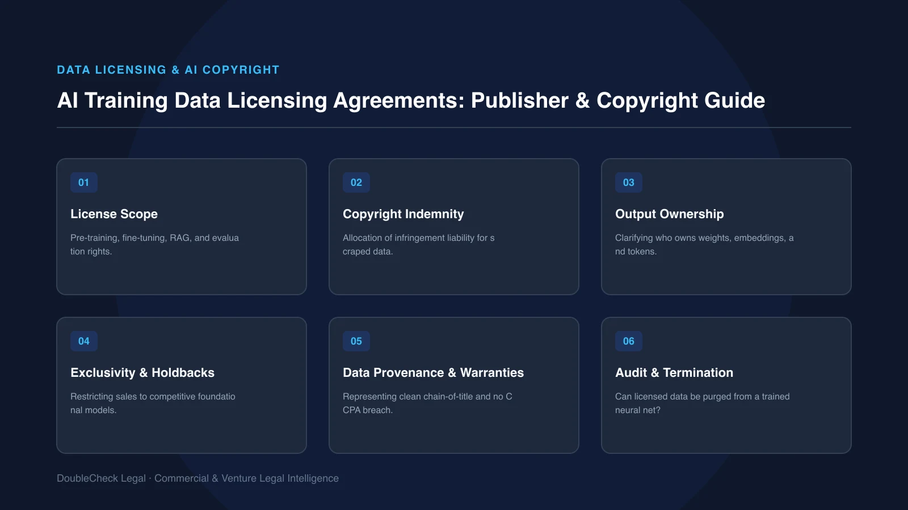
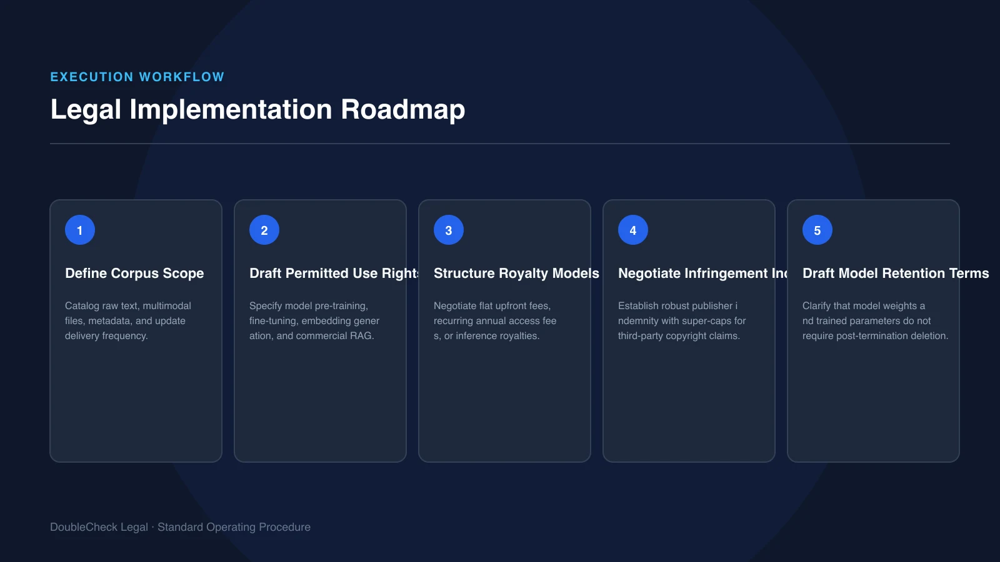

*A strategic legal guide to drafting and negotiating commercial AI training data licensing agreements, analyzing copyright infringement risks, model parameter retention clauses, publisher royalties, and RAG architectures.*

**Key takeaways:**
- **The End of Unlicensed Scraping:** With high-profile copyright litigation against OpenAI and Anthropic, commercial model builders are increasingly securing affirmative, paid data licenses from publishers.
- **The "Model Unlearning" Dilemma:** Standard contract termination covenants requiring destruction of derivative works are technically impossible for trained neural networks; agreements must explicitly exempt model weights.
- **RAG vs Training Disaggregation:** Contracts must carefully distinguish between pre-training rights, fine-tuning rights, and real-time inference retrieval rights (RAG).
- **Indemnity Allocation:** AI developers demand clean chain-of-title warranties and full copyright defense indemnity from publishers to shield their models from third-party infringement exposure.

## 1. The quick answer: Structuring AI data licensing deals

As the fair use defense faces mounting legal uncertainty in federal courts (*New York Times v. Microsoft/OpenAI*), **AI training data licensing agreements** have become the primary legal instrument for acquiring high-quality machine learning data:

1. **The Core Grant:** The publisher grants a non-exclusive, worldwide license to ingest, normalize, vectorize, and process content to train machine learning algorithms.
2. **The Output Protection:** The agreement confirms that all trained neural weights, model checkpoints, and generated inferences remain the exclusive intellectual property of the AI developer.
3. **The Unlearning Carve-Out:** Termination of the contract terminates future data access, but explicitly confirms the developer is **not required to retrain the model or delete model weights**.



## 2. In-depth legal analysis: Essential clauses in training data contracts

Negotiating an AI data agreement requires reconciling traditional copyright licensing frameworks with modern deep learning realities.

### A. The Scope of the License Grant
A poorly drafted license grant can paralyze future model development. The grant must be comprehensive:

```
"Licensor hereby grants to Licensee a non-exclusive, perpetual, irrevocable, worldwide, royalty-bearing license to copy, ingest, extract, format, vectorize, tokenize, and process the Licensed Corpus solely for the purposes of: (a) training, fine-tuning, evaluating, and testing machine learning models and artificial intelligence architectures; (b) creating embeddings, vector databases, and synthetic datasets; and (c) operating commercial inference services."
```

### B. The Machine Learning "Unlearning" Problem
In traditional software licensing, contract termination triggers the return or destruction of all copies of the licensed materials. In deep learning:
- Weights are mathematical representations diffused across hundreds of billions of parameters;
- Removing the influence of a specific corpus requires complex, expensive machine unlearning or complete retraining from scratch (costing millions of dollars).
- **The Solution:** The contract must state:

```
"Upon expiration or termination of this Agreement, Licensee shall cease ingesting new Licensed Corpus and shall delete raw source copies within thirty (30) days; provided, however, that Licensee shall not be obligated to modify, delete, or retrain any machine learning models, model checkpoints, weights, or embeddings trained prior to the effective date of termination."
```

### C. Commercial Pricing and Royalty Architectures

| Pricing Model | Structure | Best Suited For | Risk Profile |
|---|---|---|---|
| Flat Upfront Fee | Single cash payment for snapshot archive | Static historical text or image archives | Zero variable tracking; publisher misses upside |
| Annual Subscription | Recurring annual fee with ongoing API access | Real-time news feeds, legal databases, medical journals | Predictable cost; requires API uptime SLA |
| Token / Ingestion Fee | Fee per megabyte or million tokens processed | Specialized technical code or structured datasets | Scales with volume; complex ingestion audits |
| Attribution / Linkback | Lower cash fee paired with mandatory user citations | Media publishers seeking search referral traffic | Enforceability issues in non-search generative models |

## 3. Step-by-step: How to draft and negotiate an enterprise AI data license



Corporate teams should execute data licensing through a structured commercial negotiation process:

### Step 1: Technical Corpus Scoping and Delivery Architecture
Define the exact boundaries of the corpus. Establish delivery protocols: raw S3 bucket dumps, continuous streaming Webhooks, or REST API endpoints.

### Step 2: Establish Intellectual Property Warranties
Require the publisher to warrant that:
- It holds all rights, titles, and ownership required to grant the license;
- The corpus does not violate the Digital Millennium Copyright Act (DMCA) or contain pirated content;
- The data was collected in full compliance with applicable privacy laws (CCPA, GDPR) and does not contain sensitive personal data.

### Step 3: Negotiate Copyright Indemnification
Allocate risk for third-party infringement claims. Publishers typically push for standard commercial liability caps (e.g., 1x or 2x fees paid), while AI developers insist on uncapped indemnity or high super-caps for willful copyright infringement.

### Step 4: Address Exclusivity and Competitive Restrictions
Publishers often attempt to restrict developers from licensing the trained model to direct competitors. AI companies must aggressively reject such restrictions, as model weights cannot be partitioned by customer.

### Step 5: Post-Closing Governance and Audit Procedures
Define audit rights. Limit publisher audits to verifying API access logs rather than inspecting confidential model training logs or proprietary hyperparameter configurations.

## 4. Special considerations: Multimodal data, scraping, and synthetic data

- **Scraping Carve-Outs:** Ensure the contract ratifies any prior automated crawling or web scraping conducted by the developer prior to the execution of the formal agreement.
- **Synthetic Data Generation:** Clarify whether the developer may use the corpus to generate synthetic training data, and whether the publisher holds any rights in synthetic derivatives.
- **Biometric and Voice Rights:** When licensing audio or video data, ensure full releases under state right of publicity laws (e.g., California Civil Code § 3344, Tennessee ELVIS Act).

## 5. Due diligence checklist: Reviewing data licensing agreements

1. **Verify Chain of Title:** Confirm the publisher owns the underlying freelance and contributor copyrights, rather than holding mere non-transferable publishing licenses.
2. **Check Unlearning Exemption:** Ensure model weights and parameters are definitively shielded from deletion obligations upon contract termination.
3. **Audit Privacy Disclosures:** Verify that the corpus contains no protected health information (PHI) or unredacted personally identifiable information (PII).
4. **Confirm RAG Authorization:** Ensure the license grant explicitly covers real-time vector retrieval and inference prompting, not merely static pre-training.

## Where DoubleCheck fits

[DoubleCheck](https://www.contactdoublecheck.com) provides AI enterprises, foundational model developers, and digital publishers with automated contract intelligence. DoubleCheck parses commercial data licensing agreements, verifies permitted use scopes, audits IP warranties and copyright indemnities, and ensures model unlearning carve-outs are ironclad before multi-million dollar data contracts are finalized.

**Related reading:**
- [AI Regulation Startups EU AI Act Colorado](/blog/ai-regulation-startups-eu-ai-act-colorado/)
- [Who Owns AI-Generated Code? IP Checklist for Founders](/blog/ai-generated-code-ip-startup-founders/)
- [AI Vendor Contract Checklist](/blog/ai-vendor-contract-checklist/)
- [US Copyright Office AI Registration Guidance](/blog/us-copyright-office-ai-registration-guidance-human-authorship/)

**Sources:** [U.S. Copyright Office, Artificial Intelligence and Copyright Initiative](https://www.copyright.gov/ai/); [United States District Court (S.D.N.Y.), The New York Times Company v. Microsoft Corp. et al.](https://www.nysd.uscourts.gov/); [Digital Millennium Copyright Act, 17 U.S.C. § 512](https://www.law.cornell.edu/uscode/text/17/512); [Coalition for Content Provenance and Authenticity (C2PA)](https://c2pa.org/).

## FAQ

**What is an AI training data licensing agreement?**

An AI training data licensing agreement is a commercial contract between a content publisher or data owner and an AI developer, granting legal rights to ingest, tokenize, and train machine learning models on a copyrighted corpus in exchange for license fees.

**Can an AI company be forced to delete model weights if a data license terminates?**

Because machine learning weights cannot easily unlearn specific training documents, agreements typically stipulate that while the raw data must be deleted upon termination, existing model weights and parameters remain unaffected.

**What is the difference between training rights and RAG retrieval rights?**

Training rights permit adjusting foundational neural weights and embeddings during pre-training, whereas Retrieval-Augmented Generation (RAG) rights permit real-time querying and indexing of publisher content during user inference.

**How do copyright indemnity provisions work in AI data contracts?**

Publishers warrant that their corpus does not infringe third-party intellectual property or violate privacy laws, agreeing to indemnify the AI licensee against copyright infringement claims, often subject to negotiated liability caps.

**How can AI contract software assist in negotiating training data deals?**

AI contract tools rapidly benchmark license scope, compare indemnity baskets, detect missing non-deletion carve-outs, and audit representations across complex publisher agreements.

---

*General information only. This article is not legal, tax, investment, or accounting advice.*
