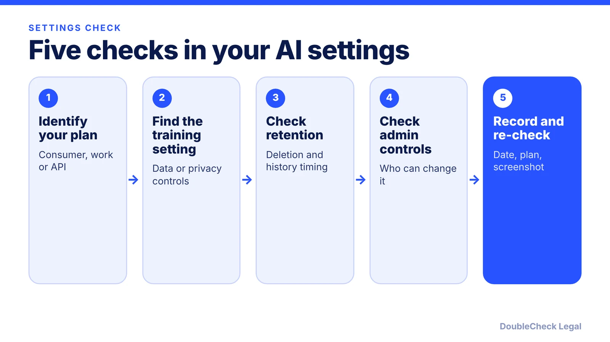
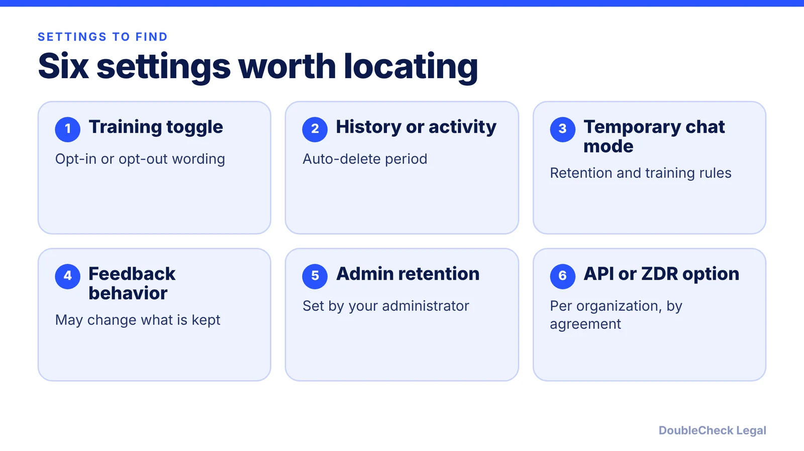

*A settings checklist for AI training opt-outs and data retention, attributed by plan type to vendor pages, as of November 2026.*

**Key takeaways:**

- The answer depends on plan type: consumer, work and API accounts follow different terms.
- Training opt-outs usually cover future chats; read the wording on timing and feedback.
- Retention is separate from training, and deleting history may not remove data kept under an exception.
- In a company, administrators and agreements may override what you see in a personal toggle.

## 1. The quick answer

**Quick answer:** To check AI vendor data retention and training opt-outs in your settings, work out which plan you are on first, because the answer differs by plan. As of November 2026, the vendor pages we read describe consumer accounts and business or API accounts differently. Anthropic says consumer Free, Pro and Max chats are used for training only if the user opts in, while its Commercial Terms products are not covered by that setting. OpenAI says ChatGPT improves from conversations unless you turn off the data control, and says it does not train on business data by default. Google says Workspace does not use customer data for training without permission, while its consumer Gemini setting works differently.

This post is a settings checklist, not a vendor ranking. For contract terms see [the AI vendor contract checklist](/blog/ai-vendor-contract-checklist/) and [data processing agreements for AI vendors](/blog/data-processing-agreement-dpa-ai-vendors-small-business/).

## 2. Why the plan type changes the answer

Vendors usually run separate terms for consumer accounts and for business or API products. That means two people using the same chatbot can have different data handling.

- **Consumer plans:** Often have a user-facing setting that controls whether chats help train models, plus a history or retention setting.
- **Business or work plans:** Usually governed by a commercial agreement, with administrator controls and different defaults.
- **API and developer products:** Governed by developer or commercial terms, with their own retention and zero data retention options.

A few vendor statements show the pattern, as of November 2026 and attributed to each vendor:

- **Anthropic** (consumer terms update, August 28, 2025): it will train new models on chats from Free, Pro and Max accounts, including Claude Code sessions from those accounts, only if the user opts in. Data is kept for five years if opted in, and the existing 30-day retention continues if not. The page says Claude for Work (Team and Enterprise), Claude Gov, Claude for Education and API use are not covered by that update because they fall under Commercial Terms.
- **OpenAI** (Data Controls FAQ): ChatGPT improves by training on conversations unless you disable training, via the Improve the model for everyone setting under Settings > Data Controls. Its business data page says it does not train on your organization's data by default for ChatGPT Business, Enterprise, Edu and the API.
- **Google** (Gemini Apps Privacy Hub, last updated November 16, 2026, and Workspace Privacy Hub, last updated October 6, 2026): for the consumer Gemini app, chat content can train models when the relevant setting is on, while the Workspace hub says Workspace does not use customer data for training without the customer prior permission or instruction.

Defaults and names change, so treat these as a snapshot and open the vendor page on the day you decide. See [how to choose an AI model for business: privacy, cost, quality](/blog/how-to-choose-an-ai-model-for-business-privacy-cost-quality/) for the broader tradeoffs.

## 3. Training opt-outs: what to look for in settings

A training opt-out is usually a toggle, but the details matter.

**Where to look.** Search settings for data controls, privacy, personalization, or activity. OpenAI names its toggle Improve the model for everyone under Data Controls and says the setting applies to your account, not a single device. Anthropic says users can change the setting at any time in Privacy Settings. Google's consumer page calls its relevant control the chat content or history setting.

**What the opt-out covers.** Anthropic says the setting applies only to new or resumed chats and coding sessions, and that data already used in training runs stays included. OpenAI says that while its toggle is off, new conversations are not used for training. Read the wording on timing: an opt-out generally governs future use, not past use.

**Exceptions.** Google says that with its consumer setting off, future chats are not used for training unless you submit feedback, and may still be reviewed for safety. Anthropic says data tied to feedback is kept for five years, so think before using feedback buttons on sensitive material.

**Temporary or incognito modes.** OpenAI says Temporary Chats are deleted from its systems within 30 days, reviewed only when needed to monitor for abuse, and not used for training. Google says temporary chats are not used for training and are kept with your account for around two months. Anthropic says incognito chats are deleted within 30 days unless flagged as a policy violation.

**Business accounts.** Do not assume the consumer toggle governs your work account. Ask your administrator and read your agreement. For legal documents, see [uploading contracts to ChatGPT: confidentiality](/blog/uploading-contracts-to-chatgpt-confidentiality/).

## 4. Retention: how long data is kept and how to shorten it

Retention is separate from training. Data can be kept for support, safety or legal reasons even if it is not used to train models.

What the pages say, as of November 2026:

- **Anthropic commercial and API (page dated July 1, 2026):** inputs and outputs are automatically deleted from the backend within 30 days of receipt or generation, with exceptions such as a longer retention feature you control, a separate agreement, enforcement of the Usage Policy and legal requirements. Flagged inputs and outputs may be kept up to 2 years. Zero data retention is an agreement that overrides the default. Anthropic's API data retention page says ZDR is enabled per organization through its sales team, and that certain models may require retention and may not be available under ZDR, so check the page for the model you use.
- **OpenAI business:** its business data page says qualifying organizations can configure how long OpenAI retains business data across ChatGPT Enterprise, Business, Edu and the API, and describes a zero data retention option on the API platform. Its Data Controls FAQ says deleted-chat retention is not specified on that page.
- **Google Gemini app, consumer:** history is auto-deleted after 18 months by default and can be set to 3 months, 36 months or indefinite. With history off, chats are still kept for about two months. Chats reviewed by human reviewers are not deleted when you delete history and are retained for up to three years.
- **Google Workspace:** prompts and responses in Gemini in Workspace are kept from 90 days to indefinitely, as set by admins. For the Gemini app, admins can set automatic deletion after 3, 18 or 36 months, and when history is off new chats are kept up to 72 hours. The hub says chats and uploaded files in the Gemini app will not be reviewed by human reviewers under the Workspace agreement.

Set the shortest retention that fits your needs, and remember that deleting history may not remove data already reviewed or retained under an exception.

## 5. Who controls the settings in a business

In a company, the setting you can see may not be the one that applies. Work accounts are often controlled by an administrator, and the agreement may override a personal toggle.

Check:

1. **Which account you are using.** Personal and work accounts can sit in the same app. Confirm you are logged in to the intended one.
2. **Admin controls.** Google says Workspace admins control Gemini history and retention periods and can turn the Gemini app on or off. OpenAI says qualifying organizations can configure retention. Ask who in your company owns those settings.
3. **Agreements.** Training and retention terms live in the commercial terms, data processing addendum and order form. See [DPA for AI vendors](/blog/data-processing-agreement-dpa-ai-vendors-small-business/).
4. **Staff behavior.** A policy that says use only approved accounts and redact sensitive data prevents most mistakes. See [what to redact before pasting a contract into AI](/blog/what-to-redact-before-pasting-a-contract-into-ai/) and [using AI for legal work safely](/blog/small-business-ai-legal-work-safely/).
5. **Privilege and privacy.** Settings do not decide whether a chat is privileged ([AI chats and privilege](/blog/ai-chats-not-privileged-heppner/)), and personal data raises [state privacy law](/blog/state-privacy-laws-2027-small-business-checklist/) questions.

If you want no vendor in the loop at all, [running AI locally](/blog/run-ai-locally-for-privacy-ollama-lm-studio-small-business/) is an option with its own tradeoffs.

## 6. A short routine and when to involve an attorney

Use this routine each quarter and whenever a vendor emails about changed terms:

1. Note the account type, the date and the vendor page you relied on.
2. Screenshot the training and retention settings.
3. Compare them with the vendor page and your contract.
4. Record who approved the setup and what data may go into the tool.

AI can help you turn a vendor page into a checklist, but verify against the live page and your own settings, since interfaces change. See [how to verify an AI-generated legal document](/blog/verify-ai-generated-legal-document/).

Consider an attorney when you handle client confidential, health, financial or children data, when a customer contract restricts subprocessors or AI use, or when a vendor refuses to sign a data processing addendum. This post is general information about published vendor pages, not a recommendation of any vendor.

## Where DoubleCheck fits

[DoubleCheck](https://www.contactdoublecheck.com) helps businesses and founders start legal work with AI, verify it, and, when professional advice is warranted, connect with an independent attorney, including for immigration questions. Attorney availability and practice areas vary. Attorneys on DoubleCheck are independent professionals; an attorney-client relationship forms only if an attorney accepts your engagement.

**Sources:** [Anthropic, Updates to our consumer terms (Aug. 28, 2025)](https://anthropic.com/news/updates-to-our-consumer-terms); [Anthropic privacy center, How long do you store my organization data (page dated July 1, 2026)](https://privacy.claude.com/en/articles/7996866-how-long-do-you-store-my-organization-s-data); [Anthropic API and data retention docs](https://platform.claude.com/docs/en/build-with-claude/api-and-data-retention); [OpenAI Help Center, Data Controls FAQ](https://help.openai.com/en/articles/7730893-data-controls-faq); [OpenAI, Business data privacy, security, and compliance](https://openai.com/business-data/); [Google, Gemini Apps Privacy Hub (last updated Nov. 16, 2026)](https://support.google.com/gemini/answer/13594961?hl=en); [Google, Generative AI in Google Workspace Privacy Hub (last updated Oct. 6, 2026)](https://knowledge.workspace.google.com/admin/generative-ai/generative-ai-in-google-workspace-privacy-hub). Not fetched: the English OpenAI business-data URL variants en-US and th-TH failed to load, so the generic openai.com/business-data page was used.

## FAQ

**How do I opt out of AI training in my settings?**

Look under data controls, privacy or activity settings. OpenAI names the toggle Improve the model for everyone under Settings > Data Controls, and Anthropic says users can change its setting in Privacy Settings. Work or API accounts may be governed by an agreement instead, so ask your administrator.

**Do business AI plans train on my data?**

Per OpenAI business data page, it does not train on organization data by default for ChatGPT Business, Enterprise, Edu and the API. Per Anthropic, Team, Enterprise and API use fall under Commercial Terms, not the consumer opt-in. Google says Workspace does not use customer data for training without prior permission.

**How long do AI vendors keep my chats?**

It varies by plan. Anthropic says commercial inputs and outputs are deleted within 30 days by default, and consumer data is kept five years if opted in to training. Google says its consumer Gemini history auto-deletes after 18 months by default. Check the page for your plan.

**Does deleting a chat remove it everywhere?**

Not always. Google says chats reviewed by human reviewers are not deleted when you delete history and are kept up to three years. Anthropic says deleted conversations are removed from backend storage within 30 days. Exceptions for safety or legal reasons can apply.

**Is a settings check enough to use AI with confidential documents?**

No. Settings are one layer. You also need the contract terms, a data processing agreement where relevant, redaction habits and a view on confidentiality. An attorney can help assess higher-risk uses.

---

*General information only. This article is not legal, tax, investment, or accounting advice.*
