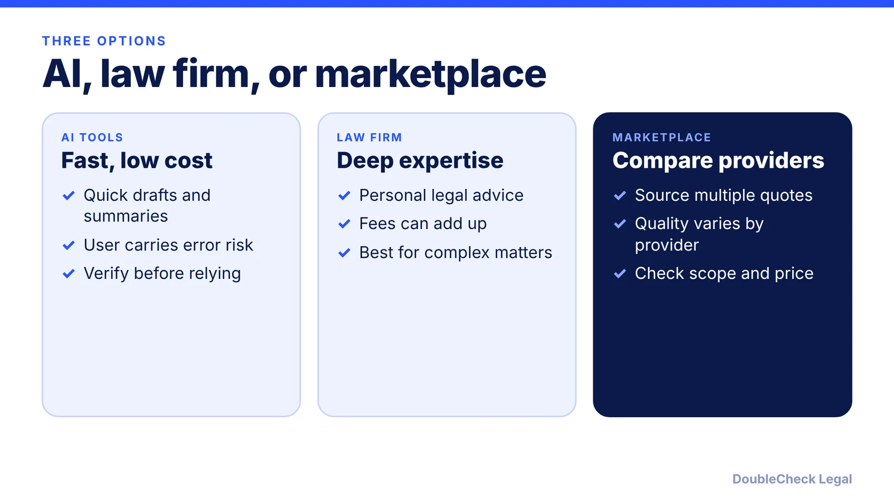
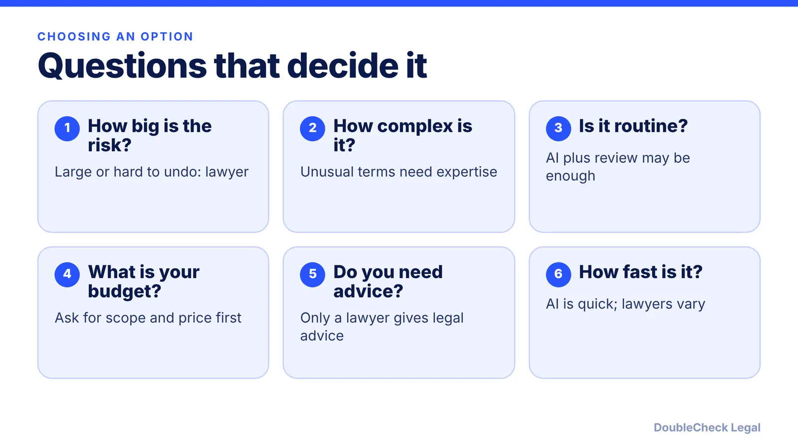

*AI, law firms, and marketplaces each fit different matters; many businesses combine them.*

**Key takeaways:**

- AI tools are fast and usually cheaper, but you carry most of the error risk.
- Law firms offer expertise and accountability, with fees that can add up.
- Marketplaces help you compare providers; quality still depends on the provider.
- Match the option to how risky, complex, and reversible the matter is.

## 1. The quick answer

**Quick answer:** Each option fits different needs. AI tools are quick and usually cheaper but need verification. A law firm offers deep expertise, accountability, and personal advice, but fees can add up. A legal marketplace lets you compare providers, but quality still depends on the individual provider. Many businesses combine them: use AI to understand and prepare, then bring a lawyer in when the stakes justify it. The right choice depends on how risky, complex, and reversible your matter is.

## 2. Where each option is strong and where it is weak

**AI tools.** [ContentBASE](https://contentbase.com/blog/lawyer-vs-legal-tech-use-attorney-or-automated-software) (January 2025) lists the pros of automated legal software as usually cheaper, fast document generation, and access from almost anywhere. Its cons: it struggles with gray areas and unexpected complications, users carry most of the responsibility for errors, and updates can lag behind changes in law. See [how AI hallucinations show up in business legal work](/blog/ai-hallucinated-citations-business/).

**Law firms.** Per the same source, lawyers bring deep legal reasoning for complex or contested matters, personalized guidance, and professional ethics rules and malpractice insurance that provide accountability. The cons: fees can add up quickly, and finding a qualified specialist can be hard. [Sprintlaw](https://sprintlaw.co.uk/compare/legal-marketplaces-vs-online-law-firms-uk/) (a UK provider, reviewed May 28, 2026) says specialist boutiques suit complex negotiations and high-risk transactions, while full-service firms are often more than a small business needs for routine documents.

**Legal marketplaces.** Sprintlaw says marketplaces suit buyers who want to source multiple quotes or compare provider profiles, but the marketplace does not always control service quality, scope, or final pricing, so you check each provider yourself.

## 3. A practical way to combine them

ContentBASE suggests software suits simple, low-risk tasks, attorneys suit high-stakes or complex matters, and it predicts hybrid models where AI handles drafting and research and lawyers handle strategy. A practical sequence:

- **Start with AI** to understand the document, list your questions, and spot unfamiliar clauses. See [AI contract review: what to check before signing](/blog/ai-contract-review-what-to-check-before-signing/) and [using AI for legal work in a small business](/blog/ai-lawyer-small-business/).
- **Verify what matters.** AI output can be wrong. A lawyer's review of an AI-checked contract is covered in [how a lawyer reviews a ChatGPT contract](/blog/lawyer-review-chatgpt-contract/).
- **Escalate by stakes.** Large, unusual, regulated, or irreversible matters call for an attorney. See [when to hire a lawyer for a small business](/blog/when-to-hire-lawyer-small-business/).
- **Control cost.** [Saving money on legal work with AI](/blog/save-money-legal-work-with-ai/) and [how much a lawyer charges to review a contract](/blog/how-much-does-a-lawyer-charge-to-review-a-contract/) show how scope affects price.

## 4. How to pick a provider, whichever route you choose

Whatever route you use, apply the same checks:

- **Who reviews the work?** Sprintlaw suggests judging providers on who reviews the work, how questions are handled, and when escalation happens.
- **Scope and price in writing.** Sprintlaw treats fixed-fee transparency, meaning clear scope and pricing before committing, as a key selection criterion.
- **Fit.** Ask about experience with your type of matter. See [how to choose a good lawyer](/blog/how-to-choose-good-lawyer/), [finding a startup lawyer in San Francisco](/blog/find-startup-lawyer-san-francisco/), and [how to get a lawyer referral](/blog/how-to-get-lawyer-referral/).

No option guarantees an outcome, and none replaces your own judgment about what is at stake.

## Where DoubleCheck fits

[DoubleCheck](https://www.contactdoublecheck.com) helps businesses and founders start legal work with AI, verify it, and, when professional advice is warranted, connect with an independent attorney, including for immigration questions. Attorney availability and practice areas vary. Attorneys on DoubleCheck are independent professionals; an attorney-client relationship forms only if an attorney accepts your engagement.

**Sources:** [ContentBASE](https://contentbase.com/blog/lawyer-vs-legal-tech-use-attorney-or-automated-software); [Sprintlaw](https://sprintlaw.co.uk/compare/legal-marketplaces-vs-online-law-firms-uk/).

## FAQ

**Should I use AI or a lawyer for legal work?**

It depends on the stakes. ContentBASE suggests software suits simple, low-risk tasks and attorneys suit high-stakes or complex matters. Many businesses use AI to prepare and a lawyer to advise where needed.

**What are the downsides of AI legal tools?**

Per ContentBASE, they struggle with gray areas and unexpected complications, users carry most of the responsibility for errors, and updates may lag behind changes in law. Verify output before relying on it.

**What is a legal marketplace?**

A platform where you can compare providers or source multiple quotes. Sprintlaw notes the marketplace does not always control service quality, scope, or final pricing, so check each provider yourself.

**Is DoubleCheck a law firm?**

No. DoubleCheck is a marketplace where businesses use AI for legal work, verify it, and connect with independent attorneys. An attorney-client relationship forms only if an attorney accepts your engagement.

---

*General information only. This article is not legal, tax, investment, or accounting advice.*
