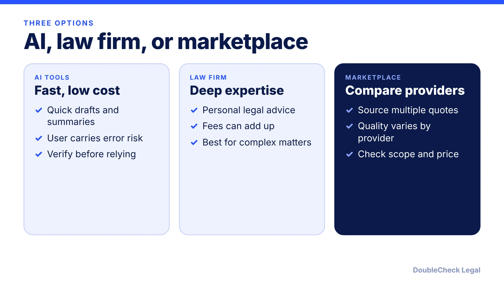
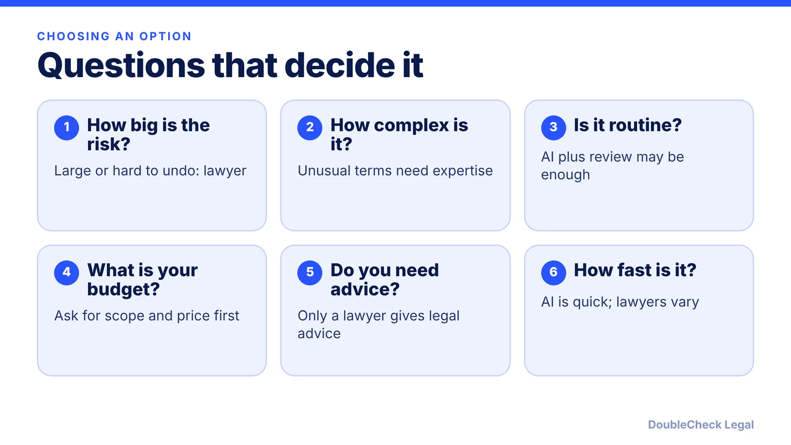

*AI, law firms, and marketplaces each fit different matters; many businesses combine them.*

**Key takeaways:**

- AI tools can be fast, but their output can be wrong and needs checking.
- Law firms offer expertise and accountability, with fees that can add up.
- Marketplaces help you compare providers; quality still depends on the provider.
- Match the option to how risky, complex, and reversible the matter is.

## 1. The quick answer

**Quick answer:** Each option fits different needs. AI tools can be quick to use but need verification. A law firm offers deep expertise, accountability, and personal advice, but fees can add up. A legal marketplace lets you compare providers, but quality still depends on the individual provider. Many businesses combine them: use AI to understand and prepare, then bring a lawyer in when the stakes justify it. The right choice depends on how risky, complex, and reversible your matter is.

## 2. Where each option is strong and where it is weak

**AI tools.** [ABA Formal Opinion 512](https://thebarexaminer.ncbex.org/article/fall-2024/generative-artificial-intelligence-tools/), which addresses lawyers' use of AI, says generative AI tools can produce inaccurate or false outputs, calls uncritical reliance on that content risky, and says the level of independent review should depend on the tool and the task. The same logic applies to you: AI can speed up drafting, but you are responsible for checking the result. See [how AI hallucinations show up in business legal work](/blog/ai-hallucinated-citations-business/).

**Law firms.** Per [Nolo](https://www.nolo.com/legal-encyclopedia/when-do-start-up-businesses-need-to-hire-a-lawyer.html), a lawyer is worth hiring for later-stage issues such as hiring employees, complex agreements, bringing on investors, or buying another business, and a lawyer's fees are usually outweighed by the cost of a serious mistake. The trade-off is cost: [FindLaw](https://www.findlaw.com/smallbusiness/hire-business-lawyer/need-business-lawyer.html) acknowledges that many small businesses have limited capital, and suggests a consultation arrangement, where you do most of the research and drafting and the attorney reviews your work, as one way to reduce it.

**Legal marketplaces.** A marketplace or directory lets you compare providers. Nolo, for example, has you briefly describe your matter and then choose attorneys to contact you. The platform is not the one advising you, so quality, scope, and pricing still depend on the individual provider, and you should check each one yourself.

## 3. A practical way to combine them

Nolo suggests self-help resources can handle early steps while a lawyer handles later-stage or complex issues, and FindLaw describes a consultation model where you prepare and an attorney reviews. A practical sequence:

- **Start with AI** to understand the document, list your questions, and spot unfamiliar clauses. See [AI contract review: what to check before signing](/blog/ai-contract-review-what-to-check-before-signing/) and [using AI for legal work in a small business](/blog/ai-lawyer-small-business/).
- **Verify what matters.** AI output can be wrong. A lawyer's review of an AI-checked contract is covered in [how a lawyer reviews a ChatGPT contract](/blog/lawyer-review-chatgpt-contract/).
- **Escalate by stakes.** Large, unusual, regulated, or irreversible matters call for an attorney. See [when to hire a lawyer for a small business](/blog/when-to-hire-lawyer-small-business/).
- **Control cost.** [Saving money on legal work with AI](/blog/save-money-legal-work-with-ai/) and [how much a lawyer charges to review a contract](/blog/how-much-does-a-lawyer-charge-to-review-a-contract/) show how scope affects price.

## 4. How to pick a provider, whichever route you choose

Whatever route you use, apply the same checks:

- **Who reviews the work?** Ask who reviews the work, how your questions are handled, and when the matter gets escalated.
- **Scope and price in writing.** Get clear scope and pricing before committing, whether the fee is fixed or hourly.
- **Fit.** Both Nolo and FindLaw recommend an experienced small business attorney, so ask about experience with your type of matter. See [how to choose a good lawyer](/blog/how-to-choose-good-lawyer/), [finding a startup lawyer in San Francisco](/blog/find-startup-lawyer-san-francisco/), and [how to get a lawyer referral](/blog/how-to-get-lawyer-referral/).

No option guarantees an outcome, and none replaces your own judgment about what is at stake.

## Where DoubleCheck fits

[DoubleCheck](https://www.contactdoublecheck.com) helps businesses and founders start legal work with AI, verify it, and, when professional advice is warranted, connect with an independent attorney, including for immigration questions. Attorney availability and practice areas vary. Attorneys on DoubleCheck are independent professionals; an attorney-client relationship forms only if an attorney accepts your engagement.

**Sources:** [Nolo, When do start-up businesses need to hire a lawyer?](https://www.nolo.com/legal-encyclopedia/when-do-start-up-businesses-need-to-hire-a-lawyer.html); [FindLaw, Do you need a business lawyer?](https://www.findlaw.com/smallbusiness/hire-business-lawyer/need-business-lawyer.html); [National Conference of Bar Examiners, The Bar Examiner on ABA Formal Opinion 512](https://thebarexaminer.ncbex.org/article/fall-2024/generative-artificial-intelligence-tools/).

## FAQ

**Should I use AI or a lawyer for legal work?**

It depends on the stakes. Nolo suggests self-help resources can cover early steps, while a lawyer is worth considering for later-stage or complex matters. Many businesses use AI to prepare and a lawyer to advise where needed.

**What are the downsides of AI legal tools?**

Per ABA Formal Opinion 512, generative AI tools can produce inaccurate or false outputs, and uncritical reliance on them is risky. Verify output before relying on it.

**What is a legal marketplace?**

A platform where you can compare providers or contact several attorneys about your matter. Quality still depends on the individual provider, so check each provider yourself.

**Is DoubleCheck a law firm?**

No. DoubleCheck is a marketplace where businesses use AI for legal work, verify it, and connect with independent attorneys. An attorney-client relationship forms only if an attorney accepts your engagement.

---

*General information only. This article is not legal, tax, investment, or accounting advice.*
