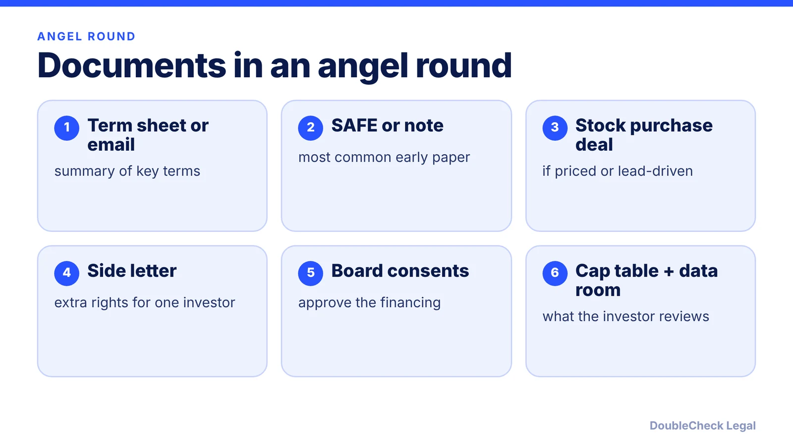
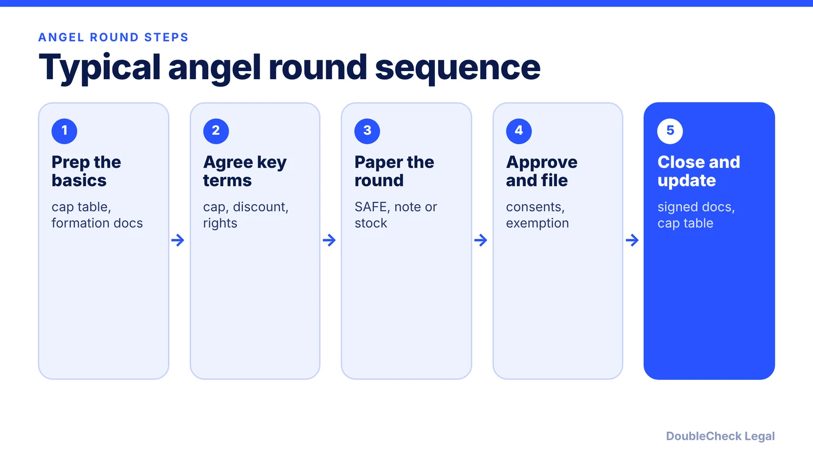

*A practical walk-through of the paper in an angel round, the terms investors negotiate and what to have ready.*

**Key takeaways:**

- There is no single angel agreement; most rounds use a SAFE, convertible note or priced stock documents, plus approvals.
- Expect to negotiate cap or price, discount, MFN, pro rata, information rights and sometimes board or veto rights.
- Angels typically ask for a cap table, formation records, IP assignments, tax records and proof of a securities exemption.
- Have a lawyer review any modified SAFE, side letter or priced round before you sign.

## 1. The quick answer

**Quick answer:** An angel investor agreement is not one document. In a typical early round the paper is a SAFE or convertible note (or a priced stock purchase agreement), plus possibly a side letter, with board approvals, an updated cap table and a securities exemption filing behind it. What to expect: the investor asks about your cap table, IP ownership and formation records; you negotiate a valuation cap or price, discount, pro rata and information rights; and you confirm the offering fits an exemption such as Rule 506(b), which per the SEC can mean a Form D notice within 15 days after the first sale. This checklist walks through the documents in the order they usually appear.

## 2. The core documents you will see

A handful of instruments cover most early rounds. Per Investor.gov, Cooley GO and Y Combinator's SAFE User Guide:

- **SAFE:** an agreement to give the investor a future equity stake if certain trigger events occur, with the investor's price set later, often by a cap or discount. Y Combinator publishes standard forms. See [SAFE notes explained for founders](/blog/safe-note-explained-for-founders/) and [what to check in a SAFE before you sign](/blog/safe-review-before-you-sign/).
- **Convertible note:** short-term debt that typically converts into equity at a later round. Compare it in [SAFE vs convertible note](/blog/safe-vs-convertible-note-startups/).
- **Priced equity round documents:** used when a round is larger or led by one investor. These add a stock purchase agreement, subscription and investor representation materials, and often an investor rights agreement and voting agreement.
- **Term sheet:** a preliminary document that signals interest. It is mostly non-binding on price but can include binding exclusivity or confidentiality. See [term sheet key terms explained](/blog/term-sheet-key-terms-explained/).
- **Side letters:** used to give one investor special rights. The risk is that they pile up unnoticed; read [side letters: what they grant](/blog/side-letters-startup-investors-what-they-grant/).

Which instrument you use depends on the round size, who leads, and how fast you need to close. If you are not sure where you are on the funding ladder, see [startup funding stages](/blog/startup-funding-stages-pre-seed-to-series-b/).

## 3. The terms angels negotiate

Most negotiation concentrates on a few economic and control terms:

- **Valuation cap and discount:** how much of the company the investor converts into. Their interaction is explained in [valuation cap vs discount for a SAFE](/blog/valuation-cap-vs-discount-safe-how-they-work-together/). Per Cooley GO, in a post-money SAFE the conversion calculation includes the conversion of SAFEs, so each investor can see more clearly what percentage they will own.
- **Most-favored-nation (MFN) clauses:** per the YC SAFE User Guide, if the company later issues SAFEs with better terms, an MFN holder may amend its SAFE to match them.
- **Pro rata rights:** the right to invest in future rounds to keep their percentage. See [pro rata rights explained](/blog/pro-rata-rights-explained-startups/).
- **Information rights:** regular financial updates.
- **Board or observer seats and veto rights:** more common in priced rounds.
- **Liquidation preference and anti-dilution:** in priced rounds, priority in a sale or protection from a lower-priced round. Full ratchet anti-dilution and liquidation preferences embedded in notes deserve close scrutiny. See [anti-dilution provisions in a term sheet](/blog/anti-dilution-provisions-term-sheet/).
- **Personal guarantees and milestone-linked repayment:** also worth close scrutiny, since they shift risk to founders personally.

There is no reliable rule of thumb for how much equity angels take; the share depends on the cap or price, round size and everything else on the cap table.

Before you agree, model the dilution. Your option pool, other SAFEs and the new money all interact, as shown in [option pool size and dilution in a first round](/blog/option-pool-size-and-dilution-first-round-explained/).

## 4. What angels ask for before they wire money

Angels vary, but the document requests are predictable. Per Baker Botts, investors typically expect to see:

1. **Cap table** showing founders, option pool, advisors, existing SAFEs and notes, and expected dilution. Start with [cap table basics](/blog/cap-table-basics-for-first-time-founders/).
2. **Formation and governance records:** certificate of incorporation or LLC filing, bylaws or operating agreement, and board or shareholder approvals. Baker Botts recommends a complete minute book with board and stockholder consents, and a cap table showing authorized, issued and reserved shares. If you are still an LLC, see [converting an LLC to a C corp before fundraising](/blog/convert-llc-to-c-corp-before-fundraising/).
3. **Founder and team agreements:** founder stock purchase agreements, IP assignments, and employee, contractor and advisor agreements. See [issuing a founder stock purchase agreement](/blog/issue-founder-stock-purchase-agreement/).
4. **IP ownership:** Baker Botts says to get signed IP assignments from all founders, employees and consultants, ideally before work begins.
5. **Existing financing documents:** any current SAFEs and notes.
6. **Tax records and compliance:** Baker Botts lists financial statements, tax filings and disclosure of any disputes among the records investors expect.
7. **Securities compliance:** documentation that the offering uses a valid exemption. Per the SEC, a Form D notice for offerings under Rule 504, Rule 506 or Section 4(a)(5) is due within 15 days after the first sale. Details are in [Form D and Rule 506 for startups](/blog/form-d-rule-506-fundraising-startups/).

Put these into a data room. A fuller list appears in [the due diligence checklist for startup fundraising](/blog/due-diligence-checklist-for-startup-fundraising/).

## 5. Doing it yourself, using AI, and when to hire an attorney

Standard SAFE forms are widely used, and AI can help you read them, summarize terms and spot gaps in your checklist. That works best for a simple, standard-form round with one or two small angels and a clean cap table. Investor.gov cautions that a SAFE may not be simple or safe, and a startup lawyer reviewing documents before signing is wise because SAFEs, notes and equity agreements have long-term dilution and control effects.

Bring in an independent attorney when:

- a SAFE or note has been modified from the standard form
- an investor asks for a side letter, board seat, veto rights or personal guarantee
- you have multiple SAFEs with different caps or an MFN clause and are unsure how they convert
- the round is priced or has a lead investor
- you promised equity informally to advisors or early helpers (see [advisor agreements and equity](/blog/advisor-agreement-equity-startups/))
- you are unsure whether your raise fits an exemption or whether investors are accredited

Use AI first to prepare. Mark every number and date, then check each against the signed paper using [verifying AI-generated legal documents](/blog/verify-ai-generated-legal-document/). A lawyer then spends time on judgment calls, not reading basics. For pricing expectations, see [how much a startup lawyer costs](/blog/how-much-does-a-startup-lawyer-cost/).

## Where DoubleCheck fits

[DoubleCheck](https://www.contactdoublecheck.com) helps businesses and founders start legal work with AI, verify it, and, when professional advice is warranted, connect with an independent attorney, including for immigration questions. Attorney availability and practice areas vary. Attorneys on DoubleCheck are independent professionals; an attorney-client relationship forms only if an attorney accepts your engagement.

**Sources:** [SEC Investor.gov, Investor Bulletin: Be Cautious of SAFEs in Crowdfunding](https://investor.gov/additional-resources/news-alerts/alerts-bulletins/investor-bulletin-be-cautious-safes-crowdfunding); [Cooley GO, What you should know about SAFEs](https://cooleygo.com/what-you-should-know-about-safes); [Y Combinator, SAFE User Guide](https://bookface-static.ycombinator.com/assets/ycdc/SAFE%20User%20Guide-a47c6588327d73aa2799e61ed7c2cae9f1a0ee9acfa9c43b62039dc06e715832.pdf); [SEC, Filing a Form D Notice](https://www.sec.gov/resources-small-businesses/exempt-offerings/filing-form-d-notice); [Baker Botts, Getting your company ready for a financing](https://ourtake.bakerbotts.com/post/102l0zt/getting-your-company-ready-for-a-financingbuilding-a-solid-foundation-for-growth).

## FAQ

**What documents do I need to close an angel investment?**

Most rounds need the investment instrument (SAFE, convertible note or stock purchase agreement), board approvals, an updated cap table and evidence of a securities exemption. Per the SEC, a Form D notice for Regulation D offerings is due within 15 days after the first sale.

**Is a SAFE an angel investor agreement?**

A SAFE is one common form of it. Per Investor.gov, a SAFE is an agreement to give the investor a future equity stake if certain trigger events occur, and Y Combinator publishes standard forms and a user guide.

**How much equity do angel investors usually take?**

There is no reliable standard. The stake depends on the cap or price, round size and what else is on the cap table, and a capped SAFE converts based on the cap and the later round price.

**What are red flags in an angel investment term?**

Full ratchet anti-dilution, liquidation preferences embedded in a note, personal guarantees and milestone-linked repayment covenants deserve close scrutiny. Have a lawyer review any of these before signing.

**Do I need a lawyer for an angel round?**

Not always for a simple standard-form SAFE, but Investor.gov cautions that a SAFE may not be simple or safe, and lawyer review before signing is wise because of long-term dilution and control effects. It is especially worth it when terms are modified or the round is priced.

---

*General information only. This article is not legal, tax, investment, or accounting advice.*
