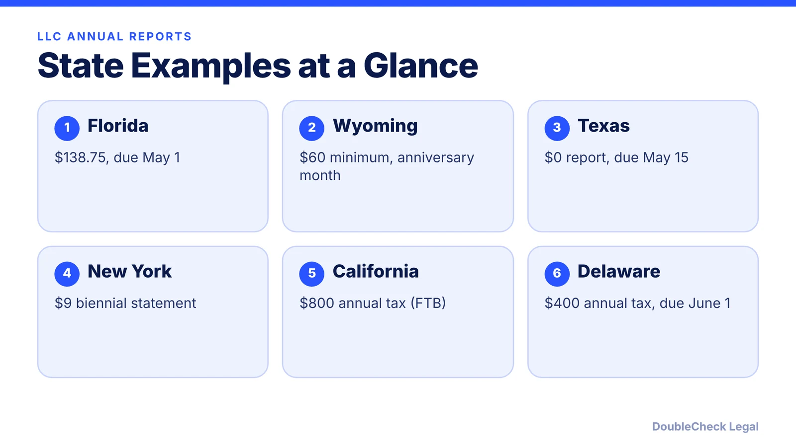
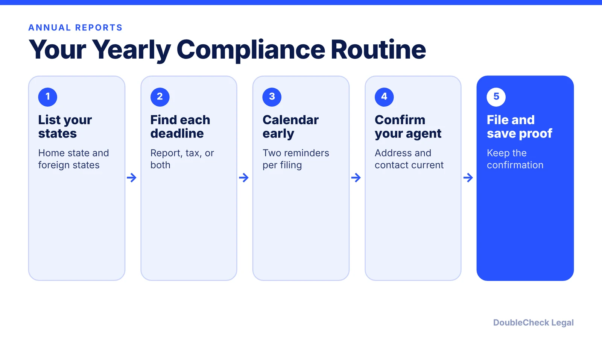

*Annual reports are easy to forget and costly to ignore. Here is how they work, with state examples.*

**Key takeaways:**

- Many states require LLC annual or biennial reports; fees and deadlines differ widely.
- Examples: Florida $138.75 due May 1; Wyoming $60 minimum; New York $9 biennial; Texas $0 report due May 15.
- Missing a report can mean late fees, lost good standing, and administrative dissolution.
- Some states, like Delaware and California, have an annual tax instead of or in addition to a report.

## 1. The quick answer

**Quick answer:** Many states require LLCs to file an annual or biennial report (sometimes called a statement of information) that confirms your address, registered agent, and managers or members. Fees and deadlines differ widely. As of November 2026, examples from the sources below: Florida $138.75 due May 1, Wyoming a $60 minimum due by the first day of the anniversary month, New York a $9 biennial statement, and Texas a $0 report through the Comptroller by May 15. Missing them can mean late fees, loss of good standing, and administrative dissolution.

## 2. What annual reports are, and what they are not

An annual report is a filing with the state business agency (usually the Secretary of State) that keeps your public record current. It is usually separate from your income tax return and from any franchise or privilege tax. Some states combine the two, and some have a tax but no report, so the labels can mislead.

Three patterns show up:

- **Report plus fee:** Florida and Wyoming. The report is the compliance filing.
- **Biennial statement:** New York requires a $9 biennial statement, due by the end of the anniversary month, per ZenBusiness. New LLCs also face a separate [publication requirement](/blog/new-york-llc-publication-requirement/).
- **Tax, no report:** Delaware LLCs file no annual report but owe a $400 annual tax due June 1, per the Delaware Division of Corporations as summarized in [our Delaware guide](/blog/delaware-llc-annual-tax-june-1/). California charges an $800 annual tax, covered in [California LLC annual tax and fee](/blog/california-llc-annual-tax-and-fee/).

Your registered agent often sends reminders, but the deadline is yours. See [Delaware registered agent requirements](/blog/delaware-registered-agent-requirements/).

## 3. Verified examples: Florida, Wyoming, Texas, New York

**Florida.** Due May 1 each year, filed online at Sunbiz. The LLC fee is $138.75. Missing the deadline adds a $400 late fee that, per Florida Trend, cannot be waived. If the report is still missing by the third Friday of September, the entity is administratively dissolved at close of business on the fourth Friday, per Florida Trend and Sneyk. Reinstatement requires an application, the report fees, and a reinstatement fee.

**Wyoming.** The license tax is $60 or $0.0002 of Wyoming assets, whichever is greater, so an LLC with $300,000 or less in Wyoming assets pays $60. It is due by the first day of the anniversary month. Per Business Anywhere, the LLC is delinquent on the second day of the following month and is dissolved if the report is not filed within 60 days of the due date. Reinstatement costs $100 plus each missed report and tax, within two years.

**Texas.** The report goes to the Comptroller as a Franchise Tax Public Information Report, due May 15, with no filing fee, per ZenBusiness. Whether franchise tax is owed depends on revenue; see [Texas franchise tax for LLCs](/blog/texas-franchise-tax-llc-corporation/).

**New York.** A $9 biennial statement, due in the anniversary month, per ZenBusiness.

## 4. Consequences of missing a report

ZenBusiness describes a general pattern: a late fee first, then loss of good standing roughly 30 to 90 days late, and possible administrative dissolution at 6 to 12 months or more. State timelines differ, as Florida and Wyoming show above.

Practical effects of losing good standing or being dissolved:

- A bank, lender, or investor may ask for a **certificate of good standing** you can no longer get.
- You may lose the right to file documents or, in some states, to sue in state courts (Delaware and New York both describe this for missed taxes or publication, per Wolters Kluwer in our related guides).
- Contracts signed while dissolved may be exposed, per Sneyk.
- Reinstatement generally means filing every missing report and paying all fees and penalties.

If you operate in more than one state, you may owe reports in each state where you are registered as a foreign LLC. If you no longer use the entity, closing it properly is cheaper than letting it lapse; see [how to dissolve an LLC](/blog/how-to-dissolve-an-llc-step-by-step/) and, for California, [closing a California LLC](/blog/close-california-llc-avoid-800-tax/). Compare ongoing costs in [LLC formation costs by state](/blog/llc-formation-cost-california-texas-florida-new-york/).

## Where DoubleCheck fits

[DoubleCheck](https://www.contactdoublecheck.com) helps businesses and founders start legal work with AI, verify it, and, when professional advice is warranted, connect with an independent attorney, including for immigration questions. Attorney availability and practice areas vary. Attorneys on DoubleCheck are independent professionals; an attorney-client relationship forms only if an attorney accepts your engagement.

**Sources:** [ZenBusiness: Annual report due dates by state](https://help.zenbusiness.com/worry-free-compliance/annual-report-due-dates-by-state); [Florida Trend: Annual reports](https://www.floridatrend.com/small-business-florida/2025/12/23/annual-reports); [Sneyk: Florida annual report](https://sneyk.com/learn/florida-annual-report); [Business Anywhere: Wyoming LLC annual report](https://businessanywhere.io/wyoming-llc-annual-report/); [Delaware Division of Corporations](https://corp.delaware.gov/alt-entitytaxinstructions); [FTB: Limited liability company](https://www.ftb.ca.gov/file/business/types/limited-liability-company).

## FAQ

**What is an LLC annual report?**

A periodic filing with the state that confirms your LLC's current information. It is separate from your income tax return, per ZenBusiness and Sneyk's description of Florida's report.

**How much is the Florida LLC annual report?**

$138.75 if filed by May 1, plus a $400 late fee if missed, per Florida Trend (2026).

**What happens if I do not file?**

Typically a late fee, then loss of good standing, then administrative dissolution. Florida dissolves in late September; Wyoming dissolves if the report is not filed within 60 days of the due date, per Florida Trend and Business Anywhere.

**Do all states require an annual report?**

No. Delaware has no LLC annual report but charges a $400 annual tax due June 1, and New York uses a biennial statement, per the Delaware Division and ZenBusiness.

---

*General information only. This article is not legal, tax, investment, or accounting advice.*
