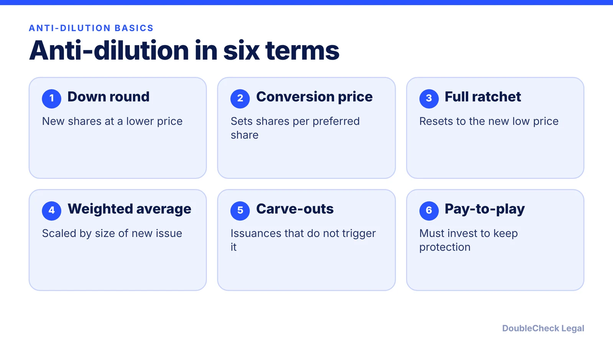
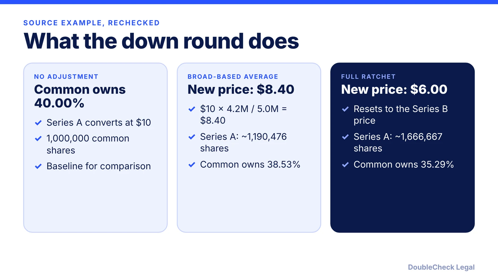

*Anti-dilution clauses only matter in a down round, but then they matter a lot. Here is how the two main types differ.*

**Key takeaways:**

- Anti-dilution lowers a preferred series' conversion price after a lower-priced issuance (per The Startup Law Blog).
- Full ratchet resets to the new price; weighted average scales the adjustment to the size of the issue.
- In the source example, common ownership was 40.00%, 38.53% (weighted), and 35.29% (full ratchet).
- The charter's definitions and carve-outs control, so read them, not just the headline term.

## 1. The quick answer

**Quick answer:** Anti-dilution provisions protect preferred investors if the company later sells shares at a lower price (a down round) by lowering the price at which their preferred converts into common. Per The Startup Law Blog, a full ratchet resets the conversion price to the new lower price, while a weighted average adjusts it using both the price drop and the size of the new issuance. Broad-based weighted average is the version the blog describes as used in NVCA-style drafting.

## 2. Full ratchet vs. weighted average

Per [The Startup Law Blog](https://www.thestartuplawblog.com/anti-dilution-provisions-startup-guide/):

- **Full ratchet:** generally resets the protected series' conversion price to the lower issue price, subject to the charter's definitions, exceptions, and any floor. The size of the new issuance does not moderate it.
- **Weighted average:** adjusts the conversion price using the price difference and the issuance size relative to a defined capitalization base.
- **Broad-based vs. narrow-based:** the difference is what counts in the base (called "A" in the formula). A narrow base counts fewer securities, which gives a bigger adjustment.

The simplified formula from that article: new conversion price = old conversion price x (A + B) / (A + C), where A is the capitalization base defined in the charter, B is the new investment divided by the old conversion price, and C is the number of new shares issued. The charter's definition of A controls, so two documents using the same label can differ.

For where this clause sits among other terms, see [key term sheet terms](/blog/term-sheet-key-terms-explained/) and the [NVCA model documents](/blog/nvca-model-documents-priced-round-explained/).

## 3. A worked example

The example below is the one used in The Startup Law Blog: 2,000,000 common shares; 1,000,000 Series A shares bought at $10 (conversion price $10); then a $12 million Series B at $6 per share issuing 2,000,000 new shares. We re-ran the arithmetic and it checks out.

In that example, weighted average costs common holders about 1.47 percentage points beyond ordinary dilution, and full ratchet about 4.71 points, per the article. The figures combine founder and employee holdings.

Why it matters beyond the math: the extra shares come out of common holders' share of the company, not the new investor's.

## 4. Carve-outs, pay-to-play, and what to negotiate

**Carve-outs.** Per the same article, employee and service-provider grants are often excluded if the charter's plan coverage and approval requirements are met, and a 409A valuation does not by itself create an exemption (see [stock options and 409A](/blog/stock-options-409a-valuation-startups/)). Options, warrants, notes, and SAFEs can trigger deemed-issuance rules, and acquisitions need their own specific exemption. Stock splits generally get a proportional adjustment, not the down-round formula.

**Pay-to-play.** Protection can be conditioned on investing in a future round. The article says nonparticipation can mean losing anti-dilution protection, converting preferred to common, or another remedy, depending on the documents.

**Checklist for founders:**

- Ask which formula applies and how the charter defines the capitalization base.
- Read the carve-out list against your [option pool](/blog/cap-table-basics-for-first-time-founders/) and convertible instruments such as [SAFEs and notes](/blog/safe-note-explained-for-founders/).
- Consider thresholds, duration limits, waivers, and pay-to-play, which the article lists as ways protection can be limited.
- Model a down round before signing; [liquidation preference](/blog/liquidation-preference-explained-founders/) and [pro rata rights](/blog/pro-rata-rights-explained-startups/) interact with it.

An attorney can read the actual charter definitions, which control over any summary.

## Where DoubleCheck fits

[DoubleCheck](https://www.contactdoublecheck.com) helps businesses and founders start legal work with AI, verify it, and, when professional advice is warranted, connect with an independent attorney, including for immigration questions. Attorney availability and practice areas vary. Attorneys on DoubleCheck are independent professionals; an attorney-client relationship forms only if an attorney accepts your engagement.

**Sources:** [The Startup Law Blog, Anti-Dilution Provisions](https://www.thestartuplawblog.com/anti-dilution-provisions-startup-guide/).

## FAQ

**What is an anti-dilution provision?**

It is a term that protects preferred investors in a down round by adjusting the price at which their preferred converts into common. Per The Startup Law Blog, the main forms are full ratchet and weighted average.

**What is the difference between full ratchet and weighted average anti-dilution?**

Per The Startup Law Blog, a full ratchet resets the conversion price to the lower issue price regardless of the issuance size, while a weighted average adjusts using both the price difference and how large the new issuance is.

**Does broad-based vs. narrow-based matter?**

Yes. Per The Startup Law Blog, it changes which securities count in the capitalization base (A) in the formula, and the charter's definition controls. The article describes the broad-based formula as used in NVCA-style drafting.

**Does a SAFE or option grant trigger anti-dilution?**

It can depend on the charter. The Startup Law Blog notes options, warrants, notes, and SAFEs can trigger deemed-issuance rules, while employee grants are often excluded if plan and approval requirements are met. Have an attorney read your definitions.

---

*General information only. This article is not legal, tax, investment, or accounting advice.*
