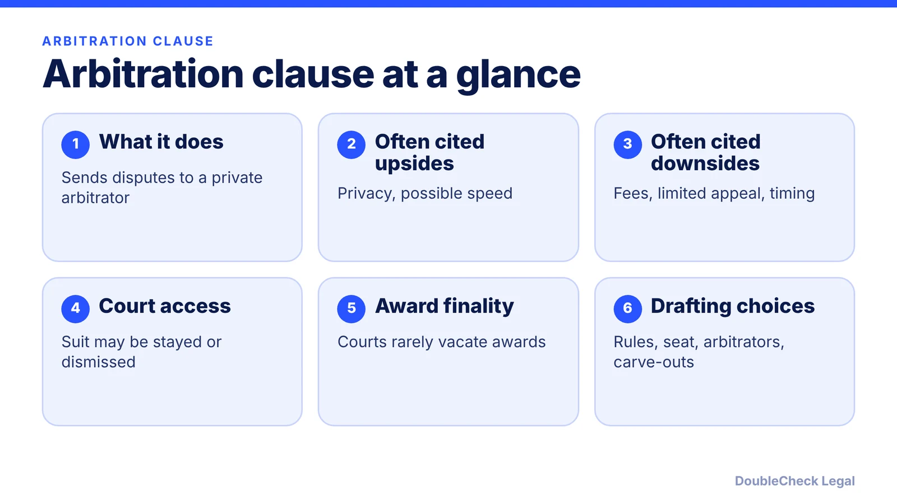
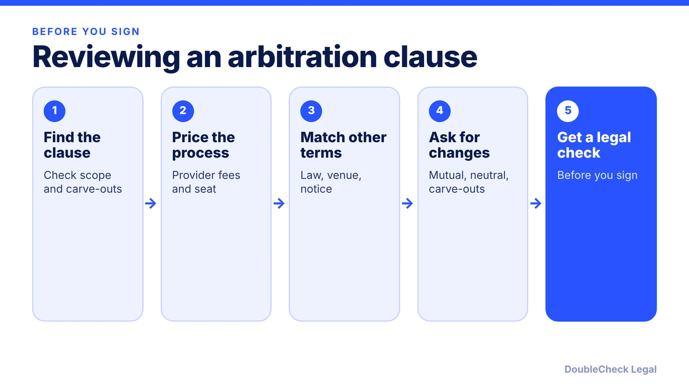

*How an arbitration clause works in a small business contract, the pros and cons sources describe, how final an award is, and a pre-signing checklist, as of November 2026.*

**Key takeaways:**

- An arbitration clause sends disputes to a private arbitrator, and a lawsuit filed anyway is likely to be stayed or dismissed.
- Cited upsides are privacy and possible speed; cited downsides are up-front fees, limited discovery and timing control.
- Courts defer heavily to awards, so a mistake on a contract point is hard to appeal.
- Check scope, rules, seat, arbitrator count, fee allocation and consistency with your governing law clause.

## 1. The quick answer

**Quick answer:** An arbitration clause is a contract term that sends disputes to a private arbitrator instead of a court. For a small business the trade-off is usually privacy and possible speed on one side, against up-front cost, limited appeal rights and less control over timing on the other. As of November 2026, commentators disagree on whether it fits small companies: Jordan Rothman (Above the Law, June 18, 2026) argues arbitration may not make sense for them, while many lawyers still recommend it for confidentiality. Which side wins depends on your typical claim size, who you contract with, and how the clause is drafted.

This guide explains how an arbitration clause works, what it can cost, how final an award really is, and what to check before you sign or propose one. It sits next to [governing law and venue clauses](/blog/governing-law-and-venue-clause-explained-which-state-law-applies/), which decide where and under which law a dispute is handled when there is no arbitration.

## 2. What an arbitration clause does

An arbitration clause says that some or all disputes under the contract will be decided by one or more arbitrators, not by a judge or jury. Most clauses are short, a paragraph or two, and sit near the end of the agreement with the boilerplate. That placement is why they are overlooked. They carry the same weight as the pricing terms.

Three effects matter in practice:

- **You usually cannot go straight to court.** Per Mark Hamilton of Tucker Arensberg (December 2, 2025), if your contract has an arbitration provision, a lawsuit is likely to be stayed or even dismissed, so you will probably have to arbitrate.
- **The process is set by the clause and the rules it names.** A clause can name an arbitration provider's rules, the city where hearings happen (the seat), and the number of arbitrators. Revision Legal (modified May 31, 2026) recommends specifying the rules, seat and number of arbitrators when you want to avoid public litigation.
- **It covers what the words cover.** A narrow clause ("disputes about payment") and a broad one ("any dispute arising out of or relating to this agreement") give very different reach, so read the scope sentence closely.

An arbitration clause is different from a governing law clause: the first decides who decides, the second which state's law applies, and the two should agree.

## 3. Pros and cons for a small business

Different sources weigh the trade-offs differently, so here they are with attribution.

**Arguments commonly made for arbitration** (Rothman, Above the Law, June 18, 2026):

- **Privacy.** Arbitration is generally much more private than litigation, which is why lawyers often recommend it.
- **Speed.** Depending on the circumstances, arbitration can resolve a dispute faster than a lawsuit, and earlier resolution can mean lower attorney fees.
- **Easier cross-border enforcement.** Revision Legal notes that arbitral awards under the New York Convention are often easier to enforce across borders than court judgments, which matters if a counterparty is abroad.

**Arguments commonly made against it for small businesses:**

- **Cost.** Rothman says parties typically pay thousands of dollars in arbitration fees, arbitrators often bill hourly rates comparable to expensive lawyers, and litigants pay only modest court fees by comparison. For five-figure claims, he writes, arbitration costs can approach the size of the claim.
- **Filing fees.** Hamilton gives one example: under the American Arbitration Association (AAA) standard clause, a case in the $300,000 to $500,000 range carried a $4,825 initial filing fee and a $4,175 final fee, about $9,000 before the arbitrator's compensation and your own legal costs. He contrasts that with a state court complaint that typically costs under $500 in filing and service. Fee schedules change, so check the provider's current schedule instead of relying on this example.
- **Timing.** Hamilton says a typical arbitration can take well over a year and depends on the arbitrator's schedule.
- **Limited discovery.** Per Hamilton, arbitrators generally cannot compel non-parties to appear, which restricts third-party subpoenas.
- **Front-loaded costs.** Rothman says costs arrive early, and a clause can invite more claims, in some cases with the business paying most of the fees.

Neither list is a verdict. If you mostly chase unpaid invoices, see [how to collect unpaid invoices in small claims](/blog/how-to-collect-unpaid-invoices-small-claims/), because a clause may affect whether that route stays open to you.

## 4. How final is an arbitration award?

The short answer is that awards are hard to undo. Ken Rosen (Today's General Counsel, February 5, 2026) summarizes the main grounds to vacate an award under Section 10(a) of the Federal Arbitration Act:

- The award was obtained through fraud, corruption or other unfair means.
- The arbitrator was clearly unfair or dishonest.
- The arbitrator misconducted the hearing, such as by refusing to hear important evidence.
- The arbitrators exceeded their powers under the agreement.

Rosen writes that courts defer heavily and that errors of law or fact alone are not enough, citing *Hall Street Associates v. Mattel* (2008). In practice, that means the arbitrator's mistake on a contract point is usually yours to live with. Compare that with a court case, where an appeal is available for legal error.

Before you agree to arbitration, ask a simple question: if the arbitrator rules against me on a point of contract interpretation, am I comfortable that this is the end of it? If the contract is a large or long-term one, that answer should shape how you negotiate the clause. Other terms interact with this one, including [limitation of liability](/blog/limitation-of-liability-clause-explained/) and [indemnification](/blog/indemnification-clause-explained-small-business/), because an arbitrator will apply them as written.

## 5. What to check before you sign or propose one

Use this checklist when a contract arrives with an arbitration clause, or when you are drafting your own.

- **Scope.** Does it cover all disputes or only some? Are claims for injunctions or unpaid invoices carved out?
- **Rules and provider.** Which rules apply, and what are the fees under them today?
- **Seat and format.** Where are hearings held, and can they be remote? A distant seat raises your cost even if the clause looks neutral.
- **Number of arbitrators.** The clause should say how many, since it affects cost.
- **Fee allocation.** Who pays arbitrator fees up front, and can the arbitrator shift fees to the loser?
- **Consistency.** Does the clause match the [governing law and venue clause](/blog/governing-law-and-venue-clause-explained-which-state-law-applies/), the [termination clause](/blog/how-to-terminate-a-contract-early-termination-clause/) and any notice requirement before a claim?
- **Who is on the other side.** Consumer, employee and franchise relationships are often subject to extra rules that vary by state and by contract type. Do not assume a form clause will hold; ask an attorney.

If a clause is lopsided, you can ask to change it. Common requests are a carve-out for small claims or injunctions, a mutual fee split, and a seat in a neutral or shared location. Whether you get them depends on leverage, a point also stressed by Revision Legal. For a full read of the other terms that surround a clause like this, see [contract red flags for small business](/blog/contract-red-flags-small-business/) and [what to check before signing an AI-reviewed contract](/blog/ai-contract-review-what-to-check-before-signing/).

## 6. When to get an attorney to look at it

You can reasonably handle a short, low-stakes agreement yourself with a careful read. Bring in an attorney when:

- The contract value or a possible dispute is large relative to your revenue.
- The other side is a larger company and the clause is non-negotiable boilerplate.
- You are in a regulated or consumer-facing business, or the counterparty is an employee, where state rules can change the result.
- The clause is paired with a class waiver, a short claim deadline or a fee-shifting term.

AI can help you read the clause, list the questions above and compare it with your other contracts. It can also miss jurisdiction-specific points and state-by-state variations, so treat its output as a first draft of your questions. See [how to verify an AI-generated legal document](/blog/verify-ai-generated-legal-document/) and [when to hire a lawyer for your small business](/blog/when-to-hire-lawyer-small-business/). If a contract has a dispute-resolution clause you do not understand, a short attorney review is usually cheaper than the dispute it governs; see [how much a lawyer charges to review a contract](/blog/how-much-does-a-lawyer-charge-to-review-a-contract/).

## Where DoubleCheck fits

[DoubleCheck](https://www.contactdoublecheck.com) helps businesses and founders start legal work with AI, verify it, and, when professional advice is warranted, connect with an independent attorney, including for immigration questions. Attorney availability and practice areas vary. Attorneys on DoubleCheck are independent professionals; an attorney-client relationship forms only if an attorney accepts your engagement.

**Sources:** [Above the Law, Arbitration Might Not Make Sense For Small Businesses (June 18, 2026)](https://abovethelaw.com/2026/06/arbitration-might-not-make-sense-for-small-businesses/); [JD Supra, Tucker Arensberg: Beware the Arbitration Clause Trap (Dec. 2, 2025)](https://www.jdsupra.com/legalnews/note-to-small-business-owners-beware-2448860/); [Today's General Counsel, Challenging Arbitration Awards (Feb. 5, 2026)](https://todaysgeneralcounsel.com/challenging-arbitration-awards-rare-but-possible/); [Revision Legal, Choice of Law and Venue Clauses Explained (modified May 31, 2026)](https://revisionlegal.com/corporate/choice-of-law-venue-contract-clauses/). Not fetched: a Legal 500 article on arbitration clauses (blocked). The AAA fee figures are one example from a law firm article and are not current schedule numbers.

## FAQ

**What is an arbitration clause in a business contract?**

It is a contract term that sends disputes to a private arbitrator instead of a court. Per Tucker Arensberg (December 2025), a lawsuit filed despite such a clause is likely to be stayed or even dismissed, so you will probably have to arbitrate.

**Is arbitration cheaper than going to court for a small business?**

Not always. Above the Law (June 2026) says parties typically pay thousands of dollars in fees and that costs can approach the size of five-figure claims, while Tucker Arensberg (December 2025) says arbitration is frequently not cheaper or faster. Costs depend on the provider rules and the size of the dispute.

**Can I appeal an arbitration award?**

Rarely. Per Today's General Counsel (February 2026), courts can vacate an award for narrow reasons such as fraud, arbitrator misconduct or exceeding powers under Section 10(a) of the Federal Arbitration Act, but errors of law or fact alone are generally not enough.

**Should my small business put an arbitration clause in its own contracts?**

It depends on your typical claim size, counterparties and need for privacy. Some lawyers recommend it for confidentiality, while others warn about cost for small claims. Consider a carve-out for small claims and injunctions, and have an attorney review the clause.

**Is an arbitration clause the same as a governing law clause?**

No. An arbitration clause decides who hears a dispute, while a governing law clause decides which state law applies. Revision Legal (updated May 2026) suggests pairing venue and choice-of-law terms with arbitration when you want finality, and the clauses should be consistent.

---

*General information only. This article is not legal, tax, investment, or accounting advice.*
