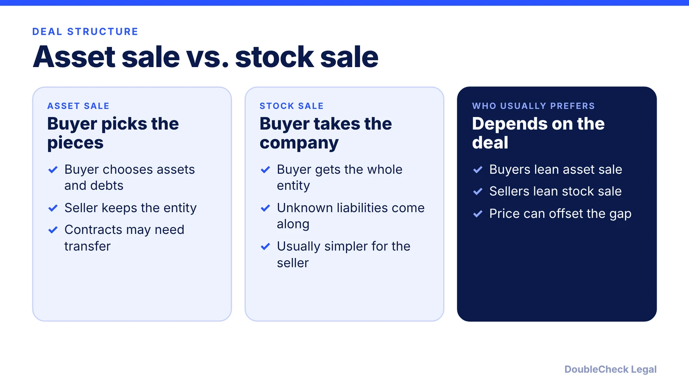
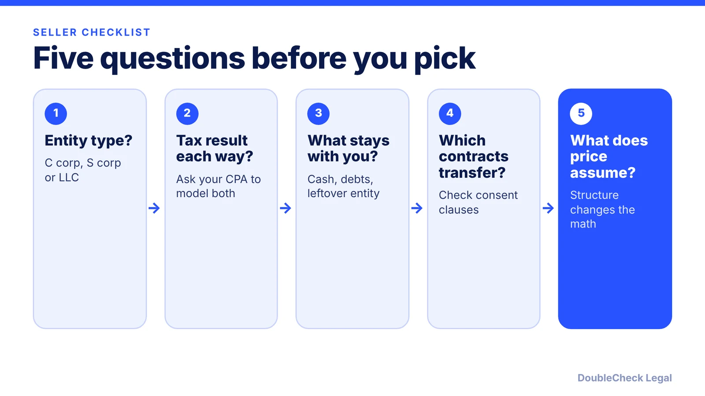

*Asset sale vs stock sale for a small business comes down to who takes the liabilities and who pays tax how many times.*

**Key takeaways:**

- Asset sale: buyer picks assets and liabilities; seller keeps the entity.
- Stock sale: buyer takes the whole company, including unknown liabilities.
- Buyers often favor asset deals for basis step-up; sellers often favor stock sales for single-level tax.
- Agree structure at the term sheet stage and have a tax advisor and attorney review it.

## 1. The quick answer

**Quick answer:** In an asset sale, the buyer picks specific assets and liabilities and the seller keeps the legal entity. In a stock sale (or membership interest sale for an LLC), the buyer acquires the owner's equity and therefore the whole company, including unknown liabilities. Buyers often prefer asset deals for liability protection and a tax basis step-up; sellers often prefer stock sales for simpler, single-level tax. The right structure for a small business depends on entity type, tax facts and contracts, so confirm with a tax advisor and attorney. Facts below are general and current as of November 2026.

## 2. How each structure works

In an **asset sale**, the buyer purchases specific assets and agreed liabilities, usually under an asset purchase agreement, and the seller keeps its entity, per Bloomberg Tax. In a **stock sale**, the buyer purchases the owner's ownership interest, usually under a stock purchase agreement, and so owns everything the entity owns. LLC interests are technically membership interests, but parties often still call the deal a stock sale.

A merger is a third route that Orrick's guide discusses alongside the two; if the deal is a merger or a reorganization with buyer stock as payment, tax results can differ and counsel should structure it.

Orrick's guide notes that structure is typically settled at the term sheet stage because it drives tax and other issues. That means your [letter of intent](/blog/how-to-write-a-letter-of-intent-business-deal/) is the moment to raise it, not the closing table. For the full process see our [small business buy or sell legal checklist](/blog/how-to-buy-or-sell-a-small-business-legal-checklist/) and the [sell-side M&A checklist](/blog/sell-side-ma-legal-checklist/).

## 3. Differences for the buyer

**Liability.** Per Bloomberg Tax, in an asset sale buyers can generally avoid liabilities not found in due diligence, and the seller keeps the legal entity and any liabilities not sold. In a stock sale the buyer takes on the contingent liabilities that come with the entity. Orrick describes an asset purchase as buying agreed assets and assuming agreed liabilities.

**Tax basis.** Orrick's tax overview says the buyer in an asset sale gets a basis step-up in the assets, which can shelter future income, while in a stock sale the buyer does not. In a plain stock deal the buyer generally inherits the existing tax basis rather than getting a step-up, which is one reason buyers often prefer asset deals.

**Contracts and licenses.** Bloomberg Tax notes buyers may prefer an asset deal if contracts or other assets are hard to transfer in a stock deal, while many contracts contain change-in-control or anti-assignment provisions that can still require consent. Whether a contract can be transferred at all depends on its wording; see [assignment clauses explained](/blog/assignment-clause-explained-can-your-contract-be-transferred/).

**Paperwork.** For an asset purchase, the IRS says both purchaser and seller generally must file Form 8594 with their income tax returns when assets make up a trade or business and the buyer's basis depends on the price paid (per the IRS Instructions for Form 8594).

**Due diligence.** A stock buyer inherits the company's history, so diligence goes deeper on past taxes, claims and compliance. Protections like [indemnification clauses](/blog/indemnification-clause-explained-small-business/) matter more here.

## 4. Differences for the seller

**Tax.** Orrick states that in a stock sale the seller is generally taxed once, usually at capital gains rates, and the gain may be excludable if the stock is qualified small business stock; see [QSBS and Section 1202](/blog/qsbs-section-1202-explained-startup-founders/). In an asset sale by a C corporation, Orrick describes two levels of tax: the corporation pays on the asset sale, then shareholders pay again on distribution. Orrick adds that many deals are structured as stock sales because the seller's tax benefits are more significant than the buyer's tax detriments. Bloomberg Tax notes that the result depends on facts such as whether the seller is an S or C corporation and how the price is allocated, so the answer depends on deal size and facts.

Per Bloomberg Tax, each asset in an asset sale is treated as sold separately, so the seller usually ends up with a mix of ordinary income and capital gain, and the IRS says the buyer and seller must allocate the price among assets under the residual method (Publication 544 and Form 8594). Sellers may ask for a price adjustment so after-tax proceeds come closer to a stock-sale outcome.

**Allocation matters.** In an asset deal, the purchase price is split among asset classes, from Class I (cash) through Class VII (goodwill and going concern value), under the residual method, per the IRS Form 8594 instructions. The split can change each side's tax result, so it is negotiated.

**What stays behind.** In an asset sale the seller keeps the entity and whatever was not sold, which often includes cash and any retained debt, and must plan for the remaining entity. What transfers is set by the purchase agreement.

## 5. Price, earnouts and other terms that interact with structure

Structure is rarely negotiated alone. Price may adjust up or down based on actual working capital versus a target, earnouts tie part of the price to future performance, and rollover equity lets sellers share in future growth. Read [earnout clauses explained](/blog/earnout-clauses-explained-selling-a-small-business/) before agreeing to contingent payments.

If owners are splitting or buying each other out rather than selling to a third party, a [buy-sell agreement](/blog/buy-sell-agreement-small-business-partners/) often sets the structure in advance. Non-competes for the seller are common in sale agreements; state rules vary, so see [non-compete agreements in 2026](/blog/noncompete-agreements-2026-small-business/).

**Handle yourself vs. get an attorney.** You can build a simple asset list, gather contracts and note change-in-control clauses on your own, and AI can help summarize them. Because structure affects tax, liability and contract transfers together, have a tax advisor and an attorney review the term sheet and purchase agreement before signing; our [AI contract review guide](/blog/ai-contract-review-what-to-check-before-signing/) shows how to check AI output first.

## Where DoubleCheck fits

[DoubleCheck](https://www.contactdoublecheck.com) helps businesses and founders start legal work with AI, verify it, and, when professional advice is warranted, connect with an independent attorney, including for immigration questions. Attorney availability and practice areas vary. Attorneys on DoubleCheck are independent professionals; an attorney-client relationship forms only if an attorney accepts your engagement.

**Sources:** [Orrick, transaction structure](https://www.orrick.com/en/tech-studio/insights/Whats-the-Best-Transaction-Structure-for-My-Sale); [Bloomberg Tax, Tax structures in buying or selling a business](https://news.bloomberglaw.com/daily-tax-report/tax-structures-in-buying-or-selling-a-business); [IRS, Sale of a business](https://www.irs.gov/businesses/small-businesses-self-employed/sale-of-a-business); [IRS Publication 544](https://www.irs.gov/publications/p544); [IRS Instructions for Form 8594](https://www.irs.gov/instructions/i8594).

## FAQ

**What is the main difference between an asset sale and a stock sale?**

In an asset sale the buyer purchases selected assets and agreed liabilities and the seller keeps the entity. In a stock sale the buyer purchases the equity and so takes the whole company, including liabilities it did not know about (per Bloomberg Tax and Orrick).

**Why do buyers prefer asset sales?**

Per Orrick and Bloomberg Tax, buyers generally get a tax basis step-up in the assets and can generally avoid liabilities not found in due diligence. Sellers may ask for a higher price to offset their added tax cost.

**Why do sellers usually prefer a stock sale?**

Orrick says a stock sale is generally taxed once, usually at capital gains rates, whereas an asset sale by a C corporation can mean tax at both the corporate and shareholder level. Results vary for LLCs and S corporations, so ask a CPA to model both.

**Do I need to file anything with the IRS in an asset sale?**

Generally yes. The IRS says both purchaser and seller must usually file Form 8594 with their tax returns when the assets make up a trade or business and the buyer basis depends on the price paid.

**Can contracts transfer automatically in an asset sale?**

Not necessarily. Many contracts have change-in-control or anti-assignment provisions that may still require consent, so check each important contract before choosing a structure.

---

*General information only. This article is not legal, tax, investment, or accounting advice.*
