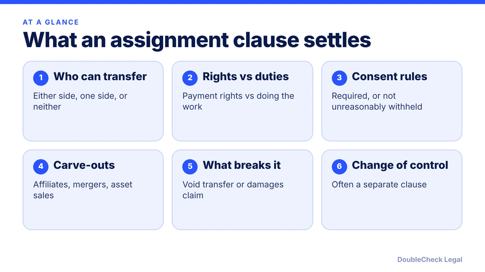
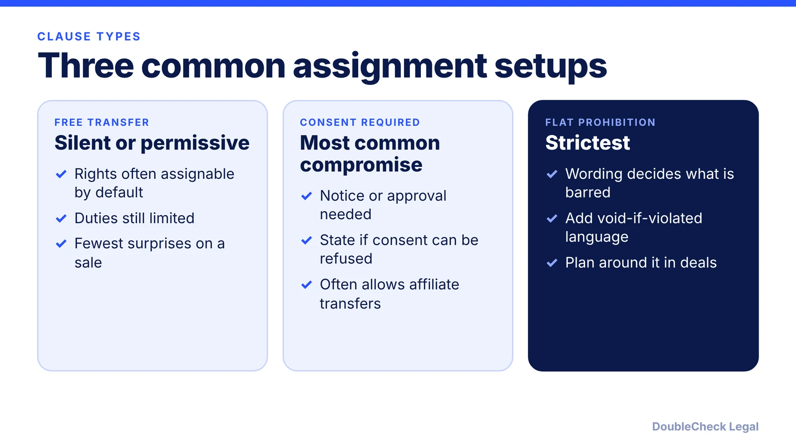

*A plain-English guide to the assignment clause: whether your contract can be transferred, what changes in a merger or sale, and what to check. Information as of November 2026.*

**Key takeaways:**

- Assignment transfers rights; delegation transfers duties. Duties are harder to transfer than payment rights, and the original party often stays liable.
- The clause wording decides what is barred and what happens if someone ignores it; void-if-violated language is stronger than a bare ban.
- Equity sales, mergers and asset sales are treated differently, and outcomes vary by state, so check before any deal.
- Define change of control, list permitted transfers, and use a novation if you want a clean release.

## 1. The quick answer

**Quick answer:** An assignment clause decides whether a party can transfer a contract to someone else. Assignment transfers rights, such as the right to be paid. Delegation transfers duties, such as doing the work. Without a restriction, rights are commonly assignable and duties are more limited, but a clause, the type of contract and state law can change the result. Whether a sale of the company or a merger triggers the clause depends on the deal structure and the exact wording, so check it before any acquisition, fundraise or vendor change.

## 2. Assignment, delegation and novation: the basic terms

Three words get mixed up, and the difference matters.

- **Assignment** transfers rights, such as license rights or the right to receive payment. Per a Morgan Lewis sourcing blog post, delegation transfers performance obligations, and the post uses "assignment" as shorthand for both.
- **Delegation** hands a duty to someone else. The original party often stays liable for delegated performance unless released.
- **Novation** replaces a party with a new one and releases the old one, which requires the agreement of the necessary parties. It is generally a clearer way to replace a party; a procurement guide from CASRAI (updated August 30, 2026) says that, unlike a simple assignment, a novation requires your consent and releases the original vendor.

**The default rules.** Contract rights are commonly assignable when the agreement does not prohibit assignment and the transfer does not materially affect the other party. Duties are more restricted, because the other side may have chosen you for your judgment, reputation or ability to perform. Personal-services duties that depend on unique skill or trust generally cannot be handed to an interchangeable performer. Morgan Lewis says most jurisdictions allow free transfer when the contract is silent.

**Sales of goods.** For contracts governed by the UCC, section 2-210 (as published by Cornell's Legal Information Institute) says a party may delegate performance unless the contract says otherwise or the other party has a substantial interest in the original party performing. Rights are generally assignable unless the assignment would materially change the other party's duty, increase its burden or risk, or impair its chance of getting return performance. The text also says a ban on assigning "the contract" is, unless circumstances suggest otherwise, a bar only on delegating performance, not on assigning rights. State versions can differ, so confirm the one that applies to you.

Related reading: [master services agreement and SOW](/blog/master-services-agreement-and-sow-small-business/) and [independent contractor agreements](/blog/independent-contractor-agreement-what-to-include/), where who performs the work is often the key issue.

## 3. Types of assignment clauses and what the wording does

CASRAI lists a range of clause types, from freely assignable, to consent that must not be unreasonably withheld, to sole-discretion consent, to affiliate carve-outs, to an outright prohibition. Where your clause sits on that range tells you what you can do.

Three drafting details change the outcome:

1. **What is restricted.** Per Morgan Lewis, a general ban on assigning the agreement is often read narrowly, restricting only delegation of duties while still allowing transfer of payment rights or licenses. To block transfers of individual rights, the clause should say expressly that rights and obligations are not transferable.
2. **What happens if someone ignores it.** Morgan Lewis notes that without further language a transfer in breach may still take effect, leaving the other party with a breach claim. A clause saying a violating assignment is null and void is stronger. CASRAI makes the same point: a bare prohibition may support only a damages claim.
3. **Consent standard.** Consent may not need to be reasonable unless the contract says so, so check the wording.

For related boilerplate that affects whether you can exit, see [early termination clauses](/blog/how-to-terminate-a-contract-early-termination-clause/) and [auto-renewal clauses](/blog/auto-renewal-clauses-business-contracts/).

## 4. Mergers, acquisitions and change of control

This is where assignment clauses cause real trouble: a company is sold and a key customer or vendor contract has a consent requirement nobody noticed.

**Deal structure matters.** A Proskauer article from September 2011 states the general background that a sale of a target's equity generally does not violate an anti-assignment provision, while an asset sale generally does absent third-party consent. CASRAI similarly says a merger where the vendor entity survives may not trigger a generic clause, while an asset sale is more clearly an assignment, and recommends defining change of control explicitly.

**Reverse triangular mergers.** In *Meso Scale Diagnostics v. Roche Diagnostics* (Delaware Court of Chancery, decided February 22, 2013), the court held that an anti-assignment clause covering assignment "by operation of law" did not reach a reverse triangular merger, per a Harvard Law School corporate governance forum summary. That summary adds caveats: the holding is strongest under Delaware law, a New Jersey federal court later reached a different result under New Jersey law, and where a contract is important to the business, obtaining consent is still prudent. Do not treat it as a universal rule.

**Assignment vs. change of control.** The two are different: an assignment clause governs whether a party can transfer the contract to a non-party, while a change of control clause governs whether the other party can terminate when a party's control changes, even though the party still exists. If your contract has both, read them together, and define the trigger precisely, for example a stated ownership threshold.

**What to do on a deal.** In a sale or financing, buyers and investors review these clauses. See [how to buy or sell a small business: legal checklist](/blog/how-to-buy-or-sell-a-small-business-legal-checklist/), [due diligence for startup fundraising](/blog/due-diligence-checklist-for-startup-fundraising/) and [Series A legal due diligence](/blog/series-a-legal-due-diligence-checklist/).

## 5. What to check or negotiate in your contract

Use this list on any contract you sign, and again before any sale or major vendor change.

- **Decide the direction you need.** Are you more likely to be the one who needs to transfer (a growing company) or the one who needs to approve a transfer (a customer protecting itself)?
- **Cover rights and duties.** Say whether the restriction applies to the whole agreement, individual rights or both, per Morgan Lewis.
- **List permitted transfers.** Affiliates, merger successors and a buyer of substantially all assets are common carve-outs.
- **Set the consent standard.** Consent not to be unreasonably withheld or delayed is friendlier than sole discretion.
- **Add notice.** CASRAI suggests requiring notice even where consent is not required.
- **Declare violations void.** If you are the protected party, add language to that effect.
- **Define change of control.** Use a concrete threshold and address termination rights.
- **Release or keep liability.** If you are transferring, ask for a novation so you are released. If you are the counterparty, do not assume notice equals consent; neither automatically releases the original party.
- **Check the surrounding clauses.** Guarantees, indemnities and confidentiality duties may survive a transfer. See [indemnification clauses](/blog/indemnification-clause-explained-small-business/).
- **Government and regulated contracts.** These may face federal restrictions even when a private contract would be transferable.

**Self-handle or get an attorney?** For a routine vendor agreement you can use the list above and an AI first pass to flag the clause. Before a sale of your company, a financing, or any contract that is critical to revenue, have an attorney confirm what the wording does under your governing law. See [AI contract review: what to check before signing](/blog/ai-contract-review-what-to-check-before-signing/). Rules and case law vary by state as of November 2026.

**Related reading:** [Asset Sale vs Stock Sale for a Small Business: Buyer and Seller Differences](/blog/asset-sale-vs-stock-sale-small-business-buyer-seller-differences/); [Work for Hire vs Assignment: Designer or Developer, Who Owns the IP?](/blog/work-for-hire-vs-assignment-designer-developer-who-owns-the-ip/)

## Where DoubleCheck fits

[DoubleCheck](https://www.contactdoublecheck.com) helps businesses and founders start legal work with AI, verify it, and, when professional advice is warranted, connect with an independent attorney, including for immigration questions. Attorney availability and practice areas vary. Attorneys on DoubleCheck are independent professionals; an attorney-client relationship forms only if an attorney accepts your engagement.

**Sources:** [Morgan Lewis, Contract Corner: Assignment and Delegation](https://www.morganlewis.com/blogs/sourcingatmorganlewis/2017/12/contract-corner-assignment-and-delegation); [CASRAI, Assignment clause in vendor contracts (August 30, 2026)](https://www.casrai.org/guides/assignment-clause-vendor-contracts); [Cornell LII, UCC 2-210](https://www.law.cornell.edu/ucc/2/2-210); [Harvard Law School Forum on Corporate Governance, Delaware Court Rules on Reverse Triangular Mergers and Anti-Assignment Provisions (March 13, 2013)](https://corpgov.law.harvard.edu/2013/03/13/delaware-court-rules-on-reverse-triangular-mergers-and-anti-assignment-provisions/); [Proskauer, September 16, 2011](https://www.proskauer.com/insights/download-pdf/1754).

## FAQ

**Can a contract be assigned without the other party's consent?**

Often rights can be, if the contract does not prohibit it and the transfer does not materially affect the other party. Duties are more restricted, and a clause or state law can change the answer.

**What is the difference between assignment and delegation?**

Assignment transfers rights, such as the right to be paid. Delegation transfers duties, such as performing the work. The original party often stays liable for delegated performance unless released.

**Does selling my company trigger the assignment clause?**

It depends on structure and wording. A Proskauer article says an equity sale generally does not violate an anti-assignment clause while an asset sale generally does, but mergers and change of control clauses vary. Check before closing.

**What happens if someone assigns a contract in breach of the clause?**

It depends on the wording. Per Morgan Lewis, without further language the transfer may still take effect and leave only a breach claim, while language declaring violating transfers void is stronger.

**What is a novation?**

A novation replaces a party with a new one and releases the original, and it needs the agreement of the necessary parties. It is generally a clearer way to replace a party than a simple assignment.

---

*General information only. This article is not legal, tax, investment, or accounting advice.*
