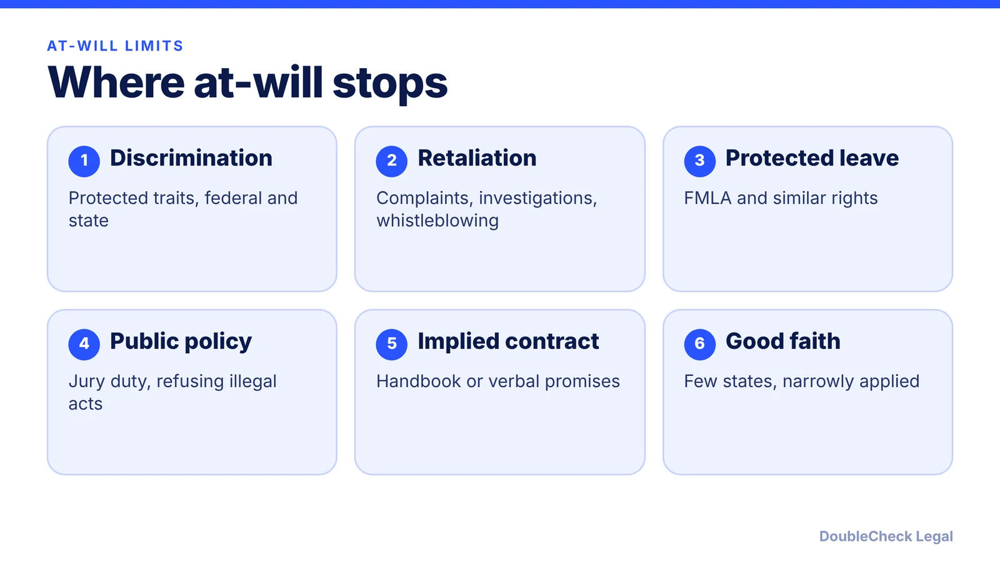
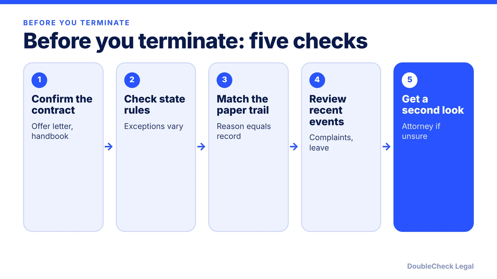

*At-will employment is the default, but discrimination, retaliation, and state exceptions limit it, and Montana works differently.*

**Key takeaways:**

- Per TriNet (July 2026), Montana is the only state that does not follow at-will; after probation, good cause is required.
- Public-policy, implied-contract, and implied-covenant exceptions vary by state, so verify yours.
- Federal discrimination and retaliation laws apply in every state.
- Consistent, dated documentation and manager training lower risk.

## 1. The quick answer

**Quick answer:** At-will employment means an employer can end the relationship for any lawful reason, or no reason, and the employee can leave the same way. It is the default in nearly every state. Per TriNet's July 2026 guide, Montana is the one state that does not follow it: after a probationary period (12 months by default, no more than 18), the employer needs good cause. Everywhere else, at-will still has limits: federal and state discrimination and retaliation laws, and in some states, public-policy, implied-contract, and implied-covenant exceptions. Which exceptions apply depends on your state, so check yours before you rely on any general rule.

## 2. The three common-law exceptions and Montana

Courts in many states carve out exceptions to at-will. Per [TriNet](https://www.trinet.com/insights/at-will-employment-states), they vary by state:

- **Public policy.** Many states recognize it, though what is protected varies. Examples include refusing to do something illegal, serving on a jury, filing a workers' compensation claim, and whistleblowing.
- **Implied contract.** This varies significantly by state. Examples are oral "for cause" assurances and handbook language on progressive discipline.
- **Implied covenant of good faith and fair dealing.** TriNet says only a small number of states recognize it and it is narrowly applied. Its example is ending someone just before a commission or bonus is earned.

On implied contracts, [FindLaw](https://www.findlaw.com/employment/losing-a-job/implied-employment-contracts-and-wrongful-termination.html) says that in states with this exception, courts have generally held that a handbook disclaimer does not by itself settle the question; they weigh it with all the other evidence, including emails, evaluations, and what managers said.

**Montana.** Per [ALFA International's Montana summary](https://www.alfainternational.com/compendium/labor-employment/montana/), the Wrongful Discharge from Employment Act (Mont. Code Ann. 39-2-901 to 39-2-915) is the exclusive remedy for wrongful discharge. Termination is at will only during the probationary period. After it, a discharge is wrongful if it was not for good cause, if it retaliated against refusing to violate public policy or reporting a violation, or if the employer violated the express provisions of its own written personnel policy. Good cause means reasonable job-related grounds, such as poor performance, disruption, or repeated policy violations.

We are not listing which other states recognize which exceptions. The sources we read did not give a reliable state-by-state breakdown, and it changes with court decisions.

## 3. Discrimination and retaliation apply in every state

Federal law overrides at-will. TriNet lists Title VII, the ADEA, and the ADA, covering race, sex, religion, national origin, age (40 and older), disability, and genetic information. It also lists protected leave under the FMLA, and retaliation for filing complaints, taking part in investigations, reporting unsafe conditions, or whistleblowing. Many states add their own protected classes, so a state with a longer list can reach more employers and more reasons.

Two practical points for a small employer:

- **Timing looks like motive.** A termination soon after a complaint, a leave request, or an injury report invites a retaliation claim even when the performance problem is real.
- **A stated reason must be true.** If the reason in the file differs from the reason you give later, that gap is usually what a claimant or agency focuses on.

Also check whether a written agreement overrides at-will. TriNet notes that employment contracts and collective bargaining agreements can. An offer letter promising a fixed term, or "termination only for cause," is a contract term, not a formality. For the termination process itself, see [how to terminate an employee legally](/blog/how-to-terminate-an-employee-legally-small-business/).

## 4. Practical steps and when to ask an attorney

Habits that reduce risk in any state:

1. **Put at-will wording in the offer letter and handbook**, and avoid language that sounds like a promise of permanent employment or "just cause" unless you mean it. See the [employee handbook guide](/blog/employee-handbook-small-business-what-to-include/).
2. **Document performance in real time.** Dated notes, written warnings, and reviews that match the reason for the decision.
3. **Follow your own written policies.** In Montana this is expressly a ground for wrongful discharge, and elsewhere a departure from your handbook can support an implied-contract argument.
4. **Train managers on what to say.** Casual assurances ("you're safe here") can be treated as representations.
5. **Check timing** against recent complaints, leave, or injuries before you act.
6. **Keep the paperwork consistent** across similar employees.

You can usually handle routine documentation yourself. Consider an employment attorney when the employee recently complained, took leave, or reported a safety issue; when you operate in Montana or have an employee there (see [multi-state remote employees](/blog/multi-state-remote-employees-compliance-startups/)); when a written agreement mentions cause or a term; or when you are offering severance (see [reviewing a severance agreement](/blog/severance-agreement-review-before-you-sign/)). Also see the [first employee checklist](/blog/how-to-hire-first-employee-legal-checklist/).

## Where DoubleCheck fits

[DoubleCheck](https://www.contactdoublecheck.com) helps businesses and founders start legal work with AI, verify it, and, when professional advice is warranted, connect with an independent attorney, including for immigration questions. Attorney availability and practice areas vary. Attorneys on DoubleCheck are independent professionals; an attorney-client relationship forms only if an attorney accepts your engagement.

**Sources:** [TriNet, At-will employment states](https://www.trinet.com/insights/at-will-employment-states); [ALFA International, Montana labor and employment](https://www.alfainternational.com/compendium/labor-employment/montana/); [FindLaw, implied employment contracts](https://www.findlaw.com/employment/losing-a-job/implied-employment-contracts-and-wrongful-termination.html); [Rocket Lawyer, exceptions to at-will](https://www.rocketlawyer.com/the-briefing-room/the-big-exceptions-to-at-will-employment).

## FAQ

**Is every state at-will?**

Not quite. Per TriNet's July 2026 guide, Montana is the only state that does not follow the doctrine. Under its Wrongful Discharge from Employment Act, employers need good cause after the probationary period, which is 12 months by default and cannot exceed 18.

**Can I fire someone for any reason in an at-will state?**

No. Per TriNet, discrimination, retaliation, and protected leave laws apply everywhere, and many states add public-policy, implied-contract, or good-faith limits.

**Does an at-will disclaimer in the handbook protect me?**

It helps but is not a guarantee. FindLaw says that in states with the implied-contract exception, courts generally treat a disclaimer as one factor among all the evidence, not as conclusive.

**What is the implied covenant of good faith?**

Per TriNet, it is recognized in only a small number of states and is applied narrowly. Its example is firing an employee shortly before a commission or bonus is earned.

---

*General information only. This article is not legal, tax, investment, or accounting advice.*
