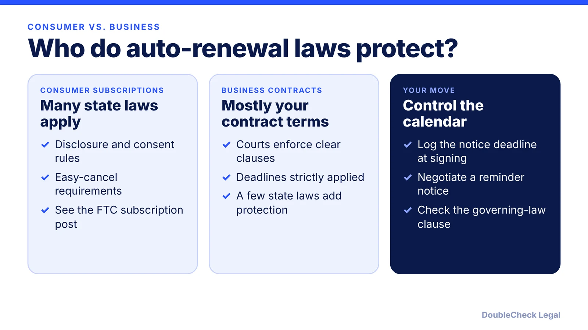
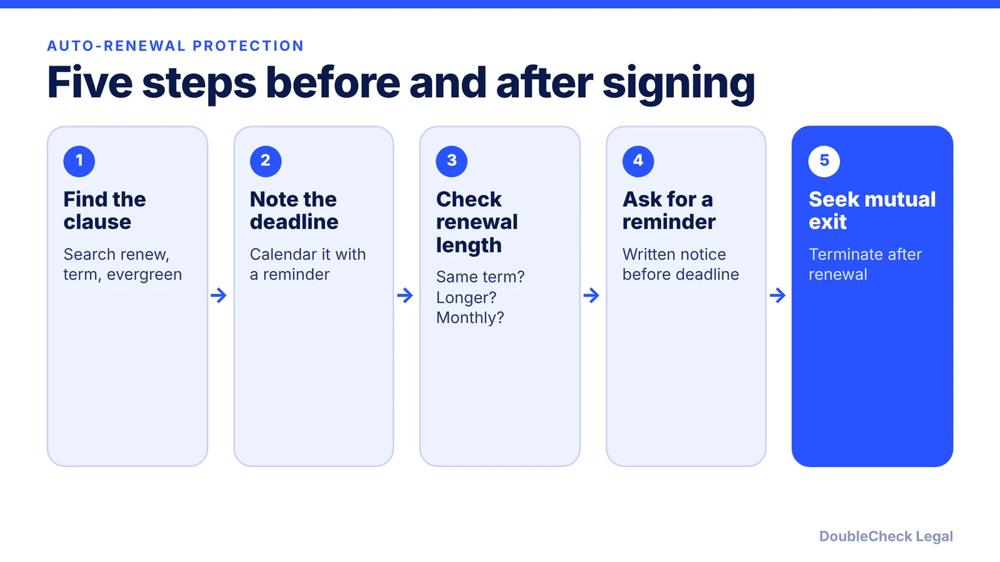

*Miss one notice date and you may be locked in for another term. Here is how business auto-renewals work and what the law adds.*

**Key takeaways:**

- Courts generally enforce clear B2B auto-renewal clauses and apply cancellation deadlines strictly, per McLane Middleton.
- Most consumer auto-renewal statutes do not cover business buyers, but some state laws do, such as New York GOL 5-903 for service, maintenance, or repair contracts.
- State rules vary and sources are dated; check your state's current statute.
- Calendar the notice deadline at signing and negotiate a reminder notice.

## 1. The quick answer

**Quick answer:** An auto-renewal (evergreen) clause renews your contract for another term unless you send notice before a deadline. In business-to-business contracts, courts generally enforce clear clauses and strictly apply the cancellation deadline, per McLane Middleton. The consumer auto-renewal statutes many people have heard of mostly do not cover business buyers, but a few state laws do, and New York's GOL 5-903 is the best-known example. Put the notice deadline on your calendar the day you sign.

## 2. How courts treat business auto-renewals

Per [McLane Middleton](https://www.mclane.com/insights/evergreen-clauses-how-enforceable-are-automatic-renewal-provisions/), courts usually enforce evergreen clauses in commercial business-to-business contracts when the language is clear and unambiguous, and a missed notice deadline means the contract renews for another term. These clauses are common in service, distribution, and supply contracts and some leases.

[Aaron Hall](https://aaronhall.com/legal-implications-of-automatic-renewal-clauses-in-b2b-contracts/) adds that courts look at whether the renewal terms are explicit, whether the parties had adequate disclosure, and whether the clause was reasonably communicated. Courts generally enforce cancellation deadlines strictly, and late notice typically triggers renewal, which can cost you leverage and may trigger fees.

Accepted delivery methods for the notice, per the same source, include certified mail, electronic communication if the contract allows it, and courier or in-person delivery. Use whatever your contract names, exactly.

## 3. State laws that can reach business contracts

This area varies by state, and sources describe it differently, so confirm your state's current statute.

- **New York, GOL 5-903.** Per the [NY Senate text](https://www.nysenate.gov/legislation/laws/GOB/5-903) as summarized, it covers contracts for service, maintenance, or repair of property. The provider must send written notice that calls attention to the renewal clause, served personally or by certified mail, at least 15 and no more than 30 days before the customer's deadline to give termination notice. Without it, the clause is unenforceable against the customer. It does not apply when the renewal period is one month or less. [Barclay Damon](https://www.barclaydamon.com/publications/q1-2023beware-the-automatic-renewal-provisions-in-contracts-with-us-companies) notes it is not limited to consumers and that many other states have no reminder-notice rule, citing Ohio as an example.
- **New York's 2021 law** is separate: per [Morgan Lewis](https://www.morganlewis.com/blogs/sourcingatmorganlewis/2020/12/new-york-reforms-automatic-renewal-laws), it covers only consumer contracts and left GOL 5-903 in place.
- **Wisconsin and Illinois.** A 2011 McLane Middleton article described a Wisconsin law reaching certain business contracts (disclosure at signing and an advance reminder for renewals over a year) and an Illinois act requiring clear and conspicuous renewal terms. A later summary on [Wikipedia](https://en.wikipedia.org/wiki/Automatic_renewal_clause) says Illinois excludes business-to-business contracts. Because these accounts conflict and are dated, check the current statute rather than rely on either.
- **Consumer statutes.** The Wikipedia summary says most automatic-renewal laws are consumer-protection statutes that do not cover business contracts such as SaaS subscriptions. For the consumer side, see [FTC click-to-cancel and SaaS](/blog/ftc-click-to-cancel-subscription-rules-saas/).

The governing-law clause matters, because the drafter often picks its home state (Barclay Damon).

## 4. Protect yourself before you sign

Practical steps, drawn from Aaron Hall and Barclay Damon:

- State the renewal term, the notice period, and whether renewal is automatic or manual.
- Negotiate reasonable opt-out notice periods and a right to renegotiate terms at renewal.
- If the other side insists on auto-renewal, try to add a contractual reminder notice, which is enforceable even where the law does not require one (Barclay Damon).
- Check price increases at renewal and whether termination after renewal is allowed.

Related reading: [how to terminate a contract early](/blog/how-to-terminate-a-contract-early-termination-clause/), [contract red flags](/blog/contract-red-flags-small-business/), the [AI vendor contract checklist](/blog/ai-vendor-contract-checklist/), and [what makes a contract binding](/blog/what-makes-a-contract-legally-binding/).

## Where DoubleCheck fits

[DoubleCheck](https://www.contactdoublecheck.com) helps businesses and founders start legal work with AI, verify it, and, when professional advice is warranted, connect with an independent attorney, including for immigration questions. Attorney availability and practice areas vary. Attorneys on DoubleCheck are independent professionals; an attorney-client relationship forms only if an attorney accepts your engagement.

**Sources:** [McLane Middleton, Evergreen Clauses](https://www.mclane.com/insights/evergreen-clauses-how-enforceable-are-automatic-renewal-provisions/); [NY Senate, General Obligations Law 5-903](https://www.nysenate.gov/legislation/laws/GOB/5-903); [Barclay Damon, Beware the Automatic Renewal Provisions](https://www.barclaydamon.com/publications/q1-2023beware-the-automatic-renewal-provisions-in-contracts-with-us-companies); [Morgan Lewis, New York Reforms Automatic Renewal Laws](https://www.morganlewis.com/blogs/sourcingatmorganlewis/2020/12/new-york-reforms-automatic-renewal-laws); [Wikipedia, Automatic renewal clause](https://en.wikipedia.org/wiki/Automatic_renewal_clause); [Aaron Hall, Automatic Renewal Clauses in B2B Contracts](https://aaronhall.com/legal-implications-of-automatic-renewal-clauses-in-b2b-contracts/).

## FAQ

**Are auto-renewal clauses legal in business contracts?**

Generally yes. Per McLane Middleton, courts usually enforce them in B2B contracts when the language is clear and unambiguous. Some states add disclosure or reminder-notice requirements, and these vary.

**Does New York require a reminder notice before auto-renewal?**

For contracts for service, maintenance, or repair of property, yes under GOL 5-903: written notice 15 to 30 days before the customer's termination deadline, served personally or by certified mail. Without it the clause is unenforceable against the customer, per the NY Senate text. It does not apply to renewal periods of one month or less.

**Do consumer auto-renewal laws protect my business?**

Usually not. Per the Wikipedia summary, most are consumer-protection statutes that do not cover business contracts. Some state laws do reach business contracts, so check the one that governs your contract.

**What if I missed the cancellation deadline?**

Ask the vendor in writing to waive the renewal or shorten the new term. Per Aaron Hall, courts generally enforce cancellation deadlines strictly, so a waiver is a negotiation, not a right. Review the clause and any state notice law with an attorney if the amount is large.

---

*General information only. This article is not legal, tax, investment, or accounting advice.*
