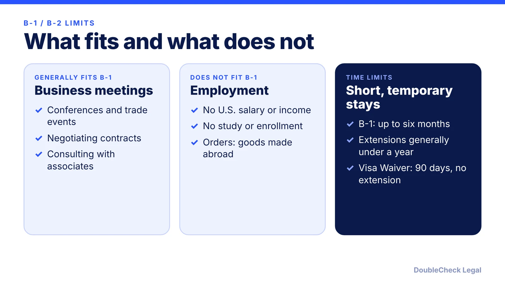
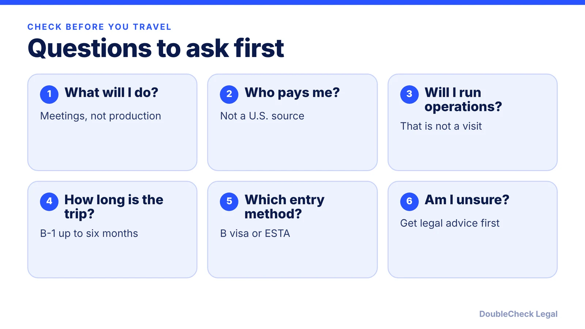

*A business visit is for meetings and deals, not for work that belongs under a work visa.*

**Key takeaways:**

- B-1 allows activities like conferences, negotiating contracts, and business meetings (per BAL).
- B-1 is not for employment, and U.S.-source salary is generally not allowed.
- B-1 initial admission is up to six months; Visa Waiver stays are 90 days with no extension.
- If the plan involves operating or working for a U.S. company, look at work-authorized options.

## 1. The quick answer

**Quick answer:** B-1 is for temporary business visits such as consulting with business associates, attending conferences, negotiating contracts, and participating in business meetings. It is not for employment. Per Berry Appleman & Leiden (BAL), "B-1 classification is not for employment in the U.S.," and visitors generally cannot receive a salary or income from a U.S.-based company. B-2 is for tourism, and B-2 visitors may not receive payment for services, per MIT. If your plans involve doing productive work in the U.S., you need a work-authorized status instead.

## 2. Permitted business activities

Per [BAL](https://www.bal.com/?p=19161), permitted B-1 activities include consulting with business associates, attending conventions or conferences, negotiating contracts, participating in business meetings, and taking orders for foreign goods. Short-term training and independent research are allowed provided they do not involve U.S.-source pay or productive employment. [The University of Houston](https://www.uh.edu/human-resources/employees/foreign-nationals/non-immigrant/b-1), citing the State Department, lists categories including business investment ventures, attending business events, lecturing or speaking, sales, service engineering, and training.

For a founder, that generally means exploring a market, meeting investors or customers, attending a conference, or negotiating a deal, with the work itself performed outside the U.S. Anything beyond that, such as joining a U.S. entity's operations, deserves legal advice first. BAL notes its page was last modified in July 2025, so check the State Department and USCIS pages for current rules.

## 3. The rule against unauthorized work

The line to hold is employment. Per BAL, visitors taking orders must have the resulting goods or services produced outside the U.S., and B-1 holders may not enroll in a course of study. Per UH, the visitor may not receive salary or income from a U.S.-based company; lecturers may receive only incidental expenses, with a limited honorarium option (no more than nine days at one institution, and no such payments from more than five organizations in six months). MIT adds that B-1 visitors cannot hold part-time or full-time employment, including temporary teaching or research positions, and that reimbursement of travel and living expenses incidental to the visit is different from salary.

Working without authorization can cause serious immigration consequences, so when a plan is unclear, ask an attorney before you travel. This post describes permitted activity only; it is not a way to fit paid work into a visitor status.

## 4. Visa, ESTA, and what to do instead

Per BAL, initial B-1 admission is up to six months, with extensions in periods of up to six months and generally not beyond one year. The Visa Waiver Program gives a 90-day stay that generally cannot be extended. MIT says the Visa Waiver route requires ESTA authorization and a round-trip ticket, and that extensions of stay and changes of status are not permitted.

If you plan to run or work for a U.S. company, look at work-authorized options. See [US visa options for founders compared](/blog/us-visa-options-for-startup-founders-compared/), [the L-1A new office visa](/blog/l-1a-visa-new-office-foreign-founders/), [E-2 treaty investor visas](/blog/e-2-treaty-investor-visa-for-founders/), and [H-1B vs L-1 vs O-1](/blog/h-1b-vs-l-1-vs-o-1-which-visa-for-tech-employees/). For setting up the company itself, read [how to incorporate in the US](/blog/how-to-incorporate-a-company-in-the-us/). A lawyer can confirm which path matches your facts.

## Where DoubleCheck fits

[DoubleCheck](https://www.contactdoublecheck.com) helps businesses and founders start legal work with AI, verify it, and, when professional advice is warranted, connect with an independent attorney, including for immigration questions. Attorney availability and practice areas vary. Attorneys on DoubleCheck are independent professionals; an attorney-client relationship forms only if an attorney accepts your engagement.

**Sources:** [BAL, Business Visitors Overview](https://www.bal.com/?p=19161); [University of Houston, B-1 Business Visitor](https://www.uh.edu/human-resources/employees/foreign-nationals/non-immigrant/b-1); [MIT ISchO, B-1 Business Visa and WB](https://ischo.mit.edu/mit-administrators/visa-processing-information/b-1-business-visa-and-wb-visa-waiver-business).

## FAQ

**Can a founder work remotely for their U.S. startup on a B-1?**

This post does not give guidance on that. Per BAL, B-1 is not for employment in the U.S., and visitors generally cannot receive a salary from a U.S.-based company, so ask an immigration attorney before you travel.

**Can I meet investors on a B-1 visa?**

BAL lists consulting with business associates, negotiating contracts, and participating in business meetings as permitted B-1 activities.

**How long can I stay on a B-1?**

BAL says initial admission is up to six months, with extensions of up to six months and generally not beyond one year. Visa Waiver Program visitors get 90 days with no extension.

**What is the difference between B-1 and B-2?**

B-1 is for business visits. Per MIT, B-2 visitors are tourists who may not have a professional affiliation or receive payment for services.

---

*General information only. This article is not legal, tax, investment, or accounting advice.*
