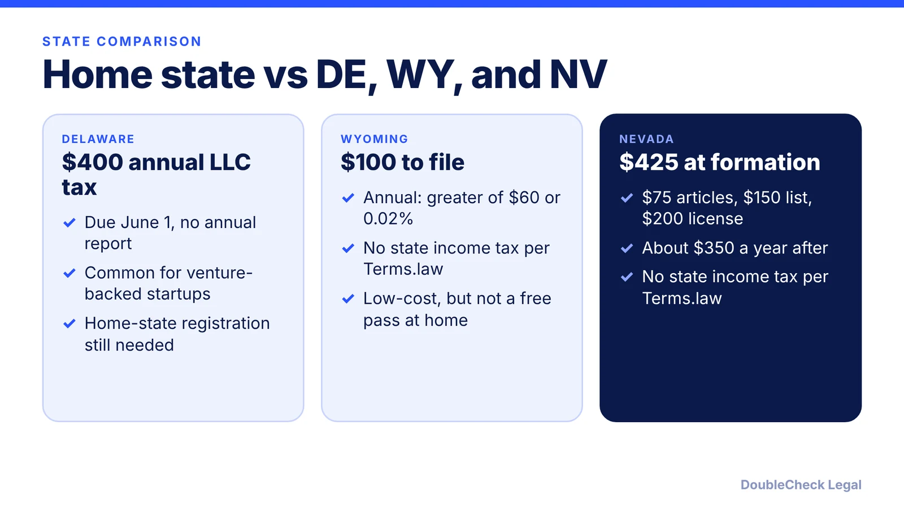
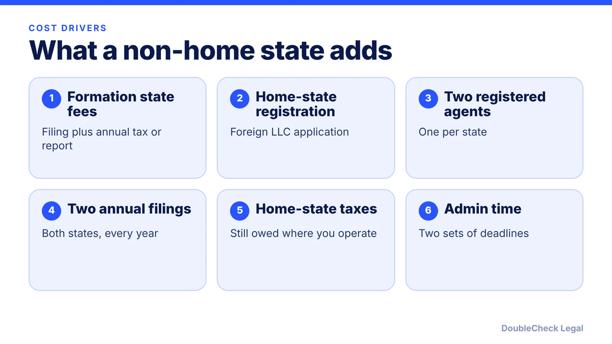

*Which state is best for an LLC? For most one-state businesses, the answer is where you operate. Here are the costs and the exceptions, as of November 2026.*

**Key takeaways:**

- Forming outside your home state generally means registering as a foreign LLC at home and paying two states.
- Delaware lists a $400 annual LLC tax; Wyoming's annual license tax is at least $60; Nevada runs about $350 a year in state fees.
- Delaware is mainly suited to venture-backed companies, and those are usually C-corporations.
- A low-fee state does not remove taxes owed where you actually do business.

## 1. The quick answer

**Quick answer:** For most small businesses that operate in one state, forming in your home state is usually the best choice, because forming elsewhere generally means registering as a foreign LLC at home and paying fees in two states. Delaware makes sense mainly for companies planning venture funding, while Wyoming and Nevada are the usual low-tax alternatives people ask about. As of November 2026, state sources list Delaware at a $400 annual LLC tax, Wyoming at a $60 minimum annual license tax, and Nevada at about $350 a year in state fees.

## 2. The costs, side by side

Figures below come from state agency fee pages and the sibling posts in this series. Fees change, so confirm each on the state's own page before filing.

- **Delaware:** the Delaware Division of Corporations lists a $400 annual tax for LLCs, due June 1, with no annual report (see [Delaware LLC annual tax](/blog/delaware-llc-annual-tax-june-1/)). Some older guides still show $300. Pages disagree on the Delaware formation fee ($110 or $90), so we do not quote one.
- **Wyoming:** $100 for Articles of Organization, and an annual license tax of the greater of $60 or $0.0002 of assets located in Wyoming, per the Wyoming Secretary of State fee schedule. See [how to start an LLC in Wyoming](/blog/how-to-start-an-llc-in-wyoming/).
- **Nevada:** $425 at formation ($75 filing, $150 initial list, $200 state business license) and $350 a year ($150 annual list plus $200 license renewal), per the Nevada Secretary of State fee schedule. See [how to start an LLC in Nevada](/blog/how-to-start-an-llc-in-nevada/).
- **Registered agent:** every state requires one in-state, and commercial agents charge varying annual fees.

## 3. Why home state usually wins

Where you form decides which state's law governs the LLC's internal affairs. It does not decide where you owe tax or registration. A foreign LLC generally must register in any state where it "does business," which means a significant, continuing presence there, and registration involves an application for authority (with a filing fee that varies by state), an in-state registered agent, and that state's ongoing fees. For example, a Wyoming LLC doing business in California is generally subject to California's $800 annual LLC tax (see the California Franchise Tax Board) plus Wyoming's annual license tax. See [California LLC annual tax and fee](/blog/california-llc-annual-tax-and-fee/).

Doing-business rules, not the formation state, drive where you must register, so your home state will generally require registration if you form elsewhere. Forming in a low-tax state does not avoid taxes in the state where you actually do business.

Compare the costs of the main home states in [LLC formation cost: California, Texas, Florida, New York](/blog/llc-formation-cost-california-texas-florida-new-york/), and see our home-state guides for [Georgia](/blog/how-to-start-an-llc-in-georgia/), [Illinois](/blog/how-to-start-an-llc-in-illinois/), [Arizona](/blog/how-to-start-an-llc-in-arizona/), and [Colorado](/blog/how-to-start-an-llc-in-colorado/).

## 4. When Delaware, Wyoming, or Nevada can make sense

**Delaware:** Delaware is the usual choice for venture-backed startups and companies planning institutional investment, because investors and their attorneys know Delaware law. Venture-backed companies are usually Delaware C-corporations rather than LLCs; read [LLC vs C-corp for startups](/blog/llc-vs-c-corp-startups/), [incorporate in California vs Delaware](/blog/incorporate-california-vs-delaware-startup/), [Delaware franchise tax for startups](/blog/delaware-franchise-tax-startups/), and [a Delaware corporation doing business in California](/blog/delaware-corporation-doing-business-in-california/). If you do use Delaware, see [Delaware registered agent requirements](/blog/delaware-registered-agent-requirements/).

**Wyoming or Nevada:** these can fit owners who live and operate in that state, or businesses with no physical presence elsewhere. Nonresidents often consider them, and Nevada's fees are higher. Whether a nonresident or foreign owner has extra federal obligations is a separate question; see [Form 5472 for foreign-owned LLCs](/blog/form-5472-foreign-owned-single-member-llc/).

**A simple way to decide:**

1. Where do you live and work? Start with that state's total cost.
2. Do you plan to raise venture capital? If yes, talk to an attorney about a Delaware C-corp.
3. Add up both states' fees if you consider forming elsewhere.
4. Ask an attorney or CPA before relying on any "tax-free" claim.

For the full process, see [how to incorporate a company in the US](/blog/how-to-incorporate-a-company-in-the-us/).

**Related reading:** [Series LLC Explained: Which States Allow It and What the Risks Are](/blog/series-llc-explained-which-states-allow-it-and-risks/); [Registered Agent for an LLC: Who Can Serve and What It Costs](/blog/registered-agent-for-an-llc-who-can-serve-and-what-it-costs/)

## Where DoubleCheck fits

[DoubleCheck](https://www.contactdoublecheck.com) helps businesses and founders start legal work with AI, verify it, and, when professional advice is warranted, connect with an independent attorney, including for immigration questions. Attorney availability and practice areas vary. Attorneys on DoubleCheck are independent professionals; an attorney-client relationship forms only if an attorney accepts your engagement.

**Sources:** [Wyoming Secretary of State, business fees](https://sos.wyo.gov:443/Business/docs/BusinessFees.pdf); [Nevada Secretary of State, fee schedule](https://nvsos.prod.govaccess.org/home/showpublisheddocument/1047/638308047406100000); [California Franchise Tax Board, limited liability company](https://www.ftb.ca.gov/file/business/types/limited-liability-company); [Delaware Division of Corporations, LLC tax](https://corp.delaware.gov/alt-entitytaxinstructions) (as cited in our Delaware LLC tax post).

## FAQ

**What is the best state to form an LLC?**

For businesses operating in one state, forming in your home state is usually best to avoid foreign registration fees and paying two states. Delaware is typically for venture-backed companies.

**Is it cheaper to form an LLC in Wyoming than in my home state?**

Not necessarily. Wyoming's filing is $100 and annual license tax is at least $60 per the Wyoming Secretary of State, but if you operate elsewhere you generally must also register there. For example, a Wyoming LLC doing business in California is generally still subject to California's $800 annual LLC tax.

**What does a Delaware LLC cost each year?**

The Delaware Division of Corporations lists a $400 annual tax for LLCs, due June 1, with no annual report. Some older guides still show $300. A registered agent is extra.

**Does a Nevada LLC avoid state tax?**

Nevada has no state personal income tax, but the benefit applies only if you live and operate there. Nevada's fees are higher: about $425 at formation and $350 a year, per the Nevada Secretary of State fee schedule.

---

*General information only. This article is not legal, tax, investment, or accounting advice.*
