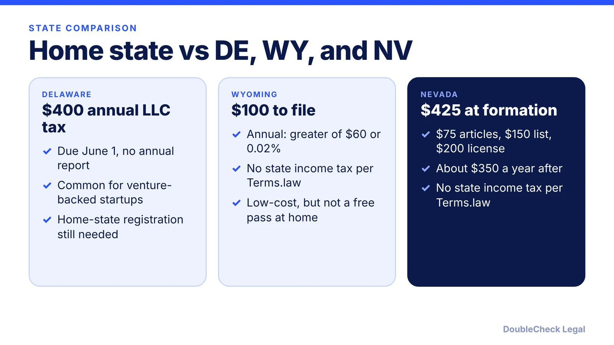
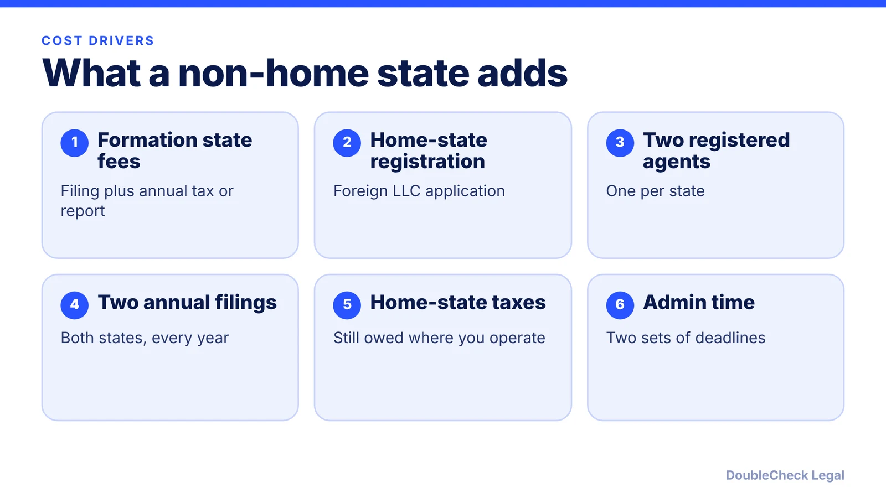

*Which state is best for an LLC? For most one-state businesses, the answer is where you operate. Here are the costs and the exceptions, as of November 2026.*

**Key takeaways:**

- Forming outside your home state generally means registering as a foreign LLC at home and paying two states, per Terms.law and Legal.com.
- Delaware lists a $400 annual LLC tax; Wyoming's annual license tax is at least $60; Nevada runs about $350 a year in state fees.
- Delaware is mainly suited to venture-backed companies, per Terms.law, and those are usually C-corporations.
- A low-fee state does not remove taxes owed where you actually do business.

## 1. The quick answer

**Quick answer:** For most small businesses that operate in one state, forming in your home state is usually the best choice, because forming elsewhere generally means registering as a foreign LLC at home and paying fees in two states (per Terms.law and Legal.com). Delaware makes sense mainly for companies planning venture funding, while Wyoming and Nevada are the usual low-tax alternatives people ask about. As of November 2026, secondary sources list Delaware at a $400 annual LLC tax, Wyoming at a $60 minimum annual license tax, and Nevada at about $350 a year in state fees.

## 2. The costs, side by side

Figures below come from secondary guides (doola, Wise, Terms.law) and the sibling posts in this series. Fees change, so confirm each on the state's own page before filing.

- **Delaware:** the Delaware Division of Corporations lists a $400 annual tax for LLCs, due June 1, with no annual report (see [Delaware LLC annual tax](/blog/delaware-llc-annual-tax-june-1/)). Per doola, that rose from $300 starting with the 2026 tax year. Pages disagree on the Delaware formation fee ($110 or $90), so we do not quote one.
- **Wyoming:** $100 for Articles of Organization, and an annual license tax of the greater of $60 or $0.0002 of assets located in Wyoming, per doola. See [how to start an LLC in Wyoming](/blog/how-to-start-an-llc-in-wyoming/).
- **Nevada:** $425 at formation ($75 filing, $150 initial list, $200 state business license) and $350 a year ($150 annual list plus $200 license renewal), per doola and Rho. See [how to start an LLC in Nevada](/blog/how-to-start-an-llc-in-nevada/).
- **Registered agent:** every state requires one in-state, and commercial agents commonly charge $50 to $300 a year, per Terms.law.

## 3. Why home state usually wins

Where you form decides which state's law governs the LLC's internal affairs. It does not decide where you owe tax or registration. Per Terms.law, a foreign LLC must register in any state where it "does business," which means a significant, continuing presence there, and registration involves an application for authority ($100 to $500 depending on the state), an in-state registered agent, and that state's ongoing fees. Its example: a Wyoming LLC operating in California pays California's $800 annual tax plus Wyoming's $60 annual report. See [California LLC annual tax and fee](/blog/california-llc-annual-tax-and-fee/).

Legal.com makes the same point: nexus laws, not the formation state, drive your obligations, and the "Foreign Qualification Trap" means your home state will generally require registration if you form elsewhere. Terms.law adds that forming in a low-tax state does not avoid taxes in the state where you actually do business, and describes Nevada as often marketed aggressively but rarely offering advantages over Wyoming for small businesses (that is that site's view).

Compare the costs of the main home states in [LLC formation cost: California, Texas, Florida, New York](/blog/llc-formation-cost-california-texas-florida-new-york/), and see our home-state guides for [Georgia](/blog/how-to-start-an-llc-in-georgia/), [Illinois](/blog/how-to-start-an-llc-in-illinois/), [Arizona](/blog/how-to-start-an-llc-in-arizona/), and [Colorado](/blog/how-to-start-an-llc-in-colorado/).

## 4. When Delaware, Wyoming, or Nevada can make sense

**Delaware:** Terms.law says Delaware is best for venture-backed startups and companies planning institutional investment, because investors and their attorneys know Delaware law. Venture-backed companies are usually Delaware C-corporations rather than LLCs; read [LLC vs C-corp for startups](/blog/llc-vs-c-corp-startups/), [incorporate in California vs Delaware](/blog/incorporate-california-vs-delaware-startup/), [Delaware franchise tax for startups](/blog/delaware-franchise-tax-startups/), and [a Delaware corporation doing business in California](/blog/delaware-corporation-doing-business-in-california/). If you do use Delaware, see [Delaware registered agent requirements](/blog/delaware-registered-agent-requirements/).

**Wyoming or Nevada:** these can fit owners who live and operate in that state, or businesses with no physical presence elsewhere. Wise notes nonresidents often consider them, and that Nevada has higher fees. Whether a nonresident or foreign owner has extra federal obligations is a separate question; see [Form 5472 for foreign-owned LLCs](/blog/form-5472-foreign-owned-single-member-llc/).

**A simple way to decide:**

1. Where do you live and work? Start with that state's total cost.
2. Do you plan to raise venture capital? If yes, talk to an attorney about a Delaware C-corp.
3. Add up both states' fees if you consider forming elsewhere.
4. Ask an attorney or CPA before relying on any "tax-free" claim.

For the full process, see [how to incorporate a company in the US](/blog/how-to-incorporate-a-company-in-the-us/).

## Where DoubleCheck fits

[DoubleCheck](https://www.contactdoublecheck.com) helps businesses and founders start legal work with AI, verify it, and, when professional advice is warranted, connect with an independent attorney, including for immigration questions. Attorney availability and practice areas vary. Attorneys on DoubleCheck are independent professionals; an attorney-client relationship forms only if an attorney accepts your engagement.

**Sources:** [Terms.law, LLC formation FAQ](https://terms.law/FAQ/small-business/llc-formation-faq.html); [Legal.com, best state to form an LLC](https://legal.com/edu/business/best-state-to-form-an-llc); [Wise, best state to form an LLC](https://wise.com/us/blog/best-state-to-form-llc); [doola, Wyoming vs Nevada vs Delaware LLC](https://www.doola.com/blog/wyoming-vs-nevada-vs-delaware-llc/); [Delaware Division of Corporations, LLC tax](https://corp.delaware.gov/alt-entitytaxinstructions) (as cited in our Delaware LLC tax post); [Rho, Nevada LLC](https://www.rho.co/blog/how-to-start-an-llc-in-nevada).

## FAQ

**What is the best state to form an LLC?**

For businesses operating in one state, Terms.law says forming in your home state is usually best to avoid foreign registration fees. Legal.com says home-state formation suits about 95% of owners. Delaware is typically for venture-backed companies.

**Is it cheaper to form an LLC in Wyoming than in my home state?**

Not necessarily. Wyoming's filing is $100 and annual license tax at least $60 per doola, but if you operate elsewhere you generally must also register there, per Terms.law. Terms.law's example: a Wyoming LLC in California still pays California's $800 annual tax.

**What does a Delaware LLC cost each year?**

The Delaware Division of Corporations lists a $400 annual tax for LLCs, due June 1, with no annual report. doola says it rose from $300 starting with the 2026 tax year. A registered agent is extra.

**Does a Nevada LLC avoid state tax?**

Nevada has no state personal income tax, per Rho and Terms.law, but the benefit applies only if you live and operate there. Nevada's fees are higher: about $425 at formation and $350 a year, per doola and Rho.

---

*General information only. This article is not legal, tax, investment, or accounting advice.*
