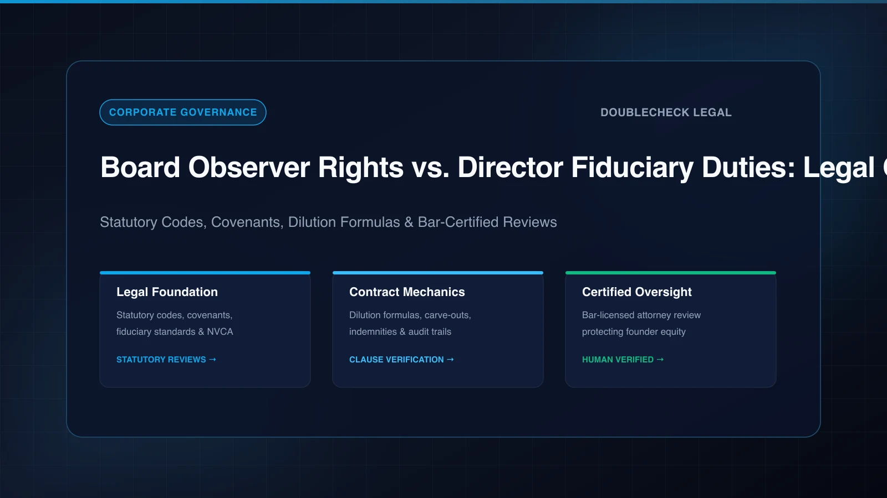
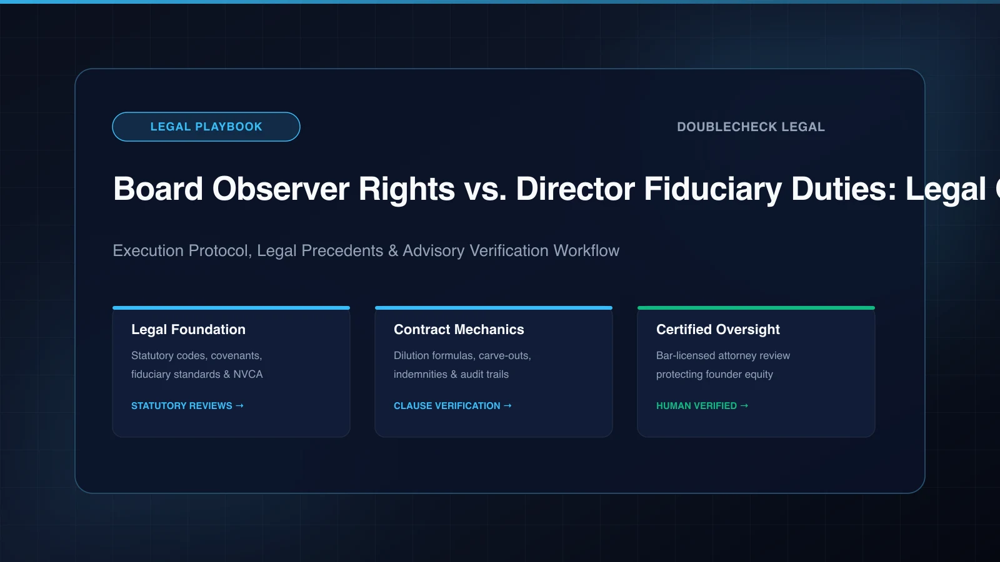

<div class="article-hero-banner mb-8">
  
</div>

## What Is the Legal Distinction Between a Director and a Board Observer?

The critical legal distinction between a **corporate director** and a **board observer** under Delaware General Corporation Law (DGCL) centers on **statutory fiduciary duties and voting governance**. A corporate director is a sworn fiduciary bound by the fundamental duties of **care, loyalty, and good faith** under Delaware law, exposed to personal liability for breaches. In contrast, a board observer is merely a contractual guest who holds rights to attend meetings and receive governance packets without holding voting authority or statutory fiduciary obligations.

```
Board Director vs. Board Observer Governance Matrix

┌────────────────────────────┬─────────────────────────────┬─────────────────────────────┐
│ Characteristic             │ Corporate Director          │ Board Observer              │
├────────────────────────────┼─────────────────────────────┼─────────────────────────────┤
│ Legal Authority            │ Statutory (DGCL § 141)      │ Purely Contractual (Letter) │
│ Voting Rights              │ Yes (One vote per director) │ Zero (Voice without vote)   │
│ Fiduciary Duties           │ Duty of Care & Loyalty      │ No common law duties        │
│ Attorney-Client Privilege  │ Within corporate circle     │ High risk of privilege loss │
│ Conflict Recusal           │ Statutory requirement       │ Only if drafted in covenant │
│ Termination of Role        │ Shareholder removal         │ Automatic contractual lapse │
└────────────────────────────┴─────────────────────────────┴─────────────────────────────┘
```

---

## Direct Answer for Boards, Founders & General Counsels

- **For Founders:** Never grant board observer seats lightly. While venture investors often view observer seats as harmless compromises when denying full board representation, an unrestricted observer can compromise your company's attorney-client privilege, leak trade secrets to portfolio competitors, and disrupt executive alignment without owing any duty of loyalty to the enterprise.
- **For Investors:** An observer seat provides comprehensive operational visibility and boardroom intelligence without subjecting the venture partner to personal breach of fiduciary duty lawsuits under Delaware Court of Chancery jurisdiction.

---

## 1. Fiduciary Duties: The Asymmetry of Corporate Exposure

### The Director's Fiduciary Burden under Delaware Law
Under Delaware jurisprudence (*Guth v. Loft*, *In re Caremark International Inc. Derivative Litigation*), corporate directors hold unyielding obligations:
1. **Duty of Care:** Requiring informed, diligent decision-making supported by reasonable inquiry and expert counsel under the protection of the Business Judgment Rule.
2. **Duty of Loyalty:** Mandating that directors prioritize the corporate entity and all stockholders above their personal interests or the specific venture fund that appointed them.

### Why Observers Owe No Inherent Duty
Because a board observer does not execute corporate actions, cast votes, or manage the business under DGCL § 141(a), Delaware courts consistently hold that **observers are not fiduciaries**. 

If a board observer attends an executive strategy session, learns of an unannounced technological pivot, and subsequently advises a competing portfolio startup within the same venture firm's fund, the startup cannot bring a common law claim for breach of the fiduciary duty of loyalty against that observer. Any legal recourse is strictly limited to breach of contract under the specific wording of the investor's **Side Letter or Investor Rights Agreement (IRA)**.

---

## 2. The Evidentiary Hazard: Waiving Attorney-Client Privilege

The most severe operational risk of accommodating board observers is the **accidental waiver of the attorney-client privilege**.

When company counsel briefs the board of directors regarding pending intellectual property litigation, regulatory inquiries, or employee harassment allegations:
- Communications between legal counsel and **directors** are protected because directors embody the corporate client.
- Because **observers are third parties** who lack fiduciary accountability, their presence in the boardroom frequently breaches the circle of confidentiality.

### The Failure of the "Common Interest" Doctrine
Litigants routinely challenge corporate claims of attorney-client privilege where observers were present. Courts regularly find that an investor's commercial interest in maximizing startup return does not satisfy the strict legal definition of a **"Common Legal Interest"**, which requires an identical, shared legal defense strategy. 

To safeguard corporate privilege, every observer side letter must incorporate explicit **Executive Session Recusal Provisions**:

> *"The Company reserves the right to exclude the Board Observer from any portion of any meeting, or withhold any confidential materials, if company counsel determines in good faith that such exclusion is required to preserve the attorney-client privilege or avoid a commercial conflict of interest."*

---

## 3. Commercial Conflicts of Interest and Portfolio Competitors

Venture capital firms invest across vertical industries. An observer representing an early-stage fund may sit on the board of multiple companies operating in adjacent AI, fintech, or enterprise software spaces.

### Mandatory Drafting Protective Provisions:
1. **Competitive Investment Disqualification:** The observer agreement must state that observer rights terminate automatically if the venture firm or any affiliated entity leads or participates in a financing for a direct competitor.
2. **Trade Secret & Non-Disclosure Covenants:** Standard boilerplate confidentiality clauses are insufficient. Observer agreements must incorporate explicit **residual knowledge limits**, prohibiting the observer from applying proprietary algorithmic insights or customer pricing lists learned during board briefings.
3. **Information Withholding Rights:** The Chief Executive Officer must retain contractual discretion to redact proprietary patent disclosures, algorithmic weights, and key commercial negotiations from observer board decks.

---

## 4. Structuring Enforceable Board Observer Agreements

When negotiating Series Seed or Series A governance documents, startups should adhere to the following NVCA-aligned structural standards:
- **Designate Named Individuals:** Never grant observer seats to a "firm generally." Require the investor to name a specific partner or principal, with changes subject to company approval.
- **Enforce Automatic Expiration:** Observer rights should automatically terminate upon:
  - The closing of the company's next qualified financing round (Series B).
  - The investor's equity holding dropping below a designated ownership threshold (e.g., less than 50% of original shares).
  - An Initial Public Offering (IPO) or Change of Control event.

---

## Statutory Authorities and Benchmark References

- **Delaware General Corporation Law (DGCL § 141):** Board of Directors powers, governance standards, and committee delegations.
- **Delaware Court of Chancery Precedents:** *In re Trados Inc. Shareholder Litigation* (fiduciary duty standards in preferred financing conflicts).
- **National Venture Capital Association (NVCA) Model Investor Rights Agreement (IRA):** Model covenants governing board observation and inspection rights.
- **Federal Rules of Evidence (Rule 502):** Attorney-Client Privilege and Work Product provisions regarding disclosures.

<div class="article-steps-banner my-10">
  
</div>
