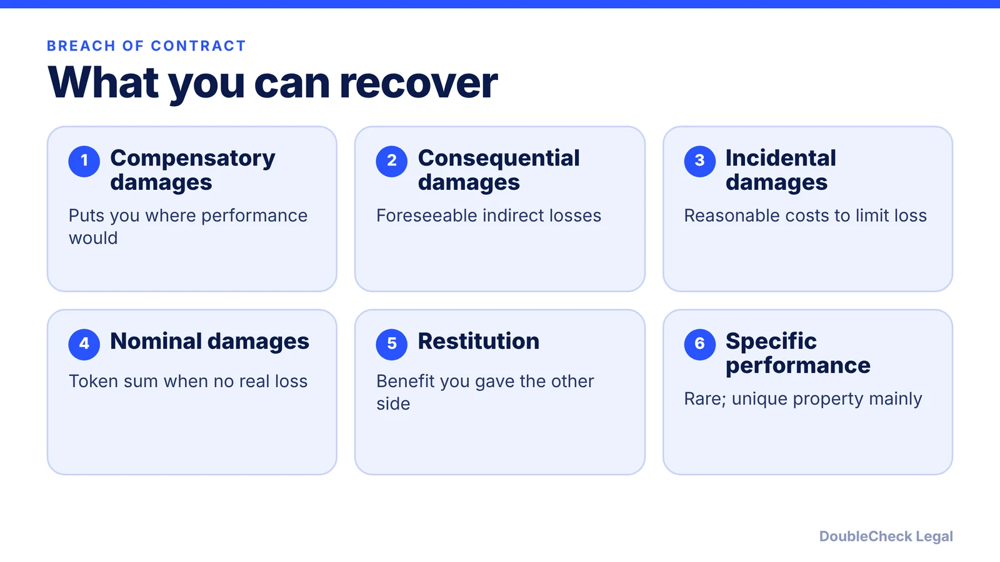
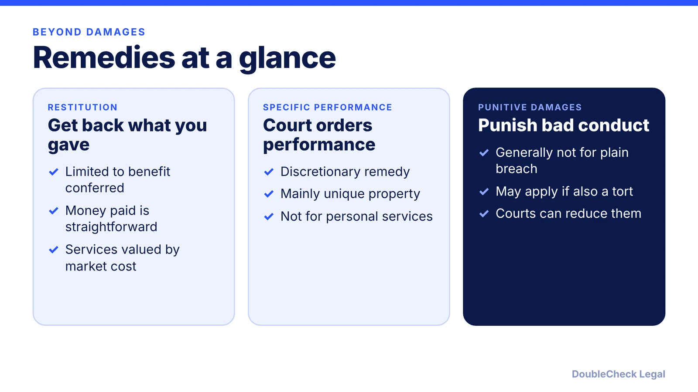

*Breach of contract remedies: what you can recover as a small business, what it takes to prove it, and what a contract can change.*

**Key takeaways:**

- Compensatory damages are the default remedy and must be proven, not speculated.
- Consequential damages need foreseeability; contracts often cap them.
- You generally must mitigate your losses.
- Attorney fees follow the contract or a statute, not the winner, in most states.

## 1. The quick answer

**Quick answer:** If the other side breaches a contract, the most common remedy is money damages meant to put you where you would have been had the contract been performed. Other remedies include consequential damages for foreseeable indirect losses, restitution of what you gave, and, in limited cases involving unique property, a court order to perform (specific performance). Punitive damages are generally not available for a plain breach, per Cornell's Legal Information Institute. You must also take reasonable steps to limit your losses, and your contract may change the default rules, for example on attorney fees.

## 2. Money damages: what counts and how it is measured

Damages are the default remedy. Per Cornell's Legal Information Institute, the goal of contract remedies is to place the harmed party in the same economic position it would have been in had no breach occurred, and monetary damages are the default remedy.

- **Expectation damages.** These are usually the difference between the value promised and the value received, plus incidental costs. Courts generally expect the amount to be supported by evidence rather than speculation, though the standard varies by state.
- **Consequential damages.** These cover indirect losses that flow from the breach, such as lost profits from a business interruption. For sales of goods, UCC section 2-715(2), as published by Cornell's Legal Information Institute, allows losses from the buyer's general or particular requirements and needs that the seller knew of when contracting, if the loss could not reasonably have been prevented. Other contracts are governed by state common law, which generally applies a similar foreseeability idea from *Hadley v. Baxendale* (1854).
- **Incidental damages.** For sales of goods, UCC section 2-715(1) covers expenses reasonably incurred because of the breach, such as the cost of inspecting, handling or caring for rejected goods and commercially reasonable cover costs.
- **Nominal damages.** A small token sum, such as one dollar, when the breach caused no real loss.

A practical example: a caterer cancels three days before your launch event. Your direct loss may be the extra cost of a rushed replacement. Lost ticket sales that you can prove with reasonable certainty might be argued as consequential damages, but only if the loss was foreseeable when you signed and you can document it.

Keep in mind that contracts often limit these amounts. Whether such a cap is enforceable depends on the contract wording and your state's law. See [limitation of liability clauses](/blog/limitation-of-liability-clause-explained/) before you assume every loss is recoverable, and [liquidated damages vs penalty clauses](/blog/liquidated-damages-vs-penalty-clause-enforceable-small-business/) for contracts that fix the amount in advance.

## 3. Restitution, specific performance, rescission and punitive damages

Money damages are not the only tool, but the others are narrower.

**Restitution.** Restitution generally aims to return to a party what it gave the other party, so recovery is tied to the benefit conferred. If money was paid, the amount is clear. If services were performed, the measure can be harder to pin down and varies by state.

**Specific performance.** Per Cornell's Legal Information Institute, it is a court order to perform, often applied when monetary damages are inadequate, most commonly with real property and sometimes with unique or irreplaceable items. Courts are generally reluctant to order it for ordinary commercial deals, and personal service contracts are treated differently in many states. An injunction, which bars a specified act, may be used to enforce a promise to refrain from doing something; that is how some non-compete and confidentiality disputes reach court.

**Rescission.** Rescission is another remedy; it means cancelling the contract and unwinding it. For the grounds and limits, see [how to void or cancel a contract](/blog/how-to-void-or-cancel-a-contract-grounds-and-limits/).

**Punitive damages.** They punish wrongful conduct rather than compensate, and courts generally do not award them for breach of contract, per Cornell's Legal Information Institute. Exceptions can arise where the conduct is also an independent tort, such as fraud, and they vary by state.

## 4. Your duty to mitigate, and the proof you need

Winning a breach claim is not just about showing that the other side broke the deal. You also have to show what it cost you.

**Mitigation.** Per Cornell's Legal Information Institute, an injured party has a duty to mitigate its harm, for example by reselling equipment bought in reliance on the contract, and failing to do so can bar recovery. The duty is one of reasonable steps, not unreasonable expense. If a vendor fails to deliver, look for a reasonable replacement quickly and keep the quotes. This is a general principle; details vary by state and by type of contract.

**Evidence.** Because damages cannot be speculative, build a file as you go:

1. The signed contract, amendments and any change emails (see [how to change a signed agreement](/blog/contract-amendment-vs-new-contract-how-to-change-a-signed-agreement/)).
2. Proof that you performed or were ready to perform.
3. Dated notices of the breach and the other side's responses.
4. Invoices, replacement quotes and records of lost sales, tied to the breach.
5. Any proof of foreseeability, such as an email telling the vendor why the deadline mattered.

If you were never given a signed document, see [verbal contracts](/blog/verbal-contract-enforceable-small-business/) for what can still be proven.

**Time limits.** Claims expire. The deadline depends on the state and the contract type; see [statute of limitations for breach of contract by state](/blog/statute-of-limitations-breach-of-contract-by-state-small-business/). Do not assume you have years.

## 5. Attorney fees, practical steps and when to get help

**Attorney fees.** Per Nolo, under the American Rule each party to a lawsuit pays its own attorney fees by default. Parties can agree in a contract that the losing side pays the winner's fees, and a mutual (prevailing-party) clause awards fees to whoever wins. Nolo also says California converts a one-way fee provision into a mutual one, so a one-sided clause can end up benefiting the other side, and that courts can review fee clauses for fairness. Other states vary. Read your fee clause before you threaten or file anything.

**A sensible order of steps:**

1. Re-read the contract for termination, notice, cure, limitation of liability and dispute resolution terms. Many contracts require a written notice and a chance to cure before you can claim breach. See [how to terminate a contract early](/blog/how-to-terminate-a-contract-early-termination-clause/).
2. Document the breach and your losses in writing.
3. Mitigate and keep the records.
4. Send a clear [demand letter](/blog/how-to-write-a-demand-letter-small-business/). Many disputes end here.
5. For smaller unpaid amounts, consider [small claims court](/blog/how-to-collect-unpaid-invoices-small-claims/), where the process is simpler. Check your state's limit.
6. If an arbitration clause applies, follow it; see [arbitration clauses explained](/blog/arbitration-clause-explained-small-business-contracts-pros-cons/).

**When to get an attorney:** If the loss is large, if you suspect fraud, if the contract has a fee-shifting or arbitration clause you do not fully understand, or if you are being sued rather than suing, talk to a licensed attorney in your state; see [when to hire a lawyer](/blog/when-to-hire-lawyer-small-business/) and [how to choose a good lawyer](/blog/how-to-choose-good-lawyer/). AI can help you organize a timeline and a list of questions, but it can miss state-specific rules, so verify its output; see [how to verify AI-generated legal documents](/blog/verify-ai-generated-legal-document/).

## Where DoubleCheck fits

[DoubleCheck](https://www.contactdoublecheck.com) helps businesses and founders start legal work with AI, verify it, and, when professional advice is warranted, connect with an independent attorney, including for immigration questions. Attorney availability and practice areas vary. Attorneys on DoubleCheck are independent professionals; an attorney-client relationship forms only if an attorney accepts your engagement.

**Sources:** [Cornell Legal Information Institute, Breach of contract](https://law.cornell.edu/wex/breach_of_contract); [Cornell Legal Information Institute, Specific performance](https://law.cornell.edu/wex/specific_performance); [Cornell Legal Information Institute, UCC 2-715](https://www.law.cornell.edu/ucc/2/2-715.html); [Nolo, Attorneys' fees provisions in contracts](https://www.nolo.com/legal-encyclopedia/attorneys-fees-provisions-contracts-32645.html).

## FAQ

**What can I recover if someone breaches a contract?**

Most often money damages that put you where performance would have. Other remedies include consequential damages, restitution and, for unique property, specific performance, per Cornell's Legal Information Institute. Punitive damages are generally not available for a plain breach.

**Can I recover lost profits for a breach of contract?**

Sometimes. Lost profits are typically consequential damages, recoverable only if the loss was foreseeable when contracting (for goods, UCC 2-715 refers to needs the seller knew of) and you can prove them with evidence. A limitation of liability clause may cap them.

**Do I have to mitigate my damages?**

Yes. Per Cornell's Legal Information Institute, an injured party has a duty to mitigate, and failing to do so can bar recovery.

**Who pays attorney fees in a breach of contract case?**

Under the American Rule, each side generally pays its own unless the contract or a statute says otherwise, per Nolo. Fee clauses can cut both ways, and California makes one-sided clauses mutual; rules vary by state.

**Can a court force the other side to perform the contract?**

Rarely. Per Cornell's Legal Information Institute, specific performance is often applied when damages are inadequate, most commonly with real property or unique items.

---

*General information only. This article is not legal, tax, investment, or accounting advice.*
