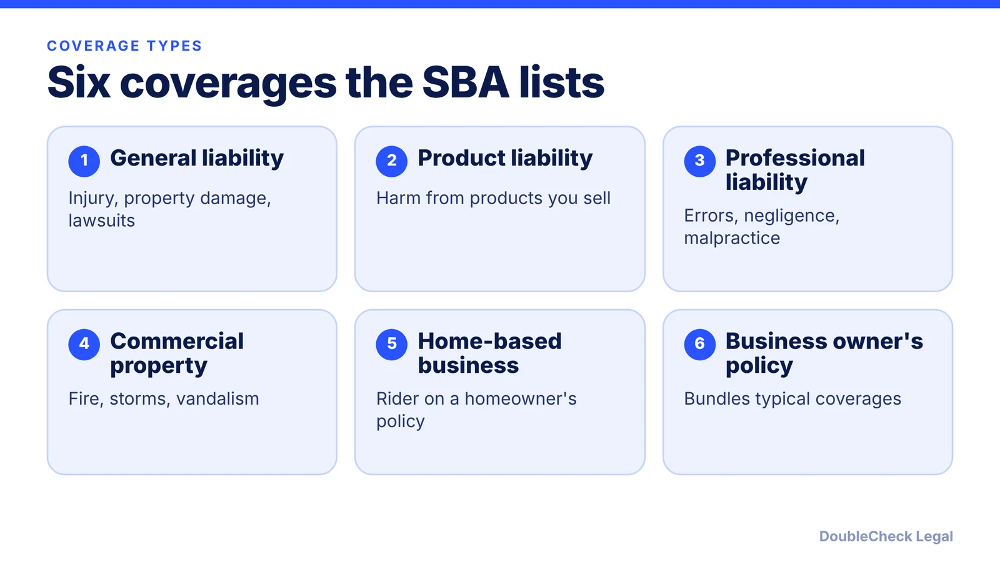
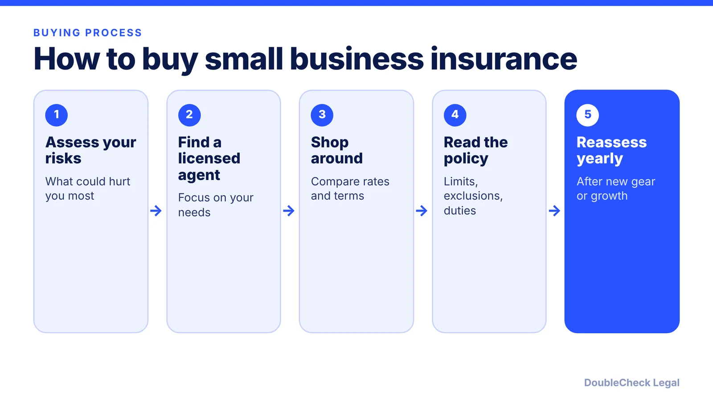

*A plain-English map of the policies the SBA lists, and a simple order for deciding what to buy first.*

**Key takeaways:**

- The SBA lists general liability, product liability, professional liability, commercial property, home-based business, and BOP coverage.
- Per the SBA, businesses with employees must carry workers' compensation, unemployment, and disability insurance; states may add more.
- Insure against losses you could not cover yourself, then shop several licensed agents.
- Reassess coverage every year and when you add equipment or expand.

## 1. The quick answer

**Quick answer:** Per the U.S. Small Business Administration, the main types of small business insurance are general liability, product liability, professional liability, commercial property, home-based business coverage, and a business owner's policy (BOP) that bundles typical coverages. If you have employees, the SBA says federal rules require workers' compensation, unemployment, and disability insurance, and some states require more. Its rule of thumb for everything else: insure against losses you could not cover yourself.

## 2. What each type covers

The descriptions below follow the [SBA's guide](https://legacy.sba.gov/business-guide/launch-your-business/get-business-insurance).

- **General liability:** covers financial losses from bodily injury, property damage, medical costs, libel, slander, lawsuit defense, and settlements or judgments. The SBA says it fits any business.
- **Product liability:** for businesses that make, wholesale, distribute, or sell products; it covers losses if a defective product causes injury.
- **Professional liability:** for businesses that provide services; it covers losses from malpractice, errors, and negligence. It is also called errors and omissions insurance.
- **Commercial property:** for businesses with significant property and physical assets; it covers damage from events such as fire, storms, and vandalism.
- **Home-based business:** added to a homeowner's policy as a rider, covering a small amount of business equipment and liability for third-party injuries. An older SBA page archived by the University of North Texas Libraries adds that homeowners' policies generally do not cover home-based business losses.
- **Business owner's policy (BOP):** bundles the typical coverages in one package, which the SBA says can simplify buying and save money. It suits most small business owners, especially home-based ones.

If you hire, read [workers' compensation requirements for startups](/blog/workers-compensation-insurance-requirements-startups/) next, since that coverage is set by state rules.

## 3. Which ones you likely need first

There is no universal list, so start from the risk. The SBA's advice is to identify the accidents, natural disasters, or lawsuits that could hurt the business and to insure against losses you could not cover yourself.

A practical order of questions:

1. **Do you have employees?** Then workers' compensation and the other employer coverages the SBA names are not optional. State rules differ.
2. **Do you sell or make physical goods?** Product liability is the coverage the SBA ties to that risk.
3. **Do you give advice or deliver services?** Professional liability addresses claims of errors or negligence.
4. **Do customers visit you, or do you own equipment or inventory?** General liability and commercial property are the starting points.
5. **Do you work from home?** Check with your agent whether a rider or separate policy is needed.

The SBA's buying tips match this flow: find a licensed agent, shop around because rates and terms can vary significantly, and reassess every year or whenever you buy equipment or expand.

## 4. Insurance, contracts, and legal structure

Insurance and contracts work together. A customer or landlord contract may require you to carry certain coverage, or may shift liability to you. Before you sign, check indemnity and insurance clauses; our guide to [contract red flags for small businesses](/blog/contract-red-flags-small-business/) covers what to look for.

Insurance also does not replace the paperwork that limits owner exposure, such as the right entity and a clear agreement among owners. See [LLC vs. C-corp](/blog/llc-vs-c-corp-startups/) for structure basics. If a policy dispute or a large contract risk shows up, [when to hire a lawyer](/blog/when-to-hire-lawyer-small-business/) explains how to decide.

An AI tool can help you list your risks and draft questions for an agent, but it cannot see your actual policy wording. Have a licensed agent or an attorney check exclusions and limits before you rely on coverage.

## Where DoubleCheck fits

[DoubleCheck](https://www.contactdoublecheck.com) helps businesses and founders start legal work with AI, verify it, and, when professional advice is warranted, connect with an independent attorney, including for immigration questions. Attorney availability and practice areas vary. Attorneys on DoubleCheck are independent professionals; an attorney-client relationship forms only if an attorney accepts your engagement.

**Sources:** [SBA, Get business insurance](https://legacy.sba.gov/business-guide/launch-your-business/get-business-insurance); [SBA, Types of business insurance (archived by UNT Libraries)](https://webarchive.library.unt.edu/web/20130316060000/http://www.sba.gov/content/types-business-insurance).

## FAQ

**What types of insurance does a small business need?**

It depends on the business. The SBA lists general liability, product liability, professional liability, commercial property, home-based business coverage, and a business owner's policy. It also says federal rules require employers to carry workers' compensation, unemployment, and disability insurance, and that some states require additional coverage.

**What is a business owner's policy (BOP)?**

Per the SBA, a BOP bundles the typical coverages into one package, which can simplify buying and save money. The SBA says it suits most small business owners, especially home-based ones.

**Does homeowners insurance cover my home business?**

Generally no. An older SBA page archived by the University of North Texas Libraries says homeowners' policies generally do not cover home-based business losses and suggests riders or separate policies. The current SBA guide describes a home-based business rider on a homeowner's policy.

**What is the difference between general and professional liability?**

Per the SBA, general liability covers bodily injury, property damage, medical costs, libel, slander, and lawsuit defense, while professional liability covers malpractice, errors, and negligence by businesses that provide services.

---

*General information only. This article is not legal, tax, investment, or accounting advice.*
