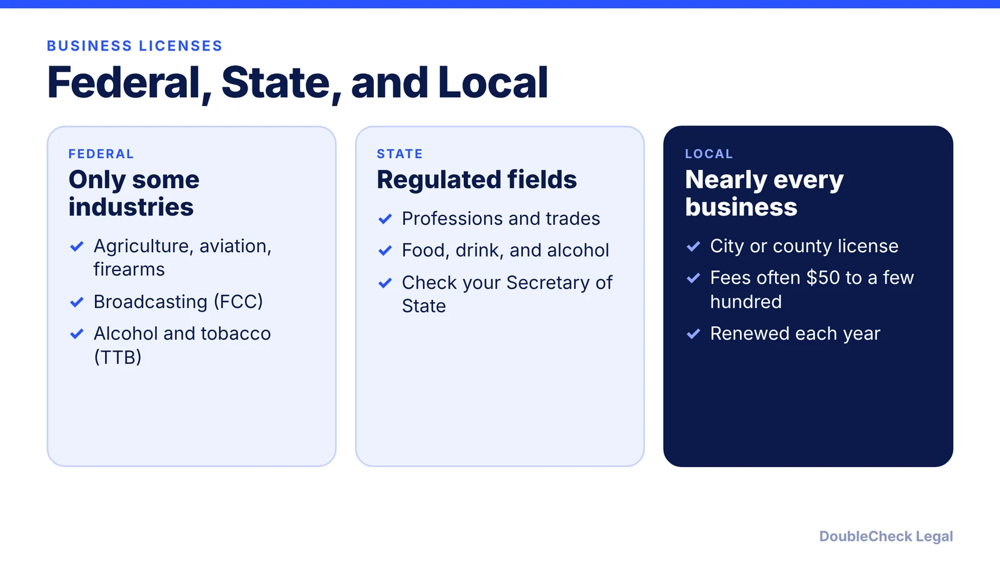
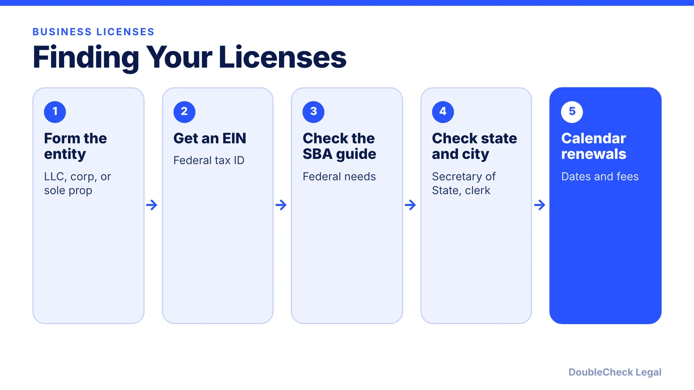

*Most small businesses need a local license, some need a state license, and few need a federal one. Here is how to find yours.*

**Key takeaways:**

- Almost every business needs a city or county license; state licenses depend on the industry.
- Only federally regulated activities, such as aviation, firearms, broadcasting, and agriculture, need federal licenses, per the SBA.
- Home-based businesses still need a municipal license, per SCORE.
- Local licenses are renewed each year; track every renewal date.

## 1. The quick answer

**Quick answer:** Most small businesses need a local (city or county) business license, some need state licenses based on their industry, and only businesses in federally regulated activities need a federal license. The SBA says what you need depends on your activities and location, and that your Secretary of State's website is a good place to start. SCORE says fees for local licenses typically range from $50 to a few hundred dollars.

## 2. Federal, state, and local licenses

**Federal.** Per the SBA, businesses in federally regulated activities need a federal license or permit, such as agriculture (USDA), aviation (FAA), firearms and explosives (ATF), and radio and television broadcasting (FCC). SCORE adds that most small businesses do not need one, and that anyone who manufactures, wholesales, imports, or sells alcohol or tobacco registers with the TTB.

**State.** SCORE lists professions such as dentists, attorneys, and realtors, personal services like hairdressers, certified trades like general contractors, and food and beverage or alcohol sellers. The SBA notes states generally regulate a broader range of activities than the federal government.

**Local.** SCORE says every business needs a license from the city where it operates. The SBA lists construction, restaurants, retail, plumbing, and vending machines as commonly regulated locally. Building or remodeling work may require separate permits, and retailers need a sales tax license to charge sales tax ([sales tax nexus guide](/blog/sales-tax-nexus-small-business-online/)).

## 3. How to find the licenses you need

Work from the entity outward:

1. Choose your structure and register it ([incorporate](/blog/how-to-incorporate-a-company-in-the-us/), [LLC vs. sole proprietor](/blog/sole-proprietor-vs-llc-solo-founder/)).
2. Get your federal tax ID ([how to get an EIN](/blog/how-to-get-an-ein-for-your-business-free/)). SCORE advises doing this, and filing a fictitious business name if your name does not include the owners' last names, before applying for a local license ([California DBA](/blog/california-fictitious-business-name-dba/), [Texas assumed name](/blog/texas-assumed-name-dba-sole-proprietor/), [Florida fictitious name](/blog/florida-fictitious-name-registration-dba/)).
3. Check the SBA's license and permit guide for federal agencies, then your Secretary of State, county, and city websites.
4. Call your city or county clerk and describe your activity precisely.

## 4. Home-based businesses and renewals

**Home-based businesses.** SCORE says you still need a municipal business license from the city where you live. Ask your city about zoning and any home occupation rules before you start.

**Renewals.** SCORE says municipal licenses must be renewed each year. The SBA warns that some licenses expire after a set period, so track renewal dates, and that renewing is often easier than applying anew. Put every license expiry in a calendar alongside your state's [annual report deadlines](/blog/annual-report-requirements-by-state-llc/). Consider [workers' compensation requirements](/blog/workers-compensation-insurance-requirements-startups/) too if you hire.

Operating without required registrations can lead to fines and temporary or permanent closure, per SCORE.

## Where DoubleCheck fits

[DoubleCheck](https://www.contactdoublecheck.com) helps businesses and founders start legal work with AI, verify it, and, when professional advice is warranted, connect with an independent attorney, including for immigration questions. Attorney availability and practice areas vary. Attorneys on DoubleCheck are independent professionals; an attorney-client relationship forms only if an attorney accepts your engagement.

**Sources:** [SBA, apply for licenses and permits](https://www.sba.gov/business-guide/launch-your-business/apply-licenses-permits); [SCORE, getting your business licenses and permits](https://www.score.org/resource/article/getting-your-business-licenses-and-permits).

## FAQ

**Do I need a business license for a home-based business?**

Yes. SCORE says you still need a municipal business license from the city where you live.

**What licenses does a small business need?**

It depends on activities and location, per the SBA. Most need a local license, some need state licenses, and few need federal ones.

**How much does a business license cost?**

SCORE says local fees typically range from $50 to a few hundred dollars, and amounts vary by industry and place.

**How often do I renew?**

SCORE says municipal licenses must be renewed each year, and the SBA says other licenses expire after set periods, so track dates.

---

*General information only. This article is not legal, tax, investment, or accounting advice.*
