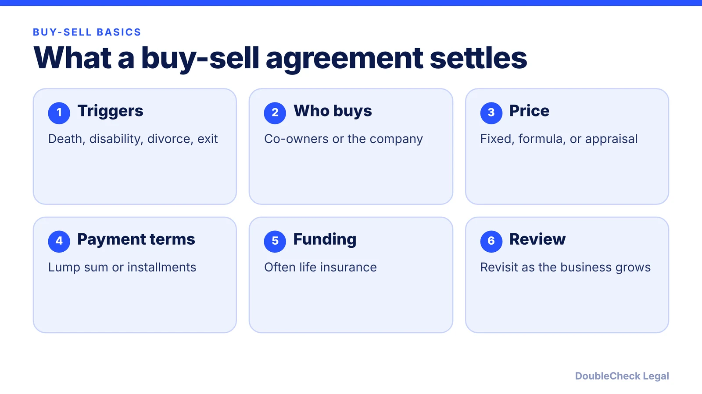
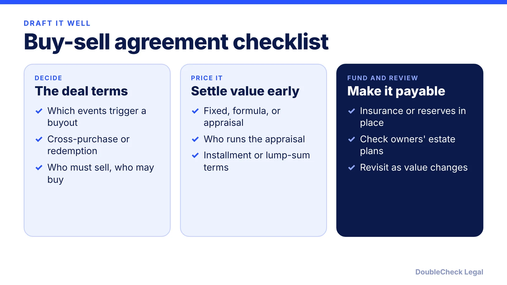

*Decide before a crisis who can buy a departing partner's share, at what price, and how it gets paid.*

**Key takeaways:**

- A buy-sell agreement sets in advance what happens to an owner's stake after death, disability, divorce, retirement, or exit.
- Two structures: cross-purchase (owners buy) and redemption (the company buys).
- Settle the valuation method and funding in advance; life insurance is a common funding source.
- Involve an attorney and a CPA; the sources agree this is not a do-it-yourself project.

## 1. The quick answer

**Quick answer:** A buy-sell agreement is a contract among business co-owners that decides in advance what happens to an owner's stake when a triggering event occurs, such as death, disability, retirement, or divorce. Per Bay Legal, it settles who can buy the departing owner's share, how the price is set, and how the purchase is paid for, so none of that is negotiated in a crisis. Without one, a deceased owner's stake may pass to heirs the surviving owners never chose as partners.

## 2. Triggering events and who can buy

The owners choose which events trigger a buyout. Common ones listed by [Bay Legal](https://baylegal.com/what-is-a-buy-sell-agreement-and-why-every-california-partner-needs-one/) are death, disability, retirement, divorce, bankruptcy, and a voluntary departure or falling-out. [Belfint](https://www.belfint.com/buy-sell-business-risks/) adds loss of a professional license or certification. Bay Legal cautions against copying a generic list and suggests tailoring triggers with an attorney.

There are two main structures:

- **Cross-purchase:** the remaining owners buy the departing owner's interest. Per SVA, this is a contract among the co-owners.
- **Entity redemption:** the business buys the interest back. Per SVA, this is a contract between the entity and its co-owners.

Bay Legal notes cross-purchase can be simple with few owners but gets complicated as ownership grows, while redemption can be easier to administer with several owners but has its own tax and structural effects. Choose with a CPA and an attorney.

## 3. Valuation and funding

Per Bay Legal, valuation methods include a fixed price the owners update periodically, a formula tied to financials such as a multiple of earnings or revenue, or an independent appraisal at the time of the trigger. The point is to make the price "a calculation rather than a negotiation in the middle of a crisis."

Funding matters as much as price. Belfint says a buyout may require substantial cash, and that life insurance is a common source that can also be used for events beyond death. Its listed benefits: timely payment at the agreed price, less strain on cash flow, and a lower chance of selling assets to pay for the buyout. SVA says any portion not covered by insurance should be paid in installments over several years.

Tax points reported by these sources:

- With two owners using cross-purchase, SVA says each owner buys a policy on the other, and the death benefit is generally free of federal income tax when the survivor is the original purchaser.
- Belfint says in a redemption the remaining owners do not get a basis step-up, which may mean higher capital gains taxes when they later sell.
- SVA says a properly drafted price can also set the interest's value for federal estate tax purposes.

Treat these as questions for your CPA, not conclusions.

## 4. Drafting checklist and common mistakes

Use this order when you draft with an attorney. A buy-sell often works alongside the [operating agreement](/blog/llc-operating-agreement-with-ai/) or, for startups, the [co-founder agreement](/blog/co-founder-agreement-startups/).

Common mistakes flagged by Bay Legal and Belfint: copying a generic trigger list, leaving valuation until the crisis, and weak funding that can leave a buyout unpaid or force asset sales. Bay Legal also says adopting the agreement early, while owners are aligned, is easier than after someone is preparing to leave. Belfint recommends reviewing it periodically.

SVA stresses these agreements are not do-it-yourself projects. For a sale of the whole business, see [how to buy or sell a small business](/blog/how-to-buy-or-sell-a-small-business-legal-checklist/). To decide when professional help is worth it, read [when to hire a lawyer](/blog/when-to-hire-lawyer-small-business/).

## Where DoubleCheck fits

[DoubleCheck](https://www.contactdoublecheck.com) helps businesses and founders start legal work with AI, verify it, and, when professional advice is warranted, connect with an independent attorney, including for immigration questions. Attorney availability and practice areas vary. Attorneys on DoubleCheck are independent professionals; an attorney-client relationship forms only if an attorney accepts your engagement.

**Sources:** [Bay Legal, Buy-sell agreements](https://baylegal.com/what-is-a-buy-sell-agreement-and-why-every-california-partner-needs-one/); [SVA Certified Public Accountants, Buy-sell agreements](https://accountants.sva.com/biz-tips/businesses-with-co-owners-probably-need-a-buy-sell-agreement); [Belfint, Buy-sell agreements](https://www.belfint.com/buy-sell-business-risks/).

## FAQ

**What is a buy-sell agreement?**

Per Bay Legal, it is a pre-agreed contract among a business's owners that settles who can buy a departing owner's share, how the price is set, and how the purchase is paid for.

**What is the difference between cross-purchase and redemption?**

Per SVA, in a cross-purchase the remaining co-owners buy the departing owner's interest; in a redemption the entity buys it. The tax and administrative effects differ, so choose with a CPA and attorney.

**How is the buyout price decided?**

Per Bay Legal, common methods are a fixed price the owners update periodically, a formula tied to financials, or an independent appraisal at the time of the trigger. The method should be chosen beforehand.

**Do we need life insurance to fund a buy-sell agreement?**

Not required, but Belfint calls life insurance a common funding source and warns that insufficient funding can leave the buyout unpaid or force asset sales. SVA says any uninsured portion should be paid in installments over several years.

---

*General information only. This article is not legal, tax, investment, or accounting advice.*
