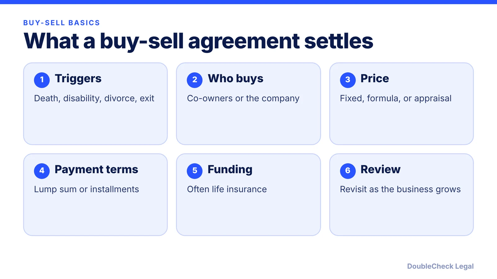
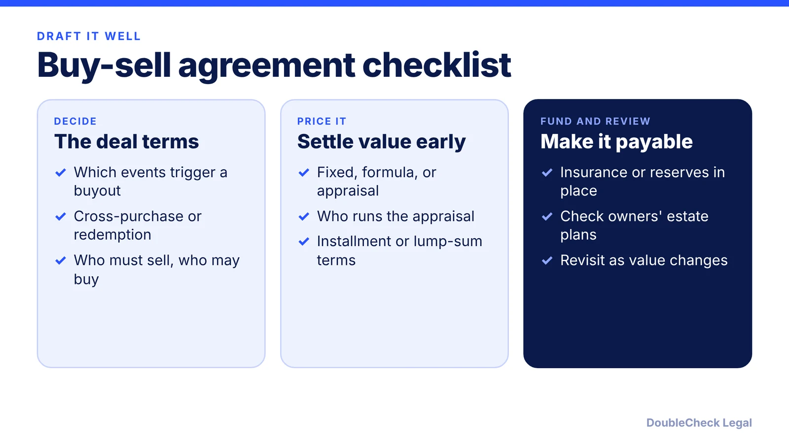

*Decide before a crisis who can buy a departing partner's share, at what price, and how it gets paid.*

**Key takeaways:**

- A buy-sell agreement sets in advance what happens to an owner's stake after death, disability, divorce, retirement, or exit.
- Two structures: cross-purchase (owners buy) and redemption (the company buys).
- Settle the valuation method and funding in advance; life insurance is a common funding source.
- Involve an attorney and a CPA; the sources agree this is not a do-it-yourself project.

## 1. The quick answer

**Quick answer:** A buy-sell agreement is a contract among business co-owners that decides in advance what happens to an owner's stake when a triggering event occurs, such as death, disability, retirement, or divorce. Per [FindLaw](https://www.findlaw.com/smallbusiness/incorporation-and-legal-structures/partnership-change-plan-ahead-with-a-buy-sell-agreement.html), it covers who can buy the departing owner's share, how the interest is valued, and what events trigger a buyout, so none of that is negotiated in a crisis. Without one, a deceased owner's stake may pass to heirs the surviving owners never chose as partners.

## 2. Triggering events and who can buy

The owners choose which events trigger a buyout. Common ones listed by [FindLaw](https://www.findlaw.com/smallbusiness/incorporation-and-legal-structures/partnership-change-plan-ahead-with-a-buy-sell-agreement.html) are death, permanent disability, retirement, divorce, personal bankruptcy, and an outside offer for a partner's interest. The [Journal of Accountancy](https://www.journalofaccountancy.com/issues/2004/oct/makethemostofbuysellagreements/) adds termination of employment and loss of a professional license. FindLaw recommends having a business organization attorney review the agreement.

There are two main structures:

- **Cross-purchase:** the remaining owners buy the departing owner's interest. Per FindLaw, the other partners buy the departing owner's share.
- **Entity redemption:** the business buys the interest back. Per FindLaw, the business itself buys the share.

The Journal of Accountancy notes that cross-purchase becomes harder to administer as the number of owners grows, while in a redemption the business bears the funding burden and has its own tax effects. FindLaw also describes hybrid and wait-and-see approaches. Choose with a CPA and an attorney.

## 3. Valuation and funding

Per the [Journal of Accountancy](https://www.journalofaccountancy.com/issues/2004/oct/makethemostofbuysellagreements/), valuation methods include formula pricing and a value the owners agree on and update at regular meetings; FindLaw's succession guide also lists an independent appraisal. FindLaw warns that disputes over price have led to costly litigation, so the agreement should say how the price is calculated.

Funding matters as much as price. Per [FindLaw](https://www.findlaw.com/smallbusiness/buy-sell-agreements-for-business-succession.html), the remaining owners may not have the cash for a buyout right away, and life insurance is a common choice; disability insurance can serve the same role for a disability. Other options include a lump-sum payment from the business or installment payments to the departing owner.

Tax points reported by these sources:

- In a cross-purchase, the Journal of Accountancy says each owner typically holds insurance on the others, and survivors usually receive the policy proceeds tax-free.
- FindLaw says that in a redemption the remaining owners generally do not get a basis increase, which may mean higher capital gains taxes when they later sell.
- The Journal of Accountancy says the agreement may set the estate tax value if the IRS accepts it, but a contract price may not bind the IRS, and IRC section 2703 can invalidate an agreement that undervalues the interest.

Treat these as questions for your CPA, not conclusions.

## 4. Drafting checklist and common mistakes

Use this order when you draft with an attorney. A buy-sell often works alongside the [operating agreement](/blog/llc-operating-agreement-with-ai/) or, for startups, the [co-founder agreement](/blog/co-founder-agreement-startups/).

Common mistakes suggested by these sources: leaving valuation until a dispute arises, and having no funding source when the buyout is triggered. FindLaw recommends reviewing the agreement regularly.

FindLaw recommends having an attorney review the agreement; it is not a do-it-yourself project. For a sale of the whole business, see [how to buy or sell a small business](/blog/how-to-buy-or-sell-a-small-business-legal-checklist/). To decide when professional help is worth it, read [when to hire a lawyer](/blog/when-to-hire-lawyer-small-business/).

**Related reading:** [Corporate Bylaws vs Operating Agreement: What Each Covers](/blog/corporate-bylaws-vs-operating-agreement-what-each-covers/); [Shareholder Agreement for a Small Business: What to Include](/blog/shareholder-agreement-small-business-what-to-include/); [Asset Sale vs Stock Sale for a Small Business: Buyer and Seller Differences](/blog/asset-sale-vs-stock-sale-small-business-buyer-seller-differences/)

## Where DoubleCheck fits

[DoubleCheck](https://www.contactdoublecheck.com) helps businesses and founders start legal work with AI, verify it, and, when professional advice is warranted, connect with an independent attorney, including for immigration questions. Attorney availability and practice areas vary. Attorneys on DoubleCheck are independent professionals; an attorney-client relationship forms only if an attorney accepts your engagement.

**Sources:** [FindLaw, partnership buy-sell agreements](https://www.findlaw.com/smallbusiness/incorporation-and-legal-structures/partnership-change-plan-ahead-with-a-buy-sell-agreement.html); [FindLaw, buy-sell agreements for business succession](https://www.findlaw.com/smallbusiness/buy-sell-agreements-for-business-succession.html); [Journal of Accountancy, Make the most of buy-sell agreements](https://www.journalofaccountancy.com/issues/2004/oct/makethemostofbuysellagreements/).

## FAQ

**What is a buy-sell agreement?**

Per FindLaw, it is a pre-agreed contract among a business's owners that settles who can buy a departing owner's share, how the price is set, and what events trigger a buyout.

**What is the difference between cross-purchase and redemption?**

Per FindLaw, in a cross-purchase the remaining co-owners buy the departing owner's interest; in a redemption the entity buys it. The tax and administrative effects differ, so choose with a CPA and attorney.

**How is the buyout price decided?**

Per the Journal of Accountancy and FindLaw, common methods include a formula, a price the owners agree on and update periodically, or an independent appraisal. The method should be chosen beforehand.

**Do we need life insurance to fund a buy-sell agreement?**

Not required, but FindLaw and the Journal of Accountancy call life insurance a common funding source, since the remaining owners may not have the cash for a buyout right away. FindLaw lists installment payments to the departing owner as another option.

---

*General information only. This article is not legal, tax, investment, or accounting advice.*
