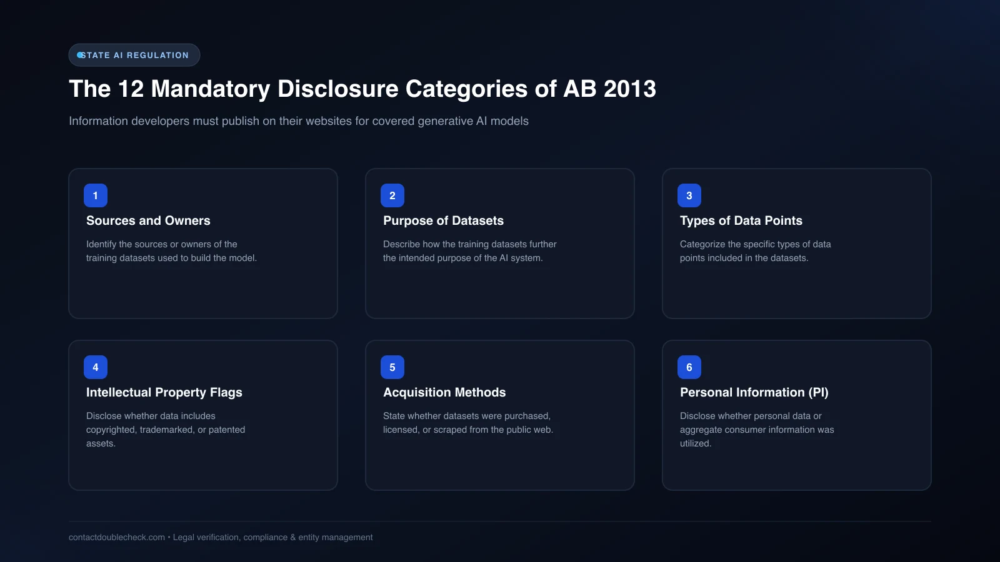
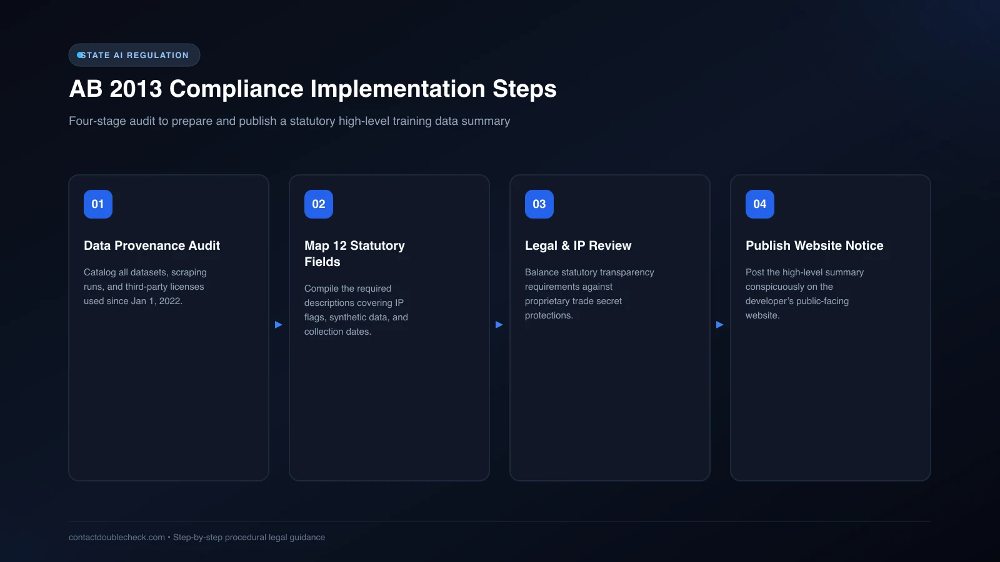

*An operational legal guide to complying with California Assembly Bill 2013 (AB 2013), the Generative Artificial Intelligence Training Data Transparency Act, active as of November 2026. General information, not legal advice.*

**Key takeaways:**

- California AB 2013 took effect on January 1, 2026, imposing public training data disclosure duties on generative AI developers.
- Applies broadly to any person or company that designs, codes, or substantially modifies a GenAI tool made available to Californians, with no minimum revenue thresholds.
- Applies retroactively to any generative AI model released, updated, or substantially modified on or after January 1, 2022.
- Developers must publish a website-accessible "high-level summary" detailing 12 statutory categories, including data sources, IP status, acquisition method, and personal data inclusion.
- Balances public transparency against trade secrets; developers need not publish raw source data or proprietary algorithmic weights.

## 1. The quick answer

**Quick answer:** California AB 2013 (codified in the California Civil Code) mandates that any developer that releases or substantially modifies a generative AI system available to California residents must post a comprehensive **high-level summary of the datasets used to train the system** on its public website. 

The law applies across the board—from multi-billion dollar foundational model providers to early-stage software startups fine-tuning models—provided the tool is accessible to users in California. The disclosure must explicitly address **12 mandatory categories of information**, including whether copyrighted materials were used, whether datasets were scraped or purchased, and whether personal consumer information was included.

For software developers and AI startups managing state regulatory disclosures, review our related analyses on [California independent contractor compliance under AB 5](/blog/california-ab5-b2b-contractor-exemption-checklist-business/) and [protecting AI-generated software intellectual property](/blog/ai-generated-code-ip-startup-founders/).

## 2. Who must comply: covered developers and retroactivity

The jurisdictional and organizational reach of AB 2013 is among the widest in state technology regulation:

- **Definition of Developer:** Applies to any individual, corporation, partnership, or legal entity that designs, codes, produces, or substantially modifies a generative AI system or service made available to Californians, whether offered for a fee or free of charge.
- **No Revenue or User Floors:** Unlike California's consumer privacy laws (CCPA) or watermark transparency rules (SB 942), AB 2013 contains zero revenue thresholds or monthly active user minimums. Early-stage startups and commercial labs are fully covered.
- **The 2022 Lookback:** The law applies to models trained, deployed, or substantially modified on or after January 1, 2022. If a company released a model in 2023 or pushed a substantial retraining update in 2024, it must publish a compliant disclosure.

## 3. The 12 statutory training data disclosure categories

The statute explicitly enumerates the 12 specific informational categories that must be addressed in the published summary:

1. **Sources and Owners:** The sources or owners of the training datasets.
2. **System Purpose:** A description of how the datasets further the intended purpose of the AI system.
3. **Data Point Types:** The specific types of data points included in the datasets.
4. **Data Point Quantities:** The number of data points or estimated volume of records.
5. **Intellectual Property Status:** Explicit disclosures stating whether the data includes copyrighted materials, trademarks, or patented subject matter, or whether it resides in the public domain.
6. **Acquisition Methods:** Whether datasets were purchased, licensed, or scraped directly from public websites.
7. **Personal Information (PI):** Whether the data contains personal information or aggregate consumer information as defined under California privacy law.
8. **Synthetic Data:** Whether synthetic data generation was used in training, and an explanation of why it was generated.
9. **Data Cleansing and Filtering:** How datasets were filtered, cleaned, or modified (e.g., removing toxic content or formatting text).
10. **Collection Dates:** The dates or date ranges during which data was collected.
11. **Initial Training Date:** The date the dataset was first incorporated into model training.
12. **Continuous Training:** Whether the AI system is subject to continuous or ongoing data collection and retraining.

## 4. Balancing transparency against proprietary trade secrets

A primary legal concern among generative AI developers is that disclosing training data could compromise proprietary trade secrets or expose the company to intellectual property infringement lawsuits:

- **High-Level Summary Standard:** The Legislature adopted the phrase "high-level summary" specifically to prevent developers from having to disclose confidential prompt files, exact file structures, or proprietary mathematical weight distributions.
- **Drafting Strategy:** Compliance summaries should utilize standardized categorical descriptions (e.g., "Publicly available web articles scraped between 2022 and 2024; licensed commercial news archives; curated technical manuals") rather than enumerating confidential supplier contracts or specific vendor proprietary filenames.

## 5. Statutory exemptions and specialized use cases

The statute provides narrow, explicit exemptions for specialized systems:

- **Security and Integrity:** AI systems built exclusively for the purpose of ensuring cybersecurity, physical security, infrastructure integrity, or fraud prevention are exempt.
- **Aviation:** Systems developed solely for the operation of aircraft within the national airspace system.
- **National Defense:** Systems developed exclusively for national security, defense, or intelligence applications provided strictly to federal government entities.

## 6. Developer compliance audit checklist for AB 2013

Technology companies releasing generative AI tools in California should execute the following compliance protocol:

1. **Inventory Model Retraining History:** Identify every generative model or fine-tuned system deployed or modified on or after January 1, 2022.
2. **Review Data Acquisition Agreements:** Audit data vendor contracts, web-scraping manifests, and open-source licenses to extract accurate provenance details.
3. **Map the 12 Categories:** Draft a structured document answering each of the 12 statutory prompts for each distinct model architecture.
4. **Conduct Legal & IP Review:** Ensure disclosures do not inadvertently concede unconsented use of protected marks or compromise trade secrets while fulfilling statutory disclosure mandates.
5. **Publish Conspicuously:** Host the disclosure at an easily identifiable URL (e.g., yourcompany.com/legal/ai-transparency) linked from the main website navigation or product footer.

## Where DoubleCheck fits

[DoubleCheck](https://www.contactdoublecheck.com) provides businesses, general counsel, and enterprise teams with automated contract review, AI-assisted verification, and legal workflow assurance. DoubleCheck helps teams verify citations, audit regulatory compliance across California, Colorado, New York, and federal agencies, and connect with experienced attorneys to ensure compliance with emerging AI standards.

**Related reading:**
- [California AB 5 B2B Contractor Exemption Checklist](/blog/california-ab5-b2b-contractor-exemption-checklist-business/)
- [AI-Generated Code and Startup IP Protection](/blog/ai-generated-code-ip-startup-founders/)
- [State Data Breach Notification Laws for Small Business](/blog/state-data-breach-notification-laws-small-business/)
- [AI Agent Security Checklist: Gmail, Slack, and Drive](/blog/ai-agent-gmail-slack-drive-security-checklist/)

**Sources:** [California State Legislature, Assembly Bill 2013 (Generative Artificial Intelligence Training Data Transparency Act)](https://leginfo.legislature.ca.gov/faces/billNavClient.xhtml?bill_id=202320240AB2013); [California Department of Justice, Privacy and Consumer Protection Guidelines](https://oag.ca.gov/privacy); [California Consumer Privacy Act (CCPA) Regulations, Cal. Civ. Code § 1798.100 et seq.](https://oag.ca.gov/privacy/ccpa); [Cornell Legal Information Institute, State Commercial Regulation Overview](https://www.law.cornell.edu/wex/commerce_clause).

## FAQ

**When did California AB 2013 take effect?**

California AB 2013 officially went into effect on January 1, 2026, requiring covered generative AI developers to publish training data summaries.

**Does AB 2013 have a minimum revenue or user threshold?**

No. Unlike some other state regulations, AB 2013 applies to any developer that creates or substantially modifies a generative AI system made available to Californians, regardless of company revenue.

**Does AB 2013 apply to AI models released before 2026?**

Yes. The law covers any generative AI system released, updated, or substantially modified on or after January 1, 2022.

**Are developers required to publish their entire raw training datasets?**

No. The statute mandates a "high-level summary" organized across 12 specific disclosure categories, rather than a raw dump of underlying data files or proprietary weights.

**What AI systems are exempt from AB 2013 disclosures?**

Exemptions include AI systems developed exclusively for security and integrity operations, aircraft operation in national airspace, or military and national defense systems for federal entities.

---

*General information only. This article is not legal, tax, investment, or accounting advice.*
