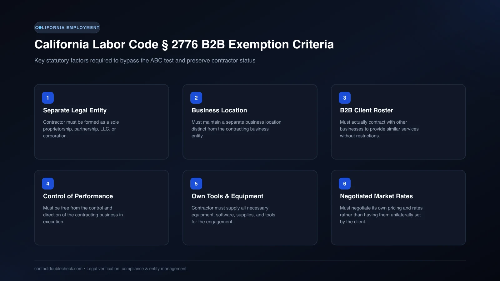
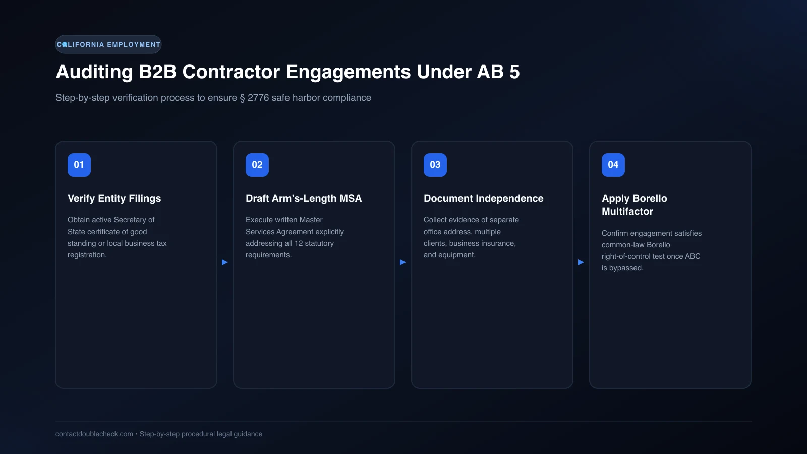

*Guide to qualifying for and documenting the Business-to-Business contractor exemption under California Assembly Bill 5 (AB 5) and Labor Code § 2776, as of November 2026. General information, not legal advice.*

**Key takeaways:**

- The B2B exemption under Labor Code § 2776 does not automatically make a worker a contractor; it merely exempts the relationship from the rigid ABC test and subjects it to the common-law *Borello* test.
- All 12 statutory conditions in § 2776 must be met simultaneously; missing one factor causes total exemption forfeiture.
- The business service provider must be a formal legal entity (sole proprietorship, partnership, LLC, or corporation) with separate premises and independent business licenses.
- Services must be rendered directly to the contracting business, not to the contracting business’s end customers.
- California EDD audits impose personal officer liability and steep civil penalties for bad-faith misclassification.

## 1. The quick answer

**Quick answer:** California’s landmark independent contractor law (AB 5, codified at Cal. Lab. Code § 2775 *et seq.*) presumes all workers are employees under the strict three-prong ABC test. To classify an outside vendor or consultant as an independent contractor without running afoul of Prong B (which requires that the contractor perform work outside the hiring entity’s usual course of business), commercial companies must qualify under the **Business-to-Business (B2B) exemption of Labor Code § 2776**.

Satisfying § 2776 requires meeting **twelve distinct statutory criteria** without exception. If satisfied, the relationship bypasses the ABC test and is judged under the traditional, flexible *Borello* right-of-control standard. If any single criterion fails, the exemption is extinguished, and the company faces aggressive payroll tax assessments from the California Employment Development Department (EDD).

For national hiring strategies, see our related guides on [multi-state remote employees compliance](/blog/multi-state-remote-employees-compliance-startups/) and [independent contractor agreement essentials](/blog/independent-contractor-agreement-what-to-include/).

## 2. AB 5, the ABC test, and why the B2B exemption matters

In 2019, California codified the Supreme Court’s *Dynamex Operations West v. Superior Court* decision through Assembly Bill 5. Under the ABC test, a worker is an employee unless the hiring business proves:
- **Prong A:** The worker is free from control and direction in connection with performance.
- **Prong B:** The worker performs work that is outside the usual course of the hiring entity’s business.
- **Prong C:** The worker is customarily engaged in an independently established trade, occupation, or business.

Prong B is fatal for most specialized consultants. A software development agency hiring an independent freelance software architect automatically fails Prong B because software development is the hiring agency’s core business.

**This is why the B2B exemption under California Labor Code § 2776 is essential:** It entirely removes the relationship from the ABC test, allowing businesses in identical or overlapping industries to contract with each other lawfully, provided they satisfy twelve mandatory statutory gates.

## 3. The 12 mandatory statutory criteria under Labor Code § 2776

To qualify for the B2B exemption, the hiring entity and the service provider must execute a written contract proving all twelve elements:

1. **Entity Formation:** The business service provider must be formed as a sole proprietorship, partnership, limited liability company (LLC), or corporation.
2. **Freedom from Control:** The provider must be free from the control and direction of the contracting business regarding performance, both contractually and in fact.
3. **Services Provided Directly to Contracting Business:** The services must be provided directly to the contracting business, rather than directly to the contracting business’s customers or clients.
4. **Written Contract:** The agreement must be set forth in a written contract specifying payment rates, terms, and project scope.
5. **Business Licenses:** The service provider must hold all required local business licenses, state tax registrations, and professional certifications.
6. **Separate Business Location:** The service provider must maintain a distinct business location, which can be the contractor’s home residence, separate from the contracting entity’s work site.
7. **Multiple Clients:** The provider must actually contract with other businesses to provide similar services or hold itself out to the general public as available to do so.
8. **Independent Advertising:** The service provider must advertise and market its own commercial services to the broader public.
9. **Tools and Equipment:** The provider must supply all necessary equipment, supplies, specialized software, and tools to perform the services.
10. **Negotiated Rates:** The provider must negotiate its own fees and billing rates rather than adhering to fixed, take-it-or-leave-it pay schedules set by the client.
11. **Discretion Over Hours and Location:** Subject to logical project completion deadlines, the provider must dictate its own working hours and operational locations.
12. **Non-Exempt Construction Scope:** The exemption cannot be utilized for construction subcontractors performing job-site labor.

## 4. The second hurdle: Passing the common-law Borello test

Qualifying under California Labor Code § 2776 does *not* automatically confer independent contractor status. It merely shifts the legal analysis from the ABC test to the multi-factor common-law standard established in *S.G. Borello & Sons, Inc. v. Department of Industrial Relations* (1989).

Under *Borello*, the principal inquiry is whether the hiring business retains the **right to control the details and means** of the work. Secondary factors evaluated by California courts and the EDD include:
- Whether the person performing services is engaged in a distinct occupation or business.
- The degree of skill required in the particular occupation.
- Whether the principal or the worker supplies the instrumentalities, tools, and place of work.
- The length of time for which the services are to be performed.
- The method of payment, whether by time or by the job.
- Whether the work is a part of the regular business of the principal.
- Whether the parties believe they are creating an employment relationship.

Because *Borello* looks at the totality of circumstances, a company that satisfies § 2776 on paper but exercises micromanagement over daily working hours or procedures will fail the *Borello* test and lose contractor classification.

## 5. Common B2B contractor audit traps and EDD enforcement

The California Employment Development Department (EDD) actively audits businesses utilizing independent contractors. Frequent compliance pitfalls include:

- **Customer-Facing Staff Augmentation:** Subcontracting an individual to perform customer support or technical consulting where the worker interacts directly with the client’s customers under the client’s brand name violates § 2776(a)(3).
- **Exclusive Contractor Relationships:** If an independent consultant derives 100% of their annual revenue from a single hiring entity over consecutive years, the EDD will argue the contractor fails the independent marketing and client roster requirements.
- **Company Equipment Provision:** Supplying company laptops, monitored email accounts, or proprietary software access without separate contractor licensing weakens the independent tools requirement.
- **Statutory Penalties:** Under Cal. Lab. Code § 226.8, engaging in "willful misclassification" carries civil penalties of $5,000 to $15,000 per violation, escalating to $25,000 per violation for established patterns of conduct.

See our detailed analysis of [contractor misclassification penalties for employers](/blog/independent-contractor-misclassification-penalties-employers/) and [how to terminate an employee or contractor legally](/blog/how-to-terminate-an-employee-legally-small-business/).

## 6. How to structure a compliant B2B contract

When retaining business service providers in California, follow these structural contracting protocols:

1. **Verify Corporate Entity:** Require the vendor to submit a Certificate of Status from the California Secretary of State or their home state before executing contracts.
2. **Execute a Master Services Agreement (MSA):** Insert express warranties affirming the contractor’s separate business premises, equipment ownership, client diversification, and rate autonomy.
3. **Bill by Milestone or Deliverable:** Structure payments around defined deliverables, sprint completions, or project milestones rather than weekly hourly timesheets.
4. **Collect W-9 and Business Licenses:** Maintain copies of the vendor’s IRS Form W-9 showing entity EIN (never SSN) and local municipal business tax registration certificates.

## Where DoubleCheck fits

[DoubleCheck](https://www.contactdoublecheck.com) provides businesses and tech founders with automated agreement reviews, contractor onboarding verification, and entity compliance checks. When multi-state contractor classification questions arise, DoubleCheck connects you with licensed employment attorneys who evaluate your contracts against California Labor Code standards.

**Related reading:**
- [Independent Contractor Classification for Startups](/blog/employee-vs-independent-contractor-classification-startups/)
- [Independent Contractor Agreement: What to Include](/blog/independent-contractor-agreement-what-to-include/)
- [Multi-State Remote Employees Compliance for Startups](/blog/multi-state-remote-employees-compliance-startups/)
- [1099-NEC Threshold Rules for Hiring Freelancers](/blog/1099-nec-2000-threshold-hiring-freelancers/)

**Sources:** [California Legislative Information, Labor Code § 2775 & § 2776](https://leginfo.legislature.ca.gov/faces/codes_displaySection.xhtml?lawCode=LAB&sectionNum=2776); [California Employment Development Department (EDD), Employment Determination Guide](https://edd.ca.gov/en/Payroll_Taxes/Independent_Contractor_Reporting); [California Department of Industrial Relations (DIR), Independent Contractor vs Employee](https://www.dir.ca.gov/dlse/faq_independentcontractor.htm); [Supreme Court of California, Dynamex Operations West v. Superior Court, 4 Cal. 5th 903 (2018)](https://scocal.stanford.edu/opinion/dynamex-operations-west-inc-v-superior-court-34584); [Supreme Court of California, S.G. Borello & Sons, Inc. v. DIR, 48 Cal. 3d 341 (1989)](https://scocal.stanford.edu/opinion/sg-borello-sons-inc-v-department-industrial-relations-30948).

## FAQ

**What is the California AB 5 B2B exemption?**

Codified in California Labor Code § 2776, the business-to-business exemption allows qualifying business service relationships to bypass the strict ABC test and instead be evaluated under the multi-factor common-law Borello standard.

**What happens if a contractor fails one of the 12 B2B criteria in California?**

If any single statutory condition of § 2776 is not satisfied, the B2B exemption fails completely. The relationship defaults back to the strict ABC test, where Prong B usually results in statutory misclassification.

**Does having an LLC or Corporation automatically protect a California contractor under AB 5?**

No. Having an active business entity is merely one prerequisite. The contractor must also maintain separate business premises, hold required local licenses, supply all tools, set its own rates, and market to multiple clients.

**What is the Borello standard under California employment law?**

Established in S.G. Borello & Sons v. DIR (1989), the test assesses whether the hiring entity controls the manner and means of work, supported by secondary factors like opportunity for profit, investment in tools, and permanence.

**Can an agency provide subcontracted workers to end clients under the B2B exemption?**

No. Section 2776(a) explicitly mandates that the contract services must be provided directly to the contracting business, not to customers or clients of the contracting business.

---

*General information only. This article is not legal, tax, investment, or accounting advice.*
