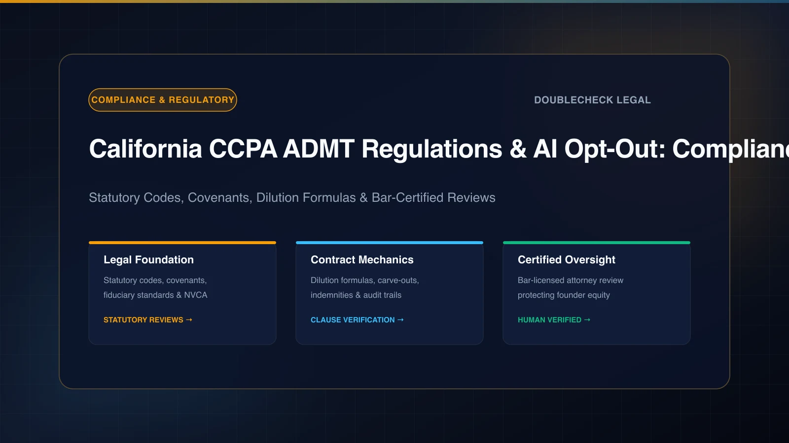
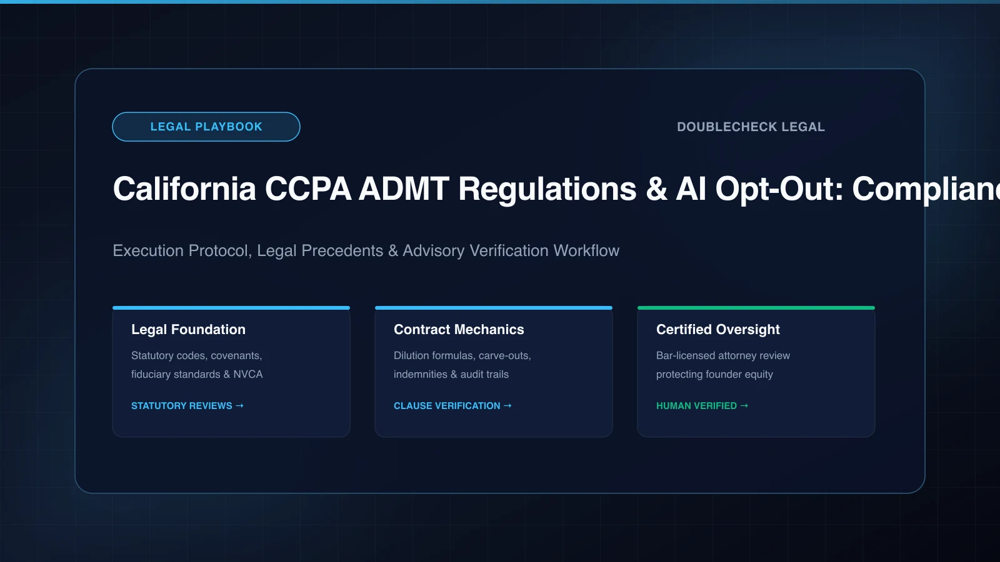

<div class="article-hero-banner mb-8">
  
</div>

## What Are California's CCPA/CPRA Automated Decisionmaking Technology (ADMT) Regulations?

Under regulations promulgated by the **California Privacy Protection Agency (CPPA)** pursuant to the **California Consumer Privacy Act (CCPA)** as amended by the **California Privacy Rights Act (CPRA)**, businesses utilizing **Automated Decisionmaking Technology (ADMT)** must provide California residents with explicit **Pre-use Notices**, mandatory **Opt-out Rights**, and access to **Algorithmic Explainability** whenever automated systems evaluate personal traits to make significant legal or economic determinations.

ADMT encompasses any computational system, algorithmic model, or artificial intelligence framework used to automate or facilitate decisions concerning consumers, workers, or job applicants in critical life domains including **employment, credit underwriting, healthcare, education, and housing**.

```
CCPA / CPRA Automated Decisionmaking Technology (ADMT) Governance Framework

┌─────────────────────────────────────────────────────────────────────────────┐
│ 1. PRE-USE ADMT NOTICE                                                      │
│    • Must inform consumer before automated processing begins                │
│    • Plain-language explanation of algorithmic logic & decision role        │
├─────────────────────────────────────────────────────────────────────────────┤
│ 2. MANDATORY CONSUMER OPT-OUT RIGHT                                         │
│    • Unconditional right to opt out of significant decisions & profiling    │
│    • Mandatory human-review fallback mechanism upon opt-out request         │
├─────────────────────────────────────────────────────────────────────────────┤
│ 3. ACCESS & EXPLAINABILITY MECHANISM                                        │
│    • Right to know specific personal outputs & algorithmic weights          │
│    • Explanation of how AI logic arrived at adverse determination           │
├─────────────────────────────────────────────────────────────────────────────┤
│ 4. FORMAL ANNUAL RISK ASSESSMENTS                                           │
│    • Mandated testing for algorithmic bias, hallucination & privacy risks   │
│    • Must be submitted to the California Privacy Protection Agency (CPPA)   │
└─────────────────────────────────────────────────────────────────────────────┘
```

---

## Direct Answer for Corporate Executives, In-House Counsel & Founders

If your enterprise platform utilizes machine learning algorithms or predictive AI models to:
1. Screen, rank, or evaluate job candidates or employees,
2. Determine customer pricing, creditworthiness, or financial service terms,
3. Monitor consumer behavior across digital environments for predictive profiling,

**You are strictly subject to California ADMT regulations.** Failing to provide compliant pre-use disclosure notices or failing to honor opt-out signals exposes your company to administrative investigations by the CPPA and statutory civil penalties of up to **$7,500 per intentional violation** under California Civil Code § 1798.155.

---

## 1. Scope and Triggers: What Qualifies as ADMT?

### Broad Statutory Definition
The CPPA regulations define ADMT broadly to encompass any software system that processes personal information and uses algorithms to facilitate or make a decision. This includes:
- **Fully Automated Decisions:** Systems operating autonomously without human intervention (e.g., algorithmic credit approval).
- **Human-in-the-Loop Facilitation:** Systems where an AI model generates scores or recommendations that heavily influence a human decision-maker (e.g., an AI candidate ranking score presented to a hiring manager).

### The "Significant Effects" Standard
Opt-out and notice obligations attach whenever ADMT is utilized to produce **"decisions that produce legal or similarly significant effects"**, defined to include:
- Provision or denial of financial or lending services.
- Housing or commercial accommodation terms.
- Educational admissions or performance scoring.
- Employment opportunities, compensation, promotions, or performance evaluations.
- Healthcare service access and insurance underwriting.

---

## 2. Core Operational Mandates: Notice and Opt-Out Architecture

### Mandatory Pre-Use ADMT Notice
Businesses cannot deploy ADMT invisibly. Prior to collecting personal data for automated evaluation, the business must present an unambiguous, prominent notice detailing:
1. **The Purpose:** The specific business objective for which the ADMT is deployed.
2. **The Logic:** A plain-language summary of the algorithmic logic, including the key variables and data points processed by the model.
3. **The Role:** Whether the system makes autonomous decisions or merely assists human reviewers.
4. **The Opt-Out Method:** A conspicuous link or interactive mechanism allowing the consumer to opt out without penalty.

### The Human Fallback Requirement
When a California consumer exercises their statutory right to opt out of ADMT:
- The business **cannot deny the service or product** if it can be delivered through non-automated means.
- In employment contexts, opting out requires the employer to provide a **non-automated human review** of the candidate's application materials.

---

## 3. Mandatory Annual Risk Assessments

Under proposed CPPA Title 11 rules, businesses processing significant volumes of California consumer data using ADMT must conduct and file **Formal Privacy Risk Assessments**:

```
ADMT Risk Assessment Components

1. Algorithmic Transparency Audit
   └── Assessment of training data provenance, bias audits & error rates.
2. Privacy Impact Analysis
   └── Balancing business benefits against negative impacts on consumers.
3. Mitigation Controls
   └── Human oversight guardrails, automated override protocols & encryption.
```

These risk assessments must be certified by senior executive management and made available to the California Privacy Protection Agency upon regulatory audit or request.

---

## 4. Enterprise Compliance Implementation Steps

1. **Conduct an Algorithmic Inventory:** Audit all software tools used across human resources, sales, and operations to catalog every third-party vendor deploying machine learning algorithms on employee or customer data.
2. **Update Privacy Disclosures:** Revise consumer and employee privacy notices to incorporate dedicated ADMT sections with clear variable disclosures.
3. **Establish Alternative Review Workflows:** Create documented, human-driven review protocols to handle consumer and applicant opt-out requests within statutory CCPA response timeframes (45 days).
4. **Audit Third-Party AI Vendors:** Execute Data Processing Addenda (DPAs) requiring third-party AI SaaS vendors to warrant ADMT compliance, provide algorithmic transparency reports, and indemnify your business against regulatory enforcement actions.

---

## Statutory Authorities and Benchmark References

- **California Consumer Privacy Act / California Privacy Rights Act (Cal. Civ. Code § 1798.100 et seq.):** Primary California statutory privacy framework.
- **California Privacy Protection Agency (CPPA) Title 11 Regulations (ADMT & Risk Assessments):** Administrative rulemaking governing automated decision technologies.
- **Federal Trade Commission (FTC) Section 5 Enforcement Guidance:** Guidance regarding algorithmic deception and unfair bias in automated systems.
- **White House Blueprint for an AI Bill of Rights:** Federal principles for automated systems, algorithmic discrimination, and human alternatives.

<div class="article-steps-banner my-10">
  
</div>
