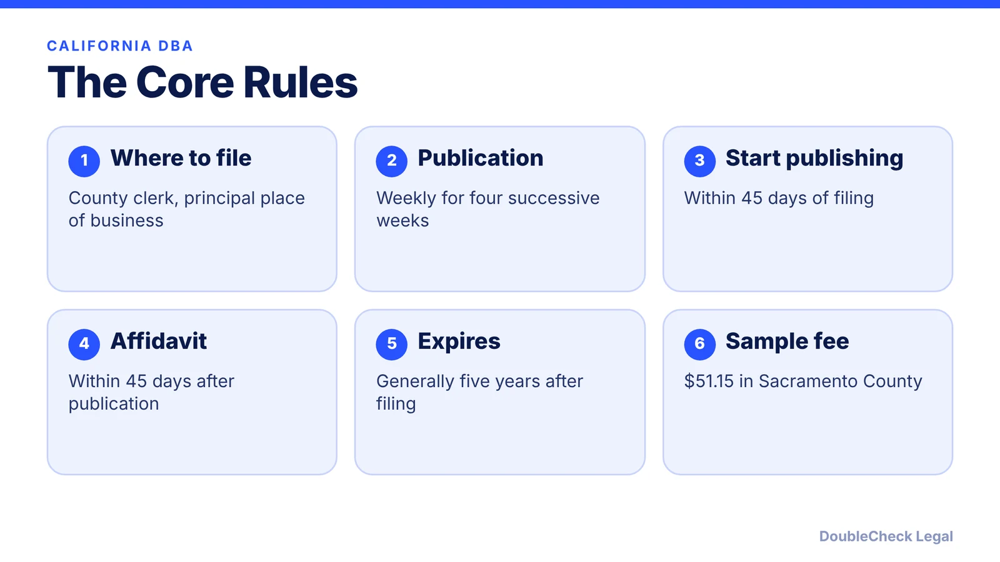
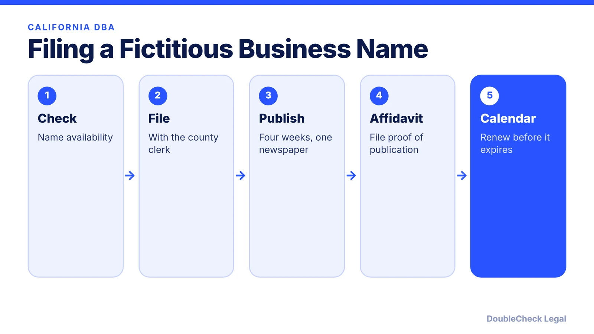
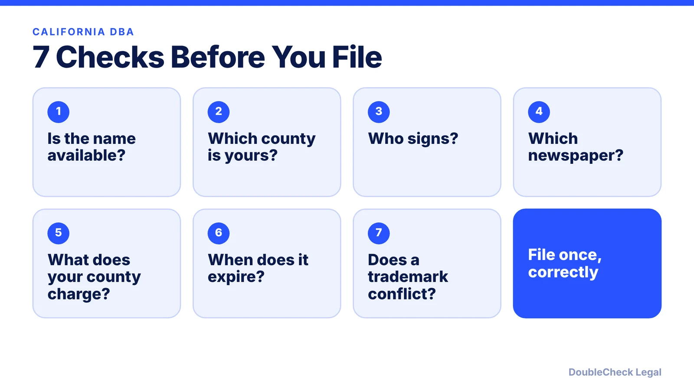

*Operating under a business name in California? Here is how the fictitious business name process works.*

**Key takeaways:**

- File a Fictitious Business Name Statement with the county clerk of your principal place of business.
- Publish once a week for four successive weeks and file an affidavit of publication.
- A statement generally expires five years after filing and on most changes after 40 days.
- Fees vary by county; Sacramento County lists $51.15 for the first name.

## 1. The quick answer

**Quick answer:** In California, a "DBA" is a **Fictitious Business Name Statement** filed with the county clerk of the county where your principal place of business is. Per a Sacramento County form, the statement must then be published in a newspaper of general circulation in that county once a week for four successive weeks, and an affidavit of publication filed with the county clerk. A statement generally expires five years after filing. Fees and details vary by county, so confirm with yours.

## 2. Step by step

Per the Sacramento County form, individuals, partnerships, LLCs, corporations, trusts, and other entities file. The statement is signed by the individual, a general partner, a trustee, or an officer or manager; an agent's signature is not accepted. In-person filers show valid photo ID, and mailed filings include a stamped self-addressed envelope for endorsed copies.

## 3. Fees, changes, and renewal

Sacramento County lists $51.15 for the first business name and owner and $8.71 for each additional name or owner. Other counties set their own fees. A statement also expires 40 days after most changes in the facts it contains (a change in an individual's residence address is an exception), or when you file a statement of abandonment. Per the form, a new statement must be filed before expiration; if refiled within 40 days of expiration it does not require republication unless the information has changed.

Knowingly filing or publishing a false statement is a misdemeanor punishable by a fine of up to $1,000, according to the form.

## 4. If you form an LLC

A DBA is not an entity. If your business is an LLC and you operate under a different name, you may still need a fictitious business name statement. See [California LLC annual tax and fee](/blog/california-llc-annual-tax-and-fee/) and [trademark and business name checks](/blog/trademark-business-name-check/) before choosing a name.

## 5. Seven checks

## Where DoubleCheck fits

[DoubleCheck](https://www.contactdoublecheck.com) is built for businesses that start legal work with AI. Bring your question or draft, use an AI-first workflow to understand and verify it, and when professional advice is warranted, you can connect with an independent attorney. Attorneys on DoubleCheck are independent professionals; an attorney-client relationship forms only if an attorney accepts your engagement.

**Sources:** [Sacramento County: Fictitious Business Name Statement form](https://finance.saccounty.gov/Tax/Documents/Fictitious%20Business%20Name%20Statement%20Effective%20July%2028%2c%202025.pdf).

## FAQ

**What is a DBA in California?**

A Fictitious Business Name Statement filed with the county clerk when you do business under a name other than your own legal name.

**Do I have to publish my DBA in California?**

Per the Sacramento County form, yes: once a week for four successive weeks in a newspaper of general circulation, then file an affidavit.

**How long does a California DBA last?**

Generally five years after filing, and it expires 40 days after most changes in the facts it contains.

**How much does a California DBA cost?**

It varies by county. Sacramento County lists $51.15 for the first name and owner.

---

*General information only. This article is not legal, tax, investment, or accounting advice.*
