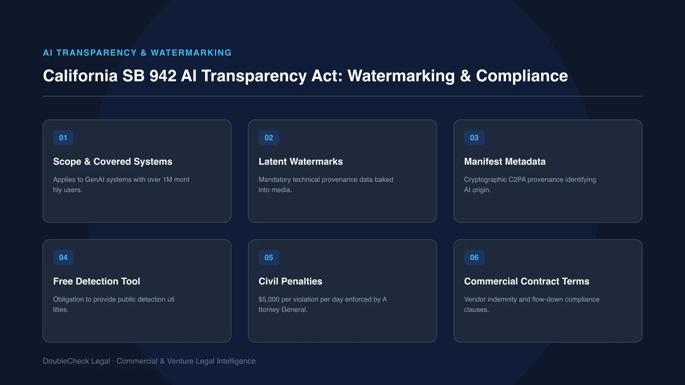
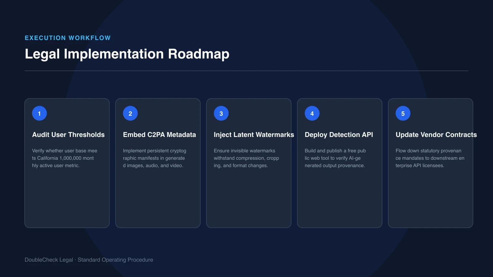

*A comprehensive regulatory breakdown of California SB 942 (the California AI Transparency Act), analyzing technical watermarking mandates, C2PA manifest metadata protocols, detection tool obligations, and enterprise liability.*

**Key takeaways:**
- **Covered Entity Threshold:** Applies to generative AI systems with over 1,000,000 monthly active users providing synthetic media services in California.
- **Dual Watermarking Mandate:** Covered systems must embed both visible/verifiable manifest metadata and resilient, invisible latent watermarks into all synthetic images, video, and audio.
- **Mandatory Public Detection Tool:** Providers must offer a free, publicly accessible online tool that allows users to verify whether specific content was generated or altered by their AI system.
- **Severe Statutory Penalties:** The California Attorney General and municipal prosecutors can recover civil penalties of $5,000 per day per violation, alongside injunctive relief.

## 1. The quick answer: What California SB 942 requires

The **California AI Transparency Act (Senate Bill 942)** establishes strict provenance and labeling rules for consumer-facing generative AI platforms:

1. **Latent Watermarking:** Covered AI systems must embed an imperceptible, technically resilient digital watermark into all created audio, video, and image files.
2. **Manifest Metadata:** Outputs must carry standardized provenance metadata (e.g., C2PA compliant) disclosing the AI model name, version, and creation timestamp.
3. **Public Detection Utility:** Developers must operate a free web tool enabling any consumer or enterprise to inspect a file and determine whether it was generated by their platform.
4. **Enforcement:** Enforceable by the California Attorney General, with statutory fines of **$5,000 per day per violation**.

## 2. In-depth legal analysis: Technical architecture and statutory scope

California continues to lead national technology regulation. Following the enactment of the EU AI Act, SB 942 sets the de facto technical provenance standard for the United States.

### A. Statutory Scope and "Covered Provider" Definition
Under California Civil Code § 1798.500:
- **Generative AI System:** Defined as an artificial intelligence system that can generate synthetic content, including text, images, video, or audio, that emulates human-generated artifacts.
- **Covered Provider:** Any person or commercial entity that develops or operates a generative AI system that has **at least 1,000,000 monthly active users** on an annualized basis and conducts business in California.

### B. Dual Technical Provenance Architecture
The statute mandates a two-pronged provenance methodology:

| Layer | Technical Requirement | Industry Standard | Durability Expectation |
|---|---|---|---|
| Manifest Metadata | Explicit data header embedded in file container | C2PA / IPTC Photo Metadata | Preserves camera/model origin, easily readable by browsers |
| Latent Watermark | Invisible mathematical signal in pixel or acoustic data | Cryptographic steganography | Must withstand compression, screenshotting, and transcoding |

### C. The Free Public Detection Tool Requirement
Under Section 1798.502, every covered provider must create and maintain an accessible online verification service:
- Must allow any user to upload a file or URL to assess authenticity;
- Must return provenance data without collecting or retaining unnecessary user personal data;
- Must be accessible via an open API for automated third-party platform integration.

## 3. Step-by-step: Enterprise implementation and legal compliance

Generative AI startups and enterprise developers should deploy compliance through a multi-stage technical roadmap:

### Step 1: User Analytics and Jurisdictional Assessment
Evaluate California web traffic and API call volume. If global monthly active users approach 1,000,000, immediately trigger regulatory compliance workflows.

### Step 2: Implement Cryptographic Provenance Pipelines
Integrate C2PA (Coalition for Content Provenance and Authenticity) signing services directly into the media rendering engine. Ensure each output is cryptographically signed at generation.

### Step 3: Embed Resilient Steganographic Watermarks
Partner with enterprise steganography vendors or build proprietary latent watermarking models capable of surviving social media compression algorithms.

### Step 4: Launch Public Provenance Portal
Deploy a dedicated verification endpoint (e.g., `verify.company.com`) allowing the public to upload media files and receive immediate confirmation of synthetic origin.

### Step 5: Update Terms of Service & API License Agreements
Insert strict contractual covenants prohibiting API licensees and downstream developers from stripping, modifying, or circumventing latent watermarks or metadata manifests.

## 4. Drafting enterprise AI contracts: Warranties and indemnification

Enterprises licensing third-party foundational models must audit commercial contracts for regulatory allocation:
- **Provenance Warranty:** The model provider represents and warrants that all outputs comply with California Civil Code § 1798.500 et seq.
- **Anti-Stripping Covenant:** Downstream software providers agree not to remove embedded watermarks prior to end-user delivery.
- **Regulatory Indemnity:** The AI vendor agrees to defend and indemnify the enterprise against regulatory enforcement actions resulting from non-compliant synthetic media generation.

## 5. Due diligence checklist: SB 942 compliance audit

1. **Verify Watermark Persistence:** Stress-test latent watermarks against Gaussian blur, JPEG recompression, and format conversion.
2. **Audit Open Source Model Exposure:** Clarify whether open-weight models hosted on enterprise cloud servers trigger covered provider obligations.
3. **Review Privacy Practices of Detection Tool:** Confirm the public detection tool does not retain uploaded media containing biometric or personal data.
4. **Update California Disclosures:** Ensure corporate privacy policies and AI ethics disclosures accurately reflect SB 942 mechanisms.

## Where DoubleCheck fits

[DoubleCheck](https://www.contactdoublecheck.com) provides AI technology companies and enterprise teams with automated contract review and regulatory compliance intelligence. DoubleCheck scans vendor agreements, software licenses, and API terms to identify regulatory gaps under California SB 942, the EU AI Act, and emerging state transparency statutes, ensuring commercial agreements carry market-standard compliance protections.

**Related reading:**
- [AI Regulation Startups EU AI Act Colorado](/blog/ai-regulation-startups-eu-ai-act-colorado/)
- [Tennessee ELVIS Act AI Voice Cloning Likeness Rights](/blog/tennessee-elvis-act-ai-voice-cloning-likeness-rights/)
- [Utah Artificial Intelligence Policy Act SB 149 Compliance](/blog/utah-artificial-intelligence-policy-act-sb-149-compliance/)
- [AI Vendor Contract Checklist](/blog/ai-vendor-contract-checklist/)

**Sources:** [California Senate Bill 942 (California AI Transparency Act, Chapter 995, Statutes of 2024)](https://leginfo.legislature.ca.gov/faces/billNavClient.xhtml?bill_id=202320240SB942); [Coalition for Content Provenance and Authenticity (C2PA) Technical Specification](https://c2pa.org/specifications/specifications/2.0/specs/C2PA_Specification.html); [California Civil Code § 1798.500 et seq.](https://leginfo.legislature.ca.gov/); [Office of the California Attorney General, Privacy & AI Enforcement](https://oag.ca.gov/).

## FAQ

**What is the California AI Transparency Act (SB 942)?**

California SB 942 is a landmark state statute requiring covered generative artificial intelligence providers to include latent watermarks and manifest metadata in AI-generated synthetic content, and to offer a free public detection tool.

**Which businesses are covered under California SB 942?**

SB 942 applies to any provider of a generative artificial intelligence system that has over 1,000,000 monthly active users and creates synthetic audio, video, or image content accessible in California.

**What technical standards are required for SB 942 AI watermarks?**

The statute requires both manifest metadata (such as C2PA Coalition for Content Provenance and Authenticity standards) and latent, imperceptible watermarks designed to persist through common modifications like compression and cropping.

**What are the penalties for non-compliance under SB 942?**

Violators face civil penalties of up to $5,000 per day per violation enforced through civil actions brought by the California Attorney General, city attorneys, or county counsel, plus reasonable attorney fees.

**How can AI contract tools assist with SB 942 compliance?**

AI contract tools audit vendor and customer agreements, verifying warranty clauses, technical provenance representations, and indemnification provisions to ensure compliance with California regulatory standards.

---

*General information only. This article is not legal, tax, investment, or accounting advice.*
