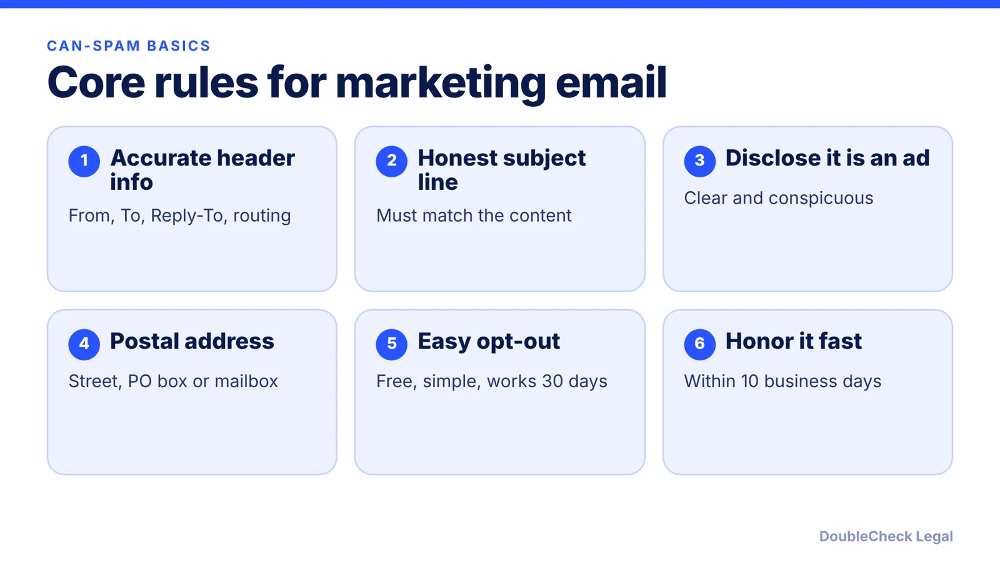
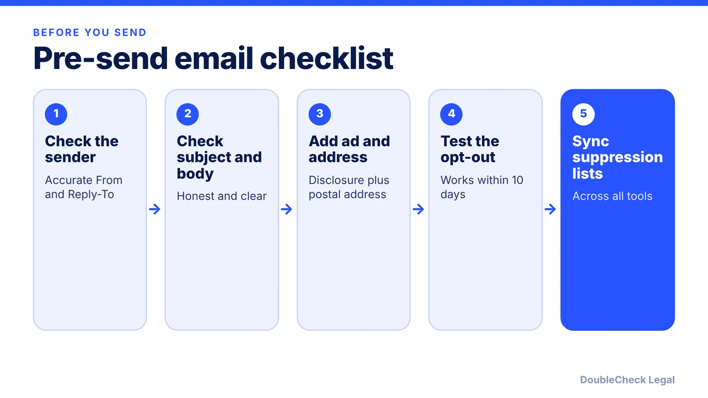

*CAN-SPAM Act email marketing rules for a small business: the core requirements, opt-out timing, transactional email limits and penalties, as of November 2026.*

**Key takeaways:**

- CAN-SPAM covers commercial email, including B2B, and requires an easy opt-out rather than prior opt-in.
- Honor opt-outs within 10 business days and keep the opt-out working for 30 days after sending.
- Transactional emails are mostly exempt, but promotions in them can make them commercial.
- The FTC guide cites penalties up to $53,088 per email, and the FTC said its penalty amounts stay unchanged in 2026.

## 1. The quick answer

**Quick answer:** The CAN-SPAM Act sets rules for commercial email, and per the FTC it covers every email whose primary purpose is advertising or promoting a product or service. For a small business, the rules come down to seven habits: accurate sender information, a truthful subject line, a clear ad disclosure, a valid postal address, a working opt-out, honoring opt-outs within 10 business days and watching what vendors send for you. The FTC guide (last modified July 22, 2025) says violations can cost up to $53,088 per email, and the FTC stated in September 2026 that its civil penalty amounts remain unchanged during 2026.

The law does not require recipients to opt in first, but it does require an easy way to opt out. Text messages have different, stricter consent rules; see [TCPA text message marketing consent](/blog/tcpa-text-message-marketing-consent-small-business/).

## 2. The core requirements, one by one

These points come from the FTC's CAN-SPAM Act compliance guide for business (published August 9, 2023; last modified July 22, 2025).

- **Do not use false or misleading header information.** The From, To, Reply-To and routing information must be accurate and identify the person or business that initiated the message.
- **Do not use deceptive subject lines.** The subject must accurately reflect the content of the message.
- **Identify the message as an ad.** The disclosure must be clear and conspicuous, and the law gives flexibility in how you do it.
- **Include a valid physical postal address.** The FTC accepts a current street address, a registered USPS post office box or a registered private mailbox. Home-based owners often use a PO box or mailbox service for this reason.
- **Tell recipients how to opt out.** Give a clear, easy-to-understand explanation, with a return email address or an easy internet-based method. You can offer a menu of choices, but one option must stop all marketing messages from you.
- **Honor opt-out requests promptly.** More on timing below.
- **Monitor what others do on your behalf.** You cannot contract away your responsibility.

An ordinary newsletter, a promotion to past customers and a cold outreach email can all be commercial messages. A B2B email is not exempt: the FTC compliance guide says the law makes no exception for business-to-business email, and the FTC definition turns on the message's primary purpose, not the recipient. If you are unsure whether a given email is commercial, treat it as commercial and include the full set.

## 3. Opt-outs, mailing lists and the 10-business-day rule

Opt-outs are where small businesses most often slip. The FTC guide lists these requirements:

- **Keep the mechanism working for at least 30 days** after you send the message.
- **Process opt-outs within 10 business days.**
- **Charge no fee,** and do not require anything beyond an email address. You may not make the person provide personal information beyond that.
- **Keep it simple:** the person should only need to reply to an email or visit a single page on the internet.
- **Do not sell or transfer opted-out addresses,** except to a company you hired to help you comply.
- **Check that spam filters do not block opt-out requests** sent to you.

If you use several email tools, for example a newsletter app, a CRM and a cold outreach tool, opt-outs must flow between them. A common failure is unsubscribing in one platform while another keeps mailing the same address. Keep one suppression list and sync it, or export and import it before each campaign.

Also read the terms of your email service provider. Providers often add their own rules and may suspend an account for complaints, which is separate from the law. This post does not cover mailbox-provider sender requirements, which change and are not part of CAN-SPAM.

## 4. Transactional and relationship messages

Not every email you send is marketing. The FTC says compliance depends on a message's primary purpose, and that transactional or relationship messages are exempt from most provisions, though they still cannot contain false or misleading routing information. The FTC lists five categories:

1. Facilitating, completing or confirming a transaction the recipient agreed to.
2. Warranty, recall, safety or security information about a product or service the recipient purchased.
3. Notices about changes to a membership, subscription, account, loan or other ongoing relationship, or periodic account balance information.
4. Employment or employee benefit information.
5. Delivering goods or services the recipient agreed to receive under a transaction.

Examples are order confirmations, receipts, shipping updates, password resets and billing notices. The FTC reads these categories narrowly. Having an ongoing relationship with a customer does not by itself make an email transactional.

Mixed messages are the common problem. If a receipt includes a large promotional banner and a coupon, the FTC says the subject line and the placement of the content decide the outcome: if a reasonable recipient would read the subject as commercial, or the transactional content is not mainly at the beginning, the message is treated as commercial. For safety, keep transactional emails transactional, and send promotions separately with the full opt-out set.

Subscription businesses should also look at renewal and cancellation rules, which sit under different laws. See [FTC click-to-cancel rules for subscription businesses](/blog/ftc-click-to-cancel-subscription-rules-saas/) and [auto-renewal clauses in business contracts](/blog/auto-renewal-clauses-business-contracts/).

## 5. Penalties, vendors and other laws that may apply

**Penalties.** The FTC compliance guide states violations can cost up to $53,088 per separate email, and says it was edited in January 2024 to reflect inflation-adjusted maximums. A September 15, 2026 Federal Register notice from the FTC states that its civil penalty amounts will remain unchanged during 2026 and that it will continue to apply 2025 levels. Because the figure is adjusted over time, check the FTC page for the current amount. The maximum is not a typical result, but it shows why one bad campaign sent to a large list is a real exposure.

**Vendors and agencies.** The FTC says both the company whose product is promoted and the company that sends the message may be held liable. If an agency, affiliate or freelancer sends email for you, put compliance duties, opt-out handling and indemnity in writing. See [indemnification clauses explained](/blog/indemnification-clause-explained-small-business/) and [the AI vendor contract checklist](/blog/ai-vendor-contract-checklist/) if the tool uses AI to write or send messages.

**Other laws.** CAN-SPAM is not the only rule. Depending on who you email and what you collect:

- **Privacy laws:** state laws and the GDPR may add notice, consent or opt-out duties for personal data. See [state privacy laws small business checklist](/blog/state-privacy-laws-2027-small-business-checklist/), [CCPA and CPRA compliance](/blog/ccpa-cpra-compliance-small-business/) and [GDPR for US startups](/blog/gdpr-for-us-startups/).
- **Text and phone marketing:** the TCPA has its own consent rules. See [TCPA text message marketing consent](/blog/tcpa-text-message-marketing-consent-small-business/).
- **Your own policies:** your privacy policy should describe how you collect and use email addresses. See [privacy policy generator for small business](/blog/privacy-policy-generator-small-business/).
- **Email list rules outside the US:** rules in other countries can be stricter than the US law. Verify them before emailing abroad.

## 6. A pre-send checklist, and when to ask an attorney

Run this before every campaign:

- **From name and reply address** identify your business and work.
- **Subject line** matches the email body.
- **Ad disclosure** is clear if the email is promotional.
- **Postal address** is in the footer and valid.
- **Unsubscribe link** works, is free and honors a single click or reply.
- **Suppression list** is current across every tool and every vendor.
- **Transactional emails** contain no hidden promotion.
- **Records:** keep copies of campaigns and opt-out logs.

Most small businesses can handle CAN-SPAM with a good email platform and this list. Consider an attorney to verify your approach when you buy or rent email lists, send on behalf of many clients, operate a marketplace or franchise, receive a complaint or FTC letter, or email into the EU, Canada or other countries with stricter consent rules. You can use AI to draft email footers, opt-out language and a short internal policy, then have an attorney verify them. See [how to use AI for legal work safely](/blog/small-business-ai-legal-work-safely/) and [when to hire a lawyer for your small business](/blog/when-to-hire-lawyer-small-business/).

## Where DoubleCheck fits

[DoubleCheck](https://www.contactdoublecheck.com) helps businesses and founders start legal work with AI, verify it, and, when professional advice is warranted, connect with an independent attorney, including for immigration questions. Attorney availability and practice areas vary. Attorneys on DoubleCheck are independent professionals; an attorney-client relationship forms only if an attorney accepts your engagement.

**Sources:** [FTC, CAN-SPAM Act: A Compliance Guide for Business](https://www.ftc.gov/business-guidance/resources/can-spam-act-compliance-guide-business?cId=cj); [Federal Register, Sept. 15, 2026 (FTC civil penalty inflation adjustments notice)](https://www.govinfo.gov/content/pkg/FR-2026-09-15/pdf/2026-18853.pdf); [FTC, CAN-SPAM Rule](https://www.ftc.gov/legal-library/browse/rules/can-spam-rule); [eCFR, 16 CFR Part 316 (CAN-SPAM Rule)](https://www.ecfr.gov/current/title-16/chapter-I/subchapter-C/part-316).

## FAQ

**What are the CAN-SPAM Act rules for a small business?**

Per the FTC, use accurate header information, a truthful subject line, a clear ad disclosure, a valid postal address and a clear opt-out, honor opt-outs within 10 business days, and monitor anyone who emails for you. These apply to emails whose primary purpose is commercial.

**Do I need permission before sending marketing email under CAN-SPAM?**

The FTC compliance guide centers on honest messages and an opt-out mechanism, not prior consent. Other laws, including privacy laws and rules for text messages or other countries, may require consent, so check them separately.

**Does CAN-SPAM apply to B2B email?**

Yes. The FTC compliance guide says the law makes no exception for business-to-business email. The FTC test looks at the primary purpose of the message. When in doubt, treat the email as commercial.

**How fast must I honor an unsubscribe request?**

Per the FTC, within 10 business days, and the opt-out mechanism must keep working for at least 30 days after you send the message. You cannot charge a fee or require more than an email address.

**What is the penalty for violating CAN-SPAM?**

The FTC compliance guide, last modified July 22, 2025, says up to $53,088 per separate email in violation. An FTC notice dated September 15, 2026 says its civil penalty amounts remain unchanged during 2026, so check the FTC page for the current figure.

---

*General information only. This article is not legal, tax, investment, or accounting advice.*
