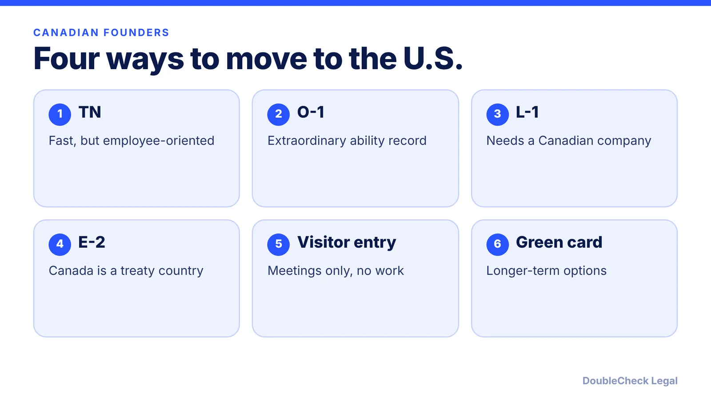
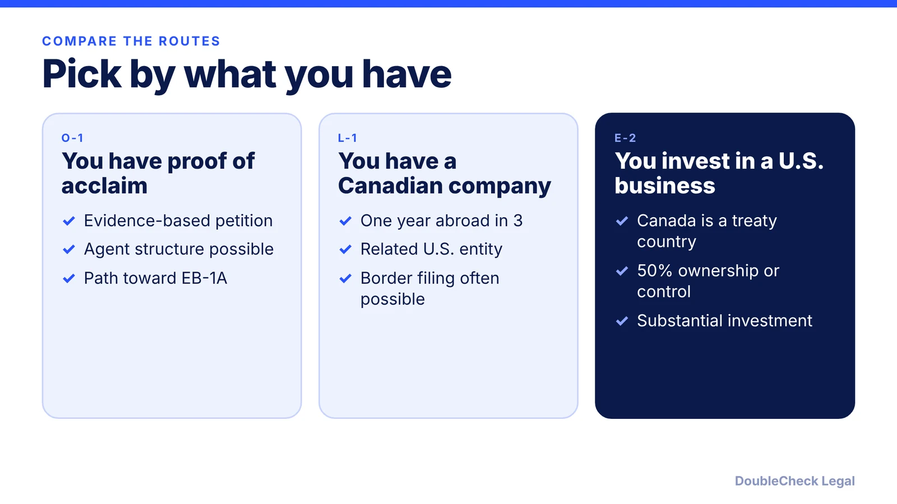

*TN is easy at the border, but it was built for employees. Founders usually look at O-1, L-1 or E-2.*

**Key takeaways:**

- The State Department says TN does not permit self-employment; TN is described as a poor fit for majority owners.
- O-1 needs an evidence record; L-1 needs a qualifying Canadian company and one year of work abroad in the prior three.
- Canada appears on E-2 treaty-country lists; E-2 needs a substantial investment and 50% ownership or control.
- Visiting for meetings is not the same as working; confirm your plan with an attorney.

## 1. The quick answer

**Quick answer:** A Canadian founder usually has four U.S. options: TN, O-1, L-1 and E-2. TN is easy to get at the border but is built for employees. The State Department says plainly: "Self-employment is not permitted." O-1 needs a strong record of achievement. L-1 needs a qualifying Canadian company you have worked for. E-2 is open to Canadian nationals because Canada is on the treaty list, and it fits founders who invest in their own U.S. business. Which one works depends on your facts, so this guide is a map, not a ruling.

## 2. TN: why it is limited for founders

TN status is for Canadian and Mexican citizens in listed USMCA professions. Per the State Department, you need a prearranged job with an employer, a Canadian can apply at a U.S. port of entry or at a consulate, and no visa is needed to enter as a USMCA professional. The same page states that self-employment is not permitted.

That matters if you want to start a company and work for it. Per R&J Immigration Law, a TN holder generally cannot simply create a company and start working for it. Passive ownership, such as holding shares without running the business day to day, may be allowed. Working for a company you own may be possible in limited cases where the company shows a real employer-employee relationship, for example with a board or management structure that supervises you, and the work matches a listed profession. R&J calls these cases complex and heavy on documentation. Berardi Immigration Law describes TN as "a poor fit for majority owners."

TN also requires nonimmigrant intent, so a pending green card case can complicate renewals (Berardi). If you are a Canadian employee at a U.S. startup you do not control, TN may still be the simplest route: see the [TN guide for tech professionals](/blog/tn-visa-canada-mexico-tech-professionals/). If you are a founder, read [starting a company on a work visa: ownership vs work](/blog/start-company-on-h1b-visa-ownership-vs-work/) for how regulators think about owner-employees.

## 3. O-1, L-1 and E-2 compared

**O-1.** For people with extraordinary ability in business, sciences, arts, education or athletics. Berardi says founders can use an agent-based petition as long as the terms of employment are controlled by someone other than the beneficiary alone. It needs a strong evidence record and has a route to EB-1A. See the [O-1A evidence guide](/blog/o-1a-visa-for-startup-founders-evidence/) and [EB-1A vs O-1](/blog/eb-1a-vs-o-1-founder-which-path/).

**L-1.** For managers, executives and specialized-knowledge workers moving from a related foreign company. Per Berardi, it requires a genuine qualifying relationship between the foreign and U.S. entities and at least one year of qualifying employment abroad in the prior three years. VisaPro adds that Canadians can often apply for L-1 status at a U.S. port of entry without a consular interview, that a new-office L-1 is first granted for 1 year, and that keeping the Canadian company operating is essential. It also warns that border applications can still be denied. Read [L-1A for founders opening a U.S. office](/blog/l-1a-visa-new-office-foreign-founders/).

**E-2.** Canada appears on E-2 country lists (per NNU Immigration and Alaz Law, which point readers to the State Department list for the current version). Per USCIS, as summarized in our [E-2 guide](/blog/e-2-treaty-investor-visa-for-founders/), E-2 needs a substantial investment in a real business, at least 50% ownership or operational control, and holders must intend to leave when status ends. R&J lists E-2 and L-1 as alternatives for active entrepreneurs.

## 4. Visiting is not working, and when to get an attorney

Crossing the border for investor meetings, conferences or contract negotiation is a visitor activity. Running your U.S. startup day to day, drawing U.S. pay or doing productive work is not, and that line is where founders get into trouble. Read [what a B-1 visitor can do](/blog/b-1-b-2-visa-business-visitor-what-founders-can-do/) and [visiting the U.S. to meet investors](/blog/visiting-the-us-to-meet-investors-b-1-esta-startup-trip-what-is-allowed/) before you cross with a laptop and a plan.

**A practical sequence.**

- Decide whether you will own and control the U.S. company. If yes, TN alone is weak.
- Check whether you qualify on achievement (O-1) or on a Canadian company (L-1).
- If neither, test E-2: investment size, ownership structure and your ability to document it.
- Plan company formation and timing together: see [how to incorporate a company in the U.S.](/blog/how-to-incorporate-a-company-in-the-us/) and [start a U.S. company as a non-resident](/blog/start-us-company-as-non-us-resident/).
- Compare all founder routes in [U.S. visa options for startup founders](/blog/us-visa-options-for-startup-founders-compared/).

**Self-handle vs. attorney.** Reading the rules and organizing your facts is a good start. Get an attorney to review before a border filing, before changing how you own the U.S. company, or if you have past refusals or status problems. See [how to find a good immigration lawyer](/blog/how-to-find-good-immigration-lawyer-startup-founder/) and [immigration lawyer fees](/blog/immigration-lawyer-fees-flat-fee-vs-hourly/). Immigration rules change often, so confirm anything time-sensitive as of November 2026 with USCIS and the State Department.

## Where DoubleCheck fits

[DoubleCheck](https://www.contactdoublecheck.com) helps businesses and founders start legal work with AI, verify it, and, when professional advice is warranted, connect with an independent attorney, including for immigration questions. Attorney availability and practice areas vary. Attorneys on DoubleCheck are independent professionals; an attorney-client relationship forms only if an attorney accepts your engagement.

**Sources:** [State Department, USMCA professional workers](https://adoption.state.gov/content/travel/en/us-visas/employment/visas-canadian-mexican-usmca-professional-workers.html); [R&J Immigration Law, TN holders starting a business](https://rjimmigrationlaw.com/resources/can-a-tn-visa-holder-start-a-business-in-the-u-s/); [Berardi Immigration Law, TN vs O-1 vs L-1 vs H-1B](https://berardiimmigrationlaw.com/tn-vs-o-1-vs-l-1-vs-h-1b-choosing-the-right-visa-architecture-for-founders-and-executives/); [VisaPro, Canada L-1](https://www.visapro.com/resources/article/canada-l1-visa/); [NNU Immigration, E-1/E-2 treaty countries](https://www.nnuimmigration.com/e-visa-treaty-countries/); [Alaz Law, E-2 countries 2026](https://www.alazlaw.com/blog/e-2-visa-countries-list-2026-treaty-investor/). The State Department treaty page and the USCIS E-2 page did not load directly, so E-2 rules are attributed to the USCIS summary in our linked E-2 guide.

## FAQ

**Can a Canadian start a company in the U.S. on a TN?**

Generally not as active self-employment. The State Department says self-employment is not permitted for TN. R&J Immigration Law says a TN holder generally cannot create a company and start working for it, though passive ownership may be allowed.

**Is Canada an E-2 treaty country?**

Yes, per NNU Immigration and Alaz Law, which list Canada among E-2 countries. Confirm on the State Department treaty list, since lists can change.

**Can a Canadian file for L-1 at the border?**

Often yes, per VisaPro, which says Canadians can often apply at a U.S. port of entry without a consular interview. It warns that border applications can still be denied, so documentation quality matters.

**Which is better for a Canadian founder, O-1 or E-2?**

It depends on your facts. O-1 turns on proof of extraordinary ability; E-2 turns on a substantial investment and 50% ownership or control (USCIS). E-2 holders must intend to leave when status ends, while O-1 has a route to EB-1A (Berardi).

---

*General information only. This article is not legal, tax, investment, or accounting advice.*
