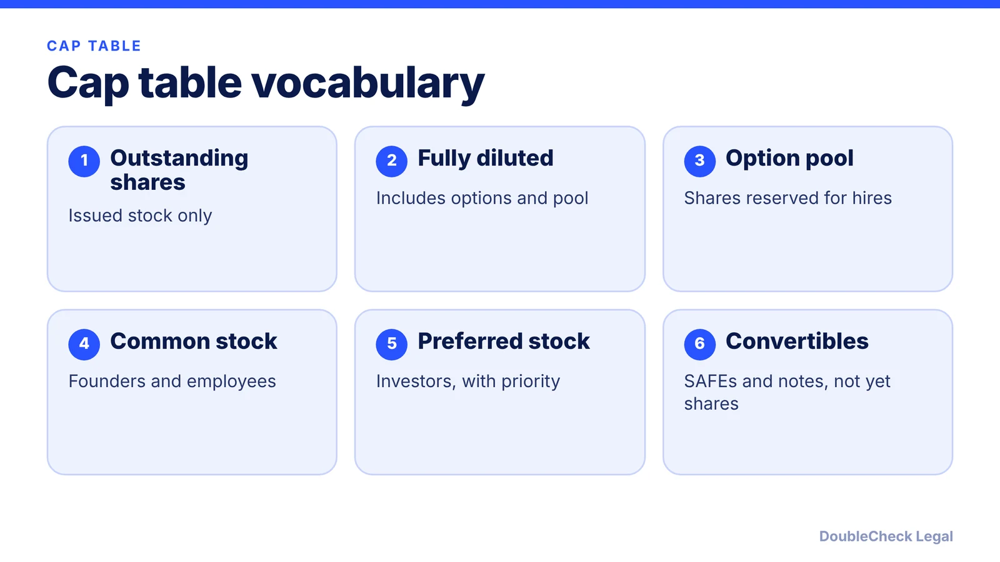
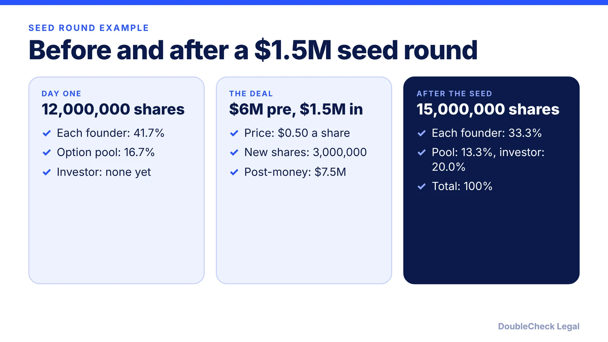

*A cap table is a ledger of who owns what, and it only works if it matches your legal records.*

**Key takeaways:**

- A cap table shows who owns what; investors read it on a fully diluted basis (shares plus options, pool, and convertibles).
- The option pool dilutes founders even before anyone is hired.
- In our example, a $1.5M seed at $6M pre-money takes two 41.7% founders to 33.3% each.
- Common errors: lost grants, stale exercises, mixed share classes, and counting pool shares twice.

## 1. The quick answer

**Quick answer:** A cap table (capitalization table) shows who owns what in your company: founders, employees, and investors, usually by share count and percentage. It is only as reliable as the legal equity records behind it. Investors think in fully diluted terms, meaning outstanding shares plus options, reserved pool shares, warrants, and convertible instruments (per Lowenstein Sandler and a16z). Founders typically start at 100% and shrink with every option pool, SAFE, and priced round.

## 2. How the pieces fit

- **Common vs. preferred.** Per a16z, founders and employees typically hold common stock while investors usually hold preferred stock, which carries liquidation preferences and governance rights that common stock does not.
- **Fully diluted.** Percentages on a fully diluted basis assume options are exercised, so each person's stake shrinks as more shares exist. The fully diluted column should total 100%; if it does not, fix the error first.
- **Option pool.** Shares set aside for future employees. Per Lowenstein Sandler, a reserved but unissued pool does not count as outstanding shares, but it lowers founders on a fully diluted basis. In its example, a 400,000-share pool (10% of 4 million) takes two 50/50 founders to 45% each.
- **Convertibles.** SAFEs and convertible notes are not shares yet but convert in a priced round; see [SAFE note explained](/blog/safe-note-explained-for-founders/) and [convertible note vs. SAFE](/blog/convertible-note-vs-safe/).

Founders' own equity starts with the split you agree ([founder equity split](/blog/founder-equity-split-how-to-divide/)), and employee options connect to [409A valuations](/blog/stock-options-409a-valuation-startups/).

## 3. A worked example

Numbers below are our own arithmetic on hypothetical terms.

**Day one.** Two founders hold 5,000,000 shares each (10,000,000 total). Before raising, you reserve a 2,000,000-share option pool. Fully diluted shares: 12,000,000. Each founder owns 5,000,000 / 12,000,000 = 41.7%; the pool is 16.7%.

**Seed round.** An investor puts in $1.5M at a $6M pre-money valuation. The pre-money price per share is $6,000,000 / 12,000,000 = $0.50, so the investor buys $1,500,000 / $0.50 = 3,000,000 new shares. Fully diluted shares: 15,000,000.

- Each founder: 5,000,000 / 15,000,000 = 33.3% (two founders: 66.7%)
- Option pool: 2,000,000 / 15,000,000 = 13.3%
- Investor: 3,000,000 / 15,000,000 = 20.0% (that is $1.5M / $7.5M post-money)
- Total: 100%

Notice the pool sits in the pre-money share count, so it dilutes founders and not the investor. Cooley GO notes that investors typically want the post-closing pool percentage counted in the pre-closing capitalization, so the pool dilutes existing holders and not the new investor, and that a larger pool can cost founders ownership even at a higher valuation. In its example, common ownership is 67.05% with a $15M pre-money and a 20% pool, versus 70.28% with a $12M pre-money and a 15% pool. See [term sheet key terms](/blog/term-sheet-key-terms-explained/) for how the pool is negotiated.

## 4. Common mistakes and how rounds change the table

Common problems in early cap tables include:

- **Lost early grants:** promised awards that were never properly authorized or documented.
- **Not updating after exercises:** failing to move exercised options into issued stock.
- **Mixing classes and series:** not tracking each security's actual rights separately.
- **Treating a name change as a transfer:** a cap table edit does not complete a share transfer, which still needs the contract and securities steps.

Two checks help: percentages must total 100%, and you must know whether an option pool increase happens before or after the investment, because it changes the result for founders and the investor. Another trap is counting granted options and the unallocated pool twice, so track them separately.

Each financing adds a row: [funding stages](/blog/startup-funding-stages-pre-seed-to-series-b/) lays out the sequence, and investors will check your records in diligence ([due diligence checklist](/blog/due-diligence-checklist-for-startup-fundraising/)). Keep the table matched to your stock ledger, board approvals, and signed agreements.

**Related reading:** [Corporate Minutes and Board Consents: Small Corporation Records Guide](/blog/corporate-minutes-and-board-consents-small-corporation-records/); [Employee Equity Grants for First Hires: How to Structure Them](/blog/employee-equity-grants-for-first-hires-how-to-structure/); [Founder Vesting Acceleration: Single Trigger vs Double Trigger Explained for Startups](/blog/founder-vesting-acceleration-single-vs-double-trigger/); [Option Pool Size and Dilution in a First Round Explained for Founders](/blog/option-pool-size-and-dilution-first-round-explained/); [Reg CF Equity Crowdfunding for Startups: Legal Basics Founders Need](/blog/reg-cf-equity-crowdfunding-startups-legal-basics/)

## Where DoubleCheck fits

[DoubleCheck](https://www.contactdoublecheck.com) helps businesses and founders start legal work with AI, verify it, and, when professional advice is warranted, connect with an independent attorney, including for immigration questions. Attorney availability and practice areas vary. Attorneys on DoubleCheck are independent professionals; an attorney-client relationship forms only if an attorney accepts your engagement.

**Sources:** [Lowenstein Sandler, Doing the Math: Valuation, Cap Tables and Founder Dilution](https://www.lowenstein.com/media/dz4hrfl1/e004-doing-the-math-valuation-cap-tables-and-founder-dilution.pdf); [Cooley GO, option pool and founder ownership](https://www.cooleygo.com/?p=3836); [a16z, How startup options and ownership work](https://a16z.com/how-startup-options-and-ownership-works/).

## FAQ

**What is a cap table?**

Per Lowenstein Sandler, a cap table is a record of who owns what, expressed as shares over a total. It is only as reliable as the legal equity records behind it, so keep it matched to your stock ledger and signed agreements.

**What does fully diluted mean?**

Per Lowenstein Sandler and a16z, outstanding counts shares actually issued, while fully diluted adds everything that could become shares, such as the option pool, granted options and warrants. Percentages are generally measured on the fully diluted total.

**Does the option pool dilute founders?**

Yes. In Lowenstein Sandler's example, a 400,000-share pool (10% of 4 million) lowers each of two 50/50 founders to 45% fully diluted without any sale. Per Cooley GO, investors typically want the pool counted in the pre-money valuation, so it dilutes existing holders rather than the new investor.

**Do SAFEs show up on a cap table?**

They appear as convertibles that are not shares yet. Per Lowenstein Sandler, a SAFE does not change the cap table at signing; dilution occurs when it converts in a priced round.

---

*General information only. This article is not legal, tax, investment, or accounting advice.*
