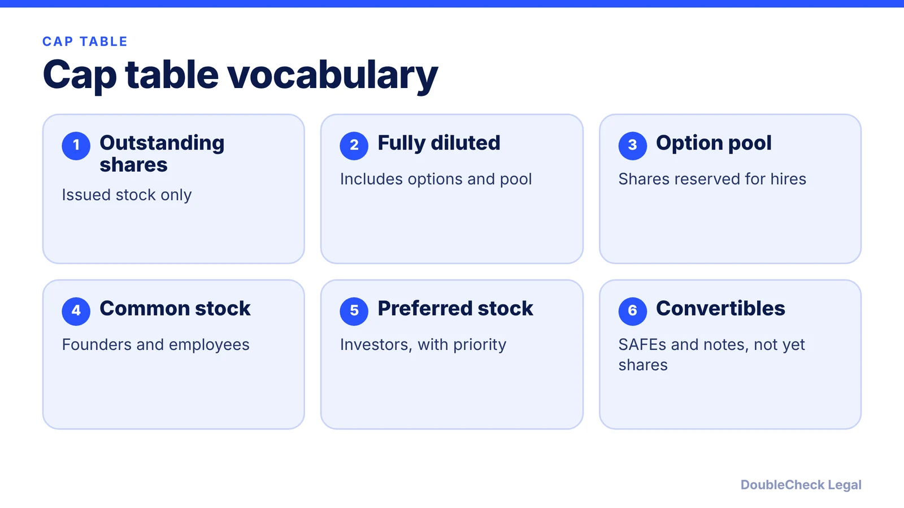
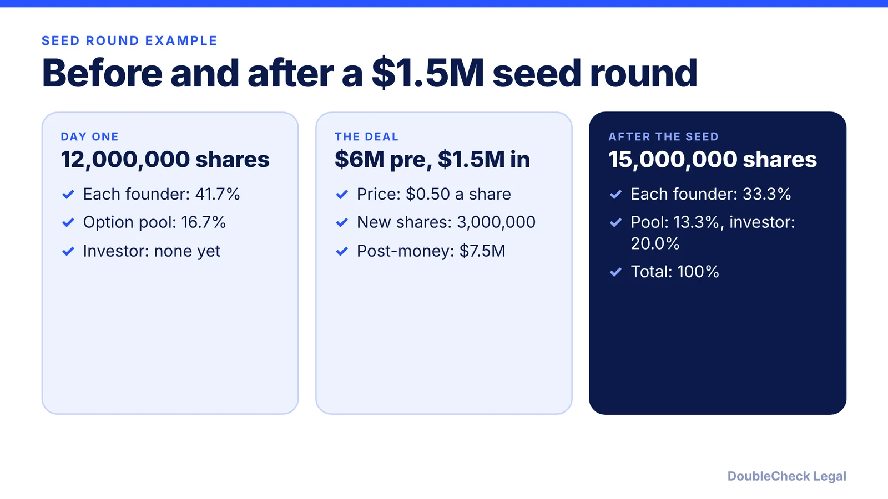

*A cap table is a ledger of who owns what, and it only works if it matches your legal records.*

**Key takeaways:**

- A cap table shows who owns what; investors read it on a fully diluted basis (shares plus options, pool, and convertibles).
- The option pool dilutes founders even before anyone is hired.
- In our example, a $1.5M seed at $6M pre-money takes two 41.7% founders to 33.3% each.
- Common errors: lost grants, stale exercises, mixed share classes, and counting pool shares twice.

## 1. The quick answer

**Quick answer:** A cap table (capitalization table) shows who owns what in your company: founders, employees, and investors, usually by share count and percentage. Per attorney Joe Wallin, it is reliable only when it matches the company's legal equity records. Investors think in fully diluted terms, meaning outstanding shares plus options, reserved pool shares, warrants, and convertible instruments. Founders typically start at 100% and shrink with every option pool, SAFE, and priced round.

## 2. How the pieces fit

- **Common vs. preferred.** Per Stefan Colovic, founders and employees usually hold common stock while investors typically hold preferred stock, which gives them payout priority in a sale or IPO.
- **Fully diluted.** Percentages on a fully diluted basis assume options are exercised, so each person's stake shrinks as more shares exist. The fully diluted column should total 100%; if it does not, fix the error first (Colovic).
- **Option pool.** Shares set aside for future employees. Wallin notes creating a pool does not create outstanding shares, but it dilutes founders on a fully diluted basis. In his example, two founders with 4,000,000 shares each drop from 50% to 44.4% when a 1,000,000-share pool is created.
- **Convertibles.** SAFEs and convertible notes are not shares yet but convert in a priced round; see [SAFE note explained](/blog/safe-note-explained-for-founders/) and [convertible note vs. SAFE](/blog/convertible-note-vs-safe/).

Founders' own equity starts with the split you agree ([founder equity split](/blog/founder-equity-split-how-to-divide/)), and employee options connect to [409A valuations](/blog/stock-options-409a-valuation-startups/).

## 3. A worked example

Numbers below are our own arithmetic on hypothetical terms.

**Day one.** Two founders hold 5,000,000 shares each (10,000,000 total). Before raising, you reserve a 2,000,000-share option pool. Fully diluted shares: 12,000,000. Each founder owns 5,000,000 / 12,000,000 = 41.7%; the pool is 16.7%.

**Seed round.** An investor puts in $1.5M at a $6M pre-money valuation. The pre-money price per share is $6,000,000 / 12,000,000 = $0.50, so the investor buys $1,500,000 / $0.50 = 3,000,000 new shares. Fully diluted shares: 15,000,000.

- Each founder: 5,000,000 / 15,000,000 = 33.3% (two founders: 66.7%)
- Option pool: 2,000,000 / 15,000,000 = 13.3%
- Investor: 3,000,000 / 15,000,000 = 20.0% (that is $1.5M / $7.5M post-money)
- Total: 100%

Notice the pool sits in the pre-money share count, so it dilutes founders and not the investor. Wallin calls the practice of enlarging the pool at a priced round the "pool shuffle": in his hypothetical, raising a pool from 5% to 20% of post-closing capitalization cuts existing holders from 61.7% to 46.7% while the investor stays at 33.3%. Wallin's SAFE example also shows that price per share, not check size, drives ownership. See [term sheet key terms](/blog/term-sheet-key-terms-explained/) for how the pool is negotiated.

## 4. Common mistakes and how rounds change the table

Wallin lists recurring problems:

- **Lost early grants:** promised awards that were never properly authorized or documented.
- **Not updating after exercises:** failing to move exercised options into issued stock.
- **Mixing classes and series:** not tracking each security's actual rights separately.
- **Treating a name change as a transfer:** a cap table edit does not complete a share transfer, which still needs the contract and securities steps.

Colovic adds two checks: percentages must total 100%, and you must know whether an option pool increase happens before or after the investment, because it changes the result for both sides. Another trap is counting granted options and the unallocated pool twice (Wallin recommends tracking them separately).

Each financing adds a row: [funding stages](/blog/startup-funding-stages-pre-seed-to-series-b/) lays out the sequence, and investors will check your records in diligence ([due diligence checklist](/blog/due-diligence-checklist-for-startup-fundraising/)). Keep the table matched to your stock ledger, board approvals, and signed agreements.

## Where DoubleCheck fits

[DoubleCheck](https://www.contactdoublecheck.com) helps businesses and founders start legal work with AI, verify it, and, when professional advice is warranted, connect with an independent attorney, including for immigration questions. Attorney availability and practice areas vary. Attorneys on DoubleCheck are independent professionals; an attorney-client relationship forms only if an attorney accepts your engagement.

**Sources:** [Joe Wallin, The Startup Law Blog, Cap Table Management](https://www.thestartuplawblog.com/cap-table-management-founders-guide/); [Stefan Colovic, Capitalization Tables for Startup Founders, Part 1](https://medium.com/toomuchcapital/capitalization-tables-for-startup-founders-part-1-pre-investment-fa81e6ad1d09).

## FAQ

**What is a cap table?**

Per Stefan Colovic, in its simplest form a cap table shows who owns what in a company. Joe Wallin adds that it is reliable only when it matches the company's legal equity records.

**What does fully diluted mean?**

Per Wallin, fully diluted counts options, reserved pool shares, warrants, and convertible instruments in addition to issued stock, while outstanding counts only issued stock. Investors think in fully diluted terms.

**Does the option pool dilute founders?**

Yes. In Wallin's example, creating a 1,000,000-share pool drops two 4,000,000-share founders from 50% to 44.4% fully diluted without any sale. A larger pool in the pre-money at a priced round shifts more dilution to founders.

**Do SAFEs show up on a cap table?**

They appear as convertibles that are not shares yet. They convert at the priced round, and per Wallin, price per share, not the size of the check, drives ownership.

---

*General information only. This article is not legal, tax, investment, or accounting advice.*
